# ADR 0036: Local browser sign-in and exact-action approval inbox

- Status: Accepted for the local simulator profile only
- Requirements: FR-003/007/008/009; SEC-001/004/005/006/009/012/015;
  REL-002/004; DATA-001

## Context

The durable approval API and operator bootstrap exist, but a browser cannot
safely paste/store API bearer credentials or be made authoritative by hiding
buttons. Adding cookies to the existing bearer routes would silently change
their trust boundary. The unauthenticated development read console is also
not an appropriate approval authority.

## Decision

Add an **optional**, same-origin Java browser adapter to the separate
`SimulatorApprovalMain` composition. It serves the built React application
at `/approvals`, owns `/auth/*` and `/browser/*`, and converges browser action
requests with the existing API's role/scope/ownership and exact-binding checks.
The existing `/api/v1/approvals` routes still require bearer authentication
and reject every Cookie or Origin header. The normal development backend
and hosted MCP profile do not start this adapter.

```mermaid
flowchart TD
  R["React inbox on numeric loopback"] --> L["Java browser adapter"]
  L -->|"Code with PKCE, state and nonce"| I["Operator-approved OIDC provider"]
  I -->|"Back-channel tokens"| L
  L --> S["Bounded in-memory session and CSRF token"]
  S --> V["Reverify access token and operator enrollment per request"]
  B["Existing bearer API"] --> V
  V --> A["Shared role, tenant, owner and exact request checks"]
  A --> D[("Durable PostgreSQL approval and atomic claim")]
  D --> X["Fixed safe simulator only"]
```

### Login and session profile

- One explicit HTTPS issuer/client and exact operator-configured authorization,
  token and JWKS URLs. No dynamic discovery, registration or user-selected issuer.
- Schema1.0 uses a confidential client, `client_secret_basic`, authorization code plus S256 PKCE.
  Callback is exactly `http://127.0.0.1:<port>/auth/callback`.
- Random 256-bit login binder cookie, state, nonce, verifier and session/CSRF
  values. Login state expires after 120 seconds and is consumed before code exchange.
  The response must include exact `code`, `state`, `iss` parameters (RFC 9207
  issuer-response profile); errors, duplicates and unknown parameters fail closed.
- Signed RS256 ID token with exact issuer, single client audience, nonce,
  access-token subject/client equality, expiry/issued-at checks, optional `azp`
  and `at_hash` checks. API authorization separately verifies the strict
  `at+jwt` access-token profile, API audience, tenant, scopes and membership.
  An ID token cannot authorize an API action. Browser subjects must be enrolled humans.
- Tokens are held only in Java session memory, not cookies, URLs returned to
  React, localStorage, sessionStorage, evidence or application logs. No refresh
  token is requested or retained. Token exchange has exact-URI allowlisting,
  DNS-pinned public-address HTTPS, platform TLS, no proxy/redirect/retry, and
  response/time bounds inherited from the hardened outbound transport.
- At most 1,000 pending logins and 1,000 sessions; expired entries are purged
  on access/insertion. Sessions end at the earliest of access-token expiry,
  ID-token expiry or 10 minutes. Login replaces the presented prior session;
  logout and service restart invalidate local sessions, not durable approvals.

### Browser defenses

Exact numeric-loopback Host, no forwarded-header trust, no CORS, no client
Authorization on browser routes, same-origin checks and cross-site Fetch
Metadata rejection for session/action APIs (public page/login navigation and
the exact IdP callback remain navigable). Every browser mutation requires
an exact Origin and session-bound `X-CSRF-Token`. Cookies are HttpOnly,
SameSite=Lax, host-only and Path=/; malformed/duplicate cookies are rejected.
Responses use no-store, no-referrer, nosniff, frame denial and restrictive CSP.
Static assets use a narrow filename allowlist, real-path containment and size
limits. React renders action arguments as text, never HTML or instructions.

**Deliberate local exception:** this listener is HTTP on numeric loopback, so
cookies do not use `Secure`/`__Host-`. This is not a public TLS cookie profile.
Do not expose it through a tunnel, proxy, public bind or shared workstation.
Cookies are not port-isolated: another service or compromised same-UID process
on the device is outside this profile's isolation guarantee. A production BFF
requires a dedicated HTTPS origin, Secure host cookies, protected server token
custody, operational revocation/abuse controls and separate qualification.

### UI authority

Requester-only accounts list/read only their own requests and can submit the
one fixed simulated change and execute only their own approved action.
Reviewers/viewers can read workspace-scoped requests. A human reviewer may
approve/deny a distinct requester's pending action with the decision scope;
a viewer cannot mutate. Combined roles retain the same separation checks.
Role plus scope and current server checks determine authority; UI visibility
is only guidance. Review and execution are separate explicit confirmations.
No mutation is automatically retried. Approval expiry, stale policy, changed
hash, reviewer removal and consumed claims remain enforced by the existing API.

[ADR 0061](0061-requester-withdrawal-inbox.md) adds explicit owner-only pending
withdrawal over ADR0060's Java cancellation route. It requires requester
membership and the separate cancel scope, not reviewer authority. **Back** only
dismisses confirmation; **Confirm withdrawal** sends the exact-hash POST.

The inbox samples one shared local clock while loaded pending/approved requests
are still live, and on focus/visible-tab events. Expiry removes review/withdraw/execute
controls and invalidates the displayed confirmation without a network refresh or
mutation. A last-moment click rechecks current selection, ID/hash, role/scope,
session lifetime, status and approval expiry before POST. Observed local time is
not moved backwards within the mounted inbox. This is advisory UX only: clock
skew and background timer throttling are possible, and Java remains the authority.
Stored status is never rewritten merely because the browser labels it expired.

## Consequences and limits

- PostgreSQL authority and simulator behavior do not change; no migration is
  needed. Sessions are intentionally not durable or shared across instances.
- Browser configuration is opt-in. Existing private operator files remain
  valid without a `browser` object. Offline check is not IdP qualification.
- The external provider must support this narrow code/issuer-response/token
  profile; opaque access tokens, multi-audience ID tokens, other algorithms,
  sender-constrained access tokens, refresh and federated logout are unsupported.
- The separate test-classpath-only interactive harness uses an obvious synthetic
  IdP account picker and disposable PostgreSQL. It cannot be enabled by normal
  operator JSON and is not evidence of real-provider compatibility.
- The existing unauthenticated read console stays separate; this does not
  authenticate every existing demo endpoint or compose hosted MCP approvals.
- No administrator provisioning UI, approved-authority revocation, managed key custody,
  real target adapter, enterprise SLO or independent security audit is claimed.

## Sources

- [OAuth Security BCP, RFC 9700](https://www.rfc-editor.org/rfc/rfc9700.html)
- [OIDC Core code flow](https://openid.net/specs/openid-connect-core-1_0.html#CodeFlowAuth)
- [Issuer identification, RFC 9207](https://www.rfc-editor.org/rfc/rfc9207.html)
- [OWASP session guidance](https://cheatsheetseries.owasp.org/cheatsheets/Session_Management_Cheat_Sheet.html)

## Explicit public-client extension

[ADR0063](0063-explicit-public-browser-code-pkce.md) adds schema1.1 explicit
`none` without a secret, preserving this confidential profile. It adds exact
organization binding in both tokens. One named native/public Auth0 composition
was live-qualified on 2026-10-22; broader provider compatibility remains pending.
