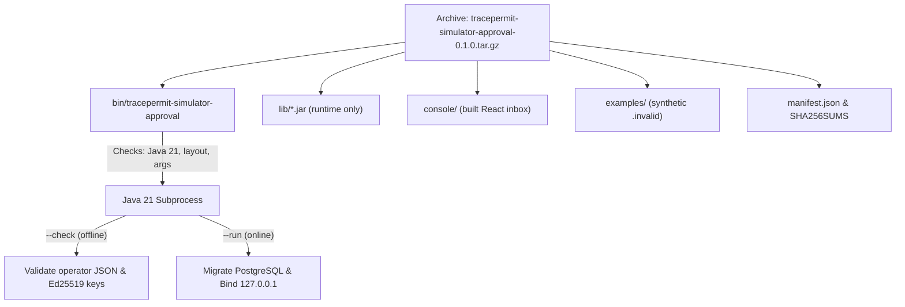

# ADR 0040: source-free simulator approval distribution

- **Status:** Accepted for the local simulator profile only
- **Requirements:** FR-012; SEC-003, SEC-011; OPS-002, OPS-004

## Context

[ADR 0035](0035-local-approval-operator-bootstrap.md) introduced `SimulatorApprovalMain`
for operator-bootstrapped durable approval enforcement, and
[ADR 0036](0036-local-browser-approval-boundary.md) added the optional same-origin
browser sign-in and React inbox. However, running or validating that composition
previously required the complete source checkout, Node.js, pnpm, and Gradle toolchains.
Qualifying the simulator approval foundation on an operator workstation requires
distributing pre-built, versioned artifacts that run with only Java 21 and operator-managed
dependencies (PostgreSQL, IdP), without leaking source trees, development test classes,
or test-classpath authentication pickers.

## Decision

Add a dedicated Gradle packaging target and a thin host-native launcher for the
existing `SimulatorApprovalMain`. The package is produced as a versioned `.tar.gz`
archive (`tracepermit-simulator-approval-0.1.0.tar.gz`) containing:

1. **Thin launcher script:** `bin/tracepermit-simulator-approval` validates Java 21,
   directory layout, and argument bounds before replacing itself via `exec` with the
   Java runtime. Its fixed entry point is `SimulatorApprovalMain`; flags cannot select
   a different profile or main class.
2. **Runtime libraries:** `lib/*.jar` contains the application main JAR plus
   `runtimeClasspath` dependencies (Jackson, Flyway, PostgreSQL driver, OkHttp,
   Nimbus JOSE). Test classes, Testcontainers and test runners are excluded.
   Shared production JARs still contain `DevelopmentBackendMain` and
   `HostedClientOAuthBackendMain`; this archive is not a class-level sandbox or
   separately minimized runtime. A host user able to invoke Java directly can
   choose another packaged main, but the supported launcher cannot.
3. **Built console assets:** `console/` contains pre-compiled React static assets
   (`index.html`, `assets/index-*.js`, `assets/index-*.css`).
4. **Operator example configuration:** `examples/simulator-approvals.example.json`
   provides synthetic `.invalid` issuer/audience URIs and placeholder fields.
5. **Documentation and manifest:** `docs/setup-runbook.md`, `docs/LICENSE`, `docs/NOTICE`,
   `manifest.json` (recording clean Git commit, commit timestamp, package version, required Java 21, and JAR
   dependency inventory with SHA-256 hashes), and `SHA256SUMS`.
6. **Integrity checksum:** `tracepermit-simulator-approval-0.1.0.tar.gz.sha256` accompanies
   the archive. The documentation explicitly distinguishes file integrity hashes from
   cryptographic third-party code signing.

### Build provenance and cache correctness

The packaging task declares the Git commit, commit timestamp and source cleanliness
as inputs using Gradle-tracked process providers. A commit-only change invalidates
cached staging, even if JAR bytes are unchanged. Missing Git metadata or tracked or
non-ignored untracked source changes fail packaging; there is no `unknown` fallback
or dirty-build override. A failed build does not run a checksum finalizer over a
previous archive. Prior files can remain on disk and are not a successful build.

Manifest schema `1.1` records `sourceCommitTimestamp` rather than the old wall-clock
`buildTimestamp`, plus `sourceTree: "clean"`. Tar entry timestamps, order and
permissions are normalized. Only this task's staging directory is archived, never
sibling build outputs. Repeated staging with identical inputs is byte-stable in
qualification; cross-host/JDK bit-for-bit reproducibility is not claimed. The local
builder and its ignored/generated inputs remain trusted; this is not authenticated
provenance, a hermetic build, or protection against concurrent source edits.

### Operational and security boundaries

- **Genuinely offline `--check`:** Performs full JSON validation, POSIX file permission
  checks (owner-only 0600/0400), Ed25519 keypair verification, and asset checks with
  zero network sockets, DNS lookups, database connections, or IdP traffic.
- **Fail-secure error redaction:** Launcher validation and Java bootstrap failures emit code-only
  redacted messages (`APPROVAL_STARTUP_FAILED: ... details redacted.`) and exit with status `2`.
  Operator file paths, database passwords, and key material are omitted by those
  handlers. JVM/OS diagnostics from a damaged archive or runtime are outside this
  guarantee; verify archive integrity before use.
- **Strict numeric loopback:** The service binds exclusively to `127.0.0.1`. No public
  bind, wildcard address, reverse proxy, or TLS bypass is permitted.
- **External operator credentials:** The archive contains zero embedded secrets,
  credentials, private keys, or pre-configured databases. All key generation
  (`openssl genpkey -algorithm ED25519`) and secret management remain operator-owned.
- **Clean signal handling:** The launcher uses `exec` so OS signals (`SIGTERM`, `SIGINT`)
  are delivered directly to the Java runtime, triggering the `approval-shutdown` hook
  for deterministic port release.

## Consequences and limits

- Operators need only a standard Java 21 runtime on macOS or Linux; Node.js, pnpm,
  and Gradle are unnecessary on the running host.
- Windows and containerized runtimes are not qualified by this profile.
- This is an alpha packaging milestone for the local simulator approval workflow,
  **not** an enterprise production release. No real AWS/Jira target SDKs, HSM key
  custody, distributed rate limiting, or external IdP qualification are provided.
- The default development backend, MCP demo launchers, and unauthenticated read console
  remain unchanged.

## Verification

- Automated test `scripts/simulator-approval-distribution.test.mjs` qualifies:
  1. Archive building and extraction into a temporary path containing spaces.
  2. Execution with Node.js, pnpm, and Gradle completely stripped from `PATH`.
  3. Execution from an unrelated working directory.
  4. Successful offline `--check` with synthetic private keys and unreachable dependencies.
  5. Negative test paths: missing arguments, invalid flags, missing `TRACEPERMIT_APPROVAL_CONFIG`,
     invalid file permissions, absent console assets, missing Java, and incompatible Java versions.
  6. Redaction verification: zero secrets or sensitive paths in outputs across all failures.
  7. Process cleanup and graceful termination.
  8. Commit-only cache invalidation, dirty/untracked/missing Git rejection, unchanged
     rebuild stability, exclusion of sibling staging outputs, exact source metadata,
     and complete per-file/JAR checksum inventories.
- Archive dependency scanning confirms absence of test classes, Testcontainers,
  `SimulatorApprovalBrowserQualificationMain`, `node_modules`, and secret material.
