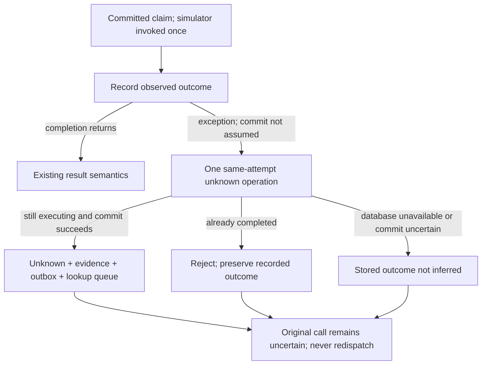

# ADR 0048 — Bounded uncertainty recording after target dispatch

- Status: accepted for the simulator service compositions
- Date: 2026-10-17
- Requirements: FR-010/015; SEC-006/010/019; REL-001/002/004/005/008/009; OPS-004

## Context

Both `DurableExecutionService` and `HumanApprovalService` commit a single-use
claim before invoking a simulator outside the database transaction. The separate
completion transaction records the outcome and evidence. If that transaction
fails, an otherwise reachable database could previously retain an `executing`
attempt without a reconciliation queue entry. Returning an error is necessary
but does not itself arrange recovery.

A completion exception also does not prove rollback. Commit may have succeeded
before an acknowledgement or connection cleanup failed. Assuming failure,
overwriting a completed outcome, restoring approval authority, or dispatching
the target again would be unsafe.

## Decision

The two services share `DurableOutcomeRecorder`. A normal outcome uses exactly
one completion operation. If it throws, the recorder makes **one additional
completion operation**, on the same tenant and attempt, with outcome `unknown`
and bounded reason `DURABLE_COMPLETION_UNCONFIRMED`.

The existing PostgreSQL `complete` operation locks the attempt and accepts only
`executing`. Its transition, evidence/outbox append and unknown-queue insertion
commit together. Thus:

- If the first completion rolled back and the database is reachable again, the
  same attempt becomes `unknown` and lookup-only reconciliation can claim it.
- If the first completion committed `succeeded`, `failed`, or `unknown`, the
  additional operation rejects that non-executing state without changing it.
  It cannot duplicate an unknown queue entry or downgrade a confirmed outcome.
- If both operations fail, the caller still receives uncertainty. The stored
  state is not inferred: it may remain `executing`, or a commit may have taken
  effect despite its exception.

The original request always throws
`DURABLE_STATE_UNAVAILABLE_AFTER_DISPATCH` after its first completion exception,
even when the additional unknown write succeeds. The first failure is retained
as its cause, with distinct secondary failures and any target failure retained
for local diagnostics. Raw failures are not copied into evidence. Existing
transport adapters retain their allowlisted errors: the direct MCP dispatcher
projects generic unknown execution, while approval HTTP/MCP may project
`SECURITY_STATE_UNAVAILABLE`. The internal service code is not promised verbatim
on every wire profile; none of these errors establishes success or no execution.

This is a bounded retry of **database outcome recording**, never a retry of a
target effect. The recorder has no target, signer, approval or claim port. It
does not acquire a new permit, release an existing consumption, resolve unknown
to an invented outcome, schedule a worker, or introduce a migration.

## Qualification

`DurableOutcomeRecorderTest` checks normal one-write operation, all three
completion outcomes before/after simulated commit, persistent failure, preserved
tenant/attempt/time binding, bounded write count and repeated exception objects.
The existing direct/approval service tests remain regression gates.

`PostgresCompletionFailureRecoveryTest` injects faults before and after actual
JDBC commits and at connection acquisition in an owned disposable PostgreSQL
16.4 container. Both direct and approved execution are exercised. Assertions
cover one target invocation, one consumed permit/attempt, consumed approval,
non-regressing outcomes, queue cardinality, transition reasons, hash-chain and
outbox integrity, replay refusal, and lookup-only resolution without redispatch.

## Limits and next recovery contract

- An unavailable database, process crash, or abandoned pre-dispatch claim can
  still leave `executing`; this change is not an executing-attempt sweeper or
  a complete recovery procedure. Do not classify an old attempt as failed or
  release authority merely because time elapsed.
- The extra database operation inherits repository connection/statement wait
  behavior. Two operations are a count bound, **not a new wall-clock SLO**.
  Connection pooling, admission and wait budgets require separate qualification.
- The ordinary launcher does not schedule the reconciliation/publisher workers
  or configure trustworthy external outcome lookup. A queued unknown is not a
  recovered target result. No external target or audit sink is enabled here.
- A valid old database snapshot can still revive old approval authority. See
  [ADR 0044](0044-database-restore-safety-limits.md). Same-database generations,
  checksums and permit-key rotation are not an independent rollback witness.
- The next declared-recovery design must separate inspection from effectful
  readiness, keep clients quiesced, fence pre-recovery authority, and resolve
  uncertain effects only from bound read-only observations. It must explicitly
  choose operator-declared quarantine versus an independently monotonic rollback
  witness. Neither that lifecycle nor automatic rollback detection is implemented
  by this ADR.

See the [operator runbook](../runbooks/durable-completion-uncertainty.md).
