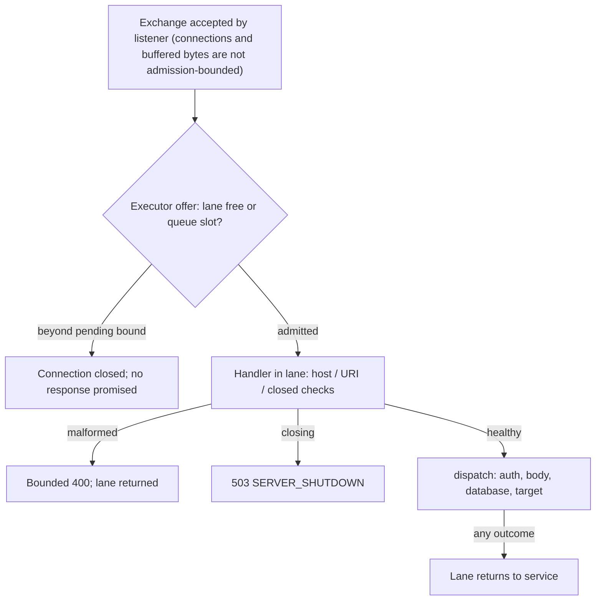

# ADR 0050 — Bounded admission for the simulator approval foundation

- Status: accepted for the simulator service compositions
- Date: 2026-10-17
- Requirements: FR-003/007/009; SEC-002/003/017; REL-001/004/009; OPS-001/005

## Context

`SimulatorApprovalServer` previously served every accepted exchange from an
`Executors.newFixedThreadPool(8)`. That executor's internal queue is unbounded:
authentication, body parsing, database work, and dispatch all ran inside pool
threads with no gate in front of them, so an arbitrary number of exchanges could
queue (and an arbitrary amount of request bytes could be parked) before any
capacity decision was made. `close()` was `server.stop(0)` followed by an
unbounded `ExecutorService.close()`: one handler blocked in a non-interruptible
call prevented shutdown from ever returning.

The foundation binds to IPv4 loopback for a single local operator. That trust
boundary makes this **local resource control, not public abuse prevention**:
there is no shared abuse state, no rate limiting, no TLS, and no sender
constraint here. [ADR 0031](0031-loopback-only-permissive-remote-foundation.md)
and [ADR 0018](0018-remote-edge-sender-constraint-and-abuse-controls.md) remain
the boundary for public-adapter abuse controls.

## Decision

The dispatch pool is the admission control. It is a fixed pool of exactly
`activeLanes` daemon lanes over a queue bounded at `pendingBound`
(`ThreadPoolExecutor` with `AbortPolicy`). A lane only starts a handler after
taking an exchange from that queue, so admission precedes every handler
statement — including the cheapest ones: the host, URI, and closed checks run
inside an admitted lane, after admission, not before it. Authentication, body
parsing, database work, and dispatch happen inside a lane exactly as before
([FR-003](../specs/02-system-requirements.md)). A queued exchange runs no
handler code at all, but it is not free: it keeps its connection open while it
waits, and the listener keeps accepting connections and buffering request
bytes that admission does not bound.

### Exact capacity definition

The bounds below count **executor tasks on one server's dispatch pool**. They
are not a bound on TCP connections the listener accepts or on buffered request
bytes: a queued exchange still holds its open connection (and any received,
buffered bytes) until a lane serves it or the connection is torn down.

- **Active:** at most `activeLanes` exchanges are inside a handler at once —
  the lane count. No admission state survives a finished exchange; every
  failure path (success, handler exception, malformed input, authentication
  failure, database outage) returns its lane to service. Malformed input is
  not capacity-free: the host/URI checks run inside the lane, so a malformed
  request consumes a lane or a queue slot until its handler returns the
  bounded 400 and releases the lane.
- **Pending:** at most `pendingBound` exchanges wait in the bounded
  `ArrayBlockingQueue`. Accepted executor work is therefore bounded at
  `activeLanes + pendingBound` tasks per server instance.
- **Overflow:** an offer beyond the pending bound is rejected by
  `AbortPolicy` before any handler runs. The JDK HTTP dispatcher catches that
  rejection and closes only the offending connection — no handler runs, no
  expensive work happens, and the server keeps serving every other connection.
  That transport rejection is the saturation signal and is **fail-closed**; no
  JSON 503 contract is claimed at this layer, and no unbounded executor is
  introduced to produce one.
- **Shutdown:** a closed or closing foundation answers `503 SERVER_SHUTDOWN`
  through the existing bounded error shape when the exchange reaches a handler
  during the race window, and refuses new connections otherwise.

Defaults: `activeLanes = 8`, `pendingBound = 16`; construction rejects values
outside `1..64` active lanes and `1..1024` pending exchanges. These are small
validated sizes for a single-operator loopback simulator — interactive review
traffic never approaches them, while a stuck browser tab or retrying client can
no longer accumulate unbounded queued work.

Rejections carry nothing: the transport close carries no body, and
`SERVER_SHUTDOWN` uses the existing bounded error shape — no token,
fingerprint, credential, or admission state enters a response body or evidence
record ([SEC-003](../specs/02-system-requirements.md)). An admission rejection
authorizes nothing, executes nothing, and never becomes an allow
([REL-009](../specs/02-system-requirements.md)). Approval binding, permit
consumption, execution transitions, and replay behavior are untouched
([FR-007](../specs/02-system-requirements.md),
[FR-009](../specs/02-system-requirements.md),
[REL-004](../specs/02-system-requirements.md)).

### Rejected alternative: a semaphore plus an extra lane

An earlier draft kept an in-handler `tryAcquire` semaphore of `activeLanes`
permits and ran one extra executor lane so a saturated foundation could answer
`503 SERVER_BUSY`. The full module battery rejected it: once the pool actually
queues — sustained concurrency above `activeLanes` — a queued task later runs
`handle()` on the extra lane, finds every permit held by the requests it was
queued behind, and gets a `503` for work the pool had already accepted. The
pre-existing latency qualification (concurrency 20 over the defaults) exposed
exactly that. Serving rejections to queued work is wrong, and distinguishing
"fresh" from "queued" at handler start is impossible through the JDK
`HttpServer` executor interface, so the in-handler saturation 503 was removed
in favor of the transport rejection above.

### Bounded close

`close()` now: stops the listener, calls `shutdown()` on the dispatch pool,
waits at most 2 seconds (`SHUTDOWN_JOIN_SECONDS`), then `shutdownNow()` to
interrupt lanes that are still running. Close therefore returns within
approximately two seconds plus interrupt propagation even when an admitted
handler is blocked. Handlers stuck in non-interruptible JDBC or OS calls may
linger as daemon threads — bounded in count by `activeLanes`, unable to accept
new work, and unable to hold JVM exit — but they are not forcibly cancelled,
and no resource owned by another service (such as the caller's datasource) is
closed here. In-flight connections are torn down by the listener stop; a client
waiting on such an exchange observes connection teardown, never a fabricated
status.

Close is bounded, not a drain: it does not guarantee that queued work ever
runs, that an in-flight side effect reaches its target outcome, or that
previously admitted work completes at all. Work admitted before close can
remain uncertain — its connection is torn down and no completion is promised,
here or to the target.

## Qualification

`SimulatorApprovalAdmissionTest` (same module, same Docker PostgreSQL and
synthetic identity fixtures as the existing server suite) asserts:

- A capacity-2 foundation with both lanes parked inside key resolution
  (deterministic latches, no sleeps): five further exchanges arrive — exactly
  `pendingBound` wait in the bounded queue, the rest are rejected at the
  transport with zero verifier-key resolutions, zero database connection
  attempts (counting datasource), and zero simulator rules; opening the gate
  serves the parked pair and then the queued pair.
- An already approved execute offered at full observed capacity (one active
  lane plus one queued exchange) is rejected at the transport with zero key
  resolutions, zero database attempts, and zero simulator rules; once capacity
  frees, the approved execute succeeds and leaves one distinct simulator rule;
  a replay is denied (409) and leaves that state unchanged.
- The dispatch pool accepts exactly `activeLanes` running tasks and
  `pendingBound` queued tasks and throws on the next offer; lanes are daemon
  and named.
- Each failure path (401, 400, 403, 404, 405, 413, 503 database outage) is
  followed by a fresh successful submission — the lane returned to service.
- 25 create/review cycles including denials leave no leaked lanes.
- `close()` is awaited behind a finite deadline on a separate daemon task and
  returns in under 10 seconds both with an admitted handler parked in key
  resolution and with a resolver that genuinely ignores interruption until the
  test releases it; the parked lane unwinds after release (its client observes
  connection teardown, not a fabricated status), a second close is a no-op,
  and parked handlers are released in a finally covering setup assertions too.
  Cleanup checks close-task termination and bounded handler joins rather than
  silently ignoring a timed-out cleanup.
- Eight submissions racing a close all complete within the bound and the
  closed foundation refuses new connections.
- Default capacity preserves the normal create → review → execute → replay
  behavior, and invalid capacities are rejected before any server starts.

The existing `SimulatorApprovalServerTest` suite is the regression gate for
approval, permit, replay, browser, and MCP behavior; the module's pre-existing
latency qualification (concurrency up to 20 over the defaults) runs in the full
battery and must stay green. Sensitivity probes swap the bounded pool for an
unbounded fixed pool and the bounded-close join for `ExecutorService.close()`
to show the overflow and close tests fail without them — the close probe now
fails promptly through the test's own finite deadline, with the finally block
still releasing the parked handler, and no external alarm.

Proof limit: the stateful simulator deduplicates identical security-group rules.
Its rule cardinality is not a target-invocation counter and cannot alone prove
exactly-once dispatch or absence of duplicate calls. The saturation tests combine
unchanged simulator state with counting key-resolution and database-access
probes. Application-level invocation-count assertions remain separate evidence
in `HumanApprovalServiceTest` (for example,
`approvedExactRequestExecutesAndDenialNeverDoes`); they are not a measured HTTP
admission-path call count.

## Limits

- The bounds are executor-task bounds per server instance, not connection or
  byte bounds. The listener accepts TCP connections and buffers request bytes
  outside admission, and a queued exchange keeps its connection open while it
  waits.
- This is local simulator resource control. It does **not** satisfy
  [SEC-017](../specs/02-system-requirements.md): public remote adapters must
  enforce fail-closed abuse controls before expensive authentication **and**
  again after authenticated tenant/principal attribution. The second,
  post-attribution gate and shared abuse state remain public-adapter scope
  ([ADR 0018](0018-remote-edge-sender-constraint-and-abuse-controls.md),
  [ADR 0021](0021-bounded-telemetry-before-dispatch.md),
  [OPS-005](../specs/02-system-requirements.md)).
- Transport-level overflow intentionally has no response contract. Clients see
  a closed connection; no JSON body, retry semantics, or rate-limit headers are
  promised there.
- Close is not a drain or cancellation: queued work may never run, no target
  outcome is guaranteed across close, and previously admitted work can remain
  uncertain.
- No health/metrics endpoint or fairness/QPS guarantee is added
  ([OPS-001](../specs/02-system-requirements.md) remains satisfied by existing
  surfaces only). Scheduling is not fair; a racing offer wins a queue slot, is
  served later, or is rejected.
- The admission layer keeps no request state, writes no evidence, and adds no
  field to any request or approval document.

See the [operator runbook](../runbooks/simulator-approval-admission.md).
