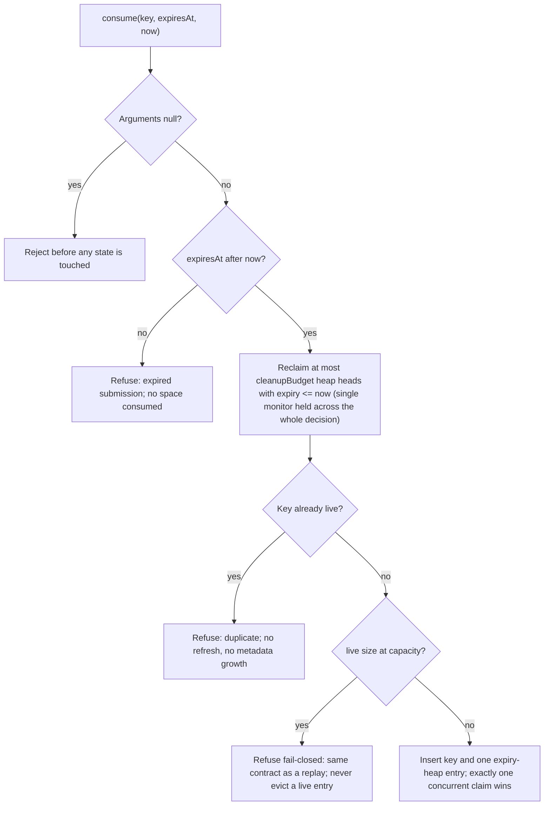

# ADR 0054 — Bounded process-local replay and permit consumption stores

- Status: accepted for the in-memory replay and permit consumption stores
- Date: 2026-10-18
- Requirements: SEC-002/003/004/006/009/014; REL-001/004/009; OPS-004 (cited,
  not fully claimed — see [Limits](#limits))

## Context

The three process-local stores behind source attestation verification,
scheduled workload verification, and execution permit consumption each used an
unbounded `ConcurrentHashMap` and swept the whole map with `removeIf` on every
`consume` call. Two defects followed from that shape:

- **Unbounded cardinality.** Entries lived until some later `consume` noticed
  their expiry. Under churn, live entries and stale-but-unreclaimed entries
  grew without limit; nothing capped how much memory a misbehaving or merely
  busy caller could pin.
- **Whole-map cleanup per call.** Every consume paid an O(n) scan over all
  entries, so the cost of one caller's cleanup backlog landed on every
  subsequent caller's critical path.

Single use itself was already atomic (`putIfAbsent`-style), and must stay so.

These stores are process-local single-instance state. They are not shared
across replicas and do not survive a restart; that boundary is unchanged here.

## Decision

Each store is bounded by two validated, positive, finite numbers: an **entry
capacity** and a **per-call cleanup budget**. Defaults are 65,536 entries and
64 reclamation removals per call; the no-arg constructors keep them, so every
existing wiring is preserved without an SPI change. Overloads accept smaller
values for deterministic tests. Construction rejects non-positive values.

A `consume` call holds one monitor across the whole decision:

1. **Argument validation first.** Null keys, expiry, or `now` are rejected
   before any state is touched; a rejected input never allocates authority
   state.
2. **Already-expired submissions are refused without consuming space.** An
   offer whose expiry is at or before `now` is counted and refused; it never
   enters the map.
3. **Bounded reclamation.** At most `cleanupBudget` entries whose recorded
   expiry is at or before `now` (equality inclusive) are reclaimed from an
   expiry-ordered min-heap. There is no full-map scan anywhere in the call.
4. **Duplicate check.** A key already present is refused. The refusal neither
   refreshes the recorded expiry nor grows any metadata.
5. **Capacity check.** When the live set is at capacity, a fresh key is
   refused with `false`. **No live entry is ever evicted to accept more work**;
   there is no allow-on-error path and no hidden replacement.
6. **Insert.** The key enters the live map and one expiry-heap entry is
   created. Duplicate, capacity, and insert are atomic under the monitor, so
   concurrent claims of one key produce exactly one winner, and distinct keys
   cannot push the live set past the cap.

Reclamation runs _before_ the duplicate check: an entry whose recorded expiry
has passed is reclaimable, so a re-submission at `now >= expiry` is a new
generation, not a replay.

### Heap-to-map invariant

There is exactly one expiry-heap entry per live map entry. Heap entries are
created only at insert and removed only by reclamation, so the heap size
always equals the live size, a stale expiry record can never address a newer
live generation, and every entry's primary and expiry metadata stay bounded
under arbitrary duplicate/expired churn. (The single monitor makes the
cleanup-versus-insert race impossible by construction.)

### Namespaces are preserved exactly

- Source attestation: issuer + token ID, kept as a collision-safe record key.
- Workload identity: tenant + issuer + token ID, kept as a collision-safe
  record key, so distinct tenants never share replay state and delimiter
  concatenation cannot fuse two identities into one.
- Execution permits: the legacy in-memory namespace stays **global by permit
  ID**. The tenant- and action-aware interface overloads delegate to the same
  map, so a permit consumed under one tenant is refused everywhere — the
  change does not partition legacy permit IDs and thereby open cross-tenant
  reuse. Tenant isolation for permits remains the durable store's contract.

### Saturation is a refusal, not a new taxonomy

At full capacity the refusal is `false` — the same contract as a replay — and
callers surface their existing replay refusal codes
(`SOURCE_ATTESTATION_REPLAYED`, `WORKLOAD_CREDENTIAL_REPLAYED`,
`EXECUTION_PERMIT_REPLAYED`). Saturation is deliberately not separately
classified: no new API, error code, or exception type is introduced. All three
real callers already pre-reject expired credentials before the store, so the
already-expired refusal is defense in depth rather than a caller-visible
behavior change.

### Cleanup is in-call, bounded, and honest about recovery

No scheduler, background cleaner, or request-created thread exists. Cleanup
work happens inside the calling consume, bounded by the budget. While a
bounded cleanup backlog remains, the store may keep answering `false` (full)
for fresh keys until successive calls drain the expired entries — a temporary
full/false is safer than a full sweep or a live eviction. Backlogs are
naturally time-limited: real credentials expire within 60 seconds
(attestations, permits) to 300 seconds (workload credentials), after which
each consume reclaims up to `cleanupBudget` entries and capacity returns.
This is recovery semantics for a local bound, **not** a revocation policy:
expiry cleanup is not an independently anchored revocation decision.

### Diagnostics stay package-private

Package-private counters (live entries, expiry-index entries, reclamation
removals, saturation refusals, expired-submission refusals) exist for
same-module tests. They expose no token, signature, private claim, issuer
identifier, or permit identifier, produce no log output, and are not a public
monitoring API ([SEC-003](../specs/02-system-requirements.md)).

## Qualification

Focused suites (all deterministic; fake time, latches, and finite future
deadlines; no sleeps):

- `InMemorySourceAttestationReplayStoreTest` (11 tests) and
  `InMemoryWorkloadIdentityReplayStoreTest` (9 tests): tiny-cap fill then
  refusal with **every still-live original entry remaining rejected afterwards**
  (an LRU implementation fails this control); already-expired offers consuming
  no capacity; duplicates with later expiry neither refreshing the claim nor
  growing metadata; the expiry-equality boundary reclaiming at or before
  `now` only; budget-exact reclamation (exactly `cleanupBudget` removals per
  call, observed through the reclamation counter); 400-iteration
  duplicate/expired churn keeping primary and expiry metadata bounded with
  heap size equal to map size at every step; 32-thread same-key races with
  exactly one winner; 32 distinct keys against a cap of 4 producing exactly 4
  winners; namespace separation and delimiter-collision probes; invalid
  arguments rejected before state changes; and a positive control where a
  healthy fresh request succeeds after genuine expiry reclamation.
- `InMemoryPermitConsumptionStoreTest` (28 tests including the two pre-existing
  concurrency/semantics tests, kept passing unchanged): adds the same
  tiny-cap, LRU-control, no-refresh, budget-exact, churn-bounded, and
  no-overshoot coverage, plus the **global legacy namespace** qualification —
  after a permit ID is consumed, the tenant-aware and action-aware overloads
  refuse the same ID from another tenant.
- `BoundedReplayVerifierIntegrationTest` (2 tests): integrates the tiny-cap
  stores into the real `SourceAttestationVerifier` and
  `ScheduledWorkloadVerifier` — a fresh, validly signed credential is refused
  with the replay refusal code while saturated, a test-local target counter
  stays at zero (dispatch follows successful verification only), and after
  genuine expiry plus bounded reclamation verification succeeds again and the
  counter advances exactly then. Scope is honest: store cardinality is not an
  invocation counter, and this proof does not extend to distributed abuse
  protection.
- `ExecutionPermitAuthorityBoundedStoreTest` (2 tests): the real
  `ExecutionPermitAuthority` refuses a freshly issued valid permit with
  `EXECUTION_PERMIT_REPLAYED` while its bounded store is saturated (no target
  effect), preserves the global permit-ID namespace across overloads, and
  succeeds again after genuine expiry.

Sensitivity probes (disposable edits, byte-for-byte restored, never
committed): bypassing the capacity guard makes the tiny-cap control tests fail
(4 failures in the source-attestation suite), and replacing the capacity
refusal with an eviction of the oldest live entry makes them fail as well
(3 failures in the permit suite). Both suites are green again after restore.

## Limits

- **Process-local.** State is per JVM instance: it does not survive a restart,
  is not shared across replicas, and confers no cross-replica durability. The
  durable PostgreSQL store remains the coordinator where durability matters.
- **Per-instance bounds.** Capacity bounds one process's live set; nothing
  here bounds a fleet, a tenant, or a deployment.
- **Trusted clock.** Reclamation and expiry decisions trust the caller's
  supplied `now`. There is no clock-rollback guarantee, no recovery fencing,
  and no durable revocation.
- **Not a revocation policy.** Expiry cleanup reclaims space for entries whose
  credential lifetime has passed; it is not an independently anchored
  revocation decision and must not be treated as one. Revocation remains the
  verifiers' credential-revocation checking.
- **Saturation is not separately classified.** A saturated store is
  indistinguishable from a replay at the store's contract; operators cannot
  tell the two apart from the refusal code alone. The package-private
  counters can distinguish them in-process for tests, but no public metric is
  added ([OPS-004](../specs/02-system-requirements.md) coverage is via this
  runbook, not a monitoring surface).
- **Temporary full/false under backlog.** Immediately after a burst expires,
  capacity recovers over several calls, at most `cleanupBudget` reclamation
  removals per call. Callers see refusal, not partial success; no fairness or
  wait-time guarantee is made.
- **Cited requirements, not fully claimed.** This change strengthens
  [SEC-002](../specs/02-system-requirements.md) fail-closed behavior,
  [SEC-004](../specs/02-system-requirements.md) and
  [SEC-014](../specs/02-system-requirements.md) single-use validation,
  [SEC-006](../specs/02-system-requirements.md) atomic consumption,
  [SEC-009](../specs/02-system-requirements.md) namespace separation
  (workload), [REL-001](../specs/02-system-requirements.md),
  [REL-004](../specs/02-system-requirements.md), and
  [REL-009](../specs/02-system-requirements.md) for the in-memory stores. It
  does not claim public distributed abuse protection, tenant isolation for the
  legacy global permit namespace, or any durable-storage property; the shared
  traceability matrix is updated separately.

See the [operator runbook](../runbooks/bounded-local-replay-stores.md).
