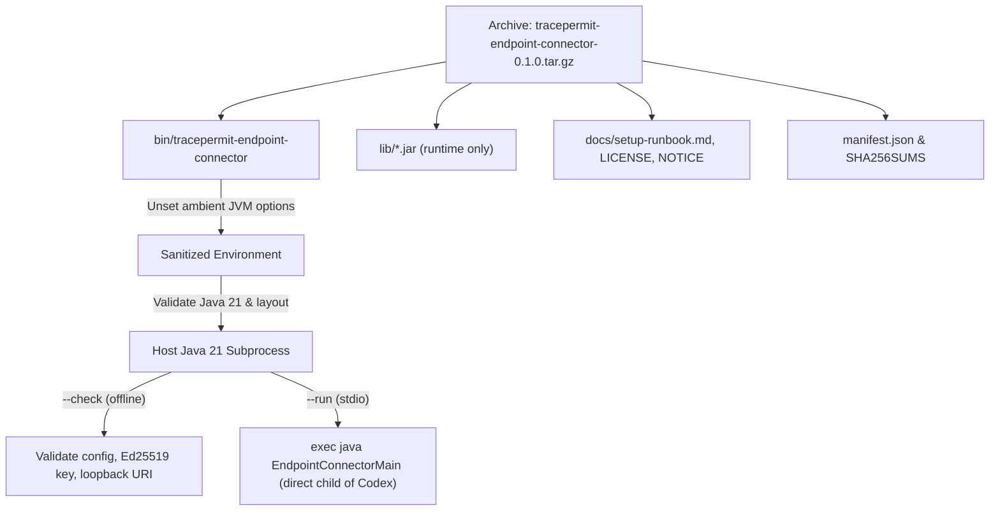

# ADR 0055: source-free local endpoint connector distribution

- **Status:** Accepted for local endpoint integration
- **Requirements:** FR-012; SEC-003, SEC-011, SEC-014; OPS-002, OPS-004

## Context

[ADR 0011](0011-endpoint-connector-and-source-attestation.md) introduced the TracePermit
endpoint connector and request-bound source attestation, [ADR 0032](0032-direct-loopback-endpoint-transport.md)
established direct loopback HTTP transport, [ADR 0038](0038-private-endpoint-observation-capture.md) added
opt-in private process observation recording, and [ADR 0057](0057-endpoint-io-deadlines.md) bounded
I/O and process probe deadlines.

However, operating or qualifying the endpoint connector previously required a full repository
checkout, Node.js, pnpm, and Gradle toolchains on the host workstation. Running native clients
such as Codex alongside TracePermit requires a relocatable, versioned distribution archive
that operates with only Java 21 and explicitly listed standard OS utilities, without requiring
source repositories, build tools, or network downloads during execution.

## Decision

Add dedicated Gradle packaging tasks in `java/endpoint-connector/build.gradle.kts` and a thin
host-native launcher script `bin/tracepermit-endpoint-connector`. The distribution is produced
as a versioned `.tar.gz` archive (`tracepermit-endpoint-connector-0.1.0.tar.gz`) accompanied by
its SHA-256 checksum (`tracepermit-endpoint-connector-0.1.0.tar.gz.sha256`).

### Archive allowlist and layout

The archive contains strictly allowlisted runtime artifacts under a single versioned root directory:

```text
tracepermit-endpoint-connector-0.1.0/
├── bin/
│   └── tracepermit-endpoint-connector
├── lib/
│   └── *.jar
├── docs/
│   ├── setup-runbook.md
│   ├── LICENSE
│   └── NOTICE
├── manifest.json
└── SHA256SUMS
```

The staging task enforces a strict allowlist:

1. **Thin launcher:** `bin/tracepermit-endpoint-connector` (executable `0755`).
2. **Compiled runtime JARs:** `lib/*.jar` (mode `0644`) containing `endpoint-connector`, `contracts`,
   `identity`, and Jackson runtime dependencies. Development test classes, test runners, and unrelated
   backend modules (`adapters-http`, `simulator`, `policy`, `persistence-postgres`) are excluded.
3. **Documentation and notices:** `docs/setup-runbook.md` (with repository-relative links relocated to
   immutable Git URLs), `docs/LICENSE`, and `docs/NOTICE` (mode `0644`).
4. **Manifest and checksums:** `manifest.json` (schema `1.1` recording clean Git commit, commit timestamp,
   package version, required Java 21, and exact JAR dependency inventory with SHA-256 hashes) and
   `SHA256SUMS` covering all extracted files.

Sources, `.git`, `.cache`, build logs, tokens, private keys, session descriptors, personal paths,
and developer configurations are strictly excluded.



### Thin launcher and process parentage

`bin/tracepermit-endpoint-connector` provides a thin, host-native interface:

- **CLI commands and platform scope:** The initial distribution bundle is strictly macOS-only (`macOS (ARM64 / x86_64)`). Accepts `--help` / `-h` (exits 0 with honest usage notice), `--check` (runs offline configuration validation), and `--run` or no arguments (starts stdio MCP server). On non-macOS platforms (e.g. Linux or Windows), `--check` and `--run` fail-closed immediately with exit code 2 and `TracePermit endpoint connector: UNSUPPORTED_PLATFORM` before observation, signing, or network calls. Unrecognized arguments are rejected with exit code 2 and safe redacted diagnostic output (`TracePermit endpoint connector: CONFIGURATION_INVALID`).
- **Secret sentinel protection:** Explicitly unsets ambient JVM diagnostic variables (`JAVA_TOOL_OPTIONS`,
  `_JAVA_OPTIONS`, `JDK_JAVA_OPTIONS`) before invoking Java. This guarantees that diagnostic banners containing
  synthetic secret sentinels are not echoed to stdout or stderr.
- **Process parentage preservation:** The launcher executes `exec java -cp "$CLASSPATH" io.tracepermit.endpoint.EndpointConnectorMain "$@"`.
  Replacing the shell process ensures that the calling client (such as native Codex) remains the immediate
  parent of the Java process, with no intermediate shell or Node.js forwarding process.
- **Paths with spaces:** All launcher paths, arguments, and classpath variables are safely quoted.

### Genuinely offline configuration validation (`--check`)

The `--check` command performs purely offline configuration inspection:

- Validates that the runtime Java major version is 21 or newer.
- Validates required environment variables:
  - `TRACEPERMIT_GATEWAY_URL`: Must be an explicit numeric loopback HTTP endpoint (`http://127.0.0.1:<port>/mcp`)
    with no userinfo, query, fragment, or HTTPS/redirect behavior.
  - `TRACEPERMIT_ENDPOINT_ISSUER`, `TRACEPERMIT_ENDPOINT_KEY_ID`, `TRACEPERMIT_ENDPOINT_DEVICE_ID`: Must be bounded,
    single-line identifiers.
  - `TRACEPERMIT_ENDPOINT_PRIVATE_KEY_PKCS8_PATH`: Must be a regular, non-symlink file with owner-only permissions
    (`0600` or `0400`) containing a valid PKCS#8 Ed25519 private key.
  - `TRACEPERMIT_CONNECTOR_BEARER_TOKEN`: Must be a non-empty, bounded string.
  - `TRACEPERMIT_ENDPOINT_OBSERVATION_DIRECTORY` (optional): If configured, verified as an absolute, canonical,
    owner-only directory (`0700`) without creating any files or directories.
- Zero network sockets, HTTP requests, DNS lookups, or IdP interactions are made.
- Zero private keys, source proofs, or diagnostic files are generated.
- On valid configuration, prints `ENDPOINT_CONFIGURATION_VALID: offline only; no gateway, IdP, observer or client checked.` to stdout and exits 0.
- On invalid configuration, emits `TracePermit endpoint connector: CONFIGURATION_INVALID` to stderr and exits 2 without leaking sensitive data.

### Build provenance and cache tracking

The packaging task declares Git commit, commit timestamp, and working tree cleanliness as Gradle-tracked
process providers. A commit-only change invalidates cached staging. Uncommitted changes or dirty working trees
fail packaging immediately.

## Consequences and limits

- The extracted connector runtime is scoped strictly to macOS (ARM64 / x86_64) and requires only Java 21 and standard macOS POSIX utilities; Linux and Windows are not supported in this bundle;
  Node.js, pnpm, Gradle, and git are not required on the target host.
- Java itself and the native Codex client are not bundled in the archive.
- The archive checksum and manifest represent integrity metadata from a trusted local build, not an
  independent cryptographic release signature or third-party provenance attestation. Rebuilding the
  distribution archive produces a different archive SHA-256 due to container timestamps, even though
  uncompressed project-JAR entries match byte-for-byte; this distribution does not guarantee bit-for-bit
  reproducible release archives.
- POSIX key files provide same-UID development custody on the host, not exclusive or hardware-protected
  custody against other processes running under the same UID. The connector does not implement
  auto-enrollment, retry loops, credential download services, or global client configuration writes (`~/.codex`).
- Offline `--check` cannot prove token validity with a remote IdP, backend readiness, public-key enrollment
  on the gateway, human presence, or policy acceptance.
- The loopback gateway restriction (`http://127.0.0.1:<port>/mcp`) remains strictly enforced; remote HTTP/HTTPS
  gateways and non-loopback bindings are rejected.
- Requirement test scope and limits:
  - **FR-012:** Packages local simulated MCP adapters and standalone endpoint runtime; cloud endpoints remain simulated.
  - **SEC-003:** Enforces ambient JVM option sanitization, private key file permission checks (`0600`/`0400`), and secret-safe diagnostics; hardware enclave custody is out of scope.
  - **SEC-011:** Direct numeric loopback HTTP only (`http://127.0.0.1:<port>/mcp`); offline `--check` makes zero network calls and creates zero files.
  - **SEC-014:** Request-bound Ed25519 source attestation verified against real backend; automated/non-interactive test runs fail closed with `SOURCE_TRIGGER_NOT_INTERACTIVE` before target execution. Wire framing is verified via mock protocol smoke server.
  - **OPS-002:** Manifest 1.1 records build provenance (clean commit and commit timestamp); packaging rejects dirty working trees.
  - **OPS-004:** Graceful termination (SIGTERM -> bounded wait -> SIGKILL) and port release verified; early exit and stalled response fixtures fail fast with bounded cleanup.
