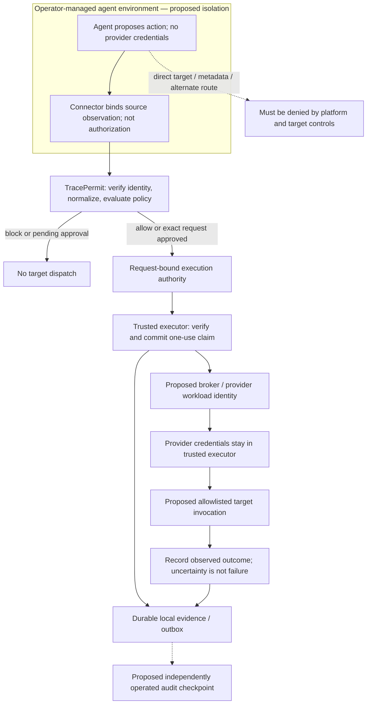

# ADR 0056: Proposed enterprise credential custody and egress boundary

- Status: **Proposed — not implemented or production-qualified**
- Date: 2026-10-18
- Primary requirements: SEC-007/008; OPS-005
- Related requirements: FR-001/008/009/012; SEC-003/006/010/012/013/014/019;
  REL-002/005/008

## Context and current boundary

TracePermit evaluates configured tool actions before simulated execution. That
does not constrain arbitrary code, alternate credentials, or network paths
outside those configured integrations. A general-purpose agent with direct
target authority can bypass an MCP gateway without attacking its policy engine.
Credential custody and managed egress therefore belong in the real-target
deployment threat model, not in a claim that an ordinary connector process
provides a complete security perimeter.

This ADR proposes a future boundary for review. It does not enable a real AWS,
Jira, database, or credential-broker adapter, or change any policy or readiness
check. The [real-target release gates](../specs/10-security-threat-model.md#7-real-target-release-gates)
remain unmet; requirement statuses are unchanged.

| Area               | Current implementation boundary                                                                                    | Proposed additional boundary                                                           |
| ------------------ | ------------------------------------------------------------------------------------------------------------------ | -------------------------------------------------------------------------------------- |
| Targets            | Deterministic simulators; no real target credentials or SDK dispatch                                               | Separately qualified, explicitly allowlisted real adapters                             |
| Authority          | Request-bound permits; the durable simulator profile commits a one-use claim before invocation                     | Independently verified authority at the real executor, with durable shared consumption |
| Endpoint connector | Same-laptop Java stdio integration and signed source observations; ordinary development key files                  | Independently protected source-key custody and an operator-managed agent sandbox       |
| Credential custody | Simulator paths do not require provider credentials                                                                | Trusted executor/broker obtains constrained provider credentials, never the agent      |
| Egress             | Local fixture checks are not host-wide network enforcement                                                         | Platform-enforced routing and target-side identity checks for the declared topology    |
| Evidence           | Local hash-linked evidence; separate durable/outbox/receipt foundations, not a configured production audit service | Independently operated checkpoint retention and deployment-specific publication        |

The ordinary local connector is not a firewall or secret vault. Remote-edge
libraries and qualification tests are not a unified production deployment.
The proposal is not an installation recipe for the same-laptop evaluation.

## Proposed boundary

### 1. Separate proposal, execution authority, and provider credentials

The agent may hold a narrowly scoped TracePermit client credential. A connector
may use a separately enrolled source-signing key. Neither is provider authority
to operate a target, and source provenance does not grant permission to execute.
The agent must not be able to read the source private key in the proposed
managed deployment. Current same-user development file custody does **not**
provide that isolation; see [ADR 0011](0011-endpoint-connector-and-source-attestation.md).

The trusted executor must revalidate the permit signature, issuer, audience,
expiry, tenant, exact canonical request binding and adapter allowlist. The
durable claim must commit before target invocation. An independent credential
broker, or a provider workload identity directly assigned to that executor,
then supplies only the authority needed for its configured operations.

A TracePermit permit is **not** a native AWS STS or Vault credential. The
executor authenticates separately to the selected provider/broker. Operator-owned
configuration, not model-supplied role ARNs, secret paths, endpoints or session
policies, determines the credential mapping. Provider policy is a second layer:
it may not express an exact request hash or all argument restrictions, so it
cannot replace executor-side permit verification.

For example, AWS `AssumeRole` credentials have a minimum session duration of
900 seconds, not five minutes. Session policies intersect with role permissions;
they do not expand them. STS sessions are not TracePermit single-use permits.
See the [AWS AssumeRole API](https://docs.aws.amazon.com/STS/latest/APIReference/API_AssumeRole.html).
Provider credentials can remain reusable within their lifetime even after a
TracePermit permit is consumed or expires. Credential lifetime, revocation and
least privilege must therefore be qualified separately for each adapter.

Reusable secrets must not enter source control, action payloads, tool results,
evidence or public projections. A trusted credential-handling component still
needs access to credentials or workload identity; this is isolation and bounded
custody, not a claim that credentials exist nowhere. SEC-012 remains partial:
bounded response redaction does not prove all logs, traces, storage and exports
are secret-free.

### 2. Preserve failure and transaction boundaries

Proposed target execution follows this sequence:

1. A trusted ingress verifies identity and, where applicable, source proof,
   then normalizes the action. Request fields do not self-assert trust.
2. Policy blocks, permits, or requires independent exact-request approval.
   Pending approval and approved-but-not-resumed requests do not dispatch.
3. The executor verifies request-bound authority and durably claims its one
   use with local pre-dispatch evidence. Failure to confirm that claim prevents
   target invocation; the executor must not assume a failed acknowledgement
   means the claim rolled back.
4. The trusted executor acquires provider credentials through its fixed
   mapping and invokes only the allowlisted target operation. Credential
   preparation and its own audit/rate limits require adapter-specific design;
   there is no atomic transaction spanning broker, local database and target.
5. A separate completion operation records the observed result. A timeout,
   crash or unconfirmed completion does not establish failure or restore
   authority. Recovery uses bound, read-only observations, never a blind retry.

The credential-acquisition ordering above is a proposal, not an existing broker
implementation. A failure after the claim can consume authority without any
target effect; an unconfirmed target outcome can remain unknown. This is not
an exactly-once guarantee for external APIs. See
[ADR 0048](0048-bounded-durable-completion-uncertainty.md) and
[ADR 0020](0020-reconcile-by-lookup-never-reexecution.md).

The diagram describes a future composition. Existing simulator components do
not implement its broker, real target, managed network or production checkpoint.

### 3. Make bypass resistance a tested deployment property

The operator must enforce default-deny target access outside the agent's control
and permit only the declared gateway route. Model-provider traffic and other
necessary dependencies need separate, explicit allowances; not every packet is
an MCP action. Those exceptions must not become arbitrary HTTP proxies or a
second path to protected targets. The executor also needs a constrained route
and provider identity, not unrestricted network and cloud administration.

Network controls and target authorization are complementary:

- Review IPv4 and IPv6, DNS resolution, redirects, proxy environment settings,
  private endpoints, loopback/host services, Unix sockets, host mounts and
  inherited credential sources. Absence of a NAT or internet route alone is not
  evidence that all bypass paths are closed.
- Kubernetes NetworkPolicy needs a supporting network plugin and policies are
  additive. Standard policies do not enforce TLS or force traffic through a
  common gateway; `hostNetwork` behavior depends on the plugin. Qualify the
  actual CNI, node and host-network topology rather than relying on a YAML file.
  See [Kubernetes Network Policies](https://kubernetes.io/docs/concepts/services-networking/network-policies/).
- Block or disable agent access to instance metadata and other ambient identity
  endpoints. EC2 metadata includes IPv4 and, where enabled, IPv6 access. IMDSv2
  and its response hop limit are not a substitute for proving the sandbox cannot
  obtain a metadata credential. See
  [EC2 metadata access](https://docs.aws.amazon.com/AWSEC2/latest/UserGuide/configuring-instance-metadata-service.html)
  and [metadata options](https://docs.aws.amazon.com/AWSEC2/latest/UserGuide/configuring-instance-metadata-options.html).
- Restrict target-side permissions to the intended executor identity. Use
  provider IAM and, where supported, mTLS or equivalent workload authentication.
  A network allowlist alone does not authenticate an action, and not every SaaS
  API accepts customer-issued client certificates.

The agent must not be able to change those policies, read broker credentials,
impersonate the executor, reach an administrative socket or move into a more
privileged host/network context. A compromised host administrator, control plane
or credential broker is outside this proposed agent-containment guarantee and
requires separate protection, detection and incident response. This is not an
"uncircumventable" perimeter or a universal prompt-injection defense.

### 4. Keep evidence claims bounded

Hash-linked records are tamper-evident under their trust assumptions, not
tamper-proof or inherently truthful. A privileged writer can rewrite a local
chain and its head. Independent signed receipts can preserve a checkpoint of
what was published; they do not prove that every event was recorded or that an
application's account of a target effect is true.

The durable simulator composition commits local claim/evidence state before
dispatch and records completion separately. The ordinary development profile
must not be presented as that durable composition. External publication is
asynchronous, outside the execution transaction; the repository's receipt
foundation is not a configured production SIEM or immutable retention service.
See [ADR 0019](0019-leased-outbox-and-external-evidence-receipts.md).

## Proposed responsibility split

| Boundary            | Future TracePermit / adapter responsibilities                         | Deployment operator responsibilities                                           |
| ------------------- | --------------------------------------------------------------------- | ------------------------------------------------------------------------------ |
| Identity and source | Verify issuer/audience/time, enrollment and exact request proof       | Identity issuance, enrollment, protected keys and revocation procedures        |
| Action authority    | Canonicalization, policy, exact approval, permit verification         | Reviewed policy and explicit adapter/resource onboarding                       |
| One-use enforcement | Durable shared consumption before dispatch; preserve uncertain states | Durable store availability, recovery fencing and replica topology              |
| Provider authority  | Fixed credential mapping, narrow operation interface, secret handling | Provider roles/broker trust, least privilege, rotation and incident revocation |
| Bypass resistance   | Document required routes and reject unconfigured target dispatch      | Managed sandbox, CNI/firewall/proxy controls and target-side identity policy   |
| Evidence            | Bounded projections, local durable records, verifiable publication    | Independent checkpoint custody, retention, access control and export review    |

These are proposed responsibilities, not a statement that all are implemented.
No infrastructure vendor or deployment model is selected by this ADR.

## Required qualification before any real-target pilot

The following gates are **not run or satisfied by this documentation change**:

- Record the exact sandbox, trust domains, identities, credential sources,
  routes, allowed dependencies and administrator assumptions. Review the
  adapter and threat model before introducing any non-production credential.
- Prove intended gateway calls work and direct target access fails through each
  applicable IP family, DNS/proxy/redirect route, metadata service and local
  credential source. Include negative controls and target invocation counters;
  lack of a local credential is not proof of network denial.
- Prove credential mapping cannot broaden tenant, role, resource, destination
  or lifetime; do not accept a model-supplied broker path or provider policy.
  Verify target credentials cannot be read through tools, host access, logs,
  error responses, evidence or exports.
- Reject forged, expired, replayed or mutated authority and wrong identities
  before target invocation. Include concurrent/replica consumption, broker and
  durable-store outages, and a valid allow control. A broker failure before
  invocation must produce zero target effects, without restoring spent authority.
- Inject failures around claim, dispatch and completion; retain uncertainty and
  demonstrate lookup-only recovery without redispatch. Address old-snapshot
  authority revival rather than assuming a valid database hash chain prevents it.
- Qualify production ingress, sender constraint, shared abuse controls and
  incident/kill-switch procedures under OPS-005. Obtain explicit release review
  for the exact non-production target before any broader rollout.

Until those gates have evidence, retain simulator-only operation and describe
bypass resistance as a deployment requirement, not an achieved product guarantee.

## Consequences and open decisions

This preserves the distinction between a policy gateway and platform isolation,
and between a one-use permit and reusable provider credentials. It avoids turning
local simulator evidence into production marketing claims.

Before implementation, select one deployment topology and one non-production
adapter; define provider policy expressiveness, credential lifecycle and broker
failure semantics; then review the corresponding security tests. Vault, STS,
service meshes and Kubernetes are possible integration choices, not dependencies
introduced here. The active source-free local connector work is separate.
