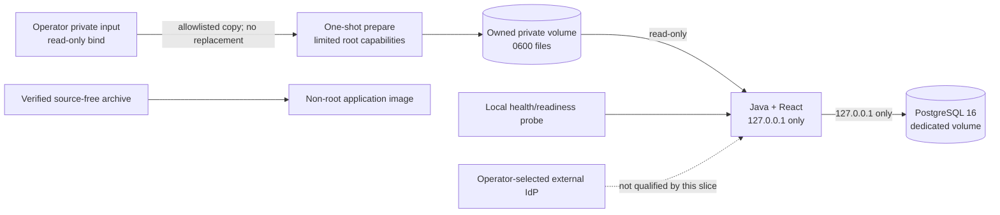

# ADR 0062: loopback container install profile foundation

- **Status:** Accepted for the Linux simulator profile only
- **Tracker:** TP-MVP-05 foundation; TP-MVP-04 dependency and public-edge acceptance remain open
- **Requirements:** FR-012; SEC-003, SEC-011, SEC-015, SEC-016, SEC-017; OPS-001, OPS-002, OPS-004, OPS-005

## Context

The source-free simulator approval archive packages the Java approval API and
React inbox, but asks an operator to install Java and PostgreSQL directly on a
host. A repeatable customer-owned installation needs a versioned application
image, explicit database lifecycle, private configuration staging, health and
readiness semantics, and executable negative checks. Containerizing the current
runtime must not convert its local browser/API surface into a remotely exposed
service or imply that an external IdP, reverse proxy, TLS edge, sender constraint,
or real target has been qualified.

The Java runtime and its PostgreSQL configuration deliberately accept only
`127.0.0.1`. Ordinary Docker bridge networking would force either the Java
listener or PostgreSQL to bind a non-loopback address. Publishing that port
would also contradict the existing local trust boundary.

## Decision

Add a Linux Docker Engine install-profile foundation under `deploy/container`.
It has the following properties:

1. The application image is built from the existing source-free distribution,
   not a second runtime assembly. Its Temurin Java 21 base is digest-pinned. The
   image records the exact source commit and archive SHA-256 as OCI labels.
2. The runtime image contains no source checkout, Node.js, pnpm, Gradle, Git,
   development credentials, private keys, or PostgreSQL password. It defaults
   to UID/GID `10001`, exposes no image port, and runs with a read-only root
   filesystem, no Linux capabilities and `no-new-privileges` in Compose.
3. The application and digest-pinned PostgreSQL 16 image use host networking
   with no Compose `ports` entries. Each process still binds only numeric IPv4
   loopback. This profile is therefore qualified only on Linux Docker Engine;
   Docker Desktop host networking, Kubernetes, bridge networking, reverse
   proxies, tunnels, and remote hosts are not supported by this decision.
4. A short-lived setup container, running as root with only the file capabilities
   needed for ownership changes, copies an allowlisted file set from a private
   read-only bind into an owned volume. It follows no final-component symlink,
   copies no extra file and refuses to replace any retained file with different
   bytes. The non-root application then runs the existing strict private-file,
   key-pair and configuration validation against that read-only volume.
5. PostgreSQL receives its password through a Compose secret file. The Java
   container receives only a path to its private configuration. Known example/
   default password values are rejected. Keys are generated by the operator or
   test at runtime and never committed or built into an image.
6. `GET /health` is a bounded local liveness projection. `GET /ready` additionally
   performs exact PostgreSQL schema validation and requires recovery mode
   `ready`. Both require the exact loopback Host, accept only GET without query,
   Cookie, Origin or Authorization, return schema `1.0`, and reveal no dependency
   identifiers or failure details. Readiness deliberately does not probe or
   claim external IdP compatibility.
7. `--check`, `--init-db`, normal `--run`, stopped-service upgrade, quarantine,
   and recovery inspection retain their existing authority separation. Compose
   does not auto-initialize, auto-migrate, repair, or delete durable state.

## Health and readiness meaning

Liveness proves that the local listener can answer a bounded request. Readiness
proves the exact packaged schema remains readable and the operator-declared
recovery row is not quarantined at probe time. Neither result proves that an
access token can currently be issued, that the configured IdP is compatible,
that a reviewer is available, that a target effect will succeed, or that this
profile is safe to expose remotely. Component authorization and fail-closed
checks remain mandatory after a ready response.

## Consequences and limits

- A fresh Linux host can run a consistent Java/PostgreSQL/React simulator
  composition without installing Java, Node.js, pnpm or Gradle.
- Host networking is an explicit compatibility constraint, not a general
  container deployment recommendation. Another local process or root can still
  access or interfere with loopback services and volumes.
- The setup container briefly has root access to mounted private input. Docker
  daemon/root compromise, same-operator compromise and hostile parent paths are
  outside this POC boundary.
- Digest pinning and archive checksums improve repeatability and inventory. They
  are not signed provenance, vulnerability attestations or an update service.
- No TLS termination, reverse-proxy trust, sender constraint, shared abuse state,
  production telemetry exporter, backup/restore fence, external IdP qualification,
  public listener, or real AWS/Jira route is added. SEC-015/016/017 and OPS-005
  remain production gates, not newly satisfied requirements.
- TP-MVP-05 remains partially complete until its TP-MVP-04 identity dependency
  and the public-edge/client-compatibility acceptance are separately resolved.

## Verification

`scripts/container-install-profile.test.mjs` builds no authority and invokes no
target. Against an owned Compose project it verifies:

- rendered Compose has host networking, zero published ports, pinned PostgreSQL,
  required values, secret-file transport and hardened application settings;
- image labels/default user, absence of exposed ports, build tools and source;
- runtime-generated Ed25519 keys, allowlisted private preparation, offline check,
  and refusal to replace a retained key;
- explicit fresh database initialization, process startup, React asset serving,
  exact liveness/readiness documents, loopback socket addresses and refusal on a
  non-loopback host address;
- database outage leaves health live but readiness unavailable with no details;
  and
- project-scoped cleanup removes only the test's containers and volumes.

The Java tests separately cover wrong method, query/header injection, readiness
failure redaction, default secret rejection and wildcard-listener rejection.
