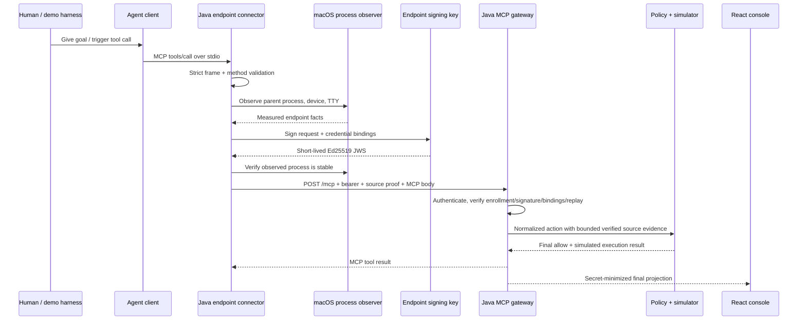

# Scenario 0: endpoint connector trust construction

**Requirements demonstrated:** FR-001, FR-003, FR-017, SEC-003, SEC-011,
SEC-014, OPS-004

## Scenario objective

Show how a proposed MCP action begins on the client endpoint and becomes a
request with verifiable source evidence before it reaches the Java enforcement
server. This scenario deliberately stops short of making source attestation
sound like authorization.

The one-sentence message is:

> The agent proposes the tool call; the endpoint connector independently
> observes its execution context, binds those facts to the exact request and
> connector credential, and forwards both to a server that must verify them.

## Data flow



## Run it

Start the common demo composition, then in Terminal 2 run:

```bash
pnpm demo:scenario:connector
```

The command prints four views:

1. the exact MCP tool call proposed by the demo client;
2. the real connector's pre-server operation plan and the boundary between
   previewed steps and measured evidence;
3. a presenter-safe representation of the outbound HTTP request; and
4. the final server-verified identity, lineage, and decision projection.

The command executes the real Java stdio connector. The outbound bearer and
compact JWS are intentionally shown only as redacted placeholders. Printing a
real secret is not necessary to prove that the boundary works.

`pnpm demo:scenario:connector:auto` skips the Enter pause but must still be run
from an attached terminal. The CLI profile requires independently observed
interactive source evidence; automatic presentation timing is not an automated
workload identity.

## What enters the connector

The client controls only a strict JSON-RPC request such as:

```json
{
  "jsonrpc": "2.0",
  "id": "connector-read",
  "method": "tools/call",
  "params": {
    "name": "aws.logs.filter_log_events",
    "arguments": {
      "logGroupName": "/app/staging",
      "filterPattern": "ERROR",
      "limit": 2
    }
  }
}
```

The client does not get to assert that it is authenticated, that a human is
present, or that its process and device are verified.

## What the connector derives

The connector performs these operations for each supported MCP frame:

1. `StdioMcpServer` enforces bounded newline-delimited JSON-RPC, exact request
   fields, supported methods, notification shape, and size limits.
2. `ProcessHandleProcessObserver` and the macOS terminal probe observe the
   immediate parent executable, executable hash, parent executable, process
   start time, device, platform, and terminal attachment.
3. `EnvironmentConnectorCredentialProvider` obtains the short-lived POC
   credential. It is never copied into evidence or diagnostics.
4. `SourceAttestationFactory` hashes the credential, hashes the canonical MCP
   request, adds issuer/key/audience/expiry and endpoint observations, and signs
   the claims with Ed25519. The proof lifetime is at most 60 seconds.
5. The process observer checks stability again to reduce observation-to-use
   substitution.
6. `LoopbackHttpGatewayTransport` permits only an exact loopback `/mcp` URL,
   disables redirects, and sends the MCP body with the bearer credential and
   compact source proof in separate headers.

In this demo harness the observed immediate parent is normally `node`, because
the Node launcher starts the Java connector. A separately qualified native
Codex or Claude Code registration would be expected to show that product's
actual parent executable; this POC does not claim that qualification yet.

## What leaves the connector

The secret-safe logical view is:

```http
POST http://127.0.0.1:8080/mcp
Authorization: Bearer [REDACTED]
tracepermit-source-attestation: [COMPACT JWS REDACTED]
Content-Type: application/json

{the parsed MCP request}
```

The JWS binds:

- the exact canonical MCP request;
- a SHA-256 fingerprint of the connector credential;
- the enrolled endpoint issuer, key, and device;
- the observed process and trigger evidence;
- the `tracepermit-gateway` audience;
- a unique token ID; and
- a short issue/expiry interval.

The private key never leaves the connector-side signer. The server receives the
compact proof and bearer only for verification; the read model excludes the
raw token, compact proof, token ID, request hash, and credential fingerprint.

## What the server must still verify

The gateway independently verifies authentication, enrolled public key,
signature, device binding, audience, lifetime, exact request hash, credential
fingerprint binding, and one-time token consumption. Only then can bounded
device/process facts enter the canonical action as authenticated source
evidence.

Source verification answers “where did this request come from?” Policy still
answers “may this identity perform this action on this resource now?” Scenario
1 demonstrates that separate decision.

## Live narration

Before pressing Enter:

> This JSON in Step 1 is an agent proposal, not trusted identity evidence. Step
> 2 explains the operations the real connector is about to perform before any
> request leaves the endpoint: OS observation, exact request and credential
> binding, local Ed25519 signing, and a stability recheck. The preview does not
> invent measurements or print proof claims; Step 4 appears only after the real
> connector runs and the gateway verifies its source attestation.

While showing the presenter-safe outbound view:

> The connector sends the original tool request plus two independent security
> artifacts: an authenticated connector credential and a short-lived endpoint
> signature bound to both that credential and this exact request. I redact the
> reusable and replay-sensitive values even in a demo.

After the server result:

> The gateway verified the proof and kept the human, endpoint process, and MCP
> client as distinct lineage hops. That establishes provenance. It does not yet
> establish that every action from this source is safe.

## Evidence to point at

- Terminal PASS lines prove initialization, bounded discovery, source-proof
  acceptance, final projection count, and absence of the bearer from the read
  model.
- In the React console, filter origin to `cli` and open the newest row.
- Point out the authenticated human principal and endpoint actor, the asserted
  MCP orchestrator hop, CLI origin, policy reason, and simulated execution.

## Code map

| Responsibility             | Java implementation                                                                                                                          |
| -------------------------- | -------------------------------------------------------------------------------------------------------------------------------------------- |
| MCP stdio validation       | `java/endpoint-connector/src/main/java/io/tracepermit/endpoint/StdioMcpServer.java`                                                          |
| Endpoint pipeline          | `java/endpoint-connector/src/main/java/io/tracepermit/endpoint/EndpointConnector.java`                                                       |
| Process/device observation | `java/endpoint-connector/src/main/java/io/tracepermit/endpoint/ProcessHandleProcessObserver.java` and `MacOsDevelopmentProcessObserver.java` |
| Request-bound proof        | `java/endpoint-connector/src/main/java/io/tracepermit/endpoint/SourceAttestationFactory.java`                                                |
| Restricted HTTP egress     | `java/endpoint-connector/src/main/java/io/tracepermit/endpoint/LoopbackHttpGatewayTransport.java`                                            |
| Gateway verification       | `java/adapters-http/src/main/java/io/tracepermit/adapters/http/LoopbackDevelopmentMcpServer.java`                                            |
| Server action construction | `java/adapters-remote/src/main/java/io/tracepermit/adapters/remote/EnforcingMcpDispatcher.java`                                              |

## Honest limitations

- The development credential is environment-delivered, not a production
  device-bound OAuth credential.
- The private key is an ephemeral local file, not Secure Enclave/TPM/MDM-backed
  managed key custody.
- Replay state is not yet a shared multi-replica production service.
- Executable allowlisting and platform-signature policy are planned.
- Native Codex/Claude version qualification remains planned.
- Transport is loopback HTTP for the local composition; production remote
  connectors require TLS and sender constraint.
