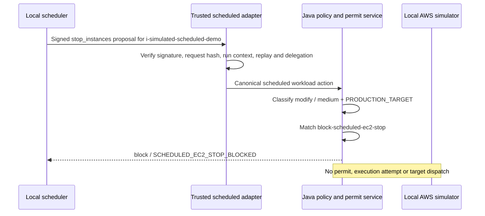

# Scenario 7: signed scheduled EC2 stop is blocked

**Requirements demonstrated:** FR-001, FR-002, FR-005, FR-006, FR-010,
FR-011, FR-012, FR-014, SEC-001, SEC-002, SEC-003, REL-001, OPS-004

## Scenario objective

Prove that a valid scheduler signature and a valid, narrowly scoped delegation
establish attribution and authority to _propose_ one simulated EC2 stop. They
do not override a higher-level organizational policy that blocks the action.
The policy decision occurs before permit issue or target dispatch.

> A scheduled job can be cryptographically authentic and still be denied
> because its exact proposed action violates policy.

This is a standalone Java scenario. The `prod` field is a **risk label** on a
`simulated-123` account. No AWS SDK, AWS credential, real EC2 instance, or
network target participates.

## Run it

Presenter mode pauses before the signed request:

```bash
pnpm demo:scenario:scheduled-stop
```

Automated acceptance runs without a pause:

```bash
pnpm demo:scenario:scheduled-stop:auto
```

The launcher unsets common AWS and Jira credential variables before starting
Java. The scenario generates Ed25519 keys in memory, verifies one request-bound
workload credential and one delegation, and prints no credential or private key.

## Exact flow



## What the verified run shows

| Boundary       | Observed result                                                          |
| -------------- | ------------------------------------------------------------------------ |
| Origin         | Authenticated workload, scheduled trigger, valid Ed25519 request binding |
| Delegation     | Verified `aws.ec2.stop` scope for one simulated instance                 |
| Classification | `modify`, `medium`, with `MUTATION_VERB` and `PRODUCTION_TARGET`         |
| Policy         | `block-scheduled-ec2-stop` → `SCHEDULED_EC2_STOP_BLOCKED`                |
| Execution      | No permit, no execution attempt, simulator dispatch count `0`            |
| Evidence       | `action.observed → policy.evaluated → authorization.denied`              |

The `stop` operation is classified as a **modification**, because it is
potentially reversible. The organizational policy still blocks it for a
scheduled workload targeting a production-labelled resource. Action class,
severity, and decision answer different questions.

The dated, secret-free [qualification record](evidence/07-signed-scheduled-stop-2026-10-12.md)
captures this run and the Scenario 4 regression check.

## Presenter narration

1. “The local scheduler signs the exact action and run context. The adapter
   independently verifies the signature and consumes its one-use credential.”
2. “The workload signs a delegation with only `aws.ec2.stop` for this one
   simulated instance. The action body cannot claim its own authority.”
3. “Java classifies the proposed stop as a modification with a production
   target signal. Our active policy forbids this combination.”
4. “The gateway returns Block and records the denial. The simulator counter
   remains zero. The signed credential never became an execution permit.”

## Revision questions

1. **Why is Stop not labelled destructive here?** The deterministic taxonomy
   treats a reversible stop as `modify`; `terminate` is destructive. Severity
   and final policy decision are independent of that broad action class.
2. **Does a valid delegation mean the action must run?** No. The delegation
   limits what the child may request. Current policy can impose a stricter
   boundary and block it.
3. **What proves the denial happened before the side effect?** No permit or
   execution attempt exists, the evidence ends at `authorization.denied`, and
   the simulator dispatch counter is zero.
4. **Does the `prod` label indicate a real AWS account?** No. The account ID is
   `simulated-123` and the target is the in-memory simulator.

## Code map

| Responsibility                                     | Implementation                                                                                                                                                       |
| -------------------------------------------------- | -------------------------------------------------------------------------------------------------------------------------------------------------------------------- |
| Launcher                                           | `scripts/run-signed-scheduled-stop-scenario.sh`                                                                                                                      |
| Presenter + signed request construction            | `java/adapters-http/src/test/java/io/tracepermit/adapters/http/SignedScheduledSemanticDemoMain.java`                                                                 |
| Cryptographic workload and delegation verification | `java/identity/src/main/java/io/tracepermit/identity/ScheduledWorkloadVerifier.java`                                                                                 |
| Trusted canonical normalization                    | `java/identity/src/main/java/io/tracepermit/identity/ScheduledActionAdapter.java`                                                                                    |
| Scenario-specific, fail-secure deny policy         | `policies/aws-scheduled-stop-demo.json`                                                                                                                              |
| Decision before permit and simulator               | `java/application/src/main/java/io/tracepermit/application/SecureExecutionService.java`                                                                              |
| Rule and zero-dispatch tests                       | `java/policy/src/test/java/io/tracepermit/policy/PolicyEvaluatorTest.java`, `java/application/src/test/java/io/tracepermit/application/SemanticEnforcementTest.java` |

## Scope limit

This is a local presenter composition. It proves the scheduled adapter,
classifier, policy, evidence, and pre-dispatch boundary for a simulator-only
tool proposal. `aws.ec2.stop_instances` is intentionally not an executable
simulator adapter or a hosted-client MCP tool. Production still needs managed
scheduler keys, durable replay state, real target credential custody, and
anti-bypass egress controls.
