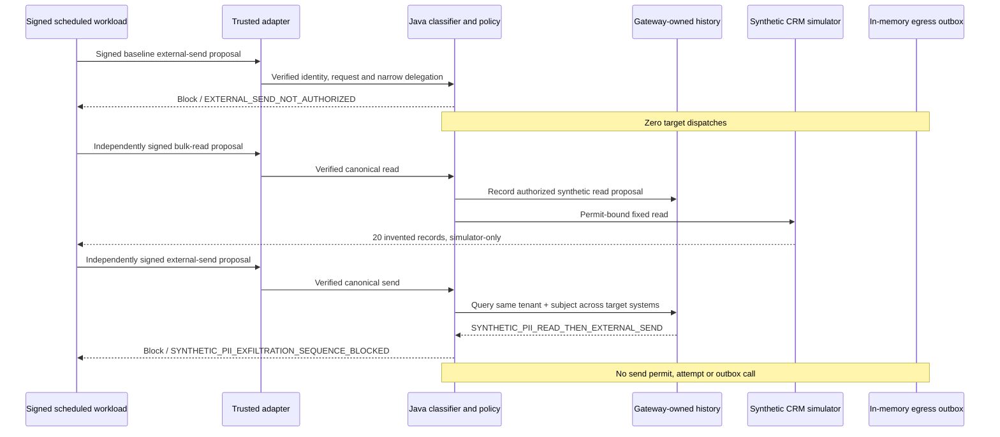

# Scenario 9: synthetic customer read followed by external-send denial

**Requirements demonstrated:** FR-001, FR-002, FR-005, FR-006, FR-008,
FR-009, FR-010, FR-011, FR-012, FR-014, SEC-001, SEC-002, SEC-005,
REL-001, OPS-004

## Scenario objective

Show why isolated tool-call checks are insufficient. A signed scheduled workload
performs one permitted bulk read of **invented** customer records from a fixed
local dataset. It then proposes an external send through a _different_ target
system. Java derives the sequence from gateway-owned history and blocks the
send before issuing a permit or calling the in-memory outbox.

This scenario is standalone and uses no ChatGPT, external service, real PII,
network sender, AWS/Jira credential, or production target. The email domain
`example.invalid` is intentionally non-routable.

## Run it

```bash
pnpm demo:scenario:pii-exfil
# no presenter pauses:
pnpm demo:scenario:pii-exfil:auto
```

The launcher removes common AWS/Jira credential variables. Runtime Ed25519
keys exist only in memory; credentials are verified but never printed.

## Exact flow



## What the qualified run shows

| Boundary       | Observed result                                                                                                                                      |
| -------------- | ---------------------------------------------------------------------------------------------------------------------------------------------------- |
| Attribution    | Each proposal has a verified scheduled workload credential and one exact delegated scope/resource.                                                   |
| Baseline       | An external send without read history is still blocked by the explicit egress rule; outbox count `0`.                                                |
| Read           | `demo.customer.bulk_read` is classified `read` with `SYNTHETIC_PII_DATASET`; the strict simulator returns 20 invented records.                       |
| Correlation    | The gateway key is tenant + authenticated subject, so a CRM read can affect a later egress decision. The client cannot supply or clear this history. |
| Follow-on send | `SYNTHETIC_PII_READ_THEN_EXTERNAL_SEND` raises severity to `critical`; the higher-priority exfiltration rule blocks.                                 |
| Execution      | Exactly one dispatch (the read), zero sends, and no permit or attempt for either denied send.                                                        |
| Evidence       | 11 bounded lifecycle records; no raw records, arguments, compact credentials, or private keys.                                                       |

The specific sequence rule changes the **reason and severity**, not the
baseline egress posture: external sends are already blocked when there is no
history. This is deliberate fail-secure policy, not proof that standalone
external transfer is safe.

The history entry records an **authorized read proposal before dispatch**, not
a confirmed target outcome. This keeps a state failure from allowing the read
to dispatch and can conservatively flag a later send if the read subsequently
fails. In this qualified run the read actually succeeds. Production would
need a shared, durable sequence store and an explicit consistency model for
committed effects versus attempted/authorized actions.

The [secret-free local evidence](evidence/09-synthetic-pii-exfil-2026-10-12.md)
records the exact automated run and regressions.

## Presenter narration

1. “The workload and each delegation are signed and request-bound. That
   establishes who proposed these tools, not that either action is safe.”
2. “The customer data is invented inside the simulator. The read is allowed
   and returns 20 local records; no raw record is written to evidence.”
3. “The next tool targets an egress system, so a per-target history key would
   miss the chain. Java correlates by tenant and verified subject.”
4. “The send is blocked before permit issue and outbox dispatch. Even the
   baseline send was denied; the sequence gives us a more precise reason.”

## Code map

| Responsibility                                | Implementation                                                                                                                                                                                                                                                                             |
| --------------------------------------------- | ------------------------------------------------------------------------------------------------------------------------------------------------------------------------------------------------------------------------------------------------------------------------------------------ |
| Launcher                                      | `scripts/run-synthetic-pii-exfil-scenario.sh`                                                                                                                                                                                                                                              |
| Signed presenter                              | `java/adapters-http/src/test/java/io/tracepermit/adapters/http/SignedScheduledSemanticDemoMain.java`                                                                                                                                                                                       |
| Cross-target history                          | `java/application/src/main/java/io/tracepermit/application/InMemoryActionSequenceStore.java`                                                                                                                                                                                               |
| Authorized-only history and pre-dispatch gate | `java/application/src/main/java/io/tracepermit/application/SecureExecutionService.java`                                                                                                                                                                                                    |
| Classification                                | `java/policy/src/main/java/io/tracepermit/policy/PolicyEvaluator.java`                                                                                                                                                                                                                     |
| Fail-secure policy                            | `policies/synthetic-pii-exfil-demo.json`                                                                                                                                                                                                                                                   |
| Fixed synthetic dataset/outbox                | `java/simulator/src/main/java/io/tracepermit/simulator/SyntheticExfilTargetSimulator.java`                                                                                                                                                                                                 |
| Enforcement and boundary tests                | `java/application/src/test/java/io/tracepermit/application/SemanticEnforcementTest.java`, `java/application/src/test/java/io/tracepermit/application/InMemoryActionSequenceStoreTest.java`, `java/simulator/src/test/java/io/tracepermit/simulator/SyntheticExfilTargetSimulatorTest.java` |

## Scope limit

The POC does not inspect arbitrary data bytes, detect real PII, observe all
agent tools, or guarantee cross-replica/restart sequence history. No external
send ever leaves the process. The rule is specific to registered synthetic
tools and the scheduled-workload presenter composition; a production exfil
control needs tool registration, destination policy, shared state, privacy
governance, target credential custody, and anti-bypass egress.
