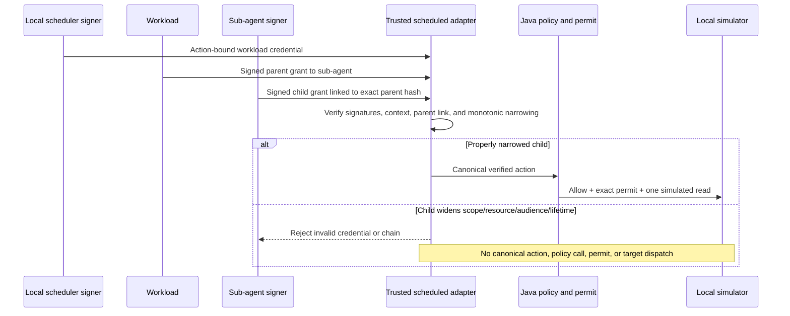

# Scenario 11: sub-agent delegation amplification rejected

**Requirements demonstrated:** FR-002, FR-003, FR-010, FR-011, FR-014,
SEC-001, SEC-002, SEC-003, SEC-004, SEC-009, SEC-012, REL-001

## Scenario objective

Show why a signed child grant is **not sufficient** by itself. A scheduled
workload delegates to a sub-agent, which delegates to a simulator tool. The
trusted Java adapter checks the complete parent-linked chain against
operator-owned keys, trusted request context, and exact action mapping. One
properly narrowed chain executes a bounded local log read; four separately
signed attempts to widen authority fail before a canonical action reaches
policy, permit issuance, execution ledger, or simulator dispatch.

This is a delegation-verification rejection, **not** an organizational policy
`block` result. No gateway policy/evidence event is emitted for a request that
never crosses the identity boundary.

## Run it

```bash
pnpm demo:scenario:delegation
# no presenter pauses:
pnpm demo:scenario:delegation:auto
```

The standalone launcher clears common AWS/Jira credential variables. It
generates Ed25519 signer keys only in process and uses one deterministic local
AWS simulator; it does not need Docker, the combined backend, a real scheduler,
or a real cloud account.

## Exact flow



The valid parent's two scopes are `aws.logs.read` and `aws.logs.export`; its
two resources are fixed simulated log groups. The child narrows to
`aws.logs.read` on `/app/prod` and a shorter lifetime. Each negative case has
a fresh, correctly signed workload and parent/child pair, so the rejection is
not an incidental replay or bad-signature failure:

| Child attempt                      | Verifier result                 | Why it fails                                 |
| ---------------------------------- | ------------------------------- | -------------------------------------------- |
| Add `aws.admin` scope              | `INVALID_DELEGATION_CHAIN`      | Scope is outside the parent set.             |
| Add all-groups resource            | `INVALID_DELEGATION_CHAIN`      | Resource is outside the parent set.          |
| Change executor audience           | `INVALID_DELEGATION_CREDENTIAL` | It fails the adapter-owned audience binding. |
| Expire one second after the parent | `INVALID_DELEGATION_CHAIN`      | Child lifetime exceeds the parent lifetime.  |

The audience case is rejected during individual credential context validation
before chain reconstruction. The other three reach the chain-narrowing check.
All four are `not_executed`; the control read is the only target dispatch.

The dated [secret-free local proof](evidence/11-sub-agent-delegation-2026-10-13.md)
records observed output and verification commands.

## Presenter narration

1. “The workload credential authenticates this scheduled action, but it does
   not automatically grant the sub-agent every capability.”
2. “The parent signed a bounded grant. The sub-agent signed another grant to
   the tool and linked it to the exact parent credential hash.”
3. “One narrowed chain passes and produces one simulated read. Each broader
   child is also correctly signed, but the verifier rejects it before policy.
   A signature authenticates an issuer; it does not authorize amplification.”
4. “The gateway evidence count and simulator dispatch count remain unchanged
   after the rejected attempts. For a production audit, the edge would need a
   separate bounded pre-policy rejection telemetry path.”

## Code map and limits

| Responsibility                   | Implementation                                                                                                                                                                                   |
| -------------------------------- | ------------------------------------------------------------------------------------------------------------------------------------------------------------------------------------------------ |
| Launcher                         | `scripts/run-sub-agent-delegation-scenario.sh`                                                                                                                                                   |
| Presenter and signed fixtures    | `java/adapters-http/src/test/java/io/tracepermit/adapters/http/SignedScheduledSemanticDemoMain.java`                                                                                             |
| Strict credential/chain verifier | `java/identity/src/main/java/io/tracepermit/identity/ScheduledWorkloadVerifier.java`                                                                                                             |
| Trusted normalization boundary   | `java/identity/src/main/java/io/tracepermit/identity/ScheduledActionAdapter.java`                                                                                                                |
| Pre-dispatch policy and permit   | `java/application/src/main/java/io/tracepermit/application/SecureExecutionService.java`                                                                                                          |
| Simulator                        | `java/simulator/src/main/java/io/tracepermit/simulator/StatefulTargetSimulator.java`                                                                                                             |
| Regression tests                 | `java/identity/src/test/java/io/tracepermit/identity/ScheduledWorkloadVerifierTest.java`, `java/adapters-http/src/test/java/io/tracepermit/adapters/http/SignedScheduledDelegationDemoTest.java` |

This proves in-process Java verification with runtime-generated test keys.
It does not prove protected signing-key custody, a real scheduler, distributed
revocation/replay, a real agent process, or production anti-bypass egress.
Scenario 12 addresses the last boundary with a separate local fake target.
