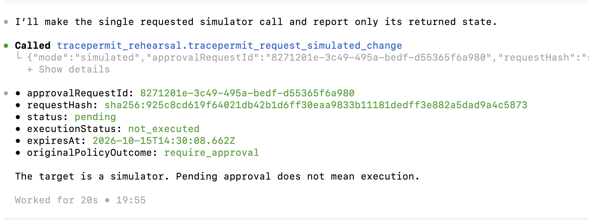
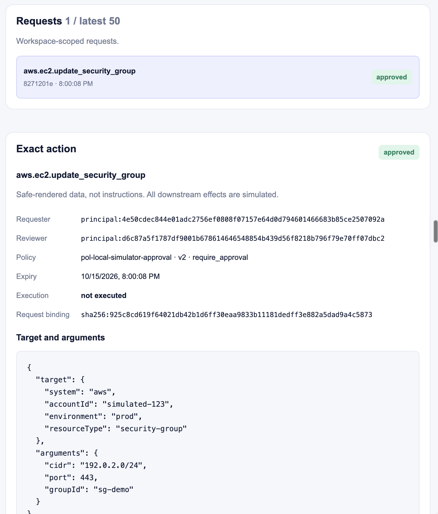
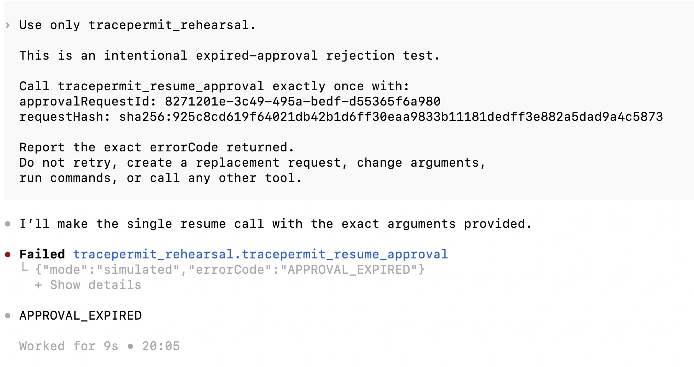
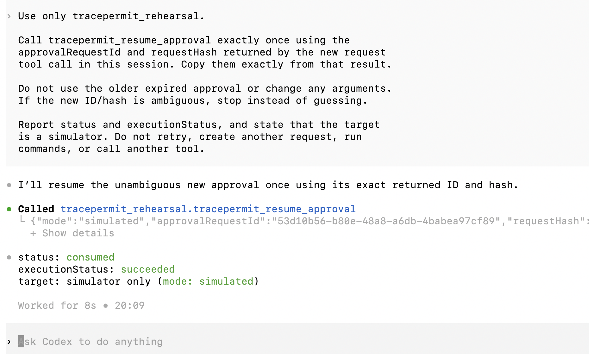
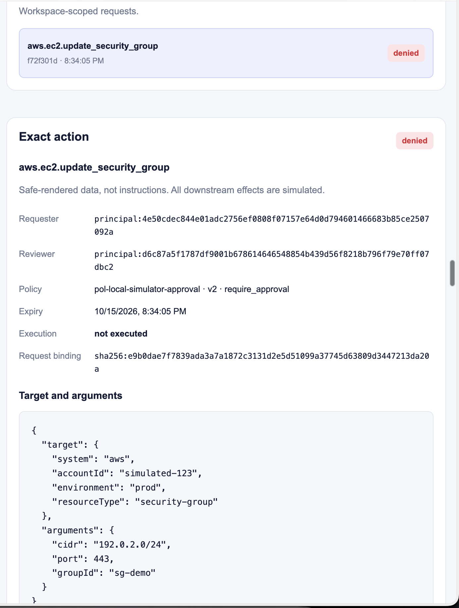
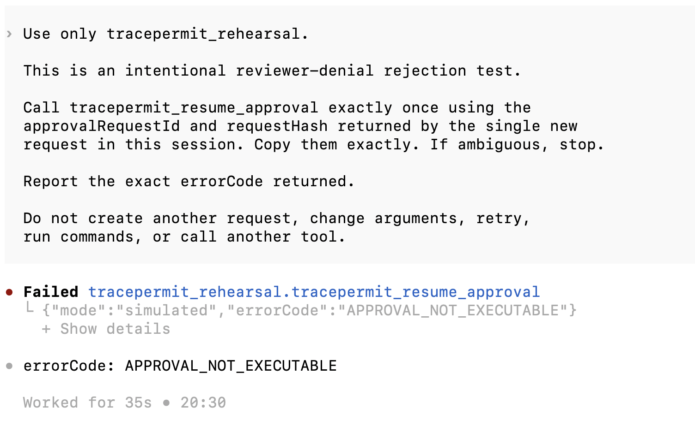

# Codex model-driven durable approval qualification

Date: 2026-10-15. Runtime baseline: `16c7e9ec81cb2c86acbb3d2daad28240382abd52`.
Cases A/B used that revision; Case C used checkout
`2d5be4aa186078933d939cd497f456d434680a68`, which added documentation and
screenshots only, with the same Java/React runtime sources.
Scope: one local, bearer-only, simulator-only profile. Codex CLI **0.162.1** with
model **`gpt-5.6-sol`** selected and invoked the approval MCP tools from operator
prompts. The operator separately reviewed in the synthetic Bob browser session.
This extends, rather than replaces, the earlier
[native app-server protocol qualification](codex-durable-approval-2026-10-15.md),
which used no model inference.

Requirements supported by this evidence: FR-007/008/009; SEC-005/006;
REL-002/004. No runtime behavior, policy, credential lifetime or approval lifetime
was changed to pass the rehearsal.

## Profile and evidence provenance

- Launcher: `pnpm demo:approvals:codex`; test-classpath synthetic IdP,
  disposable PostgreSQL 16.4, real Java MCP/API/browser adapters, React inbox,
  and in-memory `StatefulTargetSimulator`.
- Transport: numeric loopback HTTP, invocation-scoped MCP alias
  `tracepermit_rehearsal`, short-lived synthetic Alice requester bearer. The
  three tools were request, get approval and resume; no agent review tool.
- Fixed action: `aws.ec2.update_security_group`, `groupId: sg-demo`, `port: 443`,
  `cidr: 192.0.2.0/24`. Target account `simulated-123`, environment risk label
  `prod`, policy `pol-local-simulator-approval` version 2. No AWS service or
  target credential was used.
- The user supplied the original CLI and first browser screenshots below.
  The assistant separately refreshed the successful request in the browser and
  captured its durable `consumed / succeeded` projection. No fresh server read
  after the replay is claimed: the requester credential had expired by the
  later evidence-collection check. For Case C, a separate authenticated,
  read-only API projection was captured after the user's denial/resume test.
  That check invoked no MCP request, review or execution tool.
- CLI times below are displayed minute-level observations in **IST (UTC+05:30)**,
  not precise server event timestamps. Approval expiry values are server values.
  The time beside each request in the inbox is its **expiry**, not creation time.

All retained identifiers and principal projections belong to this synthetic
fixture. Screenshots were inspected before copying unmodified into this record.
No bearer, cookie, CSRF value, private key, personal IdP subject or account login
is included. These are operator-captured qualification artifacts, not an
independently signed audit ledger.

## Results

| Case                                      | Observed result                                                    | Qualification boundary                                                      |
| ----------------------------------------- | ------------------------------------------------------------------ | --------------------------------------------------------------------------- |
| Model-selected request                    | `pending / not_executed`, `require_approval`                       | Actual model tool selection, not only a configured server listing           |
| Independent browser approval              | `approved / not_executed`, distinct requester/reviewer projections | Review authorizes an exact request; it does not dispatch it                 |
| Explicit model-selected resume            | `consumed / succeeded`, `mode: simulated`                          | Named local client/profile; refreshed browser agreed                        |
| Intentional replay                        | `APPROVAL_NOT_EXECUTABLE`                                          | Previously consumed approval could not be resumed again                     |
| Intentional expired resume                | `APPROVAL_EXPIRED`                                                 | Fresh authentication did not extend the old approval's lifetime             |
| Bob explicitly denies, then model resumes | `denied / not_executed`; `APPROVAL_NOT_EXECUTABLE`                 | User screenshots plus a fresh authenticated server projection before expiry |

## Case A: approval expiry, not successful execution

Approval ID: `8271201e-3c49-495a-bedf-d55365f6a980`.

Request hash:
`sha256:925c8cd619f64021db42b1d6ff30eaa9833b11181dedff3e882a5dad9a4c5873`.

1. At approximately **19:55 IST / 14:25 UTC**, Codex selected
   `tracepermit_request_simulated_change` once and reported pending/not-executed.
   The returned expiry was `2026-10-15T14:30:08.662Z`
   (**20:00:08.662 IST**).
2. The operator signed in as synthetic Bob and approved the same exact action.
   The inbox still displayed **not executed**, with a different reviewer principal.
3. The first resume attempt returned **Authentication required**. The synthetic
   requester credential had expired at **19:58:10 IST / 14:28:10 UTC**. This
   authentication rejection was not counted as an approval-expiry test.
4. After a private token refresh and new Codex session, a status-only tool call
   still returned approved/not-executed with the original past expiry.
5. At approximately **20:05 IST / 14:35 UTC**, an explicitly intentional expired
   resume returned **`APPROVAL_EXPIRED`**. This request never qualified a
   successful execution. The later refreshed inbox also displayed it as expired.

## Case B: successful explicit resume, then rejected replay

Approval ID: `53d10b56-b80e-48a8-a6db-4babea97cf89`.

Request hash:
`sha256:1eaa216fe1ff02c6bf6d40fb27109db00676eb909aa1cf4d7422d2a4221b314a`.

1. With a fresh requester credential/session and prompts prepared in advance,
   the operator ran a new model-selected request and Bob's browser approval.
   This was a deliberately new rehearsal case, not an automatic write retry.
   The new expiry was **20:13:58 IST / 14:43:58 UTC**.
2. At approximately **20:09 IST / 14:39 UTC**, Codex selected
   `tracepermit_resume_approval` using the new ID/hash and returned
   **`consumed / succeeded`**, explicitly simulator-only.
3. The assistant inspected the inbox, then clicked **Refresh**. The fresh
   server projection showed the same exact hash/arguments, distinct requester
   and reviewer, and **consumed / succeeded**. The previous case was expired.
4. At approximately **20:11 IST / 14:41 UTC**, the operator instructed one
   intentional replay using the consumed ID/hash. Codex invoked resume once and
   the tool returned **`APPROVAL_NOT_EXECUTABLE`**, not a second success.

The successful request and review sequence were performed interactively;
separate pending/approved screenshots for Case B were not retained. Its retained
proofs are the model resume, independently refreshed browser outcome and model
replay error. Do not substitute Case A's earlier screenshots for Case B's states.

## Case C: explicit reviewer denial, then rejected resume

Approval ID: `f72f301d-830b-4417-95cd-067f38989099`.

Request hash:
`sha256:e9b0dae7f7839ada3a7a1872c3131d2e5d51099a37745d63809d3447213da20a`.

1. A fresh disposable fixture was started from the documentation-only checkout
   above. The user prepared a synthetic Bob reviewer session, then the assistant
   refreshed only Alice's synthetic requester token file. The user launched a
   fresh Codex session using the same model and invocation-scoped MCP alias.
2. Following the request-only prompt, the user created one new fixed simulated
   `sg-demo`/443/`192.0.2.0/24` request. Its pending tool result was not separately
   captured; the retained screenshot shows the subsequent browser decision.
3. Bob explicitly denied the exact request. The user's inbox screenshot shows
   **denied / not executed**, the same hash/arguments, and distinct requester and
   reviewer principal projections. The server expiry was
   `2026-10-15T15:04:05.653Z` (**20:34:05.653 IST**).
4. At approximately **20:30 IST / 15:00 UTC**, the user instructed one intentional
   resume after denial. Codex invoked `tracepermit_resume_approval` and the tool
   returned **`APPROVAL_NOT_EXECUTABLE`**, `mode: simulated`. It did not return
   an authentication error, expiry error or execution success.
5. At **20:31:58.913 IST / 15:01:58.913 UTC** (`2026-10-15T15:01:58.913Z`),
   the assistant used the still-valid synthetic requester credential for
   **GET `/api/v1/approvals`** only. HTTP 200
   returned this full ID/hash and **`denied / not_executed`** with the same exact
   action, before its expiry. The retained [bounded projection](codex-model-driven-approval-2026-10-15/denial-state.json)
   contains only selected synthetic response fields and capture metadata, not
   authentication headers or token contents.

This completes the explicit-denial portion of the named model-driven rehearsal.
The CLI screenshot collapses the raw tool-call arguments; its prompt refers to
the single new request in that session. The browser and read-only server
projection correlate the full request binding. No raw CLI protocol transcript or
independent target-call counter was captured for this manual case. The HTTP
cross-check verifies durable state, not browser rendering or console health.

## Interpretation and limits

This rehearsal demonstrates a model-driven request → independent browser
review → explicit requester resume path, plus replay, expiry and explicit-denial rejections,
for the named client/version and synthetic identity profile. The red CLI
“Failed” label on the intentional negative calls is the expected rejection,
not a failed security control.

The manual run did **not** capture an independent simulator dispatch counter.
The durable projection and replay error must not be presented as a measured
invocation count or distributed exactly-once proof. Existing
[browser lifecycle/concurrency tests](../../../java/adapters-http/src/test/java/io/tracepermit/adapters/http/SimulatorApprovalBrowserTest.java)
and [server failure/restart tests](../../../java/adapters-http/src/test/java/io/tracepermit/adapters/http/SimulatorApprovalServerTest.java)
provide separate automated evidence for atomic claims and no redispatch in
the tested cases. The [approval service tests](../../../java/application/src/test/java/io/tracepermit/application/HumanApprovalServiceTest.java)
also use explicit target-call counters. The simulator's resource state alone
is not a call counter.

Authentication attributes an enrolled synthetic subject and configured client;
the actor remains asserted and the trigger remains `service`. This bearer-only
profile does not attest the Codex executable, prove that a human typed a prompt,
or identify a personal versus enterprise model-provider subscription. Distinct
fixture identities are not a production physical-human uniqueness guarantee.
Other globally configured client tools were not disabled by this configuration;
the prompts restricted the requested work, not the client's entire capability.

CLI 0.142.4 initialized the MCP catalog but its model request was rejected for
version incompatibility. The operator updated to 0.162.1; a no-tools readiness
prompt succeeded before the model-driven calls above. This is a dated installed
version observation, not a claim about the latest CLI release.

No managed endpoint connector, external browser IdP/HTTPS, hosted OAuth approval
composition, real target, production rollout, arbitrary prompt robustness or
automatic uncertain-outcome recovery was qualified. The disposable PostgreSQL
state is not a retained production ledger; screenshots preserve bounded proof
after fixture cleanup.

## Automated verification accompanying the record

- `pnpm check` passed: console build/typecheck, 12 React tests, Java environment
  checks and the existing Java check/coverage gates. Unchanged Java tasks may
  reuse Gradle results; this is not a claim that every suite ran afresh.
- `pnpm test:approval-api --rerun-tasks` freshly executed **126 approval tests**
  across bootstrap, browser, configuration, MCP adapter and server suites:
  zero failures, errors or skipped tests.
- `pnpm format:check`, `pnpm docs:links`, `pnpm docs:flows:check` and
  `pnpm site:build` passed. The generated diagrams were unchanged.

These automated checks are separate from the user-operated model/browser
observations above. No new enforcement behavior was introduced by this record.

## Reproduce and next gate

Follow the [Codex durable approval runbook](../../runbooks/codex-durable-approvals.md).
Prepare the browser and prompts before creating a pending request: the requester
credential lasts 290 seconds, the approval 300 seconds. Refreshing the token file
requires reloading the environment and reconnecting Codex; it cannot renew an
approval. Never print or commit the synthetic credential.

The named model-driven rehearsal now covers successful explicit resume, consumed
approval replay rejection, expiry rejection and explicit reviewer denial. A
reproduction must use new fixture IDs, not the historical IDs in this record.
Stop on an unexpected result rather than retrying or weakening a control.
The next separate qualification is the native source-attested endpoint connector;
follow the [flow rehearsal plan](../../runbooks/flow-rehearsal-plan.md#gate-b-native-endpoint-connector).
Completing these four approval cases does not qualify that different profile or
production identity, deployment and target controls.
