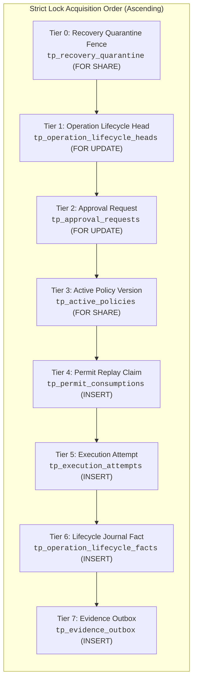
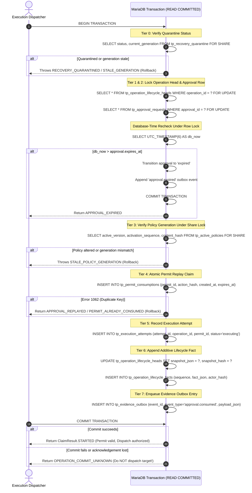
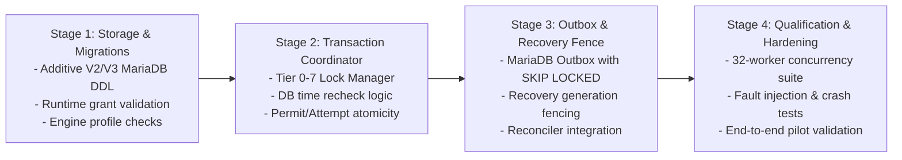

# MariaDB authority transaction and durable lifecycle composition

- Status: Proposed design for coordinator review; implementation pending.
- Requirements: FR-003, FR-007, FR-008, FR-010, FR-012, FR-015;
  SEC-001, SEC-002, SEC-003, SEC-005, SEC-006, SEC-009, SEC-012;
  REL-001, REL-002, REL-004, REL-005;
  DATA-001, DATA-002, DATA-004;
  OPS-002, OPS-004;
  PORT-001, PORT-002, PORT-003.
- Decision records: [ADR 0066](../architecture/0066-mariadb-permit-consumption-foundation.md),
  [ADR 0068](../architecture/0068-versioned-business-operation-contract.md),
  [ADR 0070](../architecture/0070-durable-business-operation-registration.md),
  [ADR 0071](../architecture/0071-uncommitted-operation-transition-proposals.md).
- Dependencies: Unmerged [PR #101](https://github.com/hemantkgupta/tracepermit/pull/101)
  (`codex/durable-operation-lifecycle`, pending withdrawal and additive lifecycle journal).
- Qualification runbook: [MariaDB authority transaction qualification plan](../runbooks/mariadb-authority-transaction-qualification-plan.md).

---

## 1. Executive summary and problem boundary

TracePermit enforces a strict central invariant: **every simulated side effect is
evaluated and authorized before execution**. In the initial reference architecture,
this invariant relies on PostgreSQL-specific transactional mechanics, including
`FOR UPDATE` / `FOR SHARE OF` row locking, transactional DDL, trigger-checked
policy generation tables, `clock_timestamp()` microsecond wall clocks, and a
composed multi-table transaction spanning approvals, execution attempts, permits,
and the evidence outbox.

An enterprise design partner deployment requires support for **Amazon RDS for
MariaDB**. However, changing a JDBC URL or mapping SQL syntax does not preserve
transactional isolation, locking semantics, timestamp resolution, or failure
recovery modes. Specifically:

1. **Locking semantics**: MariaDB InnoDB uses gap locks and next-key locks under
   its default `REPEATABLE READ` isolation, creating severe deadlock risks under
   concurrent approval and claim patterns. Under `READ COMMITTED`, gap locking is
   disabled for non-unique lookups, but row-lock acquisition order across disparate
   tables must remain strictly canonical.
2. **DDL non-transactionality**: Unlike PostgreSQL, MariaDB automatically issues
   an implicit `COMMIT` before and after any DDL statement (`CREATE TABLE`,
   `ALTER TABLE`, etc.). A failed migration cannot be rolled back by Flyway;
   schema corruption leaves an unrecoverable partial migration.
3. **Clock semantics**: PostgreSQL `clock_timestamp()` reflects real-time statement
   execution within a transaction, whereas MariaDB `NOW()` or `CURRENT_TIMESTAMP()`
   freezes at the start of the transaction. Evaluating authorization expiry during
   or after lock contention requires MariaDB `UTC_TIMESTAMP(6)` or an explicit
   clock re-sample.
4. **Error mapping**: Duplicate key violations produce MariaDB vendor error code
   `1062` (SQLState `23000`), whereas PostgreSQL yields SQLState `23505`. Lock
   wait timeouts produce MariaDB vendor error code `1205` (SQLState `40001` or
   `HY000`), and deadlocks produce error code `1213`.
5. **Architectural fragmentation**: TracePermit currently has two separate durable
   persistence designs: the legacy PostgreSQL approval/execution/outbox engine
   ([`PostgresDurableEnforcementState`](../../java/persistence-postgres/src/main/java/io/tracepermit/persistence/postgres/PostgresDurableEnforcementState.java)),
   and the modern multi-engine operations repository ([ADR 0070](../architecture/0070-durable-business-operation-registration.md)
   and unmerged PR #101 / ADR 0072). Merely creating a duplicate MariaDB enforcement
   state without reconciling these contracts would fragment the lifecycle model.

This design specifies a unified, dialect-portable authority transaction contract
for MariaDB 11.4.13 (primary), MariaDB 10.6.25 (transitional), and PostgreSQL 16.4
(parity control). It unifies business operations, approval decisions, permit
replay claims, execution attempts, and the evidence outbox into an atomic,
deadlock-free, fail-closed transaction boundary.

---

## 2. Storage engine baseline and database invariants

### 2.1 Engine matrix and configuration

TracePermit mandates the following database engine profiles:

| Role                | Database product | Exact engine version | Default storage engine |
| :------------------ | :--------------- | :------------------- | :--------------------- |
| **Primary**         | MariaDB          | `11.4.13`            | InnoDB                 |
| **Transitional**    | MariaDB          | `10.6.25`            | InnoDB                 |
| **Parity baseline** | PostgreSQL       | `16.4`               | Heap / standard        |

Any unknown product, major/minor release, or unrecognized patch version fails
closed during startup validation.

### 2.2 Storage engine invariants (MariaDB)

1. **InnoDB storage engine**: Every TracePermit table explicitly declares
   `ENGINE=InnoDB`. Tables using MyISAM, Aria, Memory, or system engines are
   strictly rejected.
2. **Binary ASCII keys and identifiers**: All primary keys, foreign keys, UUIDs,
   content hashes, and tenant/workspace identifiers use:
   `VARCHAR(64) CHARACTER SET ascii COLLATE ascii_bin` or
   `CHAR(64) CHARACTER SET ascii COLLATE ascii_bin`. This eliminates collation
   mismatches, trailing-space insensitivity, and case-folding vulnerabilities.
3. **Strict SQL mode**: The database connection pool and server configuration must
   enforce:
   `STRICT_TRANS_TABLES,ERROR_FOR_DIVISION_BY_ZERO,NO_AUTO_CREATE_USER,NO_ENGINE_SUBSTITUTION`.
4. **Microsecond UTC wall-clock**: All timestamp columns are defined as
   `DATETIME(6) NOT NULL`. Timestamps are generated using MariaDB `UTC_TIMESTAMP(6)`.
   Time-zone-dependent types (`TIMESTAMP`) that perform implicit local conversions
   are prohibited.
5. **Binary logging and durability**:
   - `innodb_flush_log_at_trx_commit = 1` (flush log to disk at every commit).
   - `sync_binlog = 1` (synchronous binary log durability when binlog is enabled).
   - `binlog_format = ROW` (strictly row-based binary logging to avoid non-deterministic
     statement-level replication anomalies).
6. **Forbidden constructs**:
   - `INSERT IGNORE` is strictly prohibited: it silences foreign key, not-null,
     and data-truncation failures, masking severe security defects.
   - `REPLACE INTO` is strictly prohibited: it executes an implicit `DELETE`
     followed by `INSERT`, breaking foreign key cascades and audit history.
   - Broad exception catching that masks vendor error codes is prohibited.

---

## 3. Composed entity model and lock ordering

To prevent deadlock under high concurrency, all transactions that mutate or read
with intent must acquire row locks in a strictly ascending order across entity
tiers.

### 3.1 Entity lock tier hierarchy



### 3.2 Lock acquisition rules

1. **Ascending acquisition**: A transaction may acquire locks at Tier $N$ only if
   it holds no locks at Tier $> N$. Backwards acquisition (e.g. locking Tier 1
   while holding Tier 2) is strictly prohibited.
2. **Root anchor lock**: The Business Operation Lifecycle Head (`tp_operation_lifecycle_heads`)
   serves as the primary mutual exclusion anchor for any business operation. Once
   held `FOR UPDATE`, no concurrent transaction can modify the operation's
   lifecycle, approval state, or execution claim.
3. **Shared policy lock**: Active policy verification uses `FOR SHARE` (or MariaDB
   `LOCK IN SHARE MODE`). This prevents policy administrators from deactivating or
   altering a policy version while an authority transaction is validating it.
4. **Query timeout**: Every SQL statement enforces a strict query timeout of
   5,000 milliseconds (`Statement.setQueryTimeout(5)`). This prevents thread
   exhaustion in the event of unforeseen lock contention or network stalling.

---

## 4. Authority transaction mechanics: permit consumption and attempt claim

The core authority transaction binds approval verification, permit issuance,
replay prevention, and execution attempt creation into a single atomic commit.

### 4.1 Transaction execution sequence



### 4.2 Database-time rechecks under lock

To eliminate race conditions caused by thread scheduling or lock-wait latency:

1. **Clock re-sampling**: Immediately after acquiring the `FOR UPDATE` lock on
   `tp_approval_requests`, the transaction executes:
   ```sql
   SELECT UTC_TIMESTAMP(6) AS current_db_time;
   ```
2. **Expiration evaluation**: If `current_db_time > approval.expires_at`:
   - The pending approval has expired while waiting for the lock.
   - The transaction transitions the approval to `expired` with reason `APPROVAL_EXPIRED`.
   - An `approval.expired` evidence record is inserted into `tp_evidence_outbox`.
   - The transaction commits the expiration and returns `ApprovalConsumptionStatus.APPROVAL_EXPIRED`.
   - **No permit is issued and no execution attempt is created.**
3. **Monotonicity assertion**: If `current_db_time < approval.updated_at`, the
   database clock has regressed. The transaction immediately rolls back and raises
   `DATABASE_CLOCK_REGRESSION` fail-closed.

---

## 5. Cancellation vs. claim races (exactly-one-winner semantics)

A critical security vulnerability in distributed systems is the race condition
between an owner withdrawing a request and a reviewer or automated worker claiming
it for execution.

### 5.1 Race arbitration via Tier 1 lock

Both operations contend for the same Tier 1 lock on `tp_operation_lifecycle_heads`:

```mermaid
flowchart TD
    Start["Concurrent Requests:<br/>1. Requester calls withdraw()<br/>2. Worker calls consumeAndClaim()"] --> Contention["Contend for Tier 1 Row Lock on Head<br/><code>tp_operation_lifecycle_heads FOR UPDATE</code>"]

    Contention -->|withdraw() acquires lock first| PathA["Path A: Requester Wins Lock"]
    PathA --> CheckPendingA{"Is authorization status<br/>'evaluating' or 'pending'?"}
    CheckPendingA -->|Yes| CancelSuccess["1. Set status = 'cancelled'<br/>2. Append withdrawal fact<br/>3. Enqueue 'operation.cancelled' outbox<br/>4. COMMIT"]
    CheckPendingA -->|No| CancelFail["Return 409 APPROVAL_NOT_CANCELLABLE<br/>ROLLBACK"]
    CancelSuccess --> WorkerLockA["Worker acquires lock second"]
    WorkerLockA --> WorkerCheckA{"Is status 'approved'?"}
    WorkerCheckA -->|No, it is 'cancelled'| WorkerRejectA["Worker refused:<br/>APPROVAL_NOT_EXECUTABLE<br/>Permit NOT claimed, Target NOT called"]

    Contention -->|consumeAndClaim() acquires lock first| PathB["Path B: Worker Wins Lock"]
    PathB --> CheckApprB{"Is status 'approved'<br/>and unexpired?"}
    CheckApprB -->|Yes| ClaimSuccess["1. Set status = 'consumed'<br/>2. Insert permit claim (Tier 4)<br/>3. Insert attempt (Tier 5)<br/>4. Append fact & outbox<br/>5. COMMIT"]
    CheckApprB -->|No| ClaimFail["Return APPROVAL_NOT_EXECUTABLE<br/>ROLLBACK"]
    ClaimSuccess --> RequesterLockB["Requester acquires lock second"]
    RequesterLockB --> RequesterCheckB{"Is status 'evaluating'/'pending'?"}
    RequesterCheckB -->|No, it is 'consumed'| RequesterRejectB["Requester refused:<br/>409 APPROVAL_NOT_CANCELLABLE<br/>Cancellation rejected"]
```

### 5.2 Elimination of partial states

Because both operations are fully enclosed within their respective transactions,
there is **zero possibility** of a partial state where:

- A permit is claimed, but the request is marked `cancelled`.
- A request is marked `cancelled`, but the target side effect is dispatched.

---

## 6. Separation of database transactions from external side effects

Holding a database lock while performing an external network call causes connection
pool exhaustion, query timeouts, and cascading system failure. Furthermore, if
the external call succeeds but the transaction subsequently fails to commit,
the system incurs an untracked external side effect (a ghost modification).

### 6.1 Four-phase execution lifecycle

TracePermit strictly mandates a four-phase execution pattern:

```text
┌─────────────────────────────────────────────────────────────────────────────┐
│ Phase 1: Pre-Transaction Validation (In-Memory, No DB Lock)                 │
│ - Validate canonical action schema and hashes.                              │
│ - Validate trusted tenant and actor identity tokens.                        │
│ - Preflight target repository and permission allowlists.                    │
└──────────────────────────────────────┬──────────────────────────────────────┘
                                       │
┌──────────────────────────────────────▼──────────────────────────────────────┐
│ Phase 2: Authority Transaction (Atomic DB Commit, Tiers 0–7)                 │
│ - Lock operation head and approval row FOR UPDATE.                          │
│ - Recheck DB time and policy generation.                                    │
│ - Consume permit (INSERT into tp_permit_consumptions).                      │
│ - Record execution attempt (status='executing').                            │
│ - Append lifecycle fact and outbox entry.                                   │
│ - COMMIT transaction and RELEASE database connection.                       │
└──────────────────────────────────────┬──────────────────────────────────────┘
                                       │ (DB connection released!)
┌──────────────────────────────────────▼──────────────────────────────────────┐
│ Phase 3: External Side Effect (Target Dispatch, NO DB LOCK HELD)            │
│ - Dispatch request to target system (e.g. GitHub Draft PR API).             │
│ - Await target HTTP response or network timeout.                            │
│ - Collect target execution receipt or error diagnostic.                     │
└──────────────────────────────────────┬──────────────────────────────────────┘
                                       │
┌──────────────────────────────────────▼──────────────────────────────────────┐
│ Phase 4: Completion Transaction (Atomic DB Commit)                          │
│ - Open new DB connection and acquire Tier 1 lock.                           │
│ - Transition attempt to 'succeeded', 'failed', or 'unknown'.                │
│ - Append completion lifecycle fact and outbox event.                        │
│ - COMMIT transaction.                                                       │
└─────────────────────────────────────────────────────────────────────────────┘
```

**Rule**: Under no circumstances may an HTTP call to GitHub, Okta, Auth0, AWS,
or any external API be invoked while a database transaction is open.

---

## 7. Commit uncertainty, crash schedules, and stale-worker fencing

### 7.1 Commit acknowledgement uncertainty

When `connection.commit()` fails or times out:

1. The client **cannot distinguish** whether MariaDB committed the redo log
   prior to network drop or rolled back the transaction.
2. The outcome is classified strictly as **`OPERATION_COMMIT_UNKNOWN`**.
3. **Fail-Closed Rule**: A return of `OPERATION_COMMIT_UNKNOWN` **never conveys
   dispatch authority**. The dispatcher must abort and not proceed to Phase 3.
4. **Reconciliation**: A subsequent retry by the client using the same scoped
   idempotency key will re-query the durable database state. If the prior
   transaction committed, the store returns the existing record; if it rolled
   back, the retry proceeds cleanly.

### 7.2 Stale-worker and recovery-generation fences

When a node crashes or a network partition occurs, a paused or partitioned
worker must not wake up and execute stale authority.

1. **Monotonic recovery generation**: The database maintains a cluster-wide
   generation counter in `tp_recovery_quarantine`:
   ```sql
   CREATE TABLE tp_recovery_quarantine (
       tenant_id VARCHAR(64) CHARACTER SET ascii COLLATE ascii_bin NOT NULL PRIMARY KEY,
       current_generation BIGINT UNSIGNED NOT NULL,
       quarantine_status VARCHAR(32) CHARACTER SET ascii COLLATE ascii_bin NOT NULL,
       fenced_at DATETIME(6) NOT NULL,
       reason_code VARCHAR(64) CHARACTER SET ascii COLLATE ascii_bin NOT NULL
   ) ENGINE=InnoDB;
   ```
2. **Generation verification**: Every authority transaction checks `current_generation`
   against the worker's startup generation under Tier 0.
3. **Restart fence**: On service restart or crash recovery, an administrative
   command increments `current_generation`. Any in-flight worker holding an
   older generation counter is fenced out immediately upon its next statement.

### 7.3 Older-backup resurrection limitation

> [!CAUTION]
> **Fundamental Storage Limitation**: If an operator restores a database snapshot
> from a backup created at $T_{\text{backup}}$, all transactions committed between
> $T_{\text{backup}}$ and the crash are erased in storage. In this restored state,
> already-consumed permits appear unconsumed, and withdrawn operations appear pending.

A database cannot internally detect that it was restored to an older physical
snapshot. Therefore, TracePermit mandates an **operational recovery boundary**:

- **Mandatory post-restore fence**: Immediately following any backup restoration,
  and prior to admitting any network traffic, an operator must run:
  ```bash
  tracepermit-admin --force-quarantine --bump-generation
  ```
- This invalidates all worker generation tokens and places the system into
  fail-closed quarantine until an audit of external target systems (e.g. GitHub PR
  activity) can reconcile unconfirmed states.

---

## 8. Least-privilege database user grants

To prevent privilege escalation and protect data integrity, TracePermit requires
two distinct database credentials.

### 8.1 Migration user (`tracepermit_migration`)

Used exclusively during stopped-service installation and explicit additive upgrades.

```sql
-- MariaDB Migration Grants
GRANT SELECT, INSERT, UPDATE, CREATE, ALTER, INDEX
  ON `tracepermit`.*
  TO 'tracepermit_migration'@'%' IDENTIFIED BY '...';
```

### 8.2 Runtime user (`tracepermit_runtime`)

Used by running application instances. **`DELETE`, `DROP`, and administrative
privileges are strictly denied.**

```sql
-- MariaDB Runtime Grants
-- 1. Base read/write on append-only and attempt tables
GRANT SELECT, INSERT
  ON `tracepermit`.`tp_business_operations`
  TO 'tracepermit_runtime'@'%';

GRANT SELECT, INSERT
  ON `tracepermit`.`tp_business_operation_facts`
  TO 'tracepermit_runtime'@'%';

GRANT SELECT, INSERT
  ON `tracepermit`.`tp_operation_lifecycle_facts`
  TO 'tracepermit_runtime'@'%';

GRANT SELECT, INSERT
  ON `tracepermit`.`tp_permit_consumptions`
  TO 'tracepermit_runtime'@'%';

GRANT SELECT, INSERT
  ON `tracepermit`.`tp_execution_permits`
  TO 'tracepermit_runtime'@'%';

GRANT SELECT, INSERT, UPDATE
  ON `tracepermit`.`tp_execution_attempts`
  TO 'tracepermit_runtime'@'%';

GRANT SELECT, INSERT, UPDATE
  ON `tracepermit`.`tp_evidence_outbox`
  TO 'tracepermit_runtime'@'%';

GRANT SELECT, INSERT, UPDATE
  ON `tracepermit`.`tp_approval_requests`
  TO 'tracepermit_runtime'@'%';

-- 2. Column-scoped update on lifecycle heads (only snapshot json and hash)
GRANT SELECT, INSERT, UPDATE (snapshot_hash, snapshot_json, updated_at)
  ON `tracepermit`.`tp_operation_lifecycle_heads`
  TO 'tracepermit_runtime'@'%';

-- 3. Read-only access to policies, quarantine, and schema history
GRANT SELECT
  ON `tracepermit`.`tp_active_policies`
  TO 'tracepermit_runtime'@'%';

GRANT SELECT
  ON `tracepermit`.`tp_policy_versions`
  TO 'tracepermit_runtime'@'%';

GRANT SELECT, UPDATE (quarantine_status, fenced_at, reason_code)
  ON `tracepermit`.`tp_recovery_quarantine`
  TO 'tracepermit_runtime'@'%';

GRANT SELECT
  ON `tracepermit`.`flyway_schema_history`
  TO 'tracepermit_runtime'@'%';
```

---

## 9. Migration boundaries and non-transactional DDL handling

### 9.1 MariaDB implicit commit hazard

In MariaDB, any DDL statement implicitly commits the current transaction. If a
migration contains two statements:

```sql
ALTER TABLE tp_operation_lifecycle_heads ADD COLUMN metadata_json TEXT;
ALTER TABLE invalid_table ADD COLUMN foo INT; -- Fails!
```

The first statement commits immediately. The second fails, but the first **cannot
be rolled back**. Flyway records the migration as failed, leaving the schema in a
corrupt intermediate state.

### 9.2 Safe migration protocol

1. **Validate-only startup**: Application instances never call `flyway.migrate()`
   on startup. They call `validateExisting()`, which verifies Flyway checksums,
   object inventories, and storage engines without executing DDL.
2. **Single-statement migration units**: Every MariaDB Flyway migration must
   contain exactly one logical schema mutation, or be wrapped in an explicit
   pre-validation check script.
3. **Offline execution**: Schema migrations are executed only when application
   nodes are stopped, preventing concurrent DDL and DML lock conflicts.
4. **No schema-downgrade scripts**: Rollback of a schema migration is executed by
   restoring a verified pre-migration backup, never by applying heuristic `DROP`
   scripts.

---

## 10. Reuse of existing ports vs. new components

To maintain architectural integrity and avoid maintaining two divergent lifecycle
engines, the MariaDB implementation reuses existing ports from main and PR #101:

| Component / Port                       | Origin                              | Proposed MariaDB reuse                                                                                    |
| :------------------------------------- | :---------------------------------- | :-------------------------------------------------------------------------------------------------------- |
| `BusinessOperationRepository`          | ADR 0070 / `persistence-operations` | **Direct reuse**: Shared across PostgreSQL and MariaDB.                                                   |
| `BusinessOperationLifecycleRepository` | PR #101 / ADR 0072                  | **Direct reuse**: Head lock and withdrawal journal are portable.                                          |
| `BusinessOperationTransitionPlanner`   | ADR 0071 / `application`            | **Direct reuse**: Pure Java state transitions, zero DB code.                                              |
| `MariaDbPermitConsumptionStore`        | ADR 0066 / `persistence-mariadb`    | **Incorporate into composed transaction**: Replay store primitives remain valid.                          |
| `DurableEnforcementState`              | `execution`                         | **Implement MariaDB provider**: Port PostgreSQL implementation to use composed Tier 0–7 lock coordinator. |
| `EvidenceOutboxPublisher`              | `application`                       | **Direct reuse**: Outbox polling and publication logic is engine-agnostic.                                |

### 10.1 Unresolved decisions for coordinator review

1. **Module location**: Should the composed MariaDB authority engine reside in
   `persistence-mariadb` or should `persistence-operations` expand to become the
   sole multi-engine persistence provider?
   - _Recommendation_: Expand `persistence-mariadb` to host the full composed
     `MariaDbDurableEnforcementState`, keeping `persistence-operations` focused on
     operation registration.
2. **Outbox leasing mechanism**: PostgreSQL uses `FOR UPDATE SKIP LOCKED` for
   concurrent outbox consumers. MariaDB 10.6+ supports `SKIP LOCKED`. Should
   TracePermit standardize on `SKIP LOCKED` across both engines?
   - _Recommendation_: Yes. Both MariaDB 11.4.13 and 10.6.25 fully support
     `SELECT ... FOR UPDATE SKIP LOCKED`, enabling identical outbox polling.

---

## 11. Requirement-to-test traceability matrix

| Requirement ID | Description                       | Test Verification Case                        | Expected Engine Coverage            |
| :------------- | :-------------------------------- | :-------------------------------------------- | :---------------------------------- |
| **FR-003**     | Approval lifecycle transitions    | `testApprovalLifecycleTransitions`            | PG 16.4, MariaDB 11.4, MariaDB 10.6 |
| **FR-007**     | Execution attempt tracking        | `testExecutionAttemptStateRecording`          | PG 16.4, MariaDB 11.4, MariaDB 10.6 |
| **FR-008**     | Atomic replay prevention          | `testPermitReplayRejectionUnderConcurrency`   | PG 16.4, MariaDB 11.4, MariaDB 10.6 |
| **FR-010**     | Pending request withdrawal        | `testPendingOperationWithdrawal`              | PG 16.4, MariaDB 11.4, MariaDB 10.6 |
| **FR-012**     | Evidence outbox capture           | `testEvidenceOutboxAtomicityWithAttempt`      | PG 16.4, MariaDB 11.4, MariaDB 10.6 |
| **FR-015**     | Policy generation binding         | `testStalePolicyGenerationRejection`          | PG 16.4, MariaDB 11.4, MariaDB 10.6 |
| **SEC-001**    | Trusted context isolation         | `testCrossTenantScopeRejection`               | PG 16.4, MariaDB 11.4, MariaDB 10.6 |
| **SEC-002**    | Requester owner validation        | `testNonOwnerWithdrawalRejection`             | PG 16.4, MariaDB 11.4, MariaDB 10.6 |
| **SEC-003**    | Distinct reviewer rule            | `testSelfReviewRejection`                     | PG 16.4, MariaDB 11.4, MariaDB 10.6 |
| **SEC-005**    | Database-time recheck & expiry    | `testLockWaitDeadlineExpiry`                  | PG 16.4, MariaDB 11.4, MariaDB 10.6 |
| **SEC-006**    | Tenant partition isolation        | `testTenantDataIsolation`                     | PG 16.4, MariaDB 11.4, MariaDB 10.6 |
| **SEC-009**    | Recovery generation fencing       | `testStaleGenerationWorkerRejection`          | PG 16.4, MariaDB 11.4, MariaDB 10.6 |
| **SEC-012**    | Least-privilege grants            | `testRuntimeUserPermissionsBoundaries`        | MariaDB 11.4, MariaDB 10.6          |
| **REL-001**    | Multi-entity atomicity            | `testPartialWriteRollbackIntegrity`           | PG 16.4, MariaDB 11.4, MariaDB 10.6 |
| **REL-002**    | Deterministic conflict resolution | `testConcurrentWithdrawalVsClaimRace`         | PG 16.4, MariaDB 11.4, MariaDB 10.6 |
| **REL-004**    | Exactly-one-winner concurrency    | `testHighConcurrencyClaimContention32Workers` | PG 16.4, MariaDB 11.4, MariaDB 10.6 |
| **REL-005**    | Commit uncertainty handling       | `testLostCommitAcknowledgementFailClosed`     | PG 16.4, MariaDB 11.4, MariaDB 10.6 |
| **DATA-001**   | Schema & engine constraints       | `testDatabaseEngineProfileValidation`         | MariaDB 11.4, MariaDB 10.6          |
| **DATA-002**   | Immutable audit journal           | `testLifecycleJournalTamperResistance`        | PG 16.4, MariaDB 11.4, MariaDB 10.6 |
| **DATA-004**   | Byte bounds & strict JSON reader  | `testStrictStoredJsonParsing`                 | PG 16.4, MariaDB 11.4, MariaDB 10.6 |
| **OPS-002**    | Explicit migration boundaries     | `testValidateExistingRejectsUnmigrated`       | PG 16.4, MariaDB 11.4, MariaDB 10.6 |
| **OPS-004**    | Credential-safe diagnostics       | `testStorageExceptionDiagnosticSanitization`  | PG 16.4, MariaDB 11.4, MariaDB 10.6 |
| **PORT-001**   | Multi-engine portability          | `testFullSuiteAcrossAllThreeEngines`          | PG 16.4, MariaDB 11.4, MariaDB 10.6 |
| **PORT-002**   | Storage engine verification       | `testInnoDBStorageEngineEnforcement`          | MariaDB 11.4, MariaDB 10.6          |
| **PORT-003**   | Portable locking semantics        | `testLockOrderDeadlockAbsence`                | PG 16.4, MariaDB 11.4, MariaDB 10.6 |

---

## 12. Sequenced implementation split

To ensure safe, test-driven delivery without destabilizing main, implementation
must proceed in four distinct, reviewable stages:



1. **Stage 1 (Storage & Migrations)**:
   - Deliver additive Flyway migrations for MariaDB `persistence-mariadb`.
   - Implement empty-only database initialization and `validateExisting()` startup checks.
   - Add automated test verifying runtime user grant restrictions (no DELETE/DROP/ALTER).
2. **Stage 2 (Authority Transaction Coordinator)**:
   - Implement `MariaDbAuthorityTransactionCoordinator` implementing Tier 0–7 lock acquisition.
   - Implement microsecond database-time re-evaluation under row lock.
   - Deliver atomic `consumeAndClaim()` uniting permit claim, attempt creation, and fact journaling.
3. **Stage 3 (Outbox & Recovery Quarantine)**:
   - Implement MariaDB evidence outbox with `SELECT ... FOR UPDATE SKIP LOCKED`.
   - Implement `MariaDbRecoveryQuarantine` with generation fencing.
   - Implement commit-uncertainty mapping (`OPERATION_COMMIT_UNKNOWN`).
4. **Stage 4 (Qualification & Adversarial Hardening)**:
   - Execute full concurrency suite across MariaDB 11.4.13, 10.6.25, and PostgreSQL 16.4.
   - Run fault injection tests: network drops during commit, lock wait timeouts, and deadlock absence.
   - Coordinate final merge and update traceability matrix.
