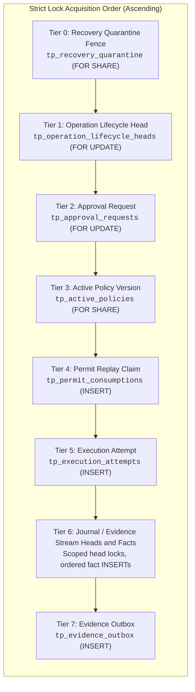
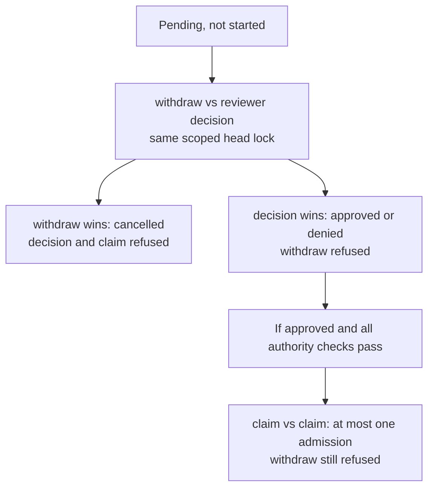
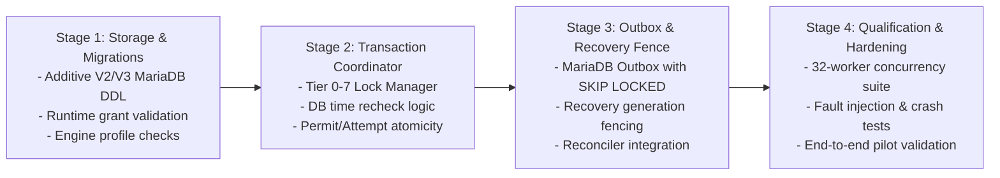

# MariaDB authority transaction and durable lifecycle composition

- Status: Proposed design for coordinator review; implementation pending.
- Requirements: FR-003, FR-007, FR-008, FR-009, FR-010, FR-012, FR-015;
  SEC-001, SEC-002, SEC-003, SEC-004, SEC-005, SEC-006, SEC-009, SEC-010, SEC-012, SEC-019;
  REL-001, REL-002, REL-004, REL-005;
  DATA-001, DATA-004;
  OPS-002, OPS-004;
  PORT-001, PORT-002, PORT-003.
- Decision records: [ADR 0066](../architecture/0066-mariadb-permit-consumption-foundation.md),
  [ADR 0068](../architecture/0068-versioned-business-operation-contract.md),
  [ADR 0070](../architecture/0070-durable-business-operation-registration.md),
  [ADR 0071](../architecture/0071-uncommitted-operation-transition-proposals.md).
- Dependencies: Merged [ADR 0072](../architecture/0072-durable-pending-operation-withdrawal.md)
  (internal pending withdrawal/journal library) and
  [ADR0075](../architecture/0075-github-business-operation-binding.md)
  (pure GitHub data-binding bridge). Neither grants execution authority.
- Qualification runbook: [MariaDB authority transaction qualification plan](../runbooks/mariadb-authority-transaction-qualification-plan.md).

---

## 1. Executive summary and problem boundary

TracePermit enforces a strict central invariant: **every simulated side effect is
evaluated and authorized before execution**. In the initial reference architecture,
this invariant relies on PostgreSQL-specific transactional mechanics, including
`FOR UPDATE` / `FOR SHARE OF` row locking, transactional DDL, trigger-checked
policy generation tables, `clock_timestamp()` microsecond wall clocks, and a
composed multi-table transaction spanning approvals, execution attempts, permits,
and the evidence outbox.

An enterprise design partner deployment requires support for **Amazon RDS for
MariaDB**. However, changing a JDBC URL or mapping SQL syntax does not preserve
transactional isolation, locking semantics, timestamp resolution, or failure
recovery modes. Specifically:

1. **Locking semantics**: InnoDB's `REPEATABLE READ` gap/next-key locking differs
   from PostgreSQL. `READ COMMITTED` reduces gap locking, but uniqueness and
   foreign-key checks can still acquire locks. Canonical application lock order
   reduces risk; it does not prove deadlock freedom.
2. **DDL non-transactionality**: Many MariaDB DDL statements implicitly commit.
   Flyway cannot roll back an already committed preceding DDL statement. Partial
   migrations require stopped-writer investigation and explicit recovery, not
   automatic repair or a blanket claim of unrecoverable corruption.
3. **Clock semantics**: PostgreSQL `clock_timestamp()` reflects real-time statement
   execution within a transaction, whereas MariaDB `NOW()` or `CURRENT_TIMESTAMP()`
   is constant within a statement, not an entire transaction. `UTC_TIMESTAMP(6)`
   is also statement-time: use a **new statement after every authority lock has
   been acquired**, not a timestamp expression in a statement that may wait.
4. **Error mapping**: Duplicate key violations produce MariaDB vendor error code
   `1062` (SQLState `23000`), whereas PostgreSQL yields SQLState `23505`. Lock
   wait timeouts produce MariaDB vendor error code `1205` (SQLState `40001` or
   `HY000`), and deadlocks produce error code `1213`.
5. **Architectural fragmentation**: TracePermit currently has two separate durable
   persistence designs: the legacy PostgreSQL approval/execution/outbox engine
   ([`PostgresDurableEnforcementState`](../../java/persistence-postgres/src/main/java/io/tracepermit/persistence/postgres/PostgresDurableEnforcementState.java)),
   and the modern multi-engine operations repository ([ADR 0070](../architecture/0070-durable-business-operation-registration.md)
   and merged ADR 0072). Merely creating a duplicate MariaDB enforcement
   state without reconciling these contracts would fragment the lifecycle model.

This design specifies a unified, dialect-portable authority transaction contract
for MariaDB 11.4.13 (primary), MariaDB 10.6.25 (transitional), and PostgreSQL 16.4
(parity control). It unifies business operations, approval decisions, permit
replay claims, execution attempts, and the evidence outbox into an atomic,
fail-closed transaction boundary. This is a proposal, not a migration, runtime
provider, RDS qualification, parity result or production-readiness claim.

All table/column names, new result codes and coordinator methods below are
**logical design placeholders** unless linked to existing source. They are not
copy/paste DDL or executable APIs. Preserve existing V1/V2 migration bytes and
contract limits; decide any new additive schema in an implementation ADR.

---

## 2. Storage engine baseline and database invariants

### 2.1 Engine matrix and configuration

The proposed qualification matrix pins the following database engine profiles:

| Role                | Database product | Exact engine version | Default storage engine |
| :------------------ | :--------------- | :------------------- | :--------------------- |
| **Primary**         | MariaDB          | `11.4.13`            | InnoDB                 |
| **Transitional**    | MariaDB          | `10.6.25`            | InnoDB                 |
| **Parity baseline** | PostgreSQL       | `16.4`               | Heap / standard        |

Any unknown product, major/minor release, or unrecognized patch version fails
closed during startup validation.

### 2.2 Storage engine invariants (MariaDB)

1. **InnoDB storage engine**: Every TracePermit table explicitly declares
   `ENGINE=InnoDB`. Tables using MyISAM, Aria, Memory, or system engines are
   strictly rejected.
2. **Exact keys and identifiers**: Choose widths/encodings from the existing
   canonical contract and migration, not a universal 64-character column. A
   prefixed SHA-256 digest alone occupies 71 ASCII characters. `ascii_bin` is
   case-sensitive but does **not** by itself guarantee trailing-space distinction
   under PAD SPACE comparisons. Require canonical input validation plus proven
   byte-exact or supported NO PAD comparisons and matching FK definitions.
   Reject whitespace/case aliases rather than normalizing identity after hashing.
3. **Strict SQL mode**: The database connection pool and server configuration must
   enforce:
   `STRICT_TRANS_TABLES,ERROR_FOR_DIVISION_BY_ZERO,NO_AUTO_CREATE_USER,NO_ENGINE_SUBSTITUTION`.
4. **Microsecond UTC wall-clock**: Required authority timestamps use
   `DATETIME(6) NOT NULL`; optional completion fields follow their explicit state
   contract. Authority time is sampled using MariaDB `UTC_TIMESTAMP(6)`.
   Time-zone-dependent types (`TIMESTAMP`) that perform implicit local conversions
   are prohibited.
5. **Binary logging and durability**:
   - `innodb_flush_log_at_trx_commit = 1` (flush log to disk at every commit).
   - `sync_binlog = 1` (synchronous binary log durability when binlog is enabled).
   - `binlog_format = ROW` (strictly row-based binary logging to avoid non-deterministic
     statement-level replication anomalies).
6. **Forbidden constructs**:
   - `INSERT IGNORE` is strictly prohibited: it silences foreign key, not-null,
     and data-truncation failures, masking severe security defects.
   - `REPLACE INTO` is strictly prohibited: it executes an implicit `DELETE`
     followed by `INSERT`, breaking foreign key cascades and audit history.
   - Broad exception catching that masks vendor error codes is prohibited.
7. **Authoritative writer connection**: Admission, current authority reads,
   quarantine/generation and lock-time samples use the single primary writer,
   not asynchronous read replicas. Require certificate/hostname-verified TLS and
   bounded connection/socket behavior. A version string or successful SELECT
   alone does not qualify RDS topology, primary routing, failover or replication
   durability. Replica lag must never resurrect approval/permit authority.

---

## 3. Composed entity model and lock ordering

To reduce deadlock risk under high concurrency, all transactions that mutate or read
with intent must acquire row locks in a strictly ascending order across entity
tiers.

### 3.1 Entity lock tier hierarchy



### 3.2 Lock acquisition rules

1. **Ascending acquisition**: A transaction may acquire locks at Tier $N$ only if
   it holds no locks at Tier $> N$. Backwards acquisition (e.g. locking Tier 1
   while holding Tier 2) is strictly prohibited.
2. **Root anchor lock**: The Business Operation Lifecycle Head (`tp_operation_lifecycle_heads`)
   serves as the primary mutual exclusion anchor for any business operation. Once
   held `FOR UPDATE`, no concurrent transaction can modify the operation's
   lifecycle, approval state, or execution claim.
3. **Shared policy lock**: Active policy verification uses `FOR SHARE` (or MariaDB
   `LOCK IN SHARE MODE`). This prevents policy administrators from deactivating or
   altering a policy version while an authority transaction is validating it.
4. **Bounded waits**: Retain five-second statement query timeouts, but do not
   describe them as a whole-operation or network deadline. Separately bound and
   qualify connection acquisition, socket, lock-wait and worker cleanup behavior.
5. **Scoped point lookups**: Every read/update/lock includes trusted tenant and
   workspace plus the exact operation identity; pseudocode below abbreviates
   these predicates. Order multiple keys deterministically. Test implicit index,
   uniqueness and FK locks too; a deadlock aborts fail closed, never authorizes
   an automatic effectful retry.
6. **Complete lock graph**: Before implementation, include evidence-stream heads,
   policy activation, reviewer decisions, quarantine/recovery and outbox leasing
   in the same reviewed graph. Lock shared stream heads before appending their
   hash-linked evidence; order multiple stream keys deterministically. Outbox
   workers must not hold later-tier leases while acquiring an earlier head lock.
   Table names/tiers here do not by themselves prove compatibility with existing
   PostgreSQL transaction paths.

---

## 4. Authority transaction mechanics: permit consumption and attempt claim

The proposed authority transaction atomically binds persisted approval, policy,
replay consumption, execution attempt and evidence. Existing permit issuance is
a separate boundary: do not claim signing is committed by JDBC or mint authority
merely because the pure ADR0075 binding validates. A future permit/claim contract
must bind all business-operation/profile fields before executor wiring.

### 4.1 Transaction execution sequence

```mermaid
sequenceDiagram
    autonumber
    actor Worker as Execution Dispatcher
    participant DB as MariaDB Transaction (READ COMMITTED)

    Worker->>DB: BEGIN TRANSACTION
    Note over DB: Tier 0: Verify Quarantine Status
    DB->>DB: SELECT status, current_generation FROM tp_recovery_quarantine FOR SHARE
    alt Quarantined or generation stale
        DB-->>Worker: Throws RECOVERY_QUARANTINED / STALE_GENERATION (Rollback)
    end

    Note over DB: Tier 1 & 2: Lock Operation Head & Approval Row
    DB->>DB: SELECT * FROM tp_operation_lifecycle_heads WHERE operation_id = ? FOR UPDATE
    DB->>DB: SELECT * FROM tp_approval_requests WHERE approval_id = ? FOR UPDATE

    Note over DB: Tier 3: Verify Policy Generation Under Share Lock
    DB->>DB: SELECT active_version, activation_sequence, content_hash FROM tp_active_policies FOR SHARE
    alt Policy altered or generation mismatch
        DB-->>Worker: Throws STALE_POLICY_GENERATION (Rollback)
    end

    Note over DB: Fresh time statement AFTER ALL authority lock waits
    DB->>DB: SELECT UTC_TIMESTAMP(6) AS db_now
    DB->>DB: Recheck trusted actor, scope, owner, state, binding, policy and deadlines
    alt Any deadline is equal to or before db_now, or another check fails
        DB-->>Worker: Fail closed; no permit claim or attempt (Rollback)
    end

    Note over DB: Tier 4: Atomic Permit Replay Claim
    DB->>DB: INSERT INTO tp_permit_consumptions (permit_id, action_hash, created_at, expires_at)
    alt Duplicate on the exact scoped permit replay key
        DB-->>Worker: Return APPROVAL_REPLAYED / PERMIT_ALREADY_CONSUMED (Rollback)
    end

    Note over DB: Tier 5: Record Execution Attempt
    DB->>DB: INSERT INTO tp_execution_attempts (attempt_id, operation_id, permit_id, status='executing')

    Note over DB: Tier 6: Append Additive Lifecycle Fact
    DB->>DB: Lock required scoped evidence heads in deterministic order
    DB->>DB: UPDATE tp_operation_lifecycle_heads SET snapshot_json = ?, snapshot_hash = ?
    DB->>DB: INSERT INTO tp_operation_lifecycle_facts (sequence, fact_json, actor_hash)

    Note over DB: Tier 7: Enqueue Evidence Outbox Entry
    DB->>DB: INSERT INTO tp_evidence_outbox (event_id, event_type='approval.consumed', payload_json)

    Worker->>DB: COMMIT TRANSACTION
    alt Commit succeeds
        DB-->>Worker: Return ClaimResult.STARTED (Permit valid, Dispatch authorized)
    else Commit fails or acknowledgement lost
        DB-->>Worker: Return OPERATION_COMMIT_UNKNOWN (Do NOT dispatch target!)
    end
```

### 4.2 Database-time rechecks under lock

To eliminate race conditions caused by thread scheduling or lock-wait latency:

1. **Clock re-sampling**: After acquiring **all** quarantine, operation, approval
   and policy locks, including any policy-share-lock wait, execute a new statement:
   ```sql
   SELECT UTC_TIMESTAMP(6) AS current_db_time;
   ```
2. **Authority recheck**: Revalidate verified requester/reviewer context, exact
   tenant/workspace/owner, role/scope/audience, operation/approval state and hash,
   independent reviewer, current policy/content/artifact binding and generation.
   Every required deadline must be **strictly after** the sampled time: equality
   is expired (`db_now >= expires_at`). A failed check creates no permit claim or
   attempt and conveys no dispatch authority. Any separately designed durable
   expiry fact must use the same atomic journal/evidence boundary, not an ad hoc
   status-only commit. Current role snapshots do not establish instant revocation.
3. **Monotonicity assertion**: If `current_db_time < approval.updated_at`, the
   database clock has regressed. The transaction immediately rolls back and raises
   `DATABASE_CLOCK_REGRESSION` fail-closed.
4. **Replay classification**: A vendor duplicate code alone is insufficient.
   Only the intended scoped permit-key conflict maps to replay. An unrelated
   unique/FK/check failure aborts as a fixed storage failure. No suppressed SQL
   diagnostic or raw connection/argument string may escape.

---

## 5. Pending-only withdrawal and admissible races

Do not broaden ADR 0072 or the existing approval API: withdrawal applies only to
evaluating/awaiting-approval authorization with **not-started** execution.
An approved request is not cancellable merely because no target call has begun.
The currently reachable operation-library write is evaluating → cancelled;
entering awaiting approval and admission remain future composition work.

### 5.1 Race arbitration via Tier 1 lock

The proposed composed commands share the same scoped Tier 1 head lock:



### 5.2 Elimination of partial states

Required tests force both actual lock schedules for withdrawal vs approve/deny,
and duplicate claims on an already approved request. On pending work every claim
must fail regardless of who acquires the lock first. A stale duplicate withdrawal
must fail the expected-state token; no path reverses already admitted work.
Atomicity/fault tests must show no cancelled state combined with an admitted
attempt. This is a required invariant, not proof of all distributed schedules or
exactly-once target execution.

---

## 6. Separation of database transactions from external side effects

Holding a database lock while performing an external network call causes connection
pool exhaustion, query timeouts, and cascading system failure. Furthermore, if
the external call succeeds but the transaction subsequently fails to commit,
the system incurs an untracked external side effect (a ghost modification).

### 6.1 Four-phase execution lifecycle

TracePermit strictly mandates a four-phase execution pattern:

```text
┌─────────────────────────────────────────────────────────────────────────────┐
│ Phase 1: Pre-Transaction Validation (In-Memory, No DB Lock)                 │
│ - Validate canonical action schema and hashes.                              │
│ - Validate trusted tenant and actor identity tokens.                        │
│ - Preflight target repository and permission allowlists.                    │
└──────────────────────────────────────┬──────────────────────────────────────┘
                                       │
┌──────────────────────────────────────▼──────────────────────────────────────┐
│ Phase 2: Authority Transaction (Atomic DB Commit, Tiers 0–7)                 │
│ - Lock operation head and approval row FOR UPDATE.                          │
│ - Recheck DB time and policy generation.                                    │
│ - Consume permit (INSERT into tp_permit_consumptions).                      │
│ - Record execution attempt (status='executing').                            │
│ - Append lifecycle fact and outbox entry.                                   │
│ - COMMIT transaction and RELEASE database connection.                       │
└──────────────────────────────────────┬──────────────────────────────────────┘
                                       │ (DB connection released!)
┌──────────────────────────────────────▼──────────────────────────────────────┐
│ Phase 3: External Side Effect (Target Dispatch, NO DB LOCK HELD)            │
│ - Dispatch request to target system (e.g. GitHub Draft PR API).             │
│ - Await target HTTP response or network timeout.                            │
│ - Collect target execution receipt or error diagnostic.                     │
└──────────────────────────────────────┬──────────────────────────────────────┘
                                       │
┌──────────────────────────────────────▼──────────────────────────────────────┐
│ Phase 4: Completion Transaction (Atomic DB Commit)                          │
│ - Open connection; acquire Tier 0 then Tier 1 and remaining required locks.  │
│ - Transition attempt to 'succeeded', 'failed', or 'unknown'.                │
│ - Append completion lifecycle fact and outbox event.                        │
│ - COMMIT transaction.                                                       │
└─────────────────────────────────────────────────────────────────────────────┘
```

**Rule**: Under no circumstances may an HTTP call to GitHub, Okta, Auth0, AWS,
or any external API be invoked while a database transaction is open.

`STARTED`/an existing attempt's `executing` label denotes durable admission, not
proof that the target received the request. Preserve the generic operation's
separate authorization/execution/outcome dimensions and explicitly map them in
the future coordinator contract. Do not change frozen lifecycle enums or report
confirmed success based on a claim label. Phase 3 still needs executor-verifiable
authority and exact ADR0075 target/precondition checks; Phase 4 must atomically
record only the actually observed result or uncertainty.

---

## 7. Commit uncertainty, crash schedules, and stale-worker fencing

### 7.1 Commit acknowledgement uncertainty

When `connection.commit()` fails or times out:

1. The client **cannot distinguish** whether MariaDB committed the redo log
   prior to network drop or rolled back the transaction.
2. The outcome is classified strictly as **`OPERATION_COMMIT_UNKNOWN`**.
3. **Fail-Closed Rule**: A return of `OPERATION_COMMIT_UNKNOWN` **never conveys
   dispatch authority**. The dispatcher must abort and not proceed to Phase 3.
4. **Reconciliation**: A separate explicit read may establish durable state.
   ADR 0070 registration retries return the immutable initial registration, not
   current authority; use lifecycle reads for progress. Neither lookup, a failed
   acknowledgement nor read-only target reconciliation grants resend authority.
   Never automatically re-enter claim/dispatch after an ambiguous commit.

### 7.2 Stale-worker and recovery-generation fences

The proposed generation check fences **new admission transactions**, not every
instruction a paused worker can execute after a previously acknowledged commit.

1. **Recovery generation**: A separately administered durable fence records
   trusted scope, current generation, quarantine state and fixed reason metadata.
   Exact schema and release mechanism require an implementation ADR and tests;
   no new DDL is approved by this document.
2. **Generation verification**: Every authority transaction checks `current_generation`
   against the worker's startup generation under Tier 0.
3. **Restart fence and gap**: Stop/isolate old dispatchers before recovery. A
   stale worker is rejected when it next enters a checked authority transaction.
   A check at admission, or even immediately before a network call, cannot
   atomically fence a pause between that check and the target effect. GitHub PR
   creation supplies no native idempotency/fencing token in this design. Stronger
   isolation, dispatch ownership and conservative unknown-outcome handling remain
   gates, not an instantaneous revocation or exactly-once guarantee.

### 7.3 Older-backup resurrection limitation

> [!CAUTION]
> **Fundamental Storage Limitation**: If an operator restores a database snapshot
> from a backup created at $T_{\text{backup}}$, all transactions committed between
> $T_{\text{backup}}$ and the crash are erased in storage. In this restored state,
> already-consumed permits appear unconsumed, and withdrawn operations appear pending.

A database cannot internally detect that it was restored to an older physical
snapshot. Therefore, TracePermit mandates an **operational recovery boundary**:

- **Proposed post-restore procedure**: Before admitting traffic, independently
  quarantine restored state, stop/isolate old dispatchers and reconcile target
  observations. A database-local counter may itself roll back with the backup;
  it cannot prove externally monotonic authority. External recovery anchoring and
  explicit operator release are unresolved implementation gates.
- No `tracepermit-admin` command implementing this proposal exists. Do not run
  invented recovery commands or clear quarantine based only on a local lookup.

---

## 8. Least-privilege database user grants

To prevent privilege escalation and protect data integrity, TracePermit requires
separate migration, runtime and narrowly scoped recovery-operator credentials.
The table below is grant intent, not a deployable provisioning script;
use a dedicated schema, restricted host/network scope and separately supplied
secrets. Validate exact deployed columns and engine-specific privilege semantics.

### 8.1 Migration user (`tracepermit_migration`)

Used exclusively during stopped-service installation and explicit additive upgrades.

Grant only DDL/DML needed by reviewed explicit migrations in the dedicated schema,
with restricted host/network scope. Keep that credential unavailable to runtime.
Provisioning and TLS enforcement need separate exact-version qualification.

### 8.2 Runtime user (`tracepermit_runtime`)

Used by running application instances. **`DELETE`, `DROP`, and administrative
privileges are strictly denied.**

| Logical data                                                           | Proposed runtime intent                                                                             |
| :--------------------------------------------------------------------- | :-------------------------------------------------------------------------------------------------- |
| Initial registration, initial/lifecycle facts, consumed-permit records | SELECT/INSERT, never UPDATE/DELETE                                                                  |
| Operation heads                                                        | SELECT/INSERT; UPDATE only snapshot hash/JSON, preserving existing ADR 0072 column limits           |
| Approval/attempt state                                                 | Only reviewed mutable state columns; never identities, scope, binding or immutable approval content |
| Outbox                                                                 | INSERT immutable event/payload/hash; only separately reviewed lease/delivery fields may be updated  |
| Active policy, policy versions, quarantine/generation, Flyway history  | SELECT only                                                                                         |

Runtime must not change generation or clear quarantine. If runtime may mark a
failure quarantined, design a separate monotonic mark-only mechanism that cannot
set ready; do not grant a generic status UPDATE. A recovery operator, not the
application, performs reviewed release. Append-only evidence grants must prevent
payload/hash rewriting; delivery-lease columns need separate bounded privileges.
The existing ADR 0072 library needs only its documented four-table grants; this
proposal does not expand those grants on a running installation.

---

## 9. Migration boundaries and non-transactional DDL handling

### 9.1 MariaDB implicit commit hazard

Many MariaDB DDL statements implicitly commit the current transaction. If a
migration contains two statements:

```sql
ALTER TABLE tp_operation_lifecycle_heads ADD COLUMN metadata_json TEXT;
ALTER TABLE invalid_table ADD COLUMN foo INT; -- Fails!
```

The first statement commits immediately. The second fails, but the first **cannot
be rolled back**. Flyway records the migration as failed, leaving the schema in a
partially upgraded state requiring investigation. Do not equate every interrupted
migration with corruption or silently repair Flyway history.

### 9.2 Safe migration protocol

1. **Validate-only startup**: Application instances never call `flyway.migrate()`
   on startup. They call `validateExisting()`, which verifies Flyway checksums,
   object inventories, and storage engines without executing DDL.
2. **Single-statement migration units**: Every MariaDB Flyway migration must
   contain exactly one logical schema mutation, or be wrapped in an explicit
   pre-validation check script.
3. **Offline execution**: Schema migrations are executed only when application
   nodes are stopped, preventing concurrent DDL and DML lock conflicts.
4. **No schema-downgrade scripts**: Rollback of a schema migration is executed by
   restoring a verified pre-migration backup, never by applying heuristic `DROP`
   scripts.

---

## 10. Reuse of existing ports vs. new components

To maintain architectural integrity and avoid maintaining two divergent lifecycle
engines, the proposed implementation reuses existing ports from main:

| Component / Port                       | Origin                              | Proposed MariaDB reuse                                                                                    |
| :------------------------------------- | :---------------------------------- | :-------------------------------------------------------------------------------------------------------- |
| `BusinessOperationRepository`          | ADR 0070 / `persistence-operations` | **Direct reuse**: Shared across PostgreSQL and MariaDB.                                                   |
| `BusinessOperationLifecycleRepository` | Merged ADR 0072                     | **Reuse its limited contract**: Current reads and pending-only withdrawal, not generic admission writes.  |
| `BusinessOperationTransitionPlanner`   | ADR 0071 / `application`            | **Direct reuse**: Pure Java state transitions, zero DB code.                                              |
| `MariaDbPermitConsumptionStore`        | ADR 0066 / `persistence-mariadb`    | **Reuse semantics, not separate commits**: Transaction participation needs a reviewed new contract.       |
| `DurableEnforcementState`              | `execution`                         | **Implement MariaDB provider**: Port PostgreSQL implementation to use composed Tier 0–7 lock coordinator. |
| `EvidenceOutboxPublisher`              | `application`                       | **Reuse port semantics**: Engine-specific lease/storage behavior still needs qualification.               |
| `GitHubBusinessOperationBinding`       | ADR0075 / `adapters-remote`         | **Pure binding only**: Load persisted data independently; never treat returned data as a claim or permit. |

### 10.1 Unresolved decisions for coordinator review

1. **Module location**: Should the composed MariaDB authority engine reside in
   `persistence-mariadb` or should `persistence-operations` expand to become the
   sole multi-engine persistence provider?
   - _Decision pending_: Preserve a single lifecycle/transaction owner. The
     operations module already owns registration **and withdrawal**. A provider
     must not call independently committing stores and describe that as atomic.
     Review the transaction-participation API and module ownership first.
2. **Outbox leasing mechanism**: PostgreSQL uses `FOR UPDATE SKIP LOCKED` for
   concurrent outbox consumers. MariaDB 10.6+ supports `SKIP LOCKED`. Should
   TracePermit standardize on `SKIP LOCKED` across both engines?
   - _Candidate_: Test `SKIP LOCKED` on both exact versions. Syntax availability
     alone does not prove identical lease, fairness, expiry or recovery semantics.

---

## 11. Requirement-to-test traceability matrix

These are **proposed acceptance cases**, not existing test method names or passing
evidence. Descriptions follow [the authoritative requirements](../specs/02-system-requirements.md).
All three engines need equivalent semantic tests; syntax/grant checks are
engine-specific. No requirement-wide implementation status is promoted.

| Requirement IDs           | Actual requirement boundary                                                   | Proposed verification                                                                       |
| :------------------------ | :---------------------------------------------------------------------------- | :------------------------------------------------------------------------------------------ |
| FR-003; SEC-001/004       | Adapter authentication; no body-asserted authority; verified token time/scope | Independently derived context, expired role/token after lock waits, no body escalation      |
| FR-007; SEC-005           | Exact request-bound human approval and canonical hash                         | Independent reviewer, changed action/profile/policy/artifact rejection, expiry equality     |
| FR-008/009; SEC-006       | Executor-verifiable authority; immediate target checks; atomic single use     | Approved-only admission, 32-way replay contention, no dispatch on uncertain commit          |
| FR-010; SEC-010; DATA-004 | Correlated append-only evidence, including corrections                        | Attempt/head/fact/outbox atomicity and rollback; append reconciliation facts                |
| FR-012                    | Simulator-first effectful adapters                                            | Deterministic synthetic target; zero live side effects in this suite                        |
| FR-015; SEC-019; REL-005  | Unknown outcomes reconciled by bound read-only lookup, not effect retry       | Lost acknowledgement, paused post-commit worker and non-authorizing lookup                  |
| SEC-002/009; REL-001      | Conservative states and scope isolation; explicit fail-safe outcomes          | Cross-tenant/workspace refusal, unsupported engine/state, generation rejection              |
| SEC-003/012; DATA-001     | No reusable credentials in storage/diagnostics; fingerprints only             | Redacted fixed errors, cause/suppression fault paths, no raw JDBC input                     |
| REL-002/004               | Distinct lifecycle outcomes and correct concurrent transitions                | Pending withdraw-vs-decision schedules; approved claim-vs-claim; coherent reads             |
| OPS-002/004               | Active version inventory and recovery runbooks                                | Exact schema/history/engine validation, restricted grants, explicit stopped-writer recovery |
| PORT-001/002/003          | Versioned contracts, canonical vectors and Java conformance                   | Preserve frozen artifacts/migration bytes; strict stored JSON and exact binding vectors     |

---

## 12. Sequenced implementation split

To ensure safe, test-driven delivery without destabilizing main, implementation
must proceed in four distinct, reviewable stages:



1. **Stage 1 (Storage & Migrations)**:
   - Decide single transaction/module ownership, then deliver reviewed additive
     migrations without rewriting existing V1/V2 bytes.
   - Implement empty-only database initialization and `validateExisting()` startup checks.
   - Add automated test verifying runtime user grant restrictions (no DELETE/DROP/ALTER).
2. **Stage 2 (Authority Transaction Coordinator)**:
   - Implement `MariaDbAuthorityTransactionCoordinator` implementing Tier 0–7 lock acquisition.
   - Implement microsecond database-time re-evaluation under row lock.
   - Deliver atomic `consumeAndClaim()` uniting permit claim, attempt creation, and fact journaling.
3. **Stage 3 (Outbox & Recovery Quarantine)**:
   - Implement MariaDB evidence outbox with `SELECT ... FOR UPDATE SKIP LOCKED`.
   - Implement `MariaDbRecoveryQuarantine` with generation fencing.
   - Implement commit-uncertainty mapping (`OPERATION_COMMIT_UNKNOWN`).
4. **Stage 4 (Qualification & Adversarial Hardening)**:
   - Execute full concurrency suite across MariaDB 11.4.13, 10.6.25, and PostgreSQL 16.4.
   - Run fault injection tests: network drops during commit, actual lock waits,
     policy-lock deadline expiry and deadlock rollback. Zero observed deadlocks
     in selected schedules is not a deadlock-freedom proof.
   - Coordinate final merge and update traceability matrix.

## 13. SQL reference boundaries

The proposal relies on MariaDB's documented
[statement-time NOW behavior](https://mariadb.com/docs/server/reference/sql-functions/date-time-functions/sysdate),
[padding-sensitive CHAR comparisons](https://mariadb.com/docs/server/reference/data-types/string-data-types/char),
[implicit-commit statement list and exceptions](https://mariadb.com/docs/server/reference/sql-statements/transactions/sql-statements-that-cause-an-implicit-commit),
and [column-scoped GRANT syntax](https://mariadb.com/docs/server/reference/sql-statements/account-management-sql-statements/grant).
Documentation is not qualification of our composed transaction: verify the exact
11.4.13/10.6.25 profiles, schema and driver behavior with the planned tests.
