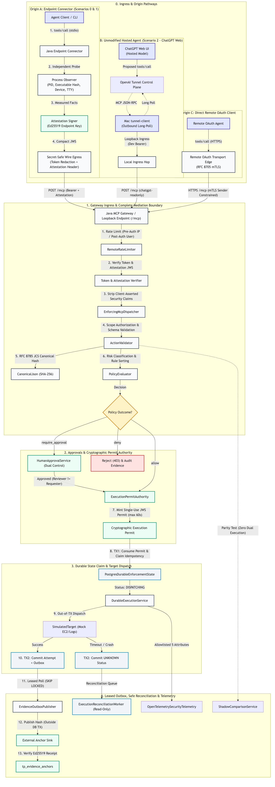
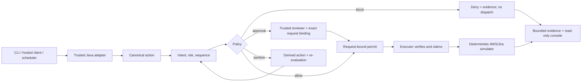

# Architecture and action flow

TracePermit is an Agentic Visibility & Control (AVC) POC. It mediates
**structured tool calls**, not a model's private reasoning or all traffic to
an AI provider. Every supported simulated side effect must pass policy before
the executor receives a request-bound permit.

## Supported origins

| Origin                 | Trusted evidence                                                                                                | Current boundary                                                                      |
| ---------------------- | --------------------------------------------------------------------------------------------------------------- | ------------------------------------------------------------------------------------- |
| CLI or local agent     | Java stdio connector observes its parent process and signs the exact MCP request with a development Ed25519 key | Java loopback MCP gateway verifies token, source proof, and replay state              |
| Hosted ChatGPT profile | The hosted client obtains an IdP token; the private tunnel carries traffic without asserting user identity      | Java OAuth resource server verifies token and maps the user before protected dispatch |
| Scheduled workload     | Signed workload identity and narrowed parent-linked delegation                                                  | Java adapter verifies the chain and constructs the canonical action                   |
| Direct remote MCP      | OAuth token and, in the hardened test profile, mTLS sender constraint                                           | Java remote adapter authenticates before parsing protected calls                      |

The hosted-client qualification covers one tested Auth0/ChatGPT/tunnel
composition. It is not a general claim about unmodified clients or production
deployment. Endpoint observations are development evidence, not managed-device
attestation. No origin may self-assert authenticated or delegated status in
tool arguments.

## Enforcement sequence

1. The adapter authenticates its caller and derives identity, source, and
   delegation facts independently of request JSON.
2. Java validates a registered tool schema and constructs a canonical action
   with a versioned hash. Unknown tools or schema versions are denied.
3. The classifier derives action class and severity from tool, target,
   arguments, and bounded server-owned sequence context. Policy returns
   allow, block, sanitize, or require approval.
4. Sanitization creates a **new** action identity and repeats evaluation.
   Human approval is bound to the exact request and an independently
   authenticated reviewer; it is not a client-supplied boolean.
5. Only an allow or valid approval can mint an executor-verifiable permit.
   The executor verifies the request and audience binding and consumes
   single-use state before invoking a simulator.
6. Denied actions never receive a permit. Evidence and console projections
   are observers, not enforcement authorities.

## Failure and deployment boundaries

Unknown identities, tools, policies, key versions, approvals, and permit
states fail closed. A target timeout can produce an **unknown** outcome;
reconciliation may perform a read-only lookup but must not replay the effect.
The optional PostgreSQL profile adds durable claims, approval state, evidence,
outbox publication, and leased reconciliation. The hardened remote adapter
tests mTLS binding, abuse controls, readiness, and bounded telemetry, but
these are not all assembled into a production deployment. The default local
demo uses loopback, process-local state, and simulated targets.

For exact implementation status, use the [current-state
baseline](specs/03-current-state-baseline.md), [threat
model](specs/10-security-threat-model.md), and [numbered simulator
scenarios](demo-scenarios/README.md).
