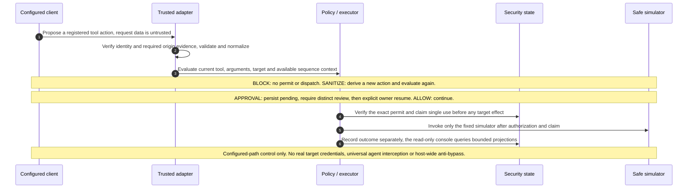
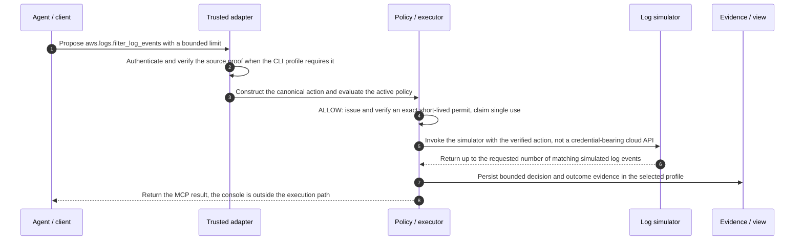
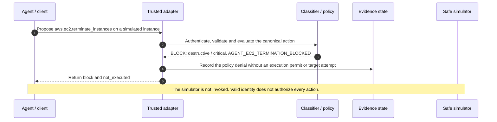
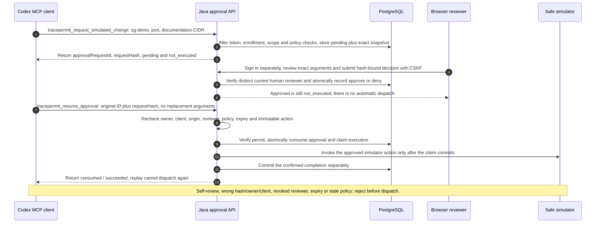
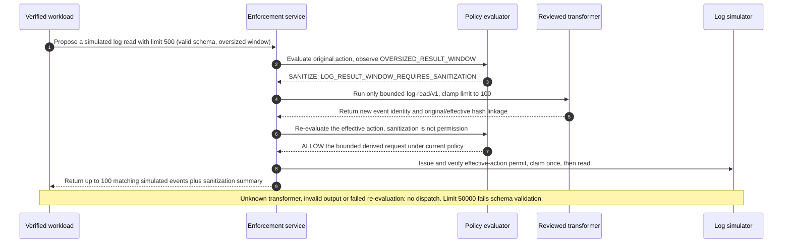
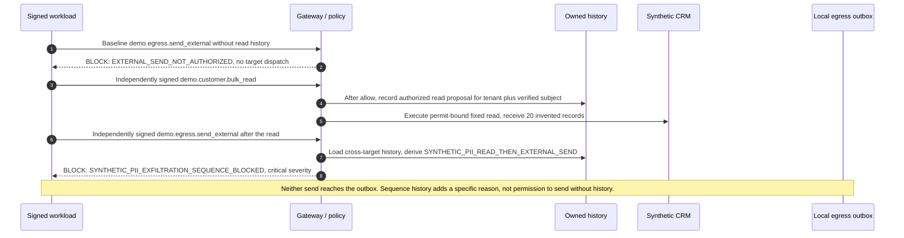
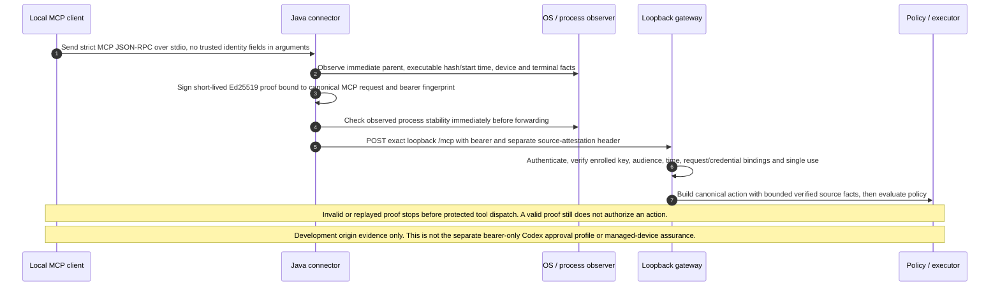
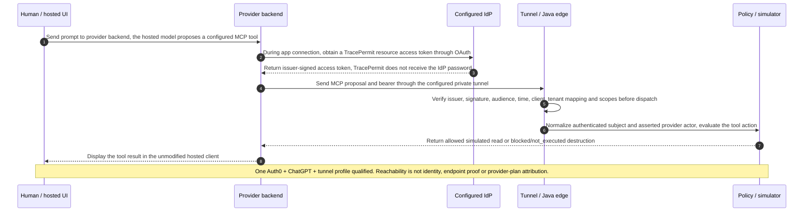
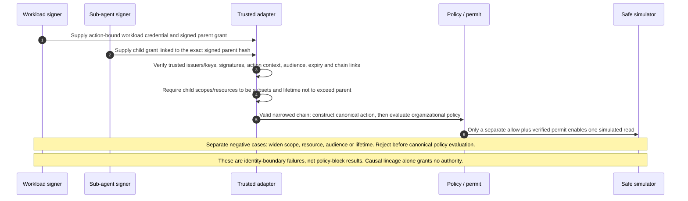
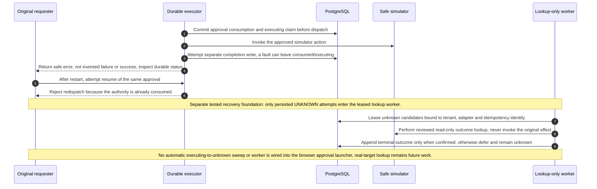

# TracePermit: architecture and action flows

TracePermit is an Agentic Visibility & Control (AVC) proof of concept. Its Java
enforcement data plane evaluates supported tool proposals before a safe simulator
can execute them. The React console displays evidence; the separately authenticated
approval inbox lets an authorized reviewer decide an exact pending request.

This guide maps the running implementation to nine flows. The shorter
[public guide](../site/guide/core-flows.md) uses the same generated diagrams.
See the [specification baseline](specs/03-current-state-baseline.md) for the full
implemented/qualified/future distinction.

## The central invariant

Every supported simulator action routed through TracePermit must pass the required
identity, schema, policy and authority checks before dispatch. A blocked proposal
has no execution permit and no target invocation. An approval is not execution.

This is **configured-path control**, not universal interception of every agent,
host-wide egress prevention or a real AWS credential broker. All downstream effects
in these flows are simulated. The public website hosts documentation, not this API.

<!-- diagram:central-invariant -->



<!-- /diagram:central-invariant -->

The trusted executor verifies the exact permit and claims single use **before**
calling the simulator. The simulator is not the permit authority. Evidence is
recorded server-side; the read-only console queries projections outside the
synchronous execution path. Neither a dashboard nor an audit record prevents a
side effect by itself.

## Entry points and trust boundaries

These profiles share Java components, but are not one interchangeable deployment.

| Entry profile        | What establishes identity                                                               | Important boundary                                                          |
| -------------------- | --------------------------------------------------------------------------------------- | --------------------------------------------------------------------------- |
| Local endpoint MCP   | Bearer verification plus an enrolled endpoint key signing request-bound source evidence | Development OS/process evidence; not managed-device assurance               |
| Hosted OAuth MCP     | Configured issuer, signature, audience, client, tenant mapping and scope checks         | Tunnel reachability is not identity; provider actor remains asserted        |
| Signed workload      | Verified workload credential and independently verified, narrowing delegation chain     | A scheduled label or causal parent ID grants no authority                   |
| Durable approval MCP | Enrolled bearer principal, client, origin and operation scopes                          | Separate bearer-only fixture; does not accept the endpoint proof header     |
| Approval browser     | Browser sign-in, server-owned membership, scoped session and CSRF checks                | A distinct authorized reviewer decides; only the original requester resumes |

Read Flows 6 and 7 first for origin attribution; Flows 1–5 explain action control;
Flows 8 and 9 explain delegated authority and uncertain execution.

## Contracts: what is actually bound

The checked-in [contracts](../contracts/) define complete envelopes. The JSON below
is an **illustrative field projection**, not a complete valid action, evaluation
or signed permit. Never accept trusted assurance fields just because a client
puts them in JSON.

```json
{
  "action": {
    "toolName": "aws.logs.filter_log_events",
    "arguments": {
      "logGroupName": "/app/staging",
      "filterPattern": "ERROR",
      "limit": 2
    }
  },
  "classification": { "actionClass": "read", "severity": "low" },
  "decision": { "outcome": "allow", "reasonCode": "BOUNDED_LOG_READ" }
}
```

- The adapter constructs the canonical action only after required verification.
  Subject, actor, trigger and delegation retain their own assurance levels.
- [Action validation](../java/contracts/src/main/java/io/tracepermit/contracts/ActionValidator.java)
  and [canonical JSON](../java/contracts/src/main/java/io/tracepermit/contracts/CanonicalJson.java)
  use the frozen `tracepermit-canonical-json-v1` profile and vectors. Do not
  substitute an arbitrary serializer or assume full RFC 8785 compatibility.
- [PolicyEvaluator](../java/policy/src/main/java/io/tracepermit/policy/PolicyEvaluator.java)
  classifies tool + arguments + target + available sequence context. The action
  classes are `read`, `modify`, `destructive` and `orchestration`; severity is
  separate. This is deterministic semantic classification, not access to a
  model's private reasoning or a universal arbitrary-code analyzer.
- An [execution permit](../java/security/src/main/java/io/tracepermit/security/ExecutionPermitAuthority.java)
  binds the authorized action and decision context, trusted issuer, audience,
  subject and short validity. Signature verification detects alteration under
  the configured key. A signature alone does not prevent replay: the selected
  consumption/claim store must enforce single use. In-memory and PostgreSQL
  compositions have different restart guarantees.
- Causal lineage answers “what caused this?”; verified delegation answers “what
  authority was granted?”. Neither valid identity nor a valid signature makes
  every requested action safe.

## Flow 1: bounded read allowed

An authenticated configured client proposes `aws.logs.filter_log_events`. The
`allow-cloudwatch-read` rule in [the AWS web policy](../policies/aws-web-readonly.json)
allows a bounded read with `BOUNDED_LOG_READ`. After permit verification and claim,
the fixed log simulator returns **up to** the requested number of matching events.
The result is not a real CloudWatch response or a production latency guarantee.

<!-- diagram:flow-1-safe-read -->



<!-- /diagram:flow-1-safe-read -->

Code: [remote dispatcher](../java/adapters-remote/src/main/java/io/tracepermit/adapters/remote/EnforcingMcpDispatcher.java),
[secure execution](../java/application/src/main/java/io/tracepermit/application/SecureExecutionService.java),
[stateful target simulator](../java/simulator/src/main/java/io/tracepermit/simulator/StatefulTargetSimulator.java).
Tests: [execution conformance](../java/conformance/src/test/java/io/tracepermit/conformance/SecureExecutionServiceTest.java)
and [remote OAuth MCP](../java/adapters-remote/src/test/java/io/tracepermit/adapters/remote/RemoteOAuthMcpServerTest.java).

Try: follow [Scenario 1](demo-scenarios/01-attested-cli-allow-block.md) after starting
`pnpm demo`. A hosted OAuth read also has [dated qualification evidence](demo-scenarios/QUALIFICATION-EVIDENCE-2026-10-11.md);
it is not a fresh live-hosted test from this documentation change.

## Flow 2: destructive proposal blocked

The same authenticated client proposes `aws.ec2.terminate_instances`. The explicit
`block-agent-ec2-termination` rule returns
`AGENT_EC2_TERMINATION_BLOCKED`: class `destructive`, severity `critical`.
The result is `block` / `not_executed`. No permit is issued and no simulator call
occurs. Authentication establishes who asked, not permission for every action.

<!-- diagram:flow-2-destructive-block -->



<!-- /diagram:flow-2-destructive-block -->

Code and tests: the same policy/executor boundary as Flow 1. Try the blocked half
of [Scenario 1](demo-scenarios/01-attested-cli-allow-block.md). The separate
[scheduled-stop scenario](demo-scenarios/07-signed-scheduled-ec2-stop-block.md) uses a
different tool, policy and signed-workload origin; do not describe it as this
termination rule.

## Flow 3: durable human approval and explicit resume

In the separate simulator-only approval profile, Codex's MCP client can request a
fixed `sg-demo` security-group change with a port and documentation-range CIDR.
The current allowlisted approval policy does not approve arbitrary AWS changes.

<!-- diagram:flow-3-human-approval -->



<!-- /diagram:flow-3-human-approval -->

The three tools are `tracepermit_request_simulated_change`,
`tracepermit_get_approval` and `tracepermit_resume_approval`.
The request stores an exact action snapshot and hash in PostgreSQL. A distinct,
currently enrolled human reviewer signs in to the role-scoped browser inbox and
decides the same request hash. Approving leaves it **approved / not_executed**.
The browser cannot dispatch a tool action.

The original requester explicitly resumes using only the ID and hash, not new
arguments. The server rechecks owner, client, origin, reviewer authority, policy,
expiry and immutable action. Approval consumption and execution claim commit
before dispatch; completion is a separate write. Replays, self-review, wrong hash,
wrong owner/client, reviewer revocation, expiry and stale policy fail before
execution. This is at-most-one dispatch per claim, **not exactly-once target
effects across a database and an external system**.

Code: [MCP adapter](../java/adapters-http/src/main/java/io/tracepermit/adapters/http/ApprovalMcpAdapter.java),
[browser adapter](../java/adapters-http/src/main/java/io/tracepermit/adapters/http/ApprovalBrowserAdapter.java),
[approval service](../java/application/src/main/java/io/tracepermit/application/HumanApprovalService.java),
[PostgreSQL state](../java/persistence-postgres/src/main/java/io/tracepermit/persistence/postgres/PostgresDurableEnforcementState.java),
[React inbox](../apps/console/src/ApprovalInbox.tsx).
Tests: [browser lifecycle](../java/adapters-http/src/test/java/io/tracepermit/adapters/http/SimulatorApprovalBrowserTest.java)
and [server failure/restart](../java/adapters-http/src/test/java/io/tracepermit/adapters/http/SimulatorApprovalServerTest.java).

Try: [Codex durable approvals runbook](runbooks/codex-durable-approvals.md),
starting `pnpm demo:approvals:codex` in its own terminal. Do not tunnel the numeric
loopback browser fixture. Native app-server MCP calls and a synthetic browser
reviewer have been qualified. A separate [model-driven record](demo-scenarios/evidence/codex-model-driven-approval-2026-10-15.md)
qualifies Codex 0.162.1/`gpt-5.6-sol` request/review/resume, replay, expiry and
explicit reviewer-denial rejection for this local profile. External browser
IdP/HTTPS and native endpoint source attestation are not qualified by this
bearer-only profile.

## Flow 4: sanitize, then evaluate again

A verified scheduled workload requests logs with `limit: 500`. This is valid tool
schema but raises `OVERSIZED_RESULT_WINDOW`. The policy returns `sanitize` with
`LOG_RESULT_WINDOW_REQUIRES_SANITIZATION`. Only the reviewed
`bounded-log-read/v1` transformer may derive `limit: 100`.

<!-- diagram:flow-4-sanitization -->



<!-- /diagram:flow-4-sanitization -->

The transformer creates a new event identity and returns original/effective
action hashes in the sanitization summary; it does **not** invent a new causal
`parentEventId`. The derived action is validated and re-evaluated, then receives
its own permit if allowed. Unknown transformer, malformed output or a denied
re-evaluation means no dispatch. `limit: 50000` is rejected by tool schema before
this flow; it is not a sanitization example. Up to 100 matching fixture events
may be returned, not necessarily 100.

Code: [bounded sanitizer](../java/application/src/main/java/io/tracepermit/application/BoundedLogReadSanitizer.java)
and [summary](../java/application/src/main/java/io/tracepermit/application/SanitizationSummary.java).
Tests: [semantic enforcement](../java/application/src/test/java/io/tracepermit/application/SemanticEnforcementTest.java).
Try `pnpm demo:scenario:semantic:auto`; see [Scenario 4](demo-scenarios/04-signed-workload-semantic-sequence.md).
This fixture signs a workload; it is not a deployed cron integration.

## Flow 5: read-then-send sequence denied

The signed-workload fixture uses `demo.customer.bulk_read` against `synthetic-crm`
and `demo.egress.send_external` against `synthetic-egress`. They are dedicated
synthetic tools, not real CRM or networking adapters.

<!-- diagram:flow-5-sequence-exfiltration -->



<!-- /diagram:flow-5-sequence-exfiltration -->

An external-send proposal **without** read history is already blocked as
`EXTERNAL_SEND_NOT_AUTHORIZED`. After an allowed bulk read, the server-owned
tenant/subject history adds `SYNTHETIC_PII_READ_THEN_EXTERNAL_SEND`; the subsequent
send is critical and denied as `SYNTHETIC_PII_EXFILTRATION_SEQUENCE_BLOCKED`.
Both blocked sends leave the local outbox empty. The sequence provides a more
specific reason; it does not make a standalone send permissible.

History records the authorized read **proposal before dispatch**, not proof of a
completed read. It is bounded, cross-target and in-memory in this fixture. It can
therefore conservatively retain a read whose later execution failed; it is not
durable global data-flow tracking or inspection of arbitrary PII contents.

Code: [sequence store](../java/application/src/main/java/io/tracepermit/application/InMemoryActionSequenceStore.java),
[policy evaluator](../java/policy/src/main/java/io/tracepermit/policy/PolicyEvaluator.java),
[synthetic exfil simulator](../java/simulator/src/main/java/io/tracepermit/simulator/SyntheticExfilTargetSimulator.java).
Tests: [semantic enforcement](../java/application/src/test/java/io/tracepermit/application/SemanticEnforcementTest.java).
Try `pnpm demo:scenario:pii-exfil:auto`; see [Scenario 9](demo-scenarios/09-synthetic-pii-read-external-send-block.md).

## Flow 6: endpoint attribution and source proof

The local Java connector is the endpoint software. It accepts strict MCP over
stdio, observes its immediate parent process, and forwards to the configured
loopback gateway. It does not host the model or intercept a prompt before a
provider backend sees it.

<!-- diagram:flow-6-endpoint-attribution -->



<!-- /diagram:flow-6-endpoint-attribution -->

The short-lived Ed25519 proof binds the exact canonical MCP request **and** bearer
credential fingerprint, audience, nonce and observed source context. The gateway
independently verifies the bearer and the enrolled endpoint key, freshness,
bindings and single use. A proof from another request or credential cannot be
substituted. The connector rechecks process stability immediately before sending.

An observed terminal is evidence of an interactive process, not proof that a
human authorized each tool. The parent in a scripted test may be Node rather
than native Codex. Development file keys and local process observations are not
hardware-backed managed-device attestation; source replay/revocation is not a
shared production service. Valid origin evidence is still subject to policy.

Code: [connector](../java/endpoint-connector/src/main/java/io/tracepermit/endpoint/EndpointConnector.java),
[proof factory](../java/endpoint-connector/src/main/java/io/tracepermit/endpoint/SourceAttestationFactory.java),
[source verifier](../java/identity/src/main/java/io/tracepermit/identity/SourceAttestationVerifier.java).
Tests: [source verification](../java/identity/src/test/java/io/tracepermit/identity/SourceAttestationVerifierTest.java).
Try [Scenario 0](demo-scenarios/00-connector-origin-and-egress.md) after `pnpm demo`:
`pnpm demo:scenario:connector:auto` requires an attached terminal. The separate
`pnpm demo:endpoint:codex` launcher supports native read/block rehearsal; the
[dated Codex 0.162.1/`gpt-5.6-sol` record](demo-scenarios/evidence/codex-native-endpoint-2026-10-15.md)
correlates both model calls with server events. Full native process-fact capture,
remaining source-negative rehearsal and production endpoint controls remain separate.

## Flow 7: hosted OAuth identity through a tunnel

A normal hosted UI sends the prompt to its provider backend **first**. The model
there proposes a configured MCP tool call. TracePermit controls the downstream
tool action; it does not inspect private model reasoning or preempt that initial
provider request.

<!-- diagram:flow-7-hosted-oauth -->



<!-- /diagram:flow-7-hosted-oauth -->

OAuth connection setup establishes the resource token before subsequent tool
calls. The private tunnel carries traffic to the Java MCP edge. The edge verifies
the configured access token and derives its authenticated subject. Provider/client
metadata has only its supported assurance; a tunnel does not establish identity,
an enterprise-vs-personal provider subscription, or endpoint process facts.

The qualified profile used Auth0 and an unmodified ChatGPT client. That specific
live profile is evidence, not a claim about every ChatGPT/Claude plan or native
client. TracePermit receives a resource access token, not the user's IdP password,
Gmail token or mailbox access. It records credential fingerprints, not raw bearer
credentials, in evidence. This is not a claim that no token exists transiently in
process memory or that the configured identity provider stores no identity data.

Code: [OAuth MCP edge](../java/adapters-remote/src/main/java/io/tracepermit/adapters/remote/RemoteOAuthMcpServer.java)
and [OIDC verifier](../java/identity/src/main/java/io/tracepermit/identity/OidcAccessTokenVerifier.java).
Tests: [remote OAuth MCP](../java/adapters-remote/src/test/java/io/tracepermit/adapters/remote/RemoteOAuthMcpServerTest.java).
Try only with the separate configuration and login steps in
[Scenario 6](demo-scenarios/06-oauth-attributed-hosted-client.md). The historical
[qualification record](demo-scenarios/QUALIFICATION-EVIDENCE-2026-10-11.md) is dated;
a new live hosted-client rehearsal must collect new evidence.

## Flow 8: sub-agent authority must narrow

The workload adapter verifies an action-bound workload credential and signed
delegation chain. A child links to the exact signed parent hash. Valid signatures
are necessary but not sufficient: scopes and resources must be subsets, audience
must remain allowed, and the child lifetime must not exceed its parent.

<!-- diagram:flow-8-delegation -->



<!-- /diagram:flow-8-delegation -->

The valid narrowed chain reaches policy and one permitted simulated read. Four
independently signed negative cases widen scope, resource, audience or lifetime.
They are rejected at the identity boundary **before canonical action construction,
policy evaluation and ordinary action evidence**, not reported as policy blocks.
The demo uses fixture signers, not a real autonomous sub-agent or a production
workload identity issuer. Key custody and revocation are development foundations.

Code: [workload verifier](../java/identity/src/main/java/io/tracepermit/identity/ScheduledWorkloadVerifier.java)
and [trusted adapter](../java/identity/src/main/java/io/tracepermit/identity/ScheduledActionAdapter.java).
Tests: [delegation scenario](../java/adapters-http/src/test/java/io/tracepermit/adapters/http/SignedScheduledDelegationDemoTest.java)
and [identity verification](../java/identity/src/test/java/io/tracepermit/identity/ScheduledWorkloadVerifierTest.java).
Try `pnpm demo:scenario:delegation:auto`; see [Scenario 11](demo-scenarios/11-sub-agent-delegation-amplification-rejected.md).

## Flow 9: uncertain outcome, restart and lookup-only recovery

A database completion failure after simulator dispatch is not evidence that the
effect failed. The approval may remain consumed and its attempt `executing`.
The server must not invent success, restore the authority or retry the effect.

<!-- diagram:flow-9-unknown-outcome -->



<!-- /diagram:flow-9-unknown-outcome -->

There are **two separately tested foundations**, not one fully wired daemon:

1. The approval failure/restart test proves that consumed authority cannot dispatch
   again after a lost completion write.
2. The reconciliation worker leases already-persisted `UNKNOWN` attempts and uses
   a read-only target outcome resolver. Confirmed evidence permits a terminal
   completion; no answer or lookup failure defers the attempt. The worker has no
   original invocation port.

No automatic `executing` → `UNKNOWN` sweeper or reconciliation worker is composed
into the browser approval launcher. Real-target lookup adapters remain future
work. Restart safety prevents redispatch; it does not magically discover an
external outcome or give a PostgreSQL transaction control over target effects.

Code: [durable executor](../java/application/src/main/java/io/tracepermit/application/DurableExecutionService.java),
[approval service](../java/application/src/main/java/io/tracepermit/application/HumanApprovalService.java),
[lookup-only worker](../java/application/src/main/java/io/tracepermit/application/ExecutionReconciliationWorker.java).
Tests: [approval server](../java/adapters-http/src/test/java/io/tracepermit/adapters/http/SimulatorApprovalServerTest.java),
[durable execution](../java/application/src/test/java/io/tracepermit/application/DurableExecutionServiceTest.java),
[reconciliation](../java/application/src/test/java/io/tracepermit/application/ExecutionReconciliationWorkerTest.java).
See [recovery ADR](architecture/0020-reconcile-by-lookup-never-reexecution.md).
Run `pnpm test:approval-api --rerun-tasks` with Docker for the approval failure path;
`pnpm check` includes the worker's unit tests, not a live recovery service.

## Further control paths

- [Tool-result injection → IAM block](demo-scenarios/10-tool-result-injection-iam-block.md):
  untrusted tool output is data, never new authority. The fixture emulates the
  follow-up proposal deterministically; it does not prove an LLM will resist all
  injections.
- [Leased evidence outbox and verified receipt](architecture/0019-leased-outbox-and-external-evidence-receipts.md):
  publication is retriable and receipt-bound; a local chain is not independently
  anchored until a configured external verifier confirms the receipt. This does
  not claim a production anchor provider is deployed.
- [Dependency failures and latency qualification](demo-scenarios/05-latency-and-fail-secure-qualification.md):
  pre-dispatch verification/state failures prevent execution. A post-dispatch
  completion outage is different: its outcome may be uncertain. Local measured
  checks are not a production p99 SLO or proof that every profile shares a store.

## Java module map

| Module                             | Responsibility                                                                                |
| ---------------------------------- | --------------------------------------------------------------------------------------------- |
| `contracts`                        | Strict canonical envelopes, normalization and frozen hashing vectors                          |
| `identity`, `endpoint-connector`   | Verified principal/delegation/source evidence; stdio transport and local observation          |
| `policy`                           | Deterministic classification and organizational decisions                                     |
| `security`                         | Permit issuance/verification and consumption interfaces                                       |
| `application`                      | Framework-independent execution, approval, sanitization, sequence and recovery services/ports |
| `persistence-postgres`             | Durable approval/claim/evidence state and transactional adapters                              |
| `adapters-http`, `adapters-remote` | Composition, strict HTTP/MCP/browser boundaries and profile-specific authentication           |
| `simulator`                        | Fixed, clearly synthetic target behavior; no cloud credentials                                |
| `apps/console`                     | React evidence views and separately authenticated reviewer UI                                 |

## Maintain and rehearse

The source of all ten diagrams is [flow-diagrams.json](design/flow-diagrams.json).
Do not hand-edit generated Mermaid or SVGs. See the
[diagram maintenance instructions](design/README.md). `pnpm docs:flows:check`
detects drift in both guides and the public images; it does not replace a semantic
review against source and tests.

Use the [rehearsal plan](runbooks/flow-rehearsal-plan.md) to distinguish historical
evidence, local deterministic scenarios and the remaining model-driven/native
qualification. A successful documentation build does not qualify a client.
