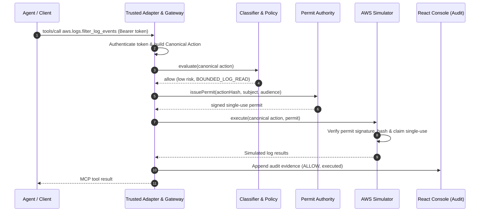
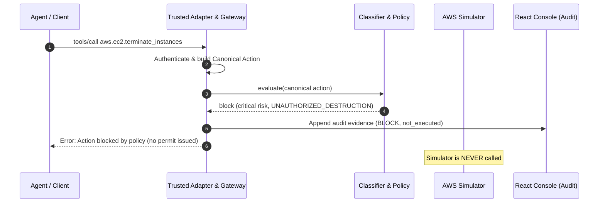
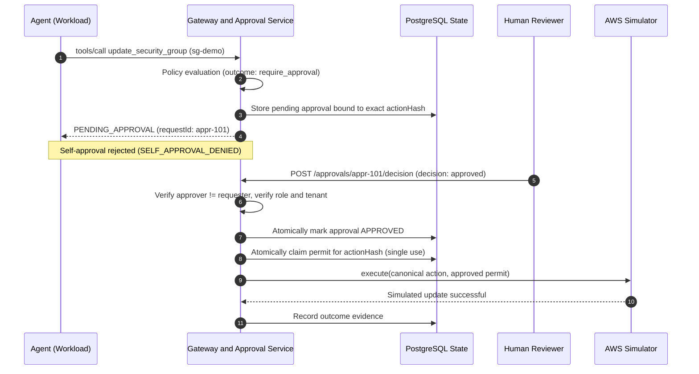
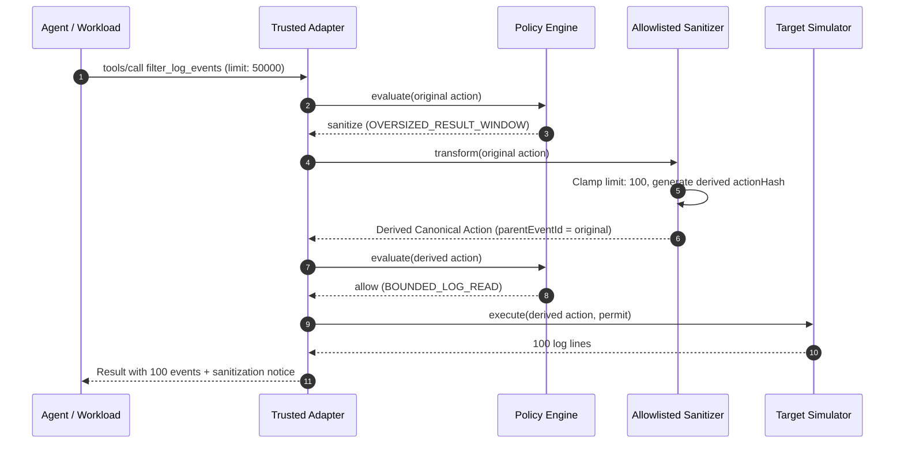
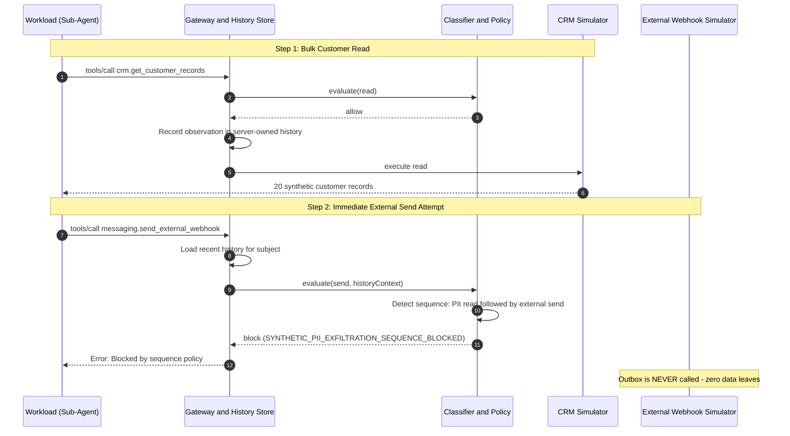

# TracePermit Core Flows & Architecture: A New Engineer's Guide

Welcome to **TracePermit**! This guide is designed to get any new engineer up to speed on the product vision, core use cases, data models, and codebase architecture in 15 minutes.

---

## 1. The Core Mental Model

### The Problem

AI agents (ChatGPT, Claude, autonomous CLI scripts, scheduled cron jobs) are increasingly empowered to invoke tools—calling cloud APIs, modifying databases, updating Jira tickets, and sending messages. Today, tools are usually given broad API keys, meaning **one prompt injection or agent hallucination can delete production infrastructure or leak customer data**.

### The Solution: Agentic Visibility & Control (AVC)

TracePermit sits directly between the agent and enterprise tools as an inline enforcement control plane.

> [!IMPORTANT]
> **The Central Invariant:**
> **No agent ever touches an enterprise target directly.** Every tool call is intercepted, authenticated, normalized into a canonical action, evaluated by policy, and requires an exact, single-use, cryptographically verified **Execution Permit** before a safe simulator can execute.

```mermaid
flowchart LR
    A["AI Agent / CLI / Workload"] -->|1. Tool Call Proposal| B["Trusted Gateway Adapter"]
    B -->|2. Authenticate & Normalize| C["Canonical Action (SHA-256)"]
    C -->|3. Risk & Sequence Scoring| D{"Policy Engine"}
    D -->|Allow| E["Issue Execution Permit"]
    D -->|Block| F["Deny & Record Evidence"]
    D -->|Require Approval| G["Human Reviewer Signoff"]
    D -->|Sanitize| H["Transform Arguments & Re-evaluate"]
    G -->|Approved| E
    E -->|4. Verify & Claim (1x)| I["Deterministic Simulator"]
    I -->|5. Audit Trail| J["Evidence Ledger & React Console"]
```

---

## 2. The 3 Core Data Contracts

Before diving into the flows, here are the three JSON contracts that flow through the entire system:

### 1. Canonical Action (`CanonicalAction`)

The normalized representation of what the agent wants to do. It strips client quirks, canonicalizes arguments, and calculates a deterministic SHA-256 hash.

```json
{
  "eventId": "018f47a2-f5ce-7a4b-8f54-80e5d3eaf091",
  "traceId": "8f3a2c1e4b5d67890123456789abcdef",
  "identity": {
    "subject": {
      "id": "user:alice@example.com",
      "type": "human",
      "assurance": "authenticated"
    },
    "actor": {
      "id": "client:chatgpt-web",
      "type": "orchestrator",
      "assurance": "asserted"
    }
  },
  "trigger": { "kind": "human", "origin": "chatgpt-web" },
  "action": {
    "protocol": "mcp",
    "toolName": "aws.logs.filter_log_events",
    "arguments": {
      "logGroupName": "/app/prod",
      "filterPattern": "ERROR",
      "limit": 50
    },
    "target": {
      "system": "aws",
      "environment": "prod",
      "resourceType": "cloudwatch-log-group"
    }
  }
}
```

### 2. Policy Evaluation (`PolicyEvaluation`)

The decision produced by the policy engine after classifying the action's risk and checking server-owned sequence history.

```json
{
  "evaluationId": "018f47a2-f5ce-7a4b-8f54-80e5d3eaf099",
  "classification": {
    "actionClass": "read",
    "severity": "low",
    "operation": "aws.logs.filter_log_events"
  },
  "decision": {
    "outcome": "allow",
    "policyId": "pol-aws-web-001",
    "policyVersion": 2,
    "matchedRuleId": "allow-cloudwatch-read",
    "reasonCode": "BOUNDED_LOG_READ"
  }
}
```

### 3. Execution Permit (`ExecutionPermit`)

A tamper-proof, short-lived JWT/JWS minted only when an action is allowed or approved. The executor verifies the cryptographic signature, checks that the `actionHash` matches the request, and atomically claims it so it can never be reused.

```json
{
  "permitId": "018f47a2-f5ce-7a4b-8f54-80e5d3eaf080",
  "issuer": "https://execution-permits.tracepermit.invalid",
  "audience": "urn:tracepermit:executor:aws",
  "subjectId": "user:alice@example.com",
  "actionHash": "sha256:97efc87ece3fb5188e998b012a0c19eeadbadf5228bc89d07591cfaca0ec4476",
  "decision": { "outcome": "allow", "policyId": "pol-aws-web-001" },
  "maxUses": 1,
  "expiresAt": "2026-10-08T10:16:01.000Z"
}
```

---

## 3. The 5 Main Product & Execution Flows

---

### Flow 1: Safe Read (Autonomous Allow)

#### Product Story

Alice asks ChatGPT or a local CLI assistant: _"Check the last 50 error logs for the production app."_ The agent invokes the `aws.logs.filter_log_events` tool. TracePermit verifies Alice's identity, determines this is a low-risk bounded read permitted by policy, issues an execution permit, executes against the simulator, and returns the log lines to the agent in milliseconds.

#### Sequence Diagram



#### Where in the Code

| Step                     | Class / File                                                                                                            | Description                                                        |
| :----------------------- | :---------------------------------------------------------------------------------------------------------------------- | :----------------------------------------------------------------- |
| **Ingress & Auth**       | [`OidcAccessTokenVerifier.java`](../java/identity/src/main/java/io/tracepermit/identity/OidcAccessTokenVerifier.java)   | Authenticates token and extracts verified subject/scopes.          |
| **Action Normalization** | [`ActionNormalizer.java`](../java/contracts/src/main/java/io/tracepermit/contracts/ActionNormalizer.java)               | Validates schema and produces canonical action + hash.             |
| **Risk & Policy**        | [`PolicyEvaluator.java`](../java/policy/src/main/java/io/tracepermit/policy/PolicyEvaluator.java)                       | Classifies `actionClass="read"`, evaluates rules, returns `allow`. |
| **Permit & Execution**   | [`InMemoryExecutionLedger.java`](../java/execution/src/main/java/io/tracepermit/execution/InMemoryExecutionLedger.java) | Atomically claims permit ID so it cannot be re-executed.           |
| **Simulator**            | [`StatefulTargetSimulator.java`](../java/simulator/src/main/java/io/tracepermit/simulator/StatefulTargetSimulator.java) | Returns simulated CloudWatch logs.                                 |

#### Try It Locally

```bash
pnpm demo:scenario:cli:auto
```

---

### Flow 2: Destructive Action (Policy Block)

#### Product Story

An assistant is tricked by a rogue prompt or makes an error and proposes terminating an EC2 instance: `aws.ec2.terminate_instances`. TracePermit attributes the request to Alice, but **authentication is not blanket authorization**. The classifier rates this action as `critical` severity infrastructure destruction. Policy returns `block`. TracePermit emits a `not_executed` evidence event and halts. **Zero permits are minted and no target API is called.**

#### Sequence Diagram



#### Compact Data Payload (Decision)

```json
{
  "evaluationId": "018f47a2-f5ce-7a4b-8f54-80e5d3eaf102",
  "classification": {
    "actionClass": "delete",
    "severity": "critical",
    "operation": "aws.ec2.terminate_instances"
  },
  "decision": {
    "outcome": "block",
    "policyId": "pol-aws-web-001",
    "matchedRuleId": "deny-destructive-ops",
    "reasonCode": "UNAUTHORIZED_INFRASTRUCTURE_DELETION"
  }
}
```

#### Where in the Code

| Step               | Class / File                                                                                                          | Description                                                                  |
| :----------------- | :-------------------------------------------------------------------------------------------------------------------- | :--------------------------------------------------------------------------- |
| **Classification** | [`Classification.java`](../java/policy/src/main/java/io/tracepermit/policy/Classification.java)                       | Maps `terminate_instances` to `delete` action class and `critical` severity. |
| **Policy Engine**  | [`PolicyEvaluator.java`](../java/policy/src/main/java/io/tracepermit/policy/PolicyEvaluator.java)                     | Evaluates deny rule; halts processing immediately.                           |
| **Audit Ledger**   | [`InMemoryEvidenceLedger.java`](../java/execution/src/main/java/io/tracepermit/execution/InMemoryEvidenceLedger.java) | Records immutable `not_executed` evidence row with decision reason.          |

#### Try It Locally

```bash
pnpm demo:scenario:scheduled-stop:auto
```

---

### Flow 3: Request-Bound Human Approval (Two-Man Rule)

#### Product Story

An agent attempts a sensitive configuration update (e.g. updating an AWS Security Group or attaching an IAM role). The policy requires human approval. TracePermit doesn't just show a generic button; it **freezes the exact canonical action hash** and creates a pending approval record.

- The requesting agent **cannot self-approve**.
- An independent human approver with the required security role reviews the exact parameters and approves.
- TracePermit validates the approver, issues a permit tied strictly to that SHA-256 hash, and allows the simulator to execute **exactly once**. Any attempt to modify parameters or replay the approval is rejected.

#### Sequence Diagram



#### Compact Data Payload (Approval Binding)

```json
{
  "approvalRequestId": "appr-018f47a2-f5ce-7a4b-8f54-80e5d3eaf301",
  "actionHash": "sha256:4b22f01234567890abcdef1234567890abcdef1234567890abcdef1234567890",
  "subjectId": "user:alice@example.com",
  "requiredRole": "security-admin",
  "status": "approved",
  "reviewer": {
    "reviewerId": "user:bob-reviewer@example.com",
    "decision": "approved",
    "decidedAt": "2026-10-08T10:20:00.000Z"
  }
}
```

#### Where in the Code

| Step                      | Class / File                                                                                                          | Description                                                             |
| :------------------------ | :-------------------------------------------------------------------------------------------------------------------- | :---------------------------------------------------------------------- |
| **Approval Lifecycle**    | [`ApprovalBinding.java`](../java/execution/src/main/java/io/tracepermit/execution/ApprovalBinding.java)               | Defines immutable link between request hash, reviewer, and decision.    |
| **Approval Verification** | [`ApprovalDecision.java`](../java/execution/src/main/java/io/tracepermit/execution/ApprovalDecision.java)             | Validates reviewer identity, prevents self-approval, checks expiration. |
| **Durable Claims**        | [`ApprovalExecutionClaim.java`](../java/execution/src/main/java/io/tracepermit/execution/ApprovalExecutionClaim.java) | Manages atomic transactional claim in PostgreSQL.                       |

#### Try It Locally

```bash
pnpm demo:scenario:approval:auto
```

---

### Flow 4: Parameter Sanitization (Self-Healing Guardrails)

#### Product Story

An agent queries logs but asks for `limit: 50000`, which would overwhelm downstream APIs and incur massive data transfer costs. Instead of a frustrating hard failure, TracePermit's policy specifies `sanitize`. An allowlisted sanitizer intercepts the parameters, clamps `limit` down to `100`, mints a **derived canonical action** with a new event ID, links it back to the original event in the lineage graph, and re-evaluates. The derived action passes policy, receives a permit, and completes smoothly.

#### Sequence Diagram



#### Compact Data Payload (Derived Action Transformation)

```json
{
  "eventId": "018f47a2-f5ce-derived-0002",
  "parentEventId": "018f47a2-f5ce-original-0001",
  "arguments": {
    "logGroupName": "/app/prod",
    "filterPattern": "ERROR",
    "limit": 100
  },
  "sanitization": {
    "transformerId": "clamp-query-limit",
    "changes": ["limit clamped from 50000 to 100"],
    "finalOutcome": "allow"
  }
}
```

#### Where in the Code

| Step                   | Class / File                                                                                              | Description                                                           |
| :--------------------- | :-------------------------------------------------------------------------------------------------------- | :-------------------------------------------------------------------- |
| **Sanitizer Rule**     | [`PolicyEvaluator.java`](../java/policy/src/main/java/io/tracepermit/policy/PolicyEvaluator.java)         | Matches `OVERSIZED_RESULT_WINDOW` and returns `sanitize`.             |
| **Action Derivation**  | [`ActionNormalizer.java`](../java/contracts/src/main/java/io/tracepermit/contracts/ActionNormalizer.java) | Creates derived canonical action preserving parent lineage.           |
| **Console Projection** | [`EvidenceView.tsx`](../apps/console/src/EvidenceView.tsx)                                                | Displays both the original request and the sanitized derived outcome. |

#### Try It Locally

```bash
pnpm demo:scenario:semantic:auto
```

---

### Flow 5: Semantic Sequence & Multi-Step Defense (Anti-Exfiltration)

#### Product Story

Evaluating tool calls in isolation is not enough. Consider an agent that does two things:

1. Calls `crm.get_customer_records` to read 20 customer contact details (Allowed: benign read).
2. Immediately calls `messaging.send_external_webhook` with those details (Malicious or prompt injection: exfiltration!).

Neither tool call is suspicious on its own. TracePermit maintains **server-owned recent action history** per subject. When the second tool call arrives, the classifier detects the toxic sequence: `SYNTHETIC_PII_READ_THEN_EXTERNAL_SEND`. Policy immediately blocks the external transmission.

#### Sequence Diagram



#### Compact Data Payload (Sequence Block)

```json
{
  "classification": {
    "actionClass": "send",
    "severity": "high",
    "signals": ["EXTERNAL_EGRESS", "SYNTHETIC_PII_READ_THEN_EXTERNAL_SEND"]
  },
  "decision": {
    "outcome": "block",
    "policyId": "pol-sequence-rules",
    "matchedRuleId": "block-pii-exfiltration-chain",
    "reasonCode": "SYNTHETIC_PII_EXFILTRATION_SEQUENCE_BLOCKED"
  }
}
```

#### Where in the Code

| Step                    | Class / File                                                                                                  | Description                                                              |
| :---------------------- | :------------------------------------------------------------------------------------------------------------ | :----------------------------------------------------------------------- |
| **History Context**     | [`ClassificationContext.java`](../java/policy/src/main/java/io/tracepermit/policy/ClassificationContext.java) | Loads sliding-window history of actions for the same tenant and subject. |
| **Sequence Classifier** | [`Classification.java`](../java/policy/src/main/java/io/tracepermit/policy/Classification.java)               | Detects toxic combinations (e.g., read PII followed by external send).   |
| **Sequence Denial**     | [`PolicyEvaluator.java`](../java/policy/src/main/java/io/tracepermit/policy/PolicyEvaluator.java)             | Enforces sequence-aware deny rules before permit generation.             |

#### Try It Locally

```bash
pnpm demo:scenario:pii-exfil:auto
```

---

## 4. Master Codebase Navigation Cheat Sheet

When you need to modify or trace code, this table maps product concepts directly to repository modules:

```text
tracepermit/
├── contracts/             # Frozen JSON Schemas & portability vectors (RFC 8785)
├── java/                  # Core backend (Java 21)
│   ├── identity/          # Token verification, Ed25519 source signatures, delegation
│   ├── contracts/         # Canonical action normalization & JSON validation
│   ├── policy/            # Risk classification & ordered rule evaluator
│   ├── execution/         # Permit issuance, replay prevention, approval bindings
│   ├── persistence-postgres/ # Flyway migrations & durable PostgreSQL state
│   ├── simulator/         # Deterministic mock AWS & Jira handlers (no real credentials!)
│   └── application/       # Spring Boot / local composition wiring
├── apps/console/          # Read-only React console for audit, lineage & policy view
└── docs/demo-scenarios/   # Reproducible numbered demo scripts
```

| Layer                      | Responsibility                                                                                  | Key Classes / Packages                                                                                                                                            |
| :------------------------- | :---------------------------------------------------------------------------------------------- | :---------------------------------------------------------------------------------------------------------------------------------------------------------------- |
| **1. Ingress & Auth**      | Verifies OAuth/OIDC tokens, Ed25519 source attestations, and parent-linked delegation chains.   | `io.tracepermit.identity.OidcAccessTokenVerifier`<br/>`io.tracepermit.identity.SourceAttestationVerifier`<br/>`io.tracepermit.identity.ScheduledWorkloadVerifier` |
| **2. Canonical Contracts** | Schema validation, RFC 8785 canonical JSON sorting, SHA-256 action hashing.                     | `io.tracepermit.contracts.ActionNormalizer`<br/>`io.tracepermit.contracts.ActionValidator`<br/>`io.tracepermit.contracts.CanonicalJson`                           |
| **3. Policy & Risk**       | Evaluates rules, action severity, and server-owned sliding-window sequence context.             | `io.tracepermit.policy.PolicyEvaluator`<br/>`io.tracepermit.policy.ClassificationContext`<br/>`io.tracepermit.policy.PolicyDecision`                              |
| **4. Permits & Claims**    | Issues single-use execution permits, enforces atomic claims, manages PostgreSQL approval state. | `io.tracepermit.execution.ApprovalBinding`<br/>`io.tracepermit.execution.DurableExecutionClaim`<br/>`io.tracepermit.execution.InMemoryExecutionLedger`            |
| **5. Simulators**          | Credential-free safe execution targets (AWS EC2, S3, CloudWatch, Jira).                         | `io.tracepermit.simulator.StatefulTargetSimulator`                                                                                                                |
| **6. Audit Console**       | Read-only React frontend displaying action feed, lineage graphs, and evidence integrity.        | `apps/console/src/App.tsx`<br/>`apps/console/src/LineageView.tsx`<br/>`apps/console/src/EvidenceView.tsx`                                                         |

---

## 5. Quick Verification Commands

To verify that your local setup is healthy:

```bash
# 1. Install dependencies
corepack enable && pnpm install --frozen-lockfile

# 2. Run static analysis & tests
pnpm check
pnpm format:check

# 3. Launch the full local demo (Terminal 1)
pnpm demo

# 4. Open the console
# Navigate to http://127.0.0.1:5173

# 5. Run any scenario (Terminal 2)
pnpm demo:scenario:cli:auto
pnpm demo:scenario:approval:auto
pnpm demo:scenario:semantic:auto
pnpm demo:scenario:pii-exfil:auto
```
