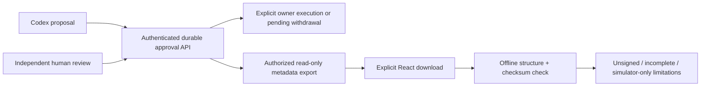

# Milestone: audit-ready simulator approval workspace

Plan baseline: main `b38e9289d791ffabc1e2142357fc8366301ee201`, after PR65/69.
GitHub is authoritative for contracts, code, review and transferable state.
Notion is the readable roadmap, not a substitute for pushed work. All lanes below
are assignments prepared for founder forwarding, not claims that a worker ran.

## Outcome and priority

An evaluator can propose a simulated change through Codex, independently review
it in the inbox, execute or withdraw as permitted, and explicitly download a
bounded record they can inspect offline. They can distinguish pending, approved,
cancelled, consumed and actual execution outcomes without sharing credentials or
raw action payloads. This advances TP-MVP-08/10/20; it does not close their full
customer, retention, onboarding or production acceptance criteria.

We reuse the existing identity, request binding, approval, history, PostgreSQL,
source-free packaging and React foundations. The new functionality is a portable
review workflow, not another standalone demonstration or a new real target.
Policy administration (preview → stage → explicit activation/rollback) follows
this milestone and needs its own operator authorization/composition design.

## Frozen contract and trust limits

The [export runbook](../runbooks/approval-review-export.md),
[ADR0064](../architecture/0064-unsigned-approval-review-export.md) and
[closed schema](../../contracts/json-schema/approval-review-export-v1.schema.json)
are the shared contract. Only the integration owner changes these. Other workers
must report a contract problem rather than silently fork it. Tests use synthetic
values. The metadata export is unsigned, not full history or a transactional
snapshot; all assurance flags remain false. No argument, source proof, token,
target response or raw event enters it. Its checksum is not authenticity.



## Ownership and integration order

| Lane            | Exclusive writing scope                                                                                                                                  | Acceptance                                                                                                                                    | Dependency                                                        |
| --------------- | -------------------------------------------------------------------------------------------------------------------------------------------------------- | --------------------------------------------------------------------------------------------------------------------------------------------- | ----------------------------------------------------------------- |
| Mac integration | Export Java adapter/helper/tests, schema/vector, ADR0064, runbook, plan, shared specs/traceability, Notion reconciliation                                | Authenticated API tests, privacy controls, original hashes, no authority/effects, required checks                                             | Current merged main                                               |
| Gemini          | React export client/download component and tests; separate browser download test file and UI runbook                                                     | Explicit user gesture, strict validation/bounds, current identity/selection, no automatic fetch/retry/download, real saved-file browser check | Frozen contract; final integrated browser run after backend merge |
| Cloud           | New `java/review-verifier` module, its tests, one settings entry, offline-checker runbook                                                                | Java21-only CLI, strict UTF-8/JSON/schema/size/version/checksum checks, fixed safe diagnostics, no network                                    | Frozen contract; can use synthetic golden vector independently    |
| GLM             | Residual PR65 harness repair on a NEW branch: adapters-http Gradle Git provider, endpoint-distribution cleanup helper, focused tests and harness runbook | Nonzero Git output cannot pass strict provenance; finite Git wait; no raw cleanup exception diagnostics                                       | Current main, not the old merged producer branch                  |

No other worker edits shared specs/ADR/schema, package scripts, CI or site unless
the integrator explicitly reallocates a path. Gemini may add an opt-in browser
test file, but the integrator wires its command/job once accepted. Cloud may not
modify the old Auth0 branch or implement new IdP trust. GLM does not duplicate the
export code. Later independent export review is a new read-only packet after the
implementation heads freeze, not simultaneous editing of their branches.

## Release gates

1. Backend contract/API reviewed and merged by founder. Unauthorized/other-owner
   reads reveal no record; current enrollment/scope/session checks precede export;
   original binding and target/evidence/authority state remain unchanged.
2. React and CLI independent PRs reviewed; their exact bases/heads/checks recorded.
   Wrong version/field/hash/mode/assurance, malformed/oversized files, missing
   scope, logout/selection races and errors never download false-success data.
3. Integrator combines only reviewed merged work and runs one final matrix:
   required check/format, targeted API/privacy/browser/scenario/package checks,
   synthetic export → saved file → actual standalone checker. No claim that an
   unsigned record verifies the canonical action or entire evidence stream.
4. Live Auth0 numeric-loopback qualification still needs its precise operator
   configuration and manual browser actions. Public client has no secret. Keep
   `127.0.0.1`, no tunnel/public listener, no relaxed typ/organization/issuer checks.
   Missing compatibility is a stop condition, not a reason to bypass validation.
5. Fresh MacBook Air evaluation and public documentation follow executed evidence.
   No signed release, commercial-readiness claim, spending, customer outreach,
   real target, external service/DNS/permissions change or automatic merge.

## Work and token discipline

One writer per branch, isolated clone/worktree. Inspect path/branch/HEAD/base,
status/divergence and ownership before edits. Preserve all existing files; no
reset, clean, discard, rebase, force-push or merge without founder approval.
Fetch and record exact commits; do not trust a pasted green-CI claim alone.

Use focused tests while iterating. Run required repository checks once at the
final coherent head, then let the integrator run the combined matrix. Report
cached/skipped/not-run checks honestly. After two failed repair attempts, return
the concrete diagnosis rather than silently expanding scope. Do not repeatedly
rebuild every package to inflate evidence. No production credentials or browser
traces/screenshots containing credentials in logs, Git, PRs, chat or handoffs.

Workers commit and push one coherent checkpoint, open a draft PR, return the
standard [handoff fields](#handoff-fields), explicitly stop editing that branch,
and wait. No automated handoff to a different writer while changes are unpushed.

## Handoff fields

```text
TRACEPERMIT HANDOFF
- Task:
- Repository:
- Branch:
- Base commit:
- Latest pushed commit:
- PR URL:
- Branch owner now:
- Working tree status:
- Completed:
- Remaining:
- Files materially changed:
- Tests passed:
- Tests failed/not run:
- Exact next command:
- Required environment:
- Local-only/manual steps:
- Security constraints:
- Known limitations:
- Safe for another environment to continue: yes/no
```

Copy-ready packets: [Gemini](packets/approval-export-gemini.md),
[cloud](packets/approval-export-cloud.md), [GLM](packets/qualification-repair-glm.md).
