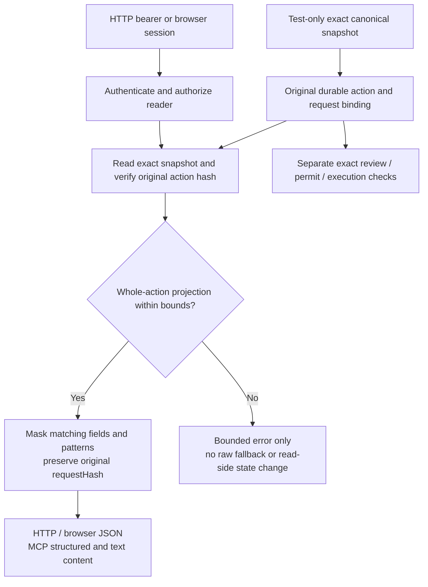

# Approval response redaction qualification

Requirements: SEC-001/005/009/012; FR-007/010; DATA-003 (partial only).
Decision: [ADR 0043](../architecture/0043-bounded-evidence-redaction.md).

This runbook qualifies the existing redaction hook at the actual authenticated
HTTP, browser-inbox and MCP response boundaries. It adds tests, not an endpoint,
credential ingestion feature, redaction policy or before-persistence filter.

## What is tested

`SimulatorApprovalRedactionBoundaryTest` runs six JUnit cases against actual
loopback HTTP servers, synthetic signed OIDC tokens/browser sessions, disposable
PostgreSQL 16 and the existing in-memory target simulator. No external login,
usable credential, cloud resource or real target is involved. Browser protocol
responses are exercised; this is not a rendered React UI or model-driven test.

| Case                               | Assertions                                                                                                                                                                                                          |
| ---------------------------------- | ------------------------------------------------------------------------------------------------------------------------------------------------------------------------------------------------------------------- |
| HTTP and MCP read responses        | Detail, list, MCP structured content and MCP text content all mask the same nested credential aliases and bearer-pattern canaries; benign arguments and exact approval metadata survive.                            |
| Browser viewer and reviewer        | Both receive masked list/detail projections; a viewer cannot decide; an independent reviewer approves the original request hash without executing.                                                                  |
| Authorization before projection    | Missing authentication, unenrolled identity, another requester's ownership and missing read scope are rejected before an otherwise invalid stored snapshot can reach redaction.                                     |
| Excessive depth                    | A deeply nested subtree under a matching secret field fails closed, including across restart; masking the parent must not bypass validation.                                                                        |
| Excessive node count               | A snapshot within the database byte limit but above the redactor node budget fails closed; HTTP/browser return bounded errors and MCP returns an error result, not raw content.                                     |
| Strict ingress and clean execution | All three ingress paths reject an extra credential argument before storing approval/evidence. An ordinary exact request still supports independent review, one simulated effect and replay rejection after restart. |

The depth and node cases are two separately reported parameterized tests. Loops
over transports, roles or fields are assertions, not additional JUnit test counts.

## Fixture provenance and limits

Current public simulator schemas accept only `groupId`, `port` and `cidr` for
the fixed security-group action. They cannot ingest arbitrary credential fields.
The tests therefore obtain an actually authenticated canonical action through the
existing MCP adapter, copy it in test code, add explicit **non-credential synthetic
canaries**, and ask the real in-process `HumanApprovalService` to derive a fresh
approval binding and persist the exact snapshot. They do not overwrite a database
row, alter an existing hash, weaken the public schema or execute a canary snapshot.
This is test-fixture reachability, not evidence that HTTP accepts secret arguments.

The database independently limits an action snapshot to 65,536 bytes of JSONB
text. A single text value above the redactor's 65,536-code-unit bound cannot be
seeded through the current durable store: PostgreSQL rejects it first. Instead,
the API qualification uses excessive **depth** and **node count** within that
storage byte limit. Library tests separately qualify text and other input bounds.

The fixture's synthetic IdP, keys, local configuration, temporary files and schema
are test-owned. Role enrollment is changed only through the operator-owned Java
fixture, never by accepting a role claim from a token or request body.

## Authority and response flow



The response's `requestHash` refers to the **original canonical request**, not a
hash of the redacted display. The tests compare the full stored event and its
original action hash before/after reads, reviewer decisions and restart. Mutating
a parsed client response cannot affect PostgreSQL. Read-only projections leave
approval state, evidence and simulator state unchanged. Approval is still not
execution; only the separate clean-request control reaches a target effect.

No confidential raw fallback is returned when the redactor rejects a snapshot.
Current HTTP/browser reads report `400 INVALID_REQUEST`; MCP status returns a
tool error with `mode: simulated` and `errorCode: INVALID_REQUEST`. Those are the
current adapter mappings, not a new error taxonomy or general recovery contract.
An invalid item also fails the bounded list response as a whole, rather than
silently skipping it or returning a partial raw page.

## Run locally

Prerequisites: Java 21, Node.js 22 or newer, pnpm 11.25.0 and Docker.
Use an owned checkout without another build or demo running in it:

```bash
source scripts/configure-java-environment.sh
java/gradlew -p java :adapters-http:test \
  --tests io.tracepermit.adapters.http.SimulatorApprovalRedactionBoundaryTest
pnpm check
pnpm format:check
pnpm docs:links
pnpm docs:flows:check
```

Expected focused result: six tests, no failures/errors/skips. Existing redaction
library, approval, browser and simulator tests remain required; this suite does
not replace them.

For an isolated negative control, replacing only the existing projection hook
with a raw `deepCopy()` must make these boundary assertions fail even though the
redaction library remains present. Restore the hook before committing or running
the final qualification. Never expose that intentionally weakened process.

Independent qualification observed **four failures and two passing controls**
with only that hook replaced: HTTP/MCP projection, browser projection, depth
failure and node-budget failure assertions detected the raw response. The
authorization and clean execution controls still passed. With the hook restored,
all six cases pass. No intentionally weakened source is retained in the change.

## Still not qualified

- Global log, metric, trace, audit-export or before-persistence redaction.
- Confidential storage of real customer secrets: exact operational snapshots
  intentionally remain unredacted. SEC-012 and DATA-003 stay **Partial**.
- Universal PII detection, encoded/split secrets or keyed pseudonymization.
- Remote/public hosting, production IdP compatibility or customer tenant setup.
- Retention, recovery fencing, rollback-safe restore or production compliance.

Unkeyed hashes are not secret confidentiality. Masking is presentation, not
authentication, authorization, argument validation or execution authority.
