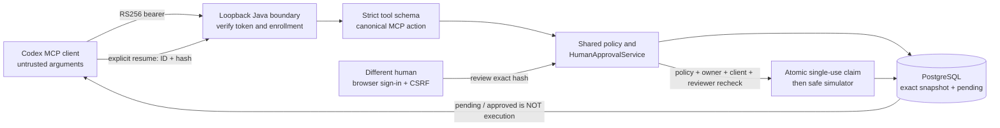

# Codex to durable simulator approval

Requirements: FR-003/004/007/008/009/012; SEC-001/004/005/006/009/012;
REL-002/004/005; DATA-001. See [ADR 0037](../architecture/0037-mcp-durable-simulator-approval-composition.md).

Codex is the first client candidate. This composition is **local, bearer-only
and simulator-only**. It reuses the existing browser inbox and durable Java
approval service, not the hosted ChatGPT OAuth/tunnel demo. A real client test
does not imply production readiness or control of the client's other tools.

## Flow and trust boundaries



The gateway trusts the verified issuer-qualified subject, configured client,
tenant and scopes plus operator enrollment. MCP metadata cannot grant a role.
The human/workload principal type comes from enrollment. The trigger remains
`service` because a bearer alone does not prove a human typed the prompt.
The actor is an asserted configured client, not a verified Codex binary. No
endpoint/source proof is fabricated. TracePermit login is not evidence of an
enterprise vs personal OpenAI account or subscription.

## 1. Start a disposable qualification environment

Prerequisites: Java 21, Node 22+, pnpm 11.25.0 and running Docker. No API key,
personal login, external IdP changes or real cloud credential is required by
the fixture itself. A model-driven Codex session uses your existing Codex access.

```bash
pnpm install --frozen-lockfile
pnpm demo:approvals:codex
```

This builds React and launches **test-classpath-only** synthetic identities,
PostgreSQL and the actual Java MCP/API/browser/simulator stack. Record the printed
MCP URL, inbox URL and private temporary token-file path. The file is mode 600;
it contains a synthetic `alice` access token valid for 290 seconds with only
`approvals.request approvals.read approvals.execute`. No reviewer credential is
given to Codex. Normal `pnpm dev:approvals` requires operator-configured OIDC,
membership, PostgreSQL and persistent signing keys; it cannot mint these tokens.

Enter `token` in the fixture terminal to replace only the synthetic token file.
Reload the environment and restart the Codex connection after a refresh. Existing
approval expiry remains 300 seconds from request creation; refresh never extends it.
Press Enter to stop and discard the fixture database and generated keys/token.
Do not retain qualification data as a production audit ledger.

## 2. Connect Codex without modifying global configuration

In a second terminal, use the **exact printed values**, not a guessed port/path:

```bash
# Replace this with the printed private synthetic file; never print the token.
export TRACEPERMIT_MCP_TOKEN="$(< /tmp/tracepermit-browser-qualification-REPLACE/codex-synthetic.token)"

# Replace PORT. Only the environment-variable NAME is in configuration/arguments.
codex --sandbox read-only \
  -c 'mcp_servers.tracepermit={url="http://127.0.0.1:PORT/mcp",bearer_token_env_var="TRACEPERMIT_MCP_TOKEN",required=true,default_tools_approval_mode="prompt"}'
```

Run `/mcp` to inspect the connection/catalog. The configuration override is for
this invocation; this runbook does not install a global MCP server or persist a
bearer token. Keep the private file/environment out of recordings and reports.
Codex's local tool-confirmation prompt is **not** TracePermit's independent review.
Read-only shell sandboxing does not by itself constrain remote MCP side effects.

Official [Codex MCP documentation](https://developers.openai.com/codex/mcp)
describes HTTP bearer auth, configuration overrides and tool approval hints.
Recheck installed-version compatibility; a configuration listing alone does not
prove an MCP handshake or invocation.

## 3. Request a change, not execution

Use this prompt in Codex:

> Use only the TracePermit MCP server. Call
> tracepermit_request_simulated_change with groupId sg-demo, port 443 and cidr
> 192.0.2.0/24 exactly once. Report approvalRequestId, requestHash, status and
> executionStatus. Explain that pending is not execution. Do not approve,
> resume, retry, use shell commands or call other tools.

Expected MCP `structuredContent` includes:

```json
{
  "mode": "simulated",
  "approvalRequestId": "<opaque UUID>",
  "requestHash": "sha256:<64 hex characters>",
  "status": "pending",
  "executionStatus": "not_executed",
  "originalPolicyOutcome": "require_approval"
}
```

The actual result also includes requester, expiry, policy ID/version and exact
action. Only `sg-demo`, ports 1–65535 and documentation CIDRs `192.0.2.0/24`,
`198.51.100.0/24`, `203.0.113.0/24` are accepted. No arbitrary resource, URL,
tenant, reviewer, policy, canonical envelope or credentials can be supplied.
The local fixed policy is version 2, explicitly covering `api` and `cli` for
this one simulator mutation; it blocks everything else.

## 4. Review in the existing browser inbox

Open the printed `/approvals` URL. Sign in through the synthetic account picker
as `bob` (reviewer). Find the same approval ID/hash, requester, exact target and
arguments. Click **Approve exact action**, then **Confirm approve**. The result
must be **approved / not executed**. Approval is not a background execution job.

`alice` is requester, `bob` reviewer, `carol` viewer, `dave` requester+reviewer.
There is no MCP approve/deny tool, even for Dave. The API also rejects Dave's
self-review; hiding a UI button is not the control. Browser tokens stay server
side, with a separate cookie/CSRF boundary. Never give the browser session or
reviewer token to the agent. At least two distinct enrolled humans are required
for this independent-review workflow in a real pilot.

## 5. Inspect and explicitly resume from the original requester

First ask Codex to call only `tracepermit_get_approval` with the saved ID. Confirm
approved and still not executed. Then, only if you intend the simulated effect:

> Use only TracePermit. Call tracepermit_resume_approval once with
> approvalRequestId <saved ID> and requestHash <saved hash>. Do not supply new
> action arguments, retry or call other tools. Report the durable approval and
> execution status, and state that the downstream target is a simulator.

Expected result: **consumed / succeeded**. Refresh the reviewer inbox and inspect
the durable outcome. A second resume must fail, never dispatch again. A renewed
credential for the same enrolled principal/client is allowed, but a different
owner, tenant, client or configured origin cannot reuse the action.

For a denial demo, request a **new** approval and have Bob deny it. Resume must
fail with `APPROVAL_NOT_EXECUTABLE`; do not change policy to make the demo pass.
Never automatically recreate an approval after a failed/uncertain resume.

## 6. Protocol and failure contract

- `POST /mcp`, JSON responses, no session IDs, SSE stream or held human wait.
  Initialize negotiates supported versions; initialized notification returns 202.
  GET/DELETE, batches, cursors and unknown versions are rejected.
- All methods require the trusted bearer/enrollment. No public tool catalog.
  Current REQUESTER role/scopes filter tools/list and independently gate calls.
- Missing/invalid bearer: HTTP 401. Browser Cookie/Origin or source-proof header:
  reject. A `cnf` claim without a supported proof mechanism is not possession.
- Invalid envelopes/tools/arguments: JSON-RPC error (or transport 400 for malformed
  JSON). Valid calls denied by authorization/approval state: `isError: true`, bounded
  `errorCode`, no secret or invented execution status. Read status to resolve it.
- Resume accepts only ID/hash and loads the immutable snapshot. Hash, actor,
  current reviewer authority, expiry, current policy and durable single use are
  checked before dispatch. HTTP execute cannot bypass MCP client binding.
- Atomic claim commits **before** effect; completion commits separately. Lost
  completion may remain consumed/executing or unknown, not safe to retry. This
  establishes at-most-one dispatch per approval, not exactly-once external effects.
- Repeated request calls can create separate pending records; JSON-RPC IDs are
  correlation, not durable request deduplication. Do not retry writes blindly.

## 7. Verification and evidence levels

```bash
pnpm test:approval-api --rerun-tasks
pnpm check
pnpm format:check
pnpm docs:links
```

`SimulatorApprovalMcpAdapterTest` tests protocol/schema/error behavior only.
`SimulatorApprovalBrowserTest` tests real HTTP/signatures/PostgreSQL MCP →
browser review → MCP resume, restart and eight concurrent resumes, scope/role,
self-review, changed inputs and expiry. `SimulatorApprovalServerTest` additionally
tests cross-client/tenant and alternate HTTP ingress, stale policy, DB failure,
lost completion and restart without redispatch. Existing durable application
tests cover the permit/approval claim implementation.

Record native Codex version, actual handshake/catalog and tool invocation
separately. An app-server inventory check can qualify native MCP initialization
without model inference; it does not prove a model chose the tool correctly.
A model-driven prompt rehearsal remains a separate UX/compatibility gate.

The [2026-10-15 qualification record](../demo-scenarios/evidence/codex-durable-approval-2026-10-15.md)
records native Codex CLI 0.142.4 initialization, catalog and actual tool calls
through its app-server API, independent Chrome review and rejected replay.
No model inference was used; the prompt-driven rehearsal is not yet qualified.

## Limits and next gate

No public production deployment, managed source attestation, live browser IdP
qualification, protected signing-key provider, multi-replica abuse controls,
real GitHub/AWS execution or host-wide credential/egress anti-bypass is added.
Keep the local HTTP browser runtime off tunnels/proxies. The default read-only
console and hosted OAuth demo remain separate compositions. Finish named-client
qualification and design-partner discovery before selecting a real-target pilot.
