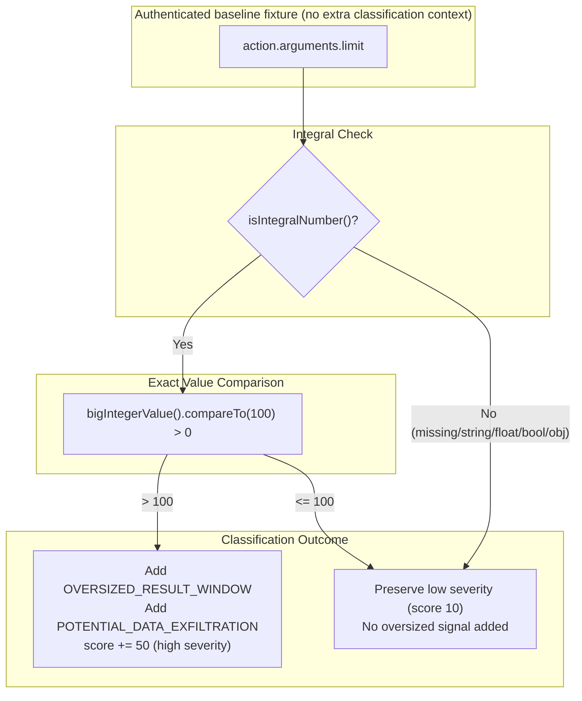

# Overflow-Safe CloudWatch Log-Window Classification

Requirements: FR-005, FR-006; SEC-002; REL-001; OPS-002.
Architecture Decision: [ADR 0039](../architecture/0039-policy-lifecycle-staging-rollback-and-simulation.md).

This runbook documents the resolution of the integer-narrowing gap in CloudWatch log-window
classification within `PolicyEvaluator`. The fix ensures that any positive integral JSON
number greater than the 100-result threshold is accurately identified as an oversized log
query without integer truncation, bit-wrapping, or floating-point precision loss.

---

## Vulnerability & Root Cause Analysis

For the simulated CloudWatch log query tool `aws.logs.filter_log_events`, the policy classifier
evaluates whether the requested `limit` argument represents an oversized log extraction window.
The original code inspected:

```java
if ("aws.logs.filter_log_events".equals(operation)
    && arguments.path("limit").isIntegralNumber()
    && arguments.path("limit").asInt() > 100) {
  score += 50;
  addSignal(signals, "OVERSIZED_RESULT_WINDOW");
  addSignal(semanticIntents, "POTENTIAL_DATA_EXFILTRATION");
}
```

In Jackson, `asInt()` narrows numeric nodes to a 32-bit signed Java `int` via `(int) longValue()`.
This introduced an integer truncation/wrap gap:

1. **Integer Overflow / Negative Wrap:** For values `Integer.MAX_VALUE + 1` (`2147483648L`) up to
   `4294967295L`, `asInt()` wraps into negative numbers (`-2147483648` to `-1`). Because negative
   numbers are `<= 100`, the condition evaluated to `false`.
2. **Modulo Wrap-to-Small:** For values such as `2^32 + 50` (`4294967346L`), the lower 32 bits
   wrap to `50`. Because `50 <= 100`, the condition evaluated to `false`.
3. **Long.MAX_VALUE Wrap:** For `Long.MAX_VALUE` (`9223372036854775807L`), the lower 32 bits wrap
   to `-1`, failing the `> 100` check.
4. **Arbitrary BigInteger Wrap:** Any `BigIntegerNode` whose lower 32 bits wrap to `<= 100` failed
   the check.

### Policy Impact in Simulator Templates

When `OVERSIZED_RESULT_WINDOW` was omitted due to numeric narrowing:

- Rule 200 (`block-oversized-log-window`) failed to match because it requires signal `OVERSIZED_RESULT_WINDOW`.
- Rule 100 (`allow-cli-staging-cloudwatch-read`) matched because tool name, origin, subject, and environment matched.
- Raw candidate simulation returned **`allow`** instead of the intended **`block`**
  for those integral inputs. This is not evidence that a runtime adapter accepted
  them or that any data was extracted; simulation invokes no target.

---

## Exact Numeric Solution

The classifier now compares the exact mathematical integer value using `BigInteger` comparison
without int/long truncation, floating-point conversion, or string coercion:

```java
private static final BigInteger OVERSIZED_LOG_WINDOW_THRESHOLD = BigInteger.valueOf(100);
...
if ("aws.logs.filter_log_events".equals(operation)
    && arguments.path("limit").isIntegralNumber()
    && arguments.path("limit").bigIntegerValue().compareTo(OVERSIZED_LOG_WINDOW_THRESHOLD) > 0) {
  score += 50;
  addSignal(signals, "OVERSIZED_RESULT_WINDOW");
  addSignal(semanticIntents, "POTENTIAL_DATA_EXFILTRATION");
}
```

### Exact Precision Guarantees

- `isIntegralNumber()` strictly accepts Jackson integral nodes (`IntNode`, `LongNode`, `ShortNode`, `BigIntegerNode`).
- `bigIntegerValue()` retrieves the exact mathematical integer without bit truncation or IEEE-754 floating-point conversion.
- `compareTo(OVERSIZED_LOG_WINDOW_THRESHOLD) > 0` evaluates true for every positive integral value exceeding 100.
- Preserves normal integer controls (`100`, `99`, `0`, `-1`, `-100`) and the score
  increment (`+50`). For the authenticated baseline without extra context,
  oversized reads score 60 (`high`) and bounded reads score 10 (`low`). Trusted
  classification context can still increase the score/severity.
- Wide negative values also keep their exact mathematical meaning. For example,
  `-4294967195` narrowed to positive `101` in the old implementation and could
  falsely add the oversized signal; the exact comparison corrects that false
  positive. This does not make a negative limit a valid tool argument.



---

## Verification and Reproduction Evidence

### Reproduction: Failing Before Fix

Running `LogWindowNumericBoundaryTest` against the original `PolicyEvaluator.java`:

- **Total Tests:** 26
- **Failures:** 12
- **Passing:** 14 (controls `<= 100`, un-overflowed small numbers, non-integral controls)

```
LogWindowNumericBoundaryTest > simulationWithBothCandidateTemplatesBlocksOversizedNarrowingVectors() FAILED
    expected: "block" but was: "allow"
LogWindowNumericBoundaryTest > classifierCorrectlyIdentifiesOversizedResultWindowWithoutNumericNarrowing:
    - Integer.MAX_VALUE + 1: 2147483648 FAILED (missing OVERSIZED_RESULT_WINDOW)
    - 2^32 + 50: 4294967346 FAILED (missing OVERSIZED_RESULT_WINDOW)
    - Long.MAX_VALUE: 9223372036854775807 FAILED (missing OVERSIZED_RESULT_WINDOW)
    - Long.MAX_VALUE + 1: 9223372036854775808 FAILED (missing OVERSIZED_RESULT_WINDOW)
    - BigInteger wrap-to-small: 2*Long.MAX + 50 FAILED (missing OVERSIZED_RESULT_WINDOW)
    - parsed JSON: 2147483648 FAILED (missing OVERSIZED_RESULT_WINDOW)
    - parsed JSON: 4294967346 FAILED (missing OVERSIZED_RESULT_WINDOW)
    - parsed JSON: 9223372036854775807 FAILED (missing OVERSIZED_RESULT_WINDOW)
    - parsed JSON: 9223372036854775808 FAILED (missing OVERSIZED_RESULT_WINDOW)
    - parsed JSON wrap-to-small: 18446744073709551664 FAILED (missing OVERSIZED_RESULT_WINDOW)
LogWindowNumericBoundaryTest > simulationLeavesInputsUnmutatedAndStoresNoCatalogState() FAILED
```

### Passing After Fix

Running `LogWindowNumericBoundaryTest` against the fixed `PolicyEvaluator.java`:

- **Total Tests:** 26
- **Failures:** 0
- **Skipped:** 0

All 26 boundary cases, dry-run simulations against both candidate templates, input immutability
checks, zero-mutation catalog assertions, and non-integral characterizations pass cleanly.

---

### Independent review and current-main reconciliation

The review independently reproduced **12 failures out of the original 26 tests**
by restoring the old narrowing comparison, then restored the fixed source.
`LogWindowClassificationReviewTest` adds **five** permanent regressions covering
constructed/parsed wide signed integer families, `ShortNode`, exact-tool scoping,
context signal deduplication/score adjustment, both-template input preservation
with a forbidden-catalog port, and the wide-negative false positive.

The focused numeric suites therefore report **31 JUnit tests**. They coexist
with the separately merged 14-test / 19-case template qualification corpus;
looped evaluations are not additional individually reported JUnit tests.
No authentication, tool-argument-validation or execution port is added.

## How to Run Qualification Tests

### Focused Unit Test

```bash
source scripts/configure-java-environment.sh
java/gradlew -p java :policy:test --tests io.tracepermit.policy.LogWindowNumericBoundaryTest
java/gradlew -p java :policy:test --tests io.tracepermit.policy.LogWindowClassificationReviewTest
```

### Full Repository Gates

```bash
pnpm check
pnpm format:check
pnpm docs:links
pnpm docs:flows:check
```

---

## Capability Limits and Boundary Guarantees

> [!NOTE]
> This fix addresses numeric narrowing in the raw classifier signal logic. It does not turn
> the classifier into general argument validation.

1. **Classifier Threshold vs Adapter Validation:** The 100-result threshold on
   `aws.logs.filter_log_events` is a coarse risk signal. Comprehensive argument validation
   (e.g., rejecting strings, booleans, floating-point numbers, or out-of-range parameters)
   remains the responsibility of trusted adapters at the ingress boundary.
2. **Non-Integral Argument Handling:** Missing, null, string (e.g., `"500"`), floating-point
   (e.g., `100.5`), boolean, or object values do not satisfy `isIntegralNumber()` and do not
   produce `OVERSIZED_RESULT_WINDOW`. This preserves existing behavior without breaking contract.
3. **Simulator-Only Boundaries:** All effects remain strictly in simulation. Zero real AWS calls,
   credentials, or production networks are accessed.

---

## Requirement coverage and limits

The [shared traceability matrix](../specs/12-traceability-matrix.md) records the
bounded evidence without inventing requirement wording or completing broad IDs.

| Requirement      | Added evidence                                                                                      | Qualification boundary                                                                                                    |
| ---------------- | --------------------------------------------------------------------------------------------------- | ------------------------------------------------------------------------------------------------------------------------- |
| FR-005/006       | Exact integral threshold classification and simulator policy outcome/reason/rule/version assertions | Known log tool and candidate policies, not all tools or live effects                                                      |
| SEC-002; REL-001 | Positive narrowing cannot hide the oversized signal; signed controls and context behavior tested    | Supports conservative policy handling; not full unknown-issuer/algorithm/permit-state or dependency-failure qualification |
| OPS-002          | Candidate policy ID/version and evaluation metadata                                                 | Partial provenance; not active-policy/key/schema/adapter inventory. The simulation result has no schemaVersion field.     |

---

## Unimplemented Target Scope

1. **General Argument Matching:** Policy schema matchers continue to support only discrete
   enum/string criteria; arbitrary argument predicates remain deferred.
2. **Production Egress & Adapters:** Live AWS SDK or CloudWatch API communication remains
   unqualified and prohibited.
3. **Dynamic Administrative Policy Mutation:** Runtime policy administration via HTTP/MCP
   remains deferred.
