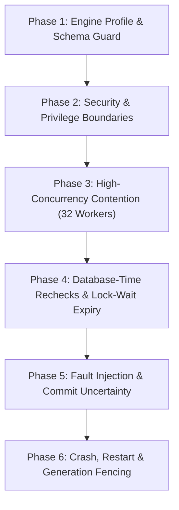

# MariaDB authority transaction qualification plan

- Status: Proposed runbook for coordinator review; implementation pending.
- Requirements: FR-003, FR-007, FR-008, FR-010, FR-012, FR-015;
  SEC-001, SEC-002, SEC-003, SEC-005, SEC-006, SEC-009, SEC-012;
  REL-001, REL-002, REL-004, REL-005;
  DATA-001, DATA-002, DATA-004;
  OPS-002, OPS-004;
  PORT-001, PORT-002, PORT-003.
- Companion design: [MariaDB authority transaction and durable lifecycle composition](../design/mariadb-authority-transaction.md).
- Prior foundation: [MariaDB permit-consumption qualification](mariadb-permit-consumption-qualification.md).

---

## 1. Overview and purpose

This runbook defines the concrete qualification and adversarial testing procedure
for the TracePermit MariaDB authority transaction. It validates that the composed
transaction—uniting business operations, approval decisions, permit consumption,
execution attempts, and evidence outbox—preserves all TracePermit security and
reliability invariants across both MariaDB profiles and the PostgreSQL control
engine.

Static inspection alone does **not** qualify a database implementation. This
runbook mandates executable, container-backed adversarial qualification covering
high-concurrency contention, lock-wait expiry, fault injection, crash recovery,
stale-worker fencing, and privilege isolation.

---

## 2. Target engine matrix

Qualification must execute identically against three containerized database engines:

| Role                     | Database product | Docker container image | Qualification scope                  |
| :----------------------- | :--------------- | :--------------------- | :----------------------------------- |
| **Primary profile**      | MariaDB          | `mariadb:11.4.13`      | Full adversarial & concurrency suite |
| **Transitional profile** | MariaDB          | `mariadb:10.6.25`      | Full adversarial & concurrency suite |
| **Control baseline**     | PostgreSQL       | `postgres:16.4-alpine` | Cross-engine parity verification     |

Any deviation in patch version, default storage engine, or SQL mode fails closed.

---

## 3. Prerequisites and test environment setup

### 3.1 Local workstation prerequisites

1. **Java Development Kit**: Eclipse Temurin OpenJDK 21 (LTS) or newer.
2. **Node.js & Tooling**: Node.js 22+, Corepack, pnpm 11.25.0.
3. **Container Runtime**: Docker Desktop or Docker Engine running with at least
   4 CPU cores and 8 GiB RAM allocated.
4. **Environment Isolation**: A dedicated, clean Git worktree or clone; no
   uncommitted changes or artifacts from other lanes.

### 3.2 Pre-flight image preparation

To avoid network timeouts during automated runs, pre-pull the required images:

```bash
docker pull mariadb:11.4.13
docker pull mariadb:10.6.25
docker pull postgres:16.4-alpine
```

---

## 4. Test execution phases

The qualification suite is organized into six sequential execution phases. Each
phase must pass completely before proceeding to the next.



---

### Phase 1: Engine profile and schema guard verification

**Objective**: Verify that runtime initialization rejects incompatible engines,
unsupported versions, non-InnoDB tables, and non-empty schemas.

#### Test cases

1. **`testEngineProfileRejection`**:
   - Supply connection metadata reporting MySQL 8.0, MariaDB 10.5, or MariaDB 12.0.
   - _Expected result_: Immediate startup failure with fixed error code
     `DATABASE_ENGINE_UNSUPPORTED`.
2. **`testStorageEngineEnforcement`**:
   - Inspect table metadata in `information_schema.tables`.
   - _Expected result_: Every application table has `ENGINE = 'InnoDB'`. Any table
     using MyISAM, Aria, or Memory throws `STORAGE_ENGINE_INVALID`.
3. **`testNonEmptyDatabaseAdoptionRejection`**:
   - Pre-populate a database with a foreign table (`dummy_table`).
   - Invoke `initializeEmpty()`.
   - _Expected result_: Operation fails closed with `DATABASE_SCHEMA_NOT_EMPTY`.
     Zero existing tables are modified or dropped.
4. **`testValidateExistingOnUnmigratedDatabase`**:
   - Invoke `validateExisting()` on an empty or partially migrated schema.
   - _Expected result_: Throws `SCHEMA_VALIDATION_FAILED`; never runs automatic
     migration or repair.

---

### Phase 2: Security and privilege boundary verification

**Objective**: Prove that application runtime connections operate under strict
least-privilege grants and cannot perform unauthorized DDL or destructive mutations.

#### Test cases

1. **`testRuntimeUserCannotDropTables`**:
   - Using a connection authenticated as `tracepermit_runtime`, execute:
     ```sql
     DROP TABLE tp_operation_lifecycle_heads;
     ```
   - _Expected result_: MariaDB returns error `1142` (Access denied for user);
     PostgreSQL returns error `42501` (insufficient privilege).
2. **`testRuntimeUserCannotDeleteRows`**:
   - Using `tracepermit_runtime`, attempt:
     ```sql
     DELETE FROM tp_permit_consumptions WHERE 1=1;
     ```
   - _Expected result_: Execution fails with access denied.
3. **`testRuntimeUserRestrictedHeadUpdate`**:
   - Attempt to update `operation_id` or `created_at` on `tp_operation_lifecycle_heads`.
   - _Expected result_: Access denied. Only column-scoped updates on `(snapshot_hash, snapshot_json, updated_at)`
     are permitted.
4. **`testTenantIsolation`**:
   - Insert an approval under `tenant_a`.
   - Attempt to read or lock the approval using a query scoped to `tenant_b`.
   - _Expected result_: Zero rows returned; no cross-tenant data leakage.

---

### Phase 3: High-concurrency contention suite

**Objective**: Validate deterministic exactly-one-winner semantics and absence
of deadlocks under severe concurrent contention.

#### Test harness parameters

- **Contenders**: 32 concurrent worker threads.
- **Store instances**: 4 distinct repository instances sharing a connection pool.
- **Target operations**:
  - Scenario A: 32 workers racing to claim the same unconsumed permit.
  - Scenario B: 16 workers attempting `withdraw()` while 16 workers attempt
    `consumeAndClaim()` on the same pending approval.

#### Test cases

1. **`testHighConcurrencyPermitClaimContention`**:
   - Submit 32 simultaneous `claim()` calls for identical `(tenant_id, permit_id)`.
   - _Expected result_:
     - Exactly **1** worker receives `ClaimResult.STARTED`.
     - Exactly **31** workers receive `ClaimResult.REPLAYED` or conflict code.
     - Total records inserted into `tp_permit_consumptions`: **1**.
     - MariaDB deadlock count (Error `1213`): **0**.
2. **`testConcurrentWithdrawalVsClaimRace`**:
   - Submit 16 simultaneous withdrawal requests and 16 claim requests for the
     same pending approval.
   - _Expected result_:
     - If withdrawal wins: approval status becomes `cancelled`; exactly 0 execution
       permits or attempts are created; all 16 claim attempts fail with
       `APPROVAL_NOT_EXECUTABLE`.
     - If claim wins: approval status becomes `consumed`; exactly 1 permit and
       1 attempt are created; all 16 withdrawal attempts fail with
       `APPROVAL_NOT_CANCELLABLE`.
     - Mixed or partial states: **0**.

---

### Phase 4: Database-time rechecks and lock-wait expiry

**Objective**: Verify that authorization deadlines are evaluated using the
authoritative database clock after all row locks are acquired.

#### Test cases

1. **`testLockWaitDeadlineExpiry`**:
   - Create an approval with `expires_at = T0 + 1000ms`.
   - Worker 1 acquires `FOR UPDATE` lock on the approval row and holds it for
     1,500ms before rolling back.
   - Worker 2 attempts `consumeAndClaim()` at `T0 + 200ms` and blocks waiting for
     the lock.
   - Worker 2 acquires the lock at `T0 + 1500ms`.
   - _Expected result_:
     - Worker 2 samples `UTC_TIMESTAMP(6)` under the lock.
     - Because `current_db_time > expires_at`, Worker 2 marks the approval `expired`
       and appends an `approval.expired` outbox event.
     - Worker 2 returns `ApprovalConsumptionStatus.APPROVAL_EXPIRED`.
     - **No permit is issued and no attempt row is created.**
2. **`testClockRegressionRejection`**:
   - Injected fault: Database clock returns a timestamp earlier than the row's
     `updated_at`.
   - _Expected result_: Transaction aborts immediately with `DATABASE_CLOCK_REGRESSION`.

---

### Phase 5: Fault injection and commit uncertainty

**Objective**: Prove that connection drops, socket timeouts, or lost commit
acknowledgements fail closed without dispatching external side effects.

#### Test cases

1. **`testLostCommitAcknowledgementFailClosed`**:
   - Inject a socket reset or proxy disconnection immediately after the MariaDB
     server receives the `COMMIT` packet but before the client receives the OK packet.
   - _Expected result_:
     - Transaction coordinator throws `OPERATION_COMMIT_UNKNOWN`.
     - The dispatch pipeline **aborts immediately**; target dispatch (Phase 3)
       is **not executed**.
     - The attempt remains in pending/reconciliation status.
2. **`testPartialWriteRollbackIntegrity`**:
   - Inject an error during Tier 6 (lifecycle fact insert) after Tier 4 and 5
     succeeded.
   - _Expected result_:
     - Entire transaction rolls back.
     - Zero rows remain in `tp_permit_consumptions`, `tp_execution_attempts`, or
       `tp_evidence_outbox`.
     - Subsequent retry executes cleanly without orphan records.

---

### Phase 6: Crash, restart, and generation fencing

**Objective**: Validate that unexpected database restarts roll back uncommitted
transactions, redo-log recovery maintains consistency, and stale workers are fenced out.

#### Test cases

1. **`testContainerCrashRecoveryRollback`**:
   - Begin a multi-row authority transaction.
   - Abruptly kill the container process (`docker kill -s SIGKILL <container>`).
   - Restart the container.
   - _Expected result_:
     - InnoDB crash recovery starts automatically.
     - Uncommitted transaction is rolled back completely.
     - Database integrity passes `CHECK TABLE` with zero corruption.
2. **`testStaleWorkerGenerationFence`**:
   - Worker A caches recovery generation `G1`.
   - Administrative fence increments generation to `G2` in `tp_recovery_quarantine`.
   - Worker A attempts an authority transaction.
   - _Expected result_:
     - Worker A's Tier 0 check fails with `STALE_RECOVERY_GENERATION`.
     - Transaction rolls back before acquiring row locks or evaluating permits.

---

## 5. Execution commands

Run the complete qualification suite across all three engines using the dedicated
Gradle test tasks:

```bash
# 1. Ensure clean environment and frozen dependencies
corepack enable
pnpm install --frozen-lockfile

# 2. Run isolated MariaDB authority transaction qualification suite
pnpm test:java-mariadb --rerun-tasks

# 3. Run full multi-engine persistence and operations test suite
./gradlew :persistence-mariadb:test :persistence-operations:test --rerun-tasks

# 4. Verify formatting, document links, and syntax
pnpm format:check
pnpm docs:links
git diff --check
```

---

## 6. Stop conditions and escalation criteria

Testing must **halt immediately without retry, code modification, or manual
database patching** upon encountering any of the following stop conditions:

1. **Deadlock detected**: Any MariaDB error `1213` (Deadlock found when trying to
   get lock) occurs during concurrency runs. (Indicates broken lock order).
2. **Uncertain dispatch**: Any target side effect is dispatched following an
   `OPERATION_COMMIT_UNKNOWN` result.
3. **Double permit claim**: More than one record exists in `tp_permit_consumptions`
   for the same `(tenant_id, permit_id)`.
4. **Cancelled execution**: An execution attempt is created for an operation whose
   status was marked `cancelled`.
5. **Partial rollback failure**: Rows remain in attempt, permit, or outbox tables
   after an injected transaction failure.
6. **Privilege leakage**: A runtime connection successfully executes `DROP`,
   `DELETE`, `ALTER`, or an unauthorized `UPDATE`.
7. **Engine mismatch**: Container reports an engine version other than `11.4.13`
   or `10.6.25`.

---

## 7. Security and diagnostic sanitization

1. **Zero credential leakage**: Database passwords, connection URLs, master
   credentials, or authorization bearer tokens must **never** appear in test
   logs, standard output, stack traces, PR bodies, or handoff records.
2. **Fingerprints only**: Actor identities and credential references must store
   only stable SHA-256 fingerprints.
3. **Disposal verification**: Upon test completion, verify that all disposable
   containers and network bridges are terminated and pruned:
   ```bash
   docker ps -q --filter "ancestor=mariadb:11.4.13" | xargs -r docker rm -f
   docker ps -q --filter "ancestor=mariadb:10.6.25" | xargs -r docker rm -f
   docker ps -q --filter "ancestor=postgres:16.4-alpine" | xargs -r docker rm -f
   ```
