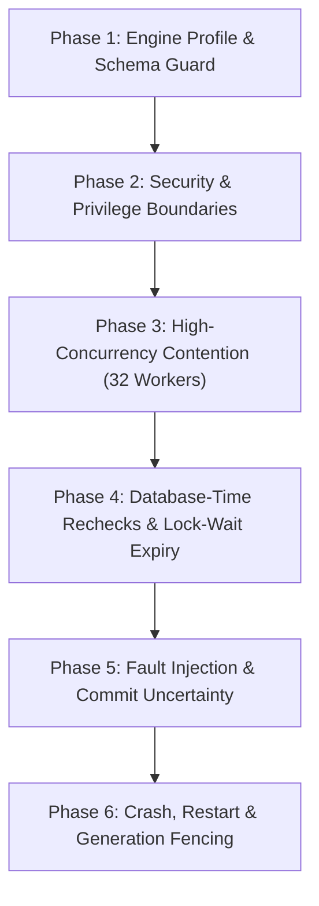

# MariaDB authority transaction qualification plan

- Status: Proposed runbook for coordinator review; implementation pending.
- Requirements: FR-003, FR-007, FR-008, FR-009, FR-010, FR-012, FR-015;
  SEC-001, SEC-002, SEC-003, SEC-004, SEC-005, SEC-006, SEC-009, SEC-010, SEC-012, SEC-019;
  REL-001, REL-002, REL-004, REL-005;
  DATA-001, DATA-004;
  OPS-002, OPS-004;
  PORT-001, PORT-002, PORT-003.
- Companion design: [MariaDB authority transaction and durable lifecycle composition](../design/mariadb-authority-transaction.md).
- Prior foundation: [MariaDB permit-consumption qualification](mariadb-permit-consumption-qualification.md).

---

## 1. Overview and purpose

This runbook defines the concrete qualification and adversarial testing procedure
for the TracePermit MariaDB authority transaction. It validates that the composed
transaction—uniting business operations, approval decisions, permit consumption,
execution attempts, and evidence outbox—preserves all TracePermit security and
reliability invariants across both MariaDB profiles and the PostgreSQL control
engine **once implemented**. The six phases below are future acceptance criteria,
not a current executable suite or passing parity claim. Test names, new result
codes and logical table names are placeholders pending implementation review.
Current evidence is limited to standalone replay and registration/withdrawal;
see [ADR 0072](../architecture/0072-durable-pending-operation-withdrawal.md).

Static inspection alone does **not** qualify a database implementation. This
runbook mandates executable, container-backed adversarial qualification covering
high-concurrency contention, lock-wait expiry, fault injection, crash recovery,
stale-worker fencing, and privilege isolation.

---

## 2. Target engine matrix

Qualification must execute identically against three containerized database engines:

| Role                     | Database product | Docker container image | Qualification scope                  |
| :----------------------- | :--------------- | :--------------------- | :----------------------------------- |
| **Primary profile**      | MariaDB          | `mariadb:11.4.13`      | Full adversarial & concurrency suite |
| **Transitional profile** | MariaDB          | `mariadb:10.6.25`      | Full adversarial & concurrency suite |
| **Control baseline**     | PostgreSQL       | `postgres:16.4-alpine` | Cross-engine parity verification     |

Any deviation in patch version, default storage engine, or SQL mode fails closed.

---

## 3. Prerequisites and test environment setup

### 3.1 Local workstation prerequisites

1. **Java Development Kit**: Compatible JDK 21 with `javac`, selected through
   `scripts/configure-java-environment.sh`; do not assume any newer JDK works.
2. **Node.js & Tooling**: Node.js 22+, Corepack, pnpm 11.25.0.
3. **Container Runtime**: Docker Desktop or Docker Engine running with at least
   4 CPU cores and 8 GiB RAM allocated.
4. **Environment Isolation**: A dedicated branch/worktree with exclusive writer
   ownership, known base/head and exact task-owned container IDs. Never restart
   Docker or prune another lane's containers to prepare a test.

### 3.2 Pre-flight image preparation

To avoid network timeouts during automated runs, pre-pull the required images:

```bash
docker pull mariadb:11.4.13
docker pull mariadb:10.6.25
docker pull postgres:16.4-alpine
```

---

## 4. Test execution phases

The qualification suite is organized into six sequential execution phases. Each
phase must pass completely before proceeding to the next.



---

### Phase 1: Engine profile and schema guard verification

**Objective**: Verify that runtime initialization rejects incompatible engines,
unsupported versions, non-InnoDB tables, and non-empty schemas.

#### Test cases

1. **`testEngineProfileRejection`**:
   - Supply connection metadata reporting MySQL 8.0, MariaDB 10.5, or MariaDB 12.0.
   - _Expected result_: Immediate startup failure with fixed error code
     `DATABASE_ENGINE_UNSUPPORTED`.
2. **`testStorageEngineEnforcement`**:
   - Inspect table metadata in `information_schema.tables`.
   - _Expected result_: Every application table has `ENGINE = 'InnoDB'`. Any table
     using MyISAM, Aria, or Memory throws `STORAGE_ENGINE_INVALID`.
3. **`testNonEmptyDatabaseAdoptionRejection`**:
   - Pre-populate a database with a foreign table (`dummy_table`).
   - Invoke `initializeEmpty()`.
   - _Expected result_: Operation fails closed with `DATABASE_SCHEMA_NOT_EMPTY`.
     Zero existing tables are modified or dropped.
4. **`testValidateExistingOnUnmigratedDatabase`**:
   - Invoke `validateExisting()` on an empty or partially migrated schema.
   - _Expected result_: Throws `SCHEMA_VALIDATION_FAILED`; never runs automatic
     migration or repair.

---

### Phase 2: Security and privilege boundary verification

**Objective**: Prove that application runtime connections operate under strict
least-privilege grants and cannot perform unauthorized DDL or destructive mutations.

#### Test cases

1. **`testRuntimeUserCannotDropTables`**:
   - Using a connection authenticated as `tracepermit_runtime`, execute:
     ```sql
     DROP TABLE tp_operation_lifecycle_heads;
     ```
   - _Expected result_: MariaDB returns error `1142` (Access denied for user);
     PostgreSQL returns error `42501` (insufficient privilege).
2. **`testRuntimeUserCannotDeleteRows`**:
   - Using `tracepermit_runtime`, attempt:
     ```sql
     DELETE FROM tp_permit_consumptions WHERE 1=1;
     ```
   - _Expected result_: Execution fails with access denied.
3. **`testRuntimeUserRestrictedHeadUpdate`**:
   - Attempt to update `operation_id` or `created_at` on `tp_operation_lifecycle_heads`.
   - _Expected result_: Access denied. Only column-scoped updates on `(snapshot_hash, snapshot_json)`
     are permitted.
4. **`testTenantIsolation`**:
   - Insert an approval under `tenant_a`.
   - Attempt to read or lock the approval using a query scoped to `tenant_b`.
   - _Expected result_: Zero rows returned; no cross-tenant data leakage.
5. **`testRuntimeCannotReleaseRecoveryFence`**:
   - Attempt to clear quarantine or change generation as runtime.
   - _Expected result_: Refused; administrative release requires separate authority.
6. **`testExactIdentityComparison`**:
   - Exercise case/trailing-space aliases, maximum contract lengths and prefixed
     71-character SHA-256 values using actual deployed indexes and FKs.
   - _Expected result_: Canonical inputs preserved; invalid aliases rejected;
     no reliance on `ascii_bin` alone for NO PAD semantics.
7. **`testPrimaryOnlyAuthorityAndTls`**:
   - Attempt authority reads/claims through a stale replica or misrouted writer,
     invalid server certificate/hostname, and bounded connection failure.
   - _Expected result_: Refuse authority. Local containers cannot qualify real
     RDS primary routing, failover, replica lag or deployed TLS; retain that
     separate live-infrastructure gate.

---

### Phase 3: High-concurrency contention suite

**Objective**: Validate correct concurrent winners and fail-closed deadlock
handling. Selected schedules cannot prove deadlock freedom.

#### Test harness parameters

- **Contenders**: 32 concurrent worker threads.
- **Store instances**: 4 distinct repository instances sharing a connection pool.
- **Target operations**:
  - Scenario A: 32 workers racing to claim the same unconsumed permit.
  - Scenario B: Pending withdrawal versus reviewer approve/deny, forcing both
    actual lock schedules. No claim can succeed while approval remains pending.
  - Scenario C: Withdrawal versus claims on an already approved request:
    withdrawal is always refused; at most one claim succeeds.

#### Test cases

1. **`testHighConcurrencyPermitClaimContention`**:
   - Submit 32 simultaneous `claim()` calls for identical `(tenant_id, permit_id)`.
   - _Expected result_:
     - Exactly **1** worker receives `ClaimResult.STARTED`.
     - Exactly **31** workers receive `ClaimResult.REPLAYED` or conflict code.
     - Total records inserted into `tp_permit_consumptions`: **1**.
     - MariaDB deadlock count (Error `1213`): **0**.
2. **`testConcurrentWithdrawalVsDecisionRace`**:
   - Force withdrawal-first and reviewer-decision-first real lock waits on pending
     work. Recheck trusted owner/reviewer context and state after the wait.
   - _Expected result_:
     - Withdrawal wins: cancelled, decision refused, zero permits/attempts.
     - Decision wins: approved or denied, withdrawal refused, no claim implied.
     - Duplicate withdrawals/stale state tokens fail; mixed states: **0**.
3. **`testApprovedClaimVsClaimAndWithdrawal`**:
   - On approved work race multiple claims and withdrawal commands.
   - _Expected result_: All withdrawals refused, at most one permit/attempt;
     no new post-approval cancellation semantics.
4. **`testPendingCannotBeClaimed`**:
   - On pending work run claims before and after withdrawal contention.
   - _Expected result_: Zero claims/attempts/target calls, independent of lock order.
5. **`testSharedEvidenceHeadLockSchedules`**:
   - Race different operations sharing an evidence stream with decision, policy
     activation and outbox leasing paths; force lock acquisition in both orders.
   - _Expected result_: Contiguous hash-linked facts, no partial head/outbox state;
     bounded rollback/refusal on deadlock, never a target retry.

---

### Phase 4: Database-time rechecks and lock-wait expiry

**Objective**: Verify that authorization deadlines are evaluated using the
authoritative database clock after all row locks are acquired.

#### Test cases

1. **`testLockWaitDeadlineExpiry`**:
   - Create an approval with `expires_at = T0 + 1000ms`.
   - Worker 1 acquires `FOR UPDATE` lock on the approval row and holds it for
     1,500ms before rolling back.
   - Worker 2 attempts `consumeAndClaim()` at `T0 + 200ms` and blocks waiting for
     the lock.
   - Worker 2 acquires the lock at `T0 + 1500ms`.
   - _Expected result_:
     - Worker 2 samples `UTC_TIMESTAMP(6)` under the lock.
     - Because `current_db_time >= expires_at`, Worker 2 refuses authority.
       Any durable expiry fact must have separately reviewed atomic semantics.
     - **No permit is issued and no attempt row is created.**
2. **`testClockRegressionRejection`**:
   - Injected fault: Database clock returns a timestamp earlier than the row's
     `updated_at`.
   - _Expected result_: Transaction aborts immediately with `DATABASE_CLOCK_REGRESSION`.
3. **`testPolicyLockWaitExpiresAuthority`**:
   - Hold the policy lock after the claimant has obtained the approval lock.
     Release it only after each independently tested approval/actor/permit deadline.
   - _Expected result_: A **fresh statement after the policy wait** detects expiry;
     no claim/attempt/dispatch. A pre-policy time sample must make the probe fail.
4. **`testExpiryEqualityAndScopedBinding`**:
   - Deterministically test exact deadline equality, changed trusted scope, owner,
     policy/artifact/generation and request/profile binding after lock acquisition.
   - _Expected result_: Equality is expired; every mismatched authority is refused.

---

### Phase 5: Fault injection and commit uncertainty

**Objective**: Prove that connection drops, socket timeouts, or lost commit
acknowledgements fail closed without dispatching external side effects.

#### Test cases

1. **`testLostCommitAcknowledgementFailClosed`**:
   - Inject a socket reset or proxy disconnection immediately after the MariaDB
     server receives the `COMMIT` packet but before the client receives the OK packet.
   - _Expected result_:
     - Transaction coordinator throws `OPERATION_COMMIT_UNKNOWN`.
     - The dispatch pipeline **aborts immediately**; target dispatch (Phase 3)
       is **not executed**.
     - Durable state is inspected separately: the transaction may have committed
       or rolled back. Never report a particular stored label from the exception.
2. **`testPartialWriteRollbackIntegrity`**:
   - Inject an error during Tier 6 (lifecycle fact insert) after Tier 4 and 5
     succeeded.
   - _Expected result_:
     - Entire transaction rolls back.
     - Zero rows remain in `tp_permit_consumptions`, `tp_execution_attempts`, or
       `tp_evidence_outbox`.
     - A separate explicitly authorized fresh operation may be tested after
       confirmed rollback; no automatic claim/effect retry is inferred.
3. **`testNonReplayConstraintFailure`**:
   - Inject an unrelated unique/FK/check failure, not the scoped permit replay key.
   - _Expected result_: Fixed storage failure, no false replay/success, no target
     call and no raw or suppressed JDBC diagnostic escape.

---

### Phase 6: Crash, restart, and generation fencing

**Objective**: Validate task-owned container crash recovery, fail-closed new
admission and the explicit limits of stale-worker fencing.

#### Test cases

1. **`testContainerCrashRecoveryRollback`**:
   - Begin a multi-row authority transaction.
   - Abruptly kill and restart only the disposable container whose exact ID,
     task label and ownership the harness recorded; never select by image alone.
   - _Expected result_:
     - InnoDB crash recovery starts automatically.
     - Uncommitted transaction is rolled back completely.
     - Verify semantic row/head/fact/outbox integrity and startup validation;
       engine health tools alone do not prove authorization consistency.
2. **`testStaleWorkerGenerationFence`**:
   - Worker A caches recovery generation `G1`.
   - Administrative fence increments generation to `G2` in `tp_recovery_quarantine`.
   - Worker A attempts an authority transaction.
   - _Expected result_:
     - Worker A's Tier 0 check fails with `STALE_RECOVERY_GENERATION`.
     - Transaction rolls back before operation/approval/permit admission (after
       the quarantine lock/check itself); zero dispatch authority is returned.
3. **`testPausedPostCommitWorkerBoundary`**:
   - Pause a worker after acknowledged admission but before its target call;
     change recovery generation independently.
   - _Expected result_: Document that a prior DB check alone cannot atomically
     fence the later call. Deployment must stop/isolate stale dispatchers. This
     probe must not be reported as instant revocation or exactly-once proof.
4. **`testOlderBackupRequiresExternalRecoveryBoundary`**:
   - Restore an older disposable database snapshot, including its older counter.
   - _Expected result_: Refuse reopening until separately reviewed recovery
     authority/quarantine and reconciliation are established. No database-only
     monotonicity or resurrection-protection claim.

---

## 5. Execution commands

The following **existing foundation commands** do not execute the future six-phase
authority suite. Standalone MariaDB covers replay storage; operations covers
registration/current reads/pending withdrawal on three engines; PostgreSQL covers
its existing composed provider. Record exact commit, XML case/skip counts and
executed/cached task counts rather than promoting these to MariaDB authority parity.

```bash
# 1. Ensure clean environment and frozen dependencies
corepack enable
pnpm install --frozen-lockfile

# 2. Existing standalone MariaDB replay foundation (not composed authority)
pnpm test:java-mariadb

# 3. Existing multi-engine registration/withdrawal and PostgreSQL compositions
pnpm test:java-operations
pnpm test:java-postgres

# 4. Mandatory repository gate and documentation checks
pnpm check
pnpm format:check
pnpm docs:links
pnpm docs:flows:check
git diff --check
```

For a focused forced run, use a bash subshell sourcing
`scripts/configure-java-environment.sh`, then `java/gradlew -p java` with the
actual module task and `--rerun-tasks --no-build-cache`. Do not invent a root
`./gradlew` or forward Gradle flags to pnpm wrappers that do not accept them.
The future authority suite needs an explicit reviewed task and zero-skips receipt
before its planned cases can be marked implemented.

---

## 6. Stop conditions and escalation criteria

Testing must **halt immediately without retry, code modification, or manual
database patching** upon encountering any of the following stop conditions:

1. **Deadlock detected**: Capture bounded fixed diagnostics for error `1213` and
   stop qualification for investigation. It may involve implicit index/FK locks,
   not just broken explicit order. No automatic effect retry or gate weakening.
2. **Uncertain dispatch**: Any target side effect is dispatched following an
   `OPERATION_COMMIT_UNKNOWN` result.
3. **Double permit claim**: More than one record exists in `tp_permit_consumptions`
   for the same `(tenant_id, permit_id)`.
4. **Cancelled execution**: An execution attempt is created for an operation whose
   status was marked `cancelled`.
5. **Partial rollback failure**: Rows remain in attempt, permit, or outbox tables
   after an injected transaction failure.
6. **Privilege leakage**: A runtime connection successfully executes `DROP`,
   `DELETE`, `ALTER`, or an unauthorized `UPDATE`.
7. **Engine mismatch**: Container reports an engine version other than `11.4.13`
   or `10.6.25`.

---

## 7. Security and diagnostic sanitization

1. **Zero credential leakage**: Database passwords, connection URLs, master
   credentials, or authorization bearer tokens must **never** appear in test
   logs, standard output, stack traces, PR bodies, or handoff records.
2. **Credential fingerprints only**: Use the existing trusted principal/scope
   representation and credential fingerprints; never store a reusable secret or
   arbitrarily change canonical identity/hash recipes. No raw sensitive arguments
   in diagnostics or test artifacts.
3. **Disposal verification**: Let Testcontainers close its own resources. Record
   exact task-owned IDs and labels before fault tests. Afterward inspect those
   IDs only; manual cleanup requires verified ownership and must preserve other
   sessions. Never remove all containers of an image, run global prune, or restart
   Docker to clean up this suite. Use bounded worker/executor cleanup so failed
   lock schedules cannot hang the test indefinitely.
