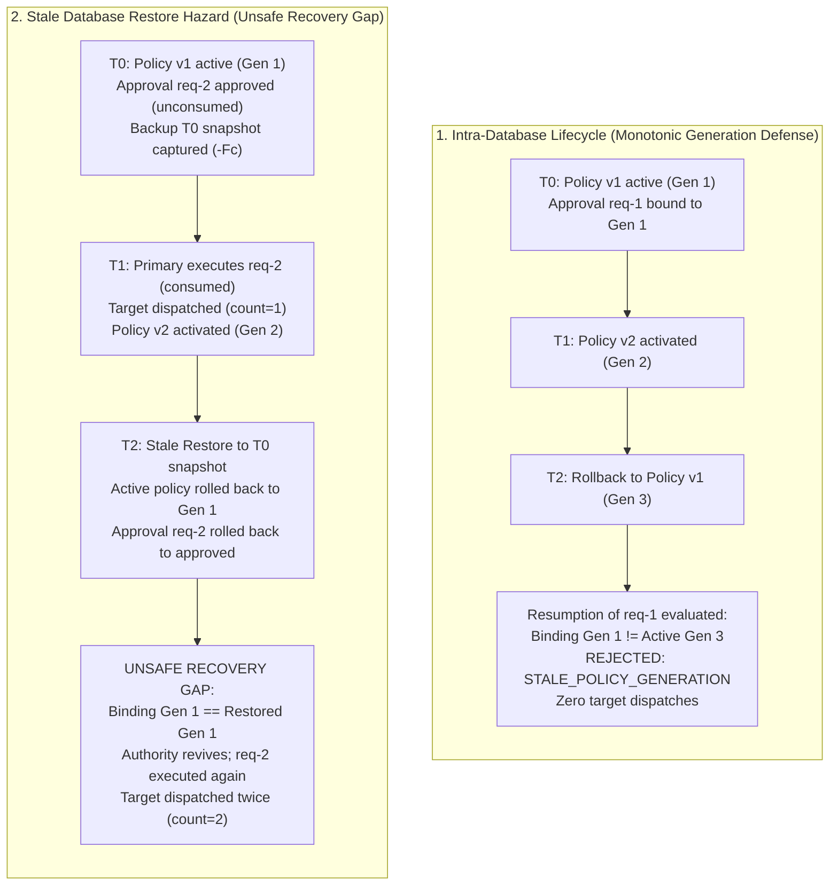

# Policy-generation-bound PostgreSQL backup and restore qualification

Requirements (bounded evidence, not full acceptance): FR-007/008/013;
SEC-005/006; REL-001/003/005; OPS-004.
Related specifications: [System requirements](../specs/02-system-requirements.md),
[Domain and data model](../specs/05-domain-and-data-model.md),
[Sequence flows](../specs/09-sequence-flows.md), and
[ADR 0042 — Durable policy-generation binding](../architecture/0042-durable-policy-generation-binding.md).

> [!IMPORTANT]
> This runbook documents a bounded simulator-only operations qualification slice
> evaluating PostgreSQL 16 `pg_dump` and `pg_restore` against TracePermit's
> opt-in V8 policy-generation-bound approval state. It is **not** a production backup
> product, disaster-recovery orchestrator, or recovery fence. Schema migration V8
> establishes relational tables and triggers, but generation-bound enforcement requires
> explicit opt-in Java service composition.

Current reruns use packaged V1–V9 (V8 introduced the policy binding). Capture now
also includes the V9 recovery row, before and after service recreation. Scenario E
declares source quarantine after its snapshot, then proves that restoring the
older archive restores `ready` and can dispatch the old approval again. This is
deliberate unsafe-gap characterization, not a supported resume procedure. See
[ADR 0051](../architecture/0051-operator-declared-recovery-quarantine.md).

---

## 1. Scope and PostgreSQL 16 foundation

This qualification establishes empirical boundaries for backup and recovery of
TracePermit when approvals are bound to durable policy lifecycle generations (ADR 0042).

- **Archive format:** PostgreSQL custom archive format (`-Fc`), captured with `pg_dump`
  and restored with `pg_restore`.
- **References:**
  - [PostgreSQL 16 Documentation: Chapter 26. Backup and Restore - SQL Dump](https://www.postgresql.org/docs/16/backup-dump.html)
  - [PostgreSQL 16 `pg_dump` Reference](https://www.postgresql.org/docs/16/app-pgdump.html)
  - [PostgreSQL 16 `pg_restore` Reference](https://www.postgresql.org/docs/16/app-pgrestore.html)

### Tested command sequence

```bash
# 1. Capture point-in-time custom archive (compressed, structured dependency catalog)
pg_dump -U "$PGUSER" -d "$SOURCE_DB" -Fc -f "$DUMP_FILE"

# 2. Restrict file permissions to owner-only inside container
chmod 0600 "$DUMP_FILE"

# 3. Restore into a newly initialized, empty target database
pg_restore -U "$PGUSER" -d "$TARGET_DB" --single-transaction --exit-on-error "$DUMP_FILE"
```

The restore runner uses `--single-transaction --exit-on-error` to ensure that any
SQL-command error aborts the restore transaction with a non-zero exit code.
This does not prove that the input archive contains all required historical state.
Only trusted, generated fixture archives are accepted: restore can execute code
chosen by the source database administrator. These commands illustrate the test
fixture, not a supported customer recovery procedure.

Each case owns two fresh databases created from `template0` inside one disposable
`postgres:16.4-alpine` container. The test checks successful dump, permission/size
inspection and restore exit codes; each archive is owner-only (`0600`), nonempty
and smaller than 5 MiB. Container cleanup removes only fixture-owned artifacts.
The fixture uses database administration/migration rights, not a qualified
least-privilege runtime role. Ephemeral Ed25519 keys stay outside the database
archive and are retained across service recreation; independent key backup,
custody and rotation are not covered. No operator database URL, real identity,
cloud credential, customer archive or real downstream service is used.

---

## 2. Monotonic generations vs. the time-travel recovery hazard

ADR 0042 guarantees that within a single continuous database history, policy activation
generations (`activation_sequence`) advance monotonically. If policy version 1 is active
under generation 1, then version 2 is activated under generation 2, and version 1 is
subsequently restored via rollback under generation 3, approvals evaluated under generation 1
fail closed with `STALE_POLICY_GENERATION` even though the version number (1) and content hash
match the active policy.

However, restoring an older database snapshot (e.g. from T0) rolls back the entire database
state—including both the active policy generation counter in `tp_active_policies` and the
approval request status in `tp_approval_requests`. Because the generation counter resides
inside the database, it cannot serve as an external monotonic witness across backup and
restore operations.



---

## 3. Qualified behaviors

The test suite [`PostgresPolicyBoundRestoreQualificationTest.java`](../../java/persistence-postgres/src/test/java/io/tracepermit/persistence/postgres/PostgresPolicyBoundRestoreQualificationTest.java)
empirically qualifies five distinct generation-bound lifecycle scenarios against real
PostgreSQL 16 Testcontainers instances:

### 3.1. Scenario A: Restored valid pending/bound approval

A valid pending approval bound to active policy generation 1 is backed up and restored
into an empty destination database:

- **Pre-constructor parity:** Raw SQL queries inspect `tp_enforcement_schema_guard`,
  `flyway_schema_history` (all V1–V9 rows, including checksums), and all 16 other
  application tables _before_ any destination Java store or service constructors
  execute. Every captured row/field is compared with the quiescent source capture,
  including nonempty bindings, exact action snapshots, approval and policy state.
  Parity is rechecked after construction. All five cases use this comparison.
- **Zero implicit dispatch:** Constructing repositories and services against the restored
  database triggers zero target dispatches.
- **Review and execution:** A distinct synthetic reviewer (`user:security-reviewer-2@example.invalid`)
  approves the restored request. Resumption executes successfully against the simulated target
  exactly once.
- **Replay rejection:** Immediate re-execution throws `IllegalStateException("APPROVAL_NOT_EXECUTABLE")`
  with zero additional target calls.

### 3.2. Scenario B: Restored consumed bound approval

An approval is executed and consumed on the source database before backup:

- **State preservation:** Restored database preserves the exact `ApprovalPolicyBinding`,
  complete approval and attempt records, exact action snapshot, terminal `consumed`
  status and all five captured evidence records. The local hash-linked evidence
  chain is reverified; this is not an independently signed recovery anchor.
- **Resumption rejection:** Calling `executeApproved` on the restored service throws
  `IllegalStateException("APPROVAL_NOT_EXECUTABLE")`.
- **Direct claim rejection:** Calling `consumeAndClaim` directly on `PostgresDurableEnforcementState`
  returns `ApprovalConsumptionStatus.APPROVAL_REPLAYED`.
- **Zero effects:** The external target counter remains at 1 with zero new invocations.

### 3.3. Scenario C: Restored stale binding after activation

An approval is bound and approved under v1 generation 1. Before backup, an operator activates
v2 generation 2:

- **State preservation:** The backup captures the v1/gen1 approval binding alongside the
  v2/gen2 active policy document.
- **Resumption rejection:** Attempting to execute the approved action after restore throws
  `IllegalStateException("STALE_POLICY_GENERATION")`.
- **Direct claim rejection:** Direct `consumeAndClaim` returns `ApprovalConsumptionStatus.STALE_POLICY_GENERATION`.
- **Integrity verified:** Target counter remains 0; no permit is consumed in `tp_consumed_execution_permits`,
  and no execution attempt is recorded.

### 3.4. Scenario D: Restored stale binding after rollback

An approval is bound under v1/gen1, v2/gen2 is activated, and the policy is rolled back
to v1/gen3 before backup:

- **Version parity vs. generation mismatch:** In the restored database, the active policy
  has `version = 1` and matches the content hash of v1. However, its generation is `3`.
  The original approval binding has `policyVersion = 1` but `policyGeneration = 1`.
- **Stale rejection:** Resumption of the gen1 approval throws `IllegalStateException("STALE_POLICY_GENERATION")`
  without dispatching to the target.
- **Fresh control qualification:** A freshly requested approval under the restored database
  binds to generation 3, is reviewed, and executes successfully (target counter increments to 1).

### 3.5. Scenario E: Explicit stale-backup hazard (UNSAFE RECOVERY GAP)

This scenario demonstrates the critical hazard of restoring a pre-consumption snapshot:

1. **T0:** Approval requested and approved under v1/gen1. Database snapshot T0 captured.
2. **T1:** Approval executed on primary (target counter = 1, status = consumed). Active policy
   advanced to v2/gen2.
3. **T2:** Database restored from snapshot T0 while within the 300-second approval lifetime.
4. **Observation:**
   - Active policy generation in the restored database rolled back to `1`.
   - Approval request in the restored database rolled back to `approved` (unconsumed).
   - Approval policy binding in the restored database rolled back to generation `1`.
   - `executeApproved` succeeds, mints a fresh permit, and dispatches to the simulated target
     a **second time** (target counter = 2).

The immutable binding itself never changed on the source; its old gen1 value
survives while the active pointer moves to gen2. Restore makes the old binding
match the old active pointer again. The original request/action, approval decision
and idempotency key are retained; the second execution has distinct permit and
attempt IDs. The independent target counter is not reset. A coherent fixed clock
puts restore at T0+30 seconds, explicitly before the original 300-second expiry.

This case additionally calls the strict existing-state validator from
[ADR 0045](../architecture/0045-explicit-database-initialization.md) on the raw
restored snapshot: validation succeeds without changing captured state. Schema
validation is not an external recovery witness. The opt-in service fixture still
uses the backward-compatible auto-migrating store constructors, not the default
static-policy operator launcher; neither factory composition nor schema V8
silently enables generation binding in that launcher.

> [!CAUTION]
> **UNSAFE RECOVERY GAP:** A database backup contains only the database's internal state.
> If an approved action was executed against an external target after the backup was captured,
> restoring that backup revives the unconsumed approval authority and rolls back the generation
> counter, allowing duplicate execution.

---

## 4. Boundary analysis

| Dimension                           | Existing Behavior                                                            | Demonstrated Gap                                                                           | Future Work (Out of Scope)                               |
| :---------------------------------- | :--------------------------------------------------------------------------- | :----------------------------------------------------------------------------------------- | :------------------------------------------------------- |
| **Intra-database policy evolution** | Tested activation and rollback reject stale approvals before claim/dispatch. | These five cases are not exhaustive concurrency or adversarial database qualification.     | Remote policy admin APIs.                                |
| **Database backup / restore**       | All captured table rows match before/after destination service recreation.   | Generations roll back with the snapshot; database cannot act as external recovery witness. | Separately reviewed external recovery fencing.           |
| **Post-restore approval execution** | Restored approved requests can execute under a matching restored generation. | Stale restore produces a second synthetic effect; real targets were not tested.            | Designed quarantine and authority invalidation workflow. |
| **Transport / identity**            | Synthetic trusted reviewer contexts used in test process.                    | Test runner fixture rights are not OIDC qualification.                                     | External IdP qualification and token revocation sync.    |

---

## 5. Recovery safety boundary — no supported resume procedure

Keep restored state isolated from effectful services and agents. Do not reconnect
or resume merely because restore or strict startup validation succeeds. A reviewed
procedure must reconcile external effects, approval authority, active policy and
identity/key state outside the old snapshot before permitting traffic.

There is no implemented quarantine switch, external monotonic recovery epoch,
bulk cancellation/revocation operation or supported production resume workflow.
Direct SQL edits are not a substitute: `cancelled` is not a supported approval
status, and triggers reject direct approval mutation. Do not disable those guards
or rewrite approval/binding/evidence rows. See
[ADR 0044](../architecture/0044-database-restore-safety-limits.md).
No RPO/RTO, cross-version upgrade, general multi-tenant restore, independent
evidence authenticity or production readiness is established here.

---

## 6. Reproduction and test execution

The behavior documented in this runbook is verified deterministically by:

```bash
# Run focused policy-bound backup/restore qualification
./java/gradlew -p java :persistence-postgres:test \
  --tests io.tracepermit.persistence.postgres.PostgresPolicyBoundRestoreQualificationTest

# Run full repository quality and link verification gates
pnpm check
pnpm format:check
pnpm docs:links
pnpm docs:flows:check
git diff --check
```

---

## 7. Traceability and proposed follow-up

- `FR-007/008`, `SEC-005/006`: exact approval/action binding, single-use claims and
  captured consumed-state replay rejection in the tested snapshot.
- `FR-013`: populated policy lifecycle revisions/generations survive restore;
  obsolete generation remains rejected across activation and cyclic rollback.
- `REL-001/003/005`, `OPS-004`: bounded recovery/idempotency evidence and an
  explicit unresolved stale-snapshot hazard, **not completed safe recovery**.
- Evidence row equality and local hash-chain verification do not establish
  `SEC-009` tenant isolation or `DATA-001` credential-fingerprint compliance.
  Those requirements have separate evidence and are not upgraded by this suite.
- [Traceability](../specs/12-traceability-matrix.md) and ADR 0044 record this
  characterization. Recovery-fence design and authority invalidation remain future
  work, not an operator instruction implemented by this PR.
