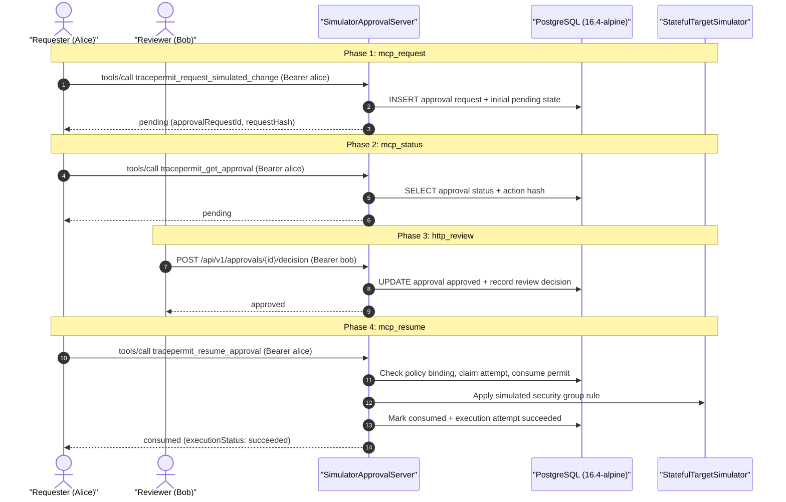

# Simulator approval latency qualification

Requirements: PERF-001/002/003; OPS-003; SEC-001/002/005/006; REL-001/005.  
Decisions: [ADR 0034](../architecture/0034-authenticated-loopback-approval-api.md), [ADR 0035](../architecture/0035-local-approval-operator-bootstrap.md), [ADR 0036](../architecture/0036-local-browser-approval-boundary.md), [ADR 0037](../architecture/0037-mcp-durable-simulator-approval-composition.md), [ADR 0041](../architecture/0041-postgres-durable-permit-consumption.md), [ADR 0042](../architecture/0042-durable-policy-generation-binding.md), [ADR 0044](../architecture/0044-database-restore-safety-limits.md), [ADR 0045](../architecture/0045-explicit-database-initialization.md).

This runbook documents the reproducible latency qualification harness for TracePermit's authenticated, durable simulator approval runtime. It provides honest, repeatable latency and throughput measurements across loopback HTTP, Model Context Protocol (MCP) tool dispatches, RS256 token verification, Ed25519 execution permits, and PostgreSQL durable state transitions.

> [!IMPORTANT]
> This is a bounded operations qualification slice of **TP-MVP-17**, not completion of the operations gate or production cloud certification. It qualifies the loopback simulator approval lifecycle backed by a disposable PostgreSQL container (`postgres:16.4-alpine`). It does **not** evaluate non-approval fast-path operations (PERF-001/002), production database clustering, cross-region WAN transit, or third-party Identity Provider (IdP) network latency.

---

## 1. Methodology and Architecture

The harness exercises the four sequential phases of an authenticated durable approval in TracePermit:



### Authorization Clock vs. Physical Latency Clock

Synthetic access tokens, review lifetimes, and execution permits require temporal bounds. In order to decouple test correctness from unpredictable test execution duration, the harness uses two clocks:

- **Controlled Frozen Authorization Clock (`2030-01-01T00:00:00Z UTC`)**: Feeds token verification, permit lifetime validation, and approval expiry checks. Synthetic credentials and tokens minted for the benchmark never expire mid-run.
- **Physical Wall Clock (`System.nanoTime()`)**: Strictly bounds every measured request round-trip (`HttpRequest` serialization $\to$ loopback socket $\to$ server dispatch $\to$ database transaction $\to$ `HttpResponse` parsing).

### Statistical Math

- **Nearest-Rank Percentiles**: For sample size $N$ and target percentile $p \in (0, 1]$, rank index $r = \lceil p \times N \rceil$, corresponding to 0-based index $i = r - 1$ in the sorted latency array.
- **Warmup Isolation**: Warmup operations exercise the full pipeline (JIT compilation, connection pooling, Flyway verification) but are excluded from latency percentiles and throughput counters.
- **Throughput Calculation**: $\text{Throughput} = \frac{\text{Success Count}}{\text{Elapsed Wall Seconds}}$.

### Inclusions and Exclusions

| Included in Timing                        | Excluded from Timing                               |
| ----------------------------------------- | -------------------------------------------------- |
| HTTP client request serialization         | Asymmetric RSA/Ed25519 keypair generation          |
| Loopback TCP socket network transit       | Container startup and Flyway schema migrations     |
| HTTP server parsing & routing             | JWT access token minting and cryptographic signing |
| RS256 synthetic access token verification | Human review think/waiting time                    |
| PostgreSQL durable transaction execution  | Latency percentiles and report calculation         |
| Stateful simulator effect application     | Post-qualification report serialization            |

---

## 2. Running the Qualification

The qualification harness requires **Docker** (for Testcontainers) and **Java 21**.

### Standalone CLI Execution

Run the complete multi-concurrency qualification sweep:

```bash
./java/gradlew -p java :adapters-http:runSimulatorApprovalLatencyQualification
```

This task compiles test classes, starts an isolated `postgres:16.4-alpine` container, executes concurrency sweeps at levels 1, 4, and 20, runs negative and replay controls, and prints human-readable tables followed by canonical JSON.

### Fast CI Smoke and Unit Verification

Run unit tests and lightweight integration smoke tests:

```bash
./java/gradlew -p java :adapters-http:test --tests io.tracepermit.adapters.http.ApprovalLatencyMeasurementsTest
```

---

## 3. Baseline Measurements

The following baseline was recorded on an Apple Silicon host (`aarch64`, 10 CPUs, macOS, OpenJDK 21):

### Concurrency 1 (Warmup: 5, Measured: 20 operations)

| Phase         | Samples | p50 (ms) | p95 (ms) | p99 (ms) | Mean (ms) | Throughput |
| :------------ | :------ | :------- | :------- | :------- | :-------- | :--------- |
| `mcp_request` | 20      | 31.027   | 38.208   | 40.885   | 32.076    | 31.2 op/s  |
| `mcp_status`  | 20      | 18.248   | 22.733   | 23.033   | 18.794    | 53.1 op/s  |
| `http_review` | 20      | 43.986   | 48.486   | 50.103   | 44.649    | 22.4 op/s  |
| `mcp_resume`  | 20      | 83.810   | 90.393   | 91.939   | 83.812    | 11.9 op/s  |

- **Total Elapsed**: 4605.91 ms
- **Observed Rule Delta**: 25 (5 warmup + 20 measured)
- **Consumed Permits**: 25
- **Execution Attempts**: 25

### Concurrency 4 (Warmup: 8, Measured: 32 operations)

| Phase         | Samples | p50 (ms) | p95 (ms) | p99 (ms) | Mean (ms) | Throughput |
| :------------ | :------ | :------- | :------- | :------- | :-------- | :--------- |
| `mcp_request` | 32      | 27.116   | 35.882   | 37.537   | 27.695    | 139.9 op/s |
| `mcp_status`  | 32      | 19.507   | 23.250   | 23.327   | 19.919    | 200.2 op/s |
| `http_review` | 32      | 45.668   | 57.362   | 59.806   | 47.838    | 80.9 op/s  |
| `mcp_resume`  | 32      | 100.583  | 124.950  | 130.671  | 102.913   | 38.3 op/s  |

- **Total Elapsed**: 2052.63 ms
- **Observed Rule Delta**: 40 (8 warmup + 32 measured)
- **Consumed Permits**: 65 (cumulative)
- **Execution Attempts**: 65 (cumulative)

### Concurrency 20 (Warmup: 20, Measured: 40 operations)

| Phase         | Samples | p50 (ms) | p95 (ms) | p99 (ms) | Mean (ms) | Throughput |
| :------------ | :------ | :------- | :------- | :------- | :-------- | :--------- |
| `mcp_request` | 40      | 91.579   | 106.583  | 117.392  | 83.129    | 194.8 op/s |
| `mcp_status`  | 40      | 48.409   | 66.244   | 66.650   | 47.078    | 347.0 op/s |
| `http_review` | 40      | 126.952  | 155.110  | 166.414  | 116.506   | 140.5 op/s |
| `mcp_resume`  | 40      | 304.729  | 380.891  | 434.205  | 287.945   | 57.4 op/s  |

- **Total Elapsed**: 2005.64 ms
- **Observed Rule Delta**: 60 (20 warmup + 40 measured)
- **Consumed Permits**: 125 (cumulative)
- **Execution Attempts**: 125 (cumulative)

### Fail-Secure Controls

| Control                    | Expected Outcome                                      | Observed                                  | Status   |
| :------------------------- | :---------------------------------------------------- | :---------------------------------------- | :------- |
| **Unauthenticated Call**   | HTTP 401 Unauthorized, 0 state effects                | HTTP 401, rule delta = 0                  | **PASS** |
| **Consumed Permit Replay** | Tool error `APPROVAL_NOT_EXECUTABLE`, 0 state effects | `APPROVAL_NOT_EXECUTABLE`, rule delta = 0 | **PASS** |

---

## 4. Report JSON Schema

The qualification run produces machine-readable JSON matching the following structure:

```json
{
  "schemaVersion": "1.0",
  "timestamp": "2026-10-17T04:40:22.000Z",
  "profile": "simulator-authenticated-durable-approval",
  "composition": "static-policy simulator server, fixture-resolved RS256 token verification, PGSimpleDataSource, loopback HTTP",
  "clock": "System.nanoTime() elapsed duration; frozen synthetic authorization clock (2030-01-01)",
  "provenance": {
    "commitSha": "d872a11daf12eac4dd2d101cb46587e9c016eb29",
    "dirty": "true"
  },
  "environment": {
    "os": "Mac OS X 27.2",
    "arch": "aarch64",
    "availableProcessors": "10",
    "javaVersion": "21.0.12.1 (Homebrew)",
    "postgresVersion": "postgres:16.4-alpine (Testcontainers)"
  },
  "timingIncluded": [
    "http_client_serialization",
    "loopback_tcp_network_transit",
    "server_http_and_json_parsing",
    "rs256_synthetic_access_token_verification",
    "postgres_durable_transactions",
    "stateful_simulator_effect"
  ],
  "timingExcluded": [
    "key_pair_generation",
    "container_startup_and_schema_migrations",
    "jwt_token_minting_and_signing",
    "human_review_waiting",
    "latency_percentiles_calculation"
  ],
  "sweeps": [
    {
      "concurrency": 1,
      "totalElapsedWallTimeMs": 4605.906,
      "observedRuleDelta": 25,
      "durableConsumedPermits": 25,
      "durableExecutionAttempts": 25,
      "phases": {
        "mcp_request": {
          "phaseName": "mcp_request",
          "concurrency": 1,
          "warmupOperations": 5,
          "measuredOperations": 20,
          "successCount": 20,
          "failureCount": 0,
          "timeoutCount": 0,
          "elapsedWallTimeMs": 641.987,
          "throughputOpsPerSec": 31.15,
          "percentiles": {
            "p50Ms": 31.027,
            "p95Ms": 38.208,
            "p99Ms": 40.885,
            "minMs": 28.674,
            "maxMs": 40.885,
            "meanMs": 32.076
          }
        }
      }
    }
  ],
  "controls": {
    "unauthenticatedRejected": true,
    "replayRejected": true,
    "replayRuleDelta": 0
  },
  "passed": true
}
```

---

## 5. Physical Bottlenecks and Limits of Qualification

1. **Phase Asymmetry**:
   - `mcp_status` is read-dominated and lightweight (~18 ms p50 at concurrency 1).
   - `http_review` incurs transactional state updates (~44 ms p50).
   - `mcp_resume` is the most resource-intensive phase (~84 ms p50 at concurrency 1, ~305 ms at concurrency 20), as it executes policy generation checks, durable execution claims, Ed25519 permit verification, permit consumption, simulator state modification, and execution transition logging in atomic PostgreSQL transactions.

2. **Connection and Containerization Overhead**:
   - The harness connects directly via `PGSimpleDataSource` without an external connection pooler like PgBouncer. Under high concurrency (concurrency 20), database lock contention and connection acquisition latency dominate p95 and p99.
   - Virtualized container I/O (Docker Desktop for macOS) introduces measurable jitter not present on native Linux kernel deployments.

3. **Non-Claims and Honest Boundaries**:
   - These measurements do **not** bound production cloud deployments where PostgreSQL runs on managed instances with write-ahead log replication across multiple availability zones.
   - External IdPs (e.g. Okta, Entra ID) introduce 50–250 ms network round-trip overhead during OAuth discovery and token issuance; this harness intentionally isolates TracePermit's internal enforcement latency from third-party IdP availability.
