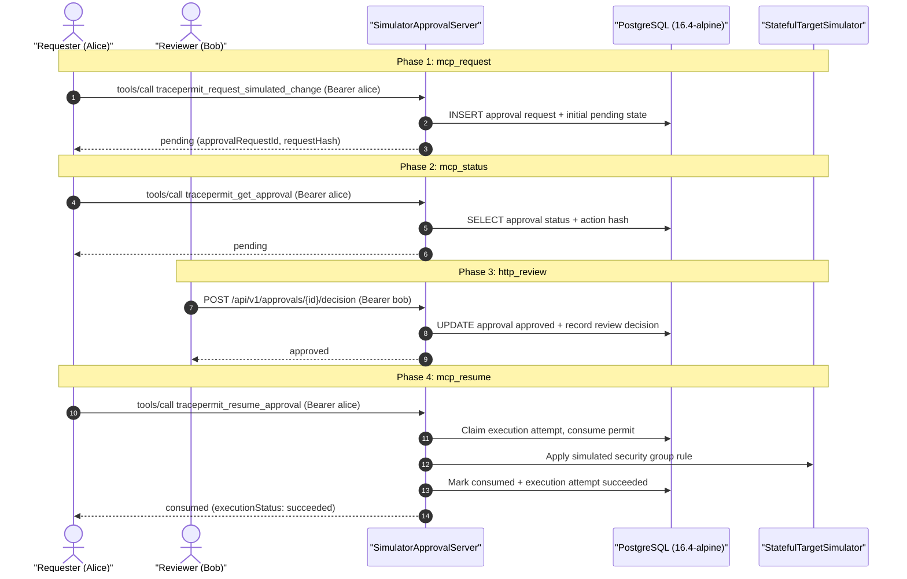

# Simulator approval latency qualification

Requirements (bounded slice): PERF-001/002/003; OPS-003; SEC-001/002/005/006; REL-001/005.
Decisions: [ADR 0034](../architecture/0034-authenticated-loopback-approval-api.md), [ADR 0035](../architecture/0035-local-approval-operator-bootstrap.md), [ADR 0036](../architecture/0036-local-browser-approval-boundary.md), [ADR 0037](../architecture/0037-mcp-durable-simulator-approval-composition.md), [ADR 0041](../architecture/0041-postgres-durable-permit-consumption.md), [ADR 0044](../architecture/0044-database-restore-safety-limits.md), [ADR 0045](../architecture/0045-explicit-database-initialization.md).

This runbook documents the reproducible latency qualification harness for TracePermit's authenticated, durable simulator approval runtime. It provides honest, repeatable latency and closed-loop phase throughput measurements across loopback HTTP, Model Context Protocol (MCP) tool dispatches, RS256 token verification, Ed25519 execution permits, and PostgreSQL durable state transitions.

> [!IMPORTANT]
> This is a bounded operations qualification slice of **TP-MVP-17**, not completion of the operations gate, production cloud certification, or a latency SLO guarantee. It qualifies the loopback simulator approval lifecycle backed by a disposable PostgreSQL container (`postgres:16.4-alpine`). It does **not** evaluate non-approval fast-path operations (PERF-001/002), durable policy generation binding (which is evaluated on dynamic-policy runtimes), production database clustering, cross-region WAN transit, or third-party Identity Provider (IdP) network latency.

---

## 1. Methodology and Architecture

The harness exercises the four sequential phases of an authenticated durable approval in TracePermit:



### Authorization Clock vs. Physical Latency Clock

Synthetic access tokens, review lifetimes, and execution permits require temporal bounds. In order to decouple test correctness from unpredictable test execution duration, the harness uses two clocks:

- **Controlled Frozen Authorization Clock (`2030-01-01T00:00:00Z UTC`)**: Feeds token verification, permit lifetime validation, and approval expiry checks. Synthetic credentials and tokens minted for the benchmark never expire mid-run.
- **Physical Wall Clock (`System.nanoTime()`)**: Strictly bounds every measured request round-trip (`HttpRequest` serialization $\to$ loopback socket $\to$ server dispatch $\to$ database transaction $\to$ `HttpResponse` parsing).

### Statistical Math & Exact Accounting

- **Exact Terminal Outcome Accounting**: Every planned operation across all phases is accounted for in an immutable terminal outcome (`SUCCESS`, `FAILURE`, `TIMEOUT`, or `CANCELLED_OR_NOT_STARTED`).
- **Nearest-Rank Percentiles**: For sample size $N$ and target percentile $p \in (0, 1]$, rank index $r = \lceil p \times N \rceil$, corresponding to 0-based index $i = r - 1$ in the sorted latency array. Sample sizes of 20, 32, and 40 mean that p99 reflects the maximum observed sample in the batch ($r = \lceil 0.99 \times 20 \rceil = 20 \implies \text{index } 19$), not a long-tail capacity guarantee.
- **Population Isolation**: Percentiles reflect `success_only` steady-state samples. Failures and timeouts are never manufactured as 0.0 ms observations; any failure or timeout immediately records an error and invalidates the PASS status of the qualification.
- **Warmup Correctness**: Warmup operations exercise JIT compilation, classloading, and initial TCP handshakes. Warmup counts are excluded from steady-state latency percentiles, but any warmup failure immediately invalidates qualification and prevents dependent phases from executing with incomplete IDs.
- **Closed-Loop Phase Throughput**: $\text{Throughput} = \frac{\text{Success Count}}{\text{Elapsed Wall Seconds}}$. This represents bounded closed-loop phase operations per second, not open-loop system capacity or end-to-end workflows per second.

### Inclusions and Exclusions

| Included in Timing                        | Excluded from Timing                               |
| ----------------------------------------- | -------------------------------------------------- |
| HTTP client request serialization         | Asymmetric RSA/Ed25519 keypair generation          |
| Loopback TCP socket network transit       | Container startup and Flyway schema migrations     |
| HTTP server parsing & routing (8 workers) | JWT access token minting and cryptographic signing |
| RS256 synthetic access token verification | Human review think/waiting time                    |
| PostgreSQL durable transaction execution  | Latency percentiles and report calculation         |
| Stateful simulator effect application     | Post-qualification report serialization            |

---

## 2. Running the Qualification

The qualification harness requires **Docker** (for Testcontainers) and **Java 21**.

### Standalone CLI Execution

Run the complete multi-concurrency qualification sweep:

```bash
./java/gradlew -p java :adapters-http:runSimulatorApprovalLatencyQualification
```

This task compiles test classes, starts an isolated `postgres:16.4-alpine` container, executes concurrency sweeps at levels 1, 4, and 20, asserts safety evidence (zero deltas before resume, exact rule, permit, and attempt deltas after resume), runs unauthenticated and replay negative controls, and prints human-readable tables followed by canonical JSON.

### Fast CI Smoke and Unit Verification

Run unit tests and lightweight integration smoke tests:

```bash
./java/gradlew -p java :adapters-http:test --tests io.tracepermit.adapters.http.ApprovalLatencyMeasurementsTest
```

---

## 3. Repaired Benchmark Measurements

### Reading a failed qualification

The success gate retains every sweep and counter assertion. A failed phase now
includes a bounded map of fixed operation categories, including numeric HTTP
statuses. Unknown exception messages become `OTHER_OPERATION_FAILURE`; raw
response bodies, credentials, request IDs, and arbitrary exception text are not
copied into that map. At most eight distinct recognized categories plus the
fallback are retained.

The standalone runner also observes a fixed set of PostgreSQL log phrases and
publishes only their constant category names on failure. This is asynchronous
test-container diagnostic observation, not a unique-error count, SQL-state
guarantee, target outcome, or proof that no database error occurred when empty.
No raw SQL/log text is published by this diagnostic. Default HTTP/phase budgets,
concurrency, warmup/measured counts, approval rules, and execution counters are
unchanged. A failed qualification remains failed; do not automatically retry an
effect, increase limits, or accept a locally passing run instead of required CI.

`LatencyFailureDiagnosticsTest` checks category bounds, exact failure accounting,
known HTTP statuses, unknown-message canaries, and PostgreSQL log projection.

### Historical measurements

The following measurements reflect the repaired qualification harness running on an Apple Silicon host (`aarch64`, 10 host CPUs, macOS, OpenJDK 21, `postgres:16.4-alpine` via Testcontainers):

### Concurrency 1 (Warmup: 5, Measured: 20 operations; 1 client thread vs 8 server workers)

| Phase         | Samples | p50 (ms) | p95 (ms) | p99 (ms) | Mean (ms) | Throughput |
| :------------ | :------ | :------- | :------- | :------- | :-------- | :--------- |
| `mcp_request` | 20      | 34.303   | 38.891   | 38.925   | 34.646    | 28.8 op/s  |
| `mcp_status`  | 20      | 18.372   | 24.207   | 24.616   | 19.138    | 52.2 op/s  |
| `http_review` | 20      | 44.491   | 54.710   | 92.143   | 46.767    | 21.4 op/s  |
| `mcp_resume`  | 20      | 84.610   | 90.499   | 92.068   | 85.395    | 11.7 op/s  |

- **Total Elapsed**: 3721.25 ms
- **Observed Rule Delta**: 25 (5 warmup + 20 measured)
- **Consumed Permits**: 25
- **Execution Attempts**: 25

### Concurrency 4 (Warmup: 8, Measured: 32 operations; 4 client threads vs 8 server workers)

| Phase         | Samples | p50 (ms) | p95 (ms) | p99 (ms) | Mean (ms) | Throughput |
| :------------ | :------ | :------- | :------- | :------- | :-------- | :--------- |
| `mcp_request` | 32      | 28.309   | 41.023   | 44.197   | 29.924    | 129.7 op/s |
| `mcp_status`  | 32      | 20.598   | 28.073   | 28.115   | 21.552    | 184.7 op/s |
| `http_review` | 32      | 44.389   | 55.650   | 57.221   | 46.368    | 84.5 op/s  |
| `mcp_resume`  | 32      | 103.225  | 114.560  | 118.269  | 103.533   | 38.1 op/s  |

- **Total Elapsed**: 2107.51 ms
- **Observed Rule Delta**: 40 (8 warmup + 32 measured)
- **Consumed Permits**: 65 (cumulative)
- **Execution Attempts**: 65 (cumulative)

### Concurrency 20 (Warmup: 20, Measured: 40 operations; 20 client threads vs 8 server workers)

| Phase         | Samples | p50 (ms) | p95 (ms) | p99 (ms) | Mean (ms) | Throughput |
| :------------ | :------ | :------- | :------- | :------- | :-------- | :--------- |
| `mcp_request` | 40      | 102.300  | 111.461  | 125.357  | 90.041    | 178.6 op/s |
| `mcp_status`  | 40      | 49.151   | 70.564   | 70.716   | 49.309    | 330.3 op/s |
| `http_review` | 40      | 143.976  | 173.198  | 183.928  | 129.790   | 124.7 op/s |
| `mcp_resume`  | 40      | 320.759  | 399.561  | 454.346  | 300.306   | 54.7 op/s  |

- **Total Elapsed**: 2517.10 ms
- **Observed Rule Delta**: 60 (20 warmup + 40 measured)
- **Consumed Permits**: 125 (cumulative)
- **Execution Attempts**: 125 (cumulative)

### Fail-Secure Controls

| Control                    | Expected Outcome                                      | Observed                                   | Status   |
| :------------------------- | :---------------------------------------------------- | :----------------------------------------- | :------- |
| **Unauthenticated Call**   | HTTP 401 Unauthorized, 0 state effects                | HTTP 401, rule delta = 0, permit delta = 0 | **PASS** |
| **Consumed Permit Replay** | Tool error `APPROVAL_NOT_EXECUTABLE`, 0 state effects | `APPROVAL_NOT_EXECUTABLE`, rule delta = 0  | **PASS** |

---

## 4. Report JSON Schema

The qualification run produces machine-readable JSON:

```json
{
  "schemaVersion": "1.0",
  "timestamp": "2026-10-17T07:16:04.000Z",
  "profile": "simulator-authenticated-durable-approval",
  "composition": "static-policy simulator server (8 worker threads), fixture-resolved RS256 token verification, unpooled PGSimpleDataSource, loopback HTTP",
  "clock": "System.nanoTime() elapsed duration; frozen synthetic authorization clock (2030-01-01)",
  "provenance": {
    "commitSha": "d3b5b93c1ece5c2c2a87c6d59e6b7a2a139b3e6c",
    "dirty": "true"
  },
  "environment": {
    "os": "Mac OS X 27.2",
    "arch": "aarch64",
    "availableProcessors": "10",
    "serverWorkerThreads": 8,
    "javaVersion": "21.0.12.1 (Homebrew)",
    "postgresVersion": "PostgreSQL 16.4 on aarch64-unknown-linux-musl, compiled by gcc (Alpine 13.2.1_git20240428) 13.2.1 20240428, 64-bit"
  },
  "timingIncluded": [
    "http_client_serialization",
    "loopback_tcp_network_transit",
    "server_http_and_json_parsing",
    "rs256_synthetic_access_token_verification",
    "postgres_durable_transactions",
    "stateful_simulator_effect"
  ],
  "timingExcluded": [
    "key_pair_generation",
    "container_startup_and_schema_migrations",
    "jwt_token_minting_and_signing",
    "human_review_waiting",
    "latency_percentiles_calculation"
  ],
  "sweeps": [
    {
      "concurrency": 1,
      "totalElapsedWallTimeMs": 3721.25,
      "observedRuleDelta": 25,
      "durableConsumedPermits": 25,
      "durableExecutionAttempts": 25,
      "phases": {
        "mcp_request": {
          "phaseName": "mcp_request",
          "concurrency": 1,
          "warmupOperations": 5,
          "measuredOperations": 20,
          "successCount": 20,
          "failureCount": 0,
          "timeoutCount": 0,
          "elapsedWallTimeMs": 693.552,
          "throughputOpsPerSec": 28.84,
          "percentiles": {
            "population": "success_only",
            "sampleCount": 20,
            "p50Ms": 34.303,
            "p95Ms": 38.891,
            "p99Ms": 38.925,
            "minMs": 28.359,
            "maxMs": 38.925,
            "meanMs": 34.646
          }
        }
      }
    }
  ],
  "controls": {
    "unauthenticatedRejected": true,
    "replayRejected": true,
    "replayRuleDelta": 0
  },
  "passed": true
}
```

---

## 5. Physical Bottlenecks and Limits of Qualification

1. **Phase Asymmetry**:
   - `mcp_status` is read-dominated and lightweight (~18 ms p50 at concurrency 1).
   - `http_review` incurs transactional state updates (~44 ms p50).
   - `mcp_resume` is the most resource-intensive phase (~85 ms p50 at concurrency 1, ~321 ms at concurrency 20), as it executes durable execution claims, Ed25519 permit verification, permit consumption, simulator state modification, and execution transition logging in PostgreSQL transactions.

2. **Connection and Concurrency Limits**:
   - The harness connects directly via `PGSimpleDataSource` without a connection pooler.
   - The `SimulatorApprovalServer` has an internal pool of **8 HTTP worker threads**. At concurrency 20, 20 client worker threads queue against 8 server threads, increasing queue dwell time.
   - Sample sizes of 20, 32, and 40 are bounded for test speed and resource limits. The p99 value in a 20-sample batch reflects the single slowest sample observed, not an open-loop statistical tail guarantee.

3. **Non-Claims and Honest Boundaries**:
   - These measurements do **not** bound production cloud deployments where PostgreSQL runs on managed instances with write-ahead log replication across multiple availability zones.
   - First-call latency reflects JVM classloading and JIT compilation and is observed during warmup; it is excluded from steady-state percentiles.
   - The benchmark uses fixture key resolution (`fixture-key`) rather than live remote JWKS network calls; network latency to external Identity Providers is not evaluated.
