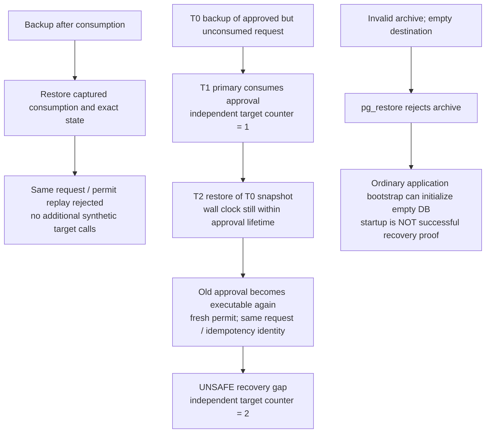

# Simulator PostgreSQL backup and restore qualification

Requirements: SEC-005/006; REL-001/003/005; OPS-004.
SEC-009 and DATA-001 remain contextual boundaries, not new full qualification.
Decision: [ADR 0044](../architecture/0044-database-restore-safety-limits.md).

This is a bounded simulator-only qualification, not a backup product, recovery
fence, production restore procedure or pilot-readiness claim. It uses separate
fresh databases in **one owned disposable PostgreSQL 16 container**, synthetic
actions/reviewers and a target counter outside the restored database. No real
target, customer archive, operator database URL or reusable credential is used.

## Captured state is not rollback-safe authority



The suite demonstrates **two unsafe recovery gaps**, not two new protections:

1. Restoring an old approval snapshot can revive authority while the approval is
   still within its original lifetime. The restored database lacks the later
   consumption/attempt/evidence state. A fresh permit can be minted; this is not
   simply replay of the identical signed permit.
2. An invalid archive leaves no recovered schema, but the ordinary repository
   constructor runs Flyway and can initialize that empty database. Querying
   missing tables before startup does not establish that startup will fail.
   The constructor has no archive identity or restore-success input.

**Keep effectful services and agents disconnected after any restore or restore
failure.** No automatic recovery epoch, external witness, quarantine flag or
validated resume procedure is implemented here. A nonzero restore exit or a
successful empty bootstrap must never be treated as recovered replay protection.
This qualification does not authorize ad hoc SQL rewriting of approval states,
blind retries, or reconnecting a restored database to live targets.

## Six actual PostgreSQL tests

`PostgresBackupRestoreQualificationTest` exercises:

| Case                                | Observed/asserted boundary                                                                                                                                                                                                                                                  |
| ----------------------------------- | --------------------------------------------------------------------------------------------------------------------------------------------------------------------------------------------------------------------------------------------------------------------------- |
| Invalid archive and empty bootstrap | Invalid/truncated header is rejected with nonzero exit; recovered tables/guard are absent. The ordinary constructor then initializes an empty fixture, explicitly demonstrating that it is not a restore-readiness gate. No server or target is attached.                   |
| Backup after consumption            | Full approval aggregate/binding, exact action/hash, permit consumption, complete execution attempt/transitions and evidence records survive. Recreated services reject approval replay and the raw store rejects duplicate permit consumption; target counter stays at one. |
| Pending and approved snapshots      | Full aggregates/bindings and actions survive. Store/service construction does not dispatch. Review and execution reject at the exact exclusive expiry boundary, with no silent renewal.                                                                                     |
| Policy and migration metadata       | Full version records, active pointer including activation sequence, transition/rollback history and all Flyway row fields (including checksums) match. Raw restored metadata is checked **before** constructors can apply migrations, and again afterward.                  |
| Stale-snapshot hazard               | The same original approval/action binding and idempotency identity are recovered while the independent target counter remains one. Resumption issues distinct permit/attempt IDs and increments the counter to two. This is an unsafe gap, not replay prevention.           |
| Incompatible restored schema guard  | A fixture-superuser changes the restored guard to unsupported version 999. Construction rejects it without repairing the guard or changing migration history. This is not general detection of every incomplete restore.                                                    |

The five submitted tests passed independently before review. A separate probe
added the submitted startup-rejection assertion to the invalid-archive case:
it failed because no startup exception occurred. The final suite retains that
behavior as an explicit gap characterization and adds the sixth guard test.
Production startup, authorization and persistence behavior are unchanged.

Those statements describe this qualification slice's legacy constructor path.
The supported operator entry point now uses explicit initialization and strict
non-migrating opens ([ADR 0045](../architecture/0045-explicit-database-initialization.md)).
Its normal run rejects empty state, while the older-snapshot authority revival
case remains unresolved. This suite's compatibility constructors still exercise
the original bootstrap ambiguity; it does not prove strict startup accepts it.

The evidence comparison verifies the existing local hash-linked chain against
the captured source records; it is not an independently signed recovery anchor
or non-repudiation proof. Raw duplicate-claim tests exercise storage semantics,
not authentication of a fabricated network request.

## Owned fixture commands and archive handling

All tools run inside the fresh test container. Databases are generated,
validated fixture names created from `template0`; the destination must have
no public tables before restore. No operator-selected target is accepted.

The effective operations are:

```bash
# Inside the owned test container only; generated fixture names/paths.
# Local socket authentication belongs to this disposable fixture.
umask 077
pg_dump -h /var/run/postgresql -U "$FIXTURE_ROLE" \
  -d "$SOURCE_FIXTURE_DB" -Fc -f "$FIXTURE_ARCHIVE"
pg_restore --single-transaction --exit-on-error \
  -h /var/run/postgresql -U "$FIXTURE_ROLE" \
  -d "$FRESH_DESTINATION_DB" "$FIXTURE_ARCHIVE"
```

The Java helper passes fixed command arguments separately; it does not read
operator DB configuration or interpolate shell-supplied database names.
Archive files must be owner-only mode `0600`, nonempty and at most 4 MiB for
these small synthetic fixtures. An existing archive path is not overwritten.
Cleanup addresses only the test-generated files/databases; the owned container
is stopped after the suite. This is neither encrypted backup custody nor a
production least-privilege restore qualification.

`pg_restore` defaults to continuing after SQL errors; the fixture uses
`--single-transaction` and `--exit-on-error`, and checks every dump/restore
exit code. A nonzero exit can have causes besides corruption. The invalid-header
test does not qualify every mid-stream failure or archive authenticity.

Restoring an archive can execute source-controlled SQL code. Only archives
generated by this test are trusted/restored; do not point the helper at a
customer, downloaded or unknown archive.

## Schema, key and tenant limits

- This is same-checkout/same-version qualification, not rolling upgrade or
  cross-version restore. Main at intake uses V1-V7. Expected complete migration
  rows and guard are captured from a freshly migrated source, not inferred from
  the restored destination. Composition with a new migration requires separate
  integration qualification.
- A generated ephemeral Ed25519 keypair is retained across service recreation
  in the test process. No private key is committed, stored in evidence, or
  recovered from the database archive. Real key custody, revocation and key
  recovery remain separate concerns.
- The fixture uses superuser/migration rights in the disposable container.
  It does not establish runtime least privilege, RLS, backup-role grants or
  production role/ownership recovery.
- `pg_dump` captures one database, not the whole cluster or cluster-wide
  roles/tablespaces. A whole-database archive may contain multiple tenant
  partitions; it is not an independently authorized tenant export.
- Only synthetic fixtures and fingerprint-based evidence are used. This suite
  does not establish global secret redaction, retention, tenant-specific backup
  privacy, residency, RPO/RTO or protection against a database administrator.

## Reproduce locally

Prerequisites: Java 21, Node.js 22 or newer, pnpm 11.25.0 and Docker. Use an owned
checkout without another build or demo running in it:

```bash
source scripts/configure-java-environment.sh
java/gradlew -p java :persistence-postgres:test \
  --tests io.tracepermit.persistence.postgres.PostgresBackupRestoreQualificationTest
pnpm check
pnpm format:check
pnpm docs:links
pnpm docs:flows:check
```

Expected focused result: six tests, zero failures/errors/skips. The stale-restore
case passes by **detecting duplicate synthetic execution**, not by preventing it.
Broader REL-005/SEC-006 recovery safety and OPS-004 acceptance remain partial.

## Primary references

- [PostgreSQL 16 SQL dump](https://www.postgresql.org/docs/16/backup-dump.html):
  consistent database snapshot and database-versus-cluster boundaries.
- [PostgreSQL 16 pg_dump](https://www.postgresql.org/docs/16/app-pgdump.html):
  custom archives, permissions and scope.
- [PostgreSQL 16 pg_restore](https://www.postgresql.org/docs/16/app-pgrestore.html):
  error handling, transaction mode and trust in source SQL.
