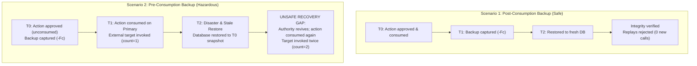

# Simulator PostgreSQL backup and restore qualification

Requirements: SEC-005, SEC-006, SEC-009; REL-001, REL-003, REL-005; DATA-001; OPS-004.
Related specifications: [System requirements](../specs/02-system-requirements.md),
[Domain and data model](../specs/05-domain-and-data-model.md), and
[Sequence flows](../specs/09-sequence-flows.md).

> [!IMPORTANT]
> This is a bounded **TP-MVP-17 operations qualification slice** using disposable
> Testcontainers PostgreSQL 16 instances and deterministic simulator targets. It is
> **not** a production backup management product, high-availability cluster, or
> automated disaster recovery orchestrator. All tests execute inside isolated
> test fixtures without accessing production databases, cloud resources, or real credentials.

---

## 1. Scope and PostgreSQL 16 foundation

This qualification establishes empirical boundaries for backing up and restoring
TracePermit's PostgreSQL persistence layer using official PostgreSQL tools:

- **Archive format:** PostgreSQL custom archive format (`-Fc`), produced via `pg_dump`
  and restored via `pg_restore`.
- **References:**
  - [PostgreSQL 16 Documentation: Chapter 26. Backup and Restore - SQL Dump](https://www.postgresql.org/docs/16/backup-dump.html)
  - [PostgreSQL 16 `pg_dump` Reference](https://www.postgresql.org/docs/16/app-pgdump.html)
  - [PostgreSQL 16 `pg_restore` Reference](https://www.postgresql.org/docs/16/app-pgrestore.html)

### Tested command sequence

```bash
# 1. Capture point-in-time custom archive (compressed, structured dependency layout)
pg_dump -U "$PGUSER" -d "$SOURCE_DB" -Fc -f "$DUMP_FILE"

# 2. Restore into a newly initialized, empty target database
pg_restore -U "$PGUSER" -d "$TARGET_DB" "$DUMP_FILE"
```

The restore runner inspects the exit code of `pg_restore`. Any non-zero exit code indicates
archive truncation or corruption, aborting initialization immediately.

---

## 2. Recovery timeline and replay hazard



---

## 3. Qualified behaviors

The integration test suite [`PostgresBackupRestoreQualificationTest.java`](../../java/persistence-postgres/src/test/java/io/tracepermit/persistence/postgres/PostgresBackupRestoreQualificationTest.java)
verifies five distinct lifecycle scenarios:

### 3.1. Rejection of corrupted or truncated archives

A deliberately corrupted archive (e.g. truncated header or random byte injection) causes
`pg_restore` to fail with exit code `1` and emit `did not find magic string in header`.
The target database remains unpopulated. Direct queries against `tp_enforcement_schema_guard`
and enforcement tables fail closed (`relation does not exist`), preventing unready databases
from being declared healthy.

### 3.2. Post-consumption backup preserves replay protection

When a backup is captured _after_ a request is executed and consumed:

- **Exact snapshots preserved:** `tp_approval_action_snapshots` retains the exact canonical
  action document and matching SHA-256 hash.
- **Permit consumption preserved:** `tp_consumed_execution_permits` retains the consumed permit,
  and `PostgresPermitConsumptionStore.isConsumed()` evaluates to `true`.
- **Execution state preserved:** `tp_execution_attempts` and transitions retain the terminal
  `succeeded` state, started/updated timestamps, and idempotency keys.
- **Evidence chain integrity:** The append-only evidence stream in `tp_evidence_events` survives
  with identical cryptographic event hashes and passes `InMemoryEvidenceLedger.verifyRecords()`.
- **Replay rejection:** Re-executing `executeApproved` or re-claiming the permit throws
  `APPROVAL_NOT_EXECUTABLE` and `PERMIT_REPLAYED` respectively, with **zero** additional
  target invocations.

### 3.3. Pending and approved requests survive without automatic dispatch

Requests in `pending` or `approved` states survive restore with exact bindings, tool names,
and expiration timestamps:

- **No auto-dispatch:** Constructing repositories or services against the restored database
  does not dispatch or execute any pending actions. Target invocation counters remain `0`.
- **Clock-controlled expiry:** Advancing a controllable test clock past the 300-second expiration
  window causes both review and execution calls to fail closed with `APPROVAL_EXPIRED`, transitioning
  the database status to `expired` without silent authority extension.

### 3.4. Policy revisions and Flyway schema metadata parity

Policy revisions managed via `PostgresPolicyLifecycleStore` survive restore with full parity:

- **Active selection and rollback:** Active version pointers (`v1`), version documents, content
  hashes, activation history (3 transitions), and rollback records survive restore.
- **Flyway schema history:** The restored `flyway_schema_history` table contains the identical
  record of 7 applied migrations (`V1` through `V7`) with matching checksums.
- **Schema guard validation:** `tp_enforcement_schema_guard` reports `contract_version = 7`,
  satisfying startup verification without re-migration.

---

## 4. Critical rollback limit: the stale-restore hazard

> [!CAUTION]
> **UNSAFE RECOVERY GAP:** Point-in-time restore to a snapshot taken prior to consumption
> revives unconsumed authority and causes duplicate target execution.

Standard PostgreSQL backups capture only the internal state of the database at snapshot time ($T_0$).
They have no awareness of:

1. Real-world target effects executed after the snapshot was taken ($T_1$).
2. Real-world clock progression that occurred while the database was offline ($T_2$).

### Hazard demonstration

In test `criticalRollbackLimitDemonstratesUnsafeAuthorityRevivalOnStaleRestore`:

1. **$T_0$:** An action is approved. A backup `backup_T0.dump` is captured.
2. **$T_1$:** The action is executed against the target simulator. The database records the
   permit as consumed, and the target invocation counter increments to `1`.
3. **$T_2$:** The database is restored from `backup_T0.dump`. Because the snapshot predates $T_1$,
   the restored database sees the approval in status `approved` and the permit as unconsumed.
4. **Duplicate Execution:** When a client invokes `executeApproved` against the restored store,
   the store treats the authority as valid, issues and consumes a permit, and calls the target
   simulator a **second time** (`targetInvocations == 2`).

### Mandatory operator quarantine protocol

Because `pg_dump` and `pg_restore` cannot prevent authority revival on stale restore:

- **Restored databases MUST be quarantined:** Application services and automated agent
  dispatchers MUST NOT be reconnected immediately after database restoration.
- **Revocation before resumption:** Operators must explicitly review pending and approved
  authorizations in `tp_approval_requests` and transition them to `expired` or `denied`
  before bringing public endpoints online.
- **No automated fence:** TP-MVP-17 implements **no** external recovery epoch, witness service,
  or distributed lease fence. Future enterprise milestones must establish an external
  revocation witness or epoch coordination mechanism before claiming autonomous recovery.

---

## 5. Security and boundary constraints

- **Database privileges:** Test fixtures execute with superuser privileges within disposable
  Testcontainers instances. Production deployments must separate migration roles from runtime
  application roles.
- **Credential hygiene:** Stored evidence records contain only credential fingerprints (`sha256:...`)
  and never reusable bearer tokens, private keys, or client secrets (SEC-003, DATA-001).
- **Tenant boundary:** While database constraints enforce tenant isolation (`tenant_id`),
  database-level `pg_dump` operates on the entire database cluster or database catalog, backing
  up all tenant partitions simultaneously (SEC-009).
- **Key boundary:** Cryptographic signing keys (e.g. permit authority keys and evidence anchor keys)
  exist outside PostgreSQL. Restoring a database does not rotate, revoke, or restore external keys.

---

## 6. Verification and reproduction

Prerequisites:

- Java 21 JDK
- Node.js >= 22 and pnpm 11.25.0
- Docker running locally (for Testcontainers PostgreSQL 16)

```bash
# Sourcing environment and running focused qualification test
source scripts/configure-java-environment.sh
java/gradlew -p java :persistence-postgres:test --tests io.tracepermit.persistence.postgres.PostgresBackupRestoreQualificationTest

# Full repository quality gates
pnpm check
pnpm format:check
pnpm docs:links
pnpm docs:flows:check
```

### Test execution summary

- **Test class:** `io.tracepermit.persistence.postgres.PostgresBackupRestoreQualificationTest`
- **Total tests:** 5
- **Passed:** 5
- **Failures:** 0
- **Skipped:** 0

---

## 7. Proposed traceability matrix updates

For integrator application in `docs/specs/12-traceability-matrix.md`:

| Requirement ID | Summary                                       | Status      | Implementation Target                                                        | Verification Method                                                                                              |
| :------------- | :-------------------------------------------- | :---------- | :--------------------------------------------------------------------------- | :--------------------------------------------------------------------------------------------------------------- |
| **SEC-005**    | Request-bound approval and permit hashing     | IMPLEMENTED | `io.tracepermit.persistence.postgres.PostgresDurableEnforcementState`        | `PostgresBackupRestoreQualificationTest`                                                                         |
| **SEC-006**    | Atomic consumption before target effect       | PARTIAL     | `io.tracepermit.persistence.postgres.PostgresPermitConsumptionStore`         | `PostgresBackupRestoreQualificationTest` (preserves consumption post-restore; stale restore requires quarantine) |
| **SEC-009**    | Tenant and partition isolation                | IMPLEMENTED | `io.tracepermit.persistence.postgres.PostgresDurableEnforcementState`        | `PostgresBackupRestoreQualificationTest`, `PostgresDurableEnforcementStateTest`                                  |
| **REL-001**    | Explicit fail-safe behavior                   | IMPLEMENTED | `io.tracepermit.persistence.postgres.PostgresBackupRestoreQualificationTest` | `PostgresBackupRestoreQualificationTest` (corrupt archive fail-closed, clock expiry)                             |
| **REL-003**    | Stable idempotency keys across retries        | IMPLEMENTED | `io.tracepermit.persistence.postgres.PostgresDurableEnforcementState`        | `PostgresBackupRestoreQualificationTest`                                                                         |
| **REL-005**    | Recovery and reconciliation                   | PARTIAL     | `docs/runbooks/simulator-backup-restore-qualification.md`                    | `PostgresBackupRestoreQualificationTest` (documents stale-restore hazard and quarantine requirement)             |
| **DATA-001**   | Credential fingerprint storage                | IMPLEMENTED | `io.tracepermit.persistence.postgres.PostgresDurableEnforcementState`        | `PostgresBackupRestoreQualificationTest`                                                                         |
| **OPS-004**    | Operational runbook for recovery and rollback | IMPLEMENTED | `docs/runbooks/simulator-backup-restore-qualification.md`                    | `scripts/check-doc-links.mjs`                                                                                    |
