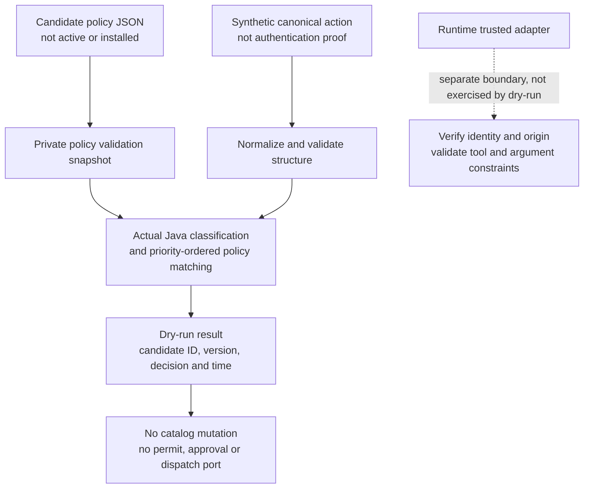

# Simulator policy templates and dry-run qualification

Requirements: FR-005/006/013; SEC-001/002/003; OPS-002.
See [ADR 0039](../architecture/0039-policy-lifecycle-staging-rollback-and-simulation.md)
and the [coverage matrix](../specs/12-traceability-matrix.md).

These are **opt-in candidate policies**, not installed profiles or authenticated
administration endpoints. The default launchers and default policies are unchanged.
The corpus uses deterministic synthetic canonical actions and the actual Java
`PolicyLifecycleService.simulate` method. It does not create even a simulated
target effect.

## Evaluation flow and trust boundary



`ActionValidator` validates canonical structure and evidence consistency; it does
not verify a token, source signature or issuer trust. A structurally valid asserted
human, or canonical evidence naming an untrusted synthetic issuer, can still
produce an `allow` simulation result. The templates have no assurance predicate.
Only a trusted runtime adapter may supply verified identity/origin fields.
Do not expose raw canonical simulation as an authentication or execution API.

## Candidate definitions

Both templates use explicit default-block decisions and version 1:

| Candidate                                                                  | Policy ID                           | Default reason                            |
| -------------------------------------------------------------------------- | ----------------------------------- | ----------------------------------------- |
| [Observer](../../policies/templates/simulator-observer.json)               | `tpl-simulator-observer-001`        | `SIMULATOR_OBSERVER_DEFAULT_BLOCK`        |
| [Reviewed change](../../policies/templates/simulator-reviewed-change.json) | `tpl-simulator-reviewed-change-001` | `SIMULATOR_REVIEWED_CHANGE_DEFAULT_BLOCK` |

Both contain:

- Priority 300: `block-destructive-operations`, matching destructive
  classification, returns `DESTRUCTIVE_OPERATIONS_BLOCKED`.
- Priority 200: `block-oversized-log-window`, matching the explicit AWS log-read
  tool plus `OVERSIZED_RESULT_WINDOW`, returns `OVERSIZED_LOG_WINDOW_BLOCKED`.
- Priority 100: `allow-cli-staging-cloudwatch-read`, matching canonical CLI human,
  AWS, staging, read classification and exact `aws.logs.filter_log_events`,
  returns `CLI_STAGING_LOG_READ_ALLOWED`. This is not an authentication check.

Reviewed change additionally contains priority 250
`require-approval-cli-staging-security-group-update`: exact
`aws.ec2.update_security_group`, CLI human, AWS, staging, modify classification.
It returns `require_approval`,
`SIMULATOR_SECURITY_GROUP_UPDATE_REQUIRES_APPROVAL`, and approval group
`simulator-security-reviewers`. That group is decision metadata, not evidence of
an enrolled reviewer or a durable approval request. The candidate never allows
this write unconditionally.

The oversized read also matches the explicit read allow, so its higher priority
matters. A destructive delete does **not** match the different update-tool/modify
rule; that vector proves destructive matching, not competing-rule precedence.

## Reproduce

Prerequisites: Java 21, Node 22+, pnpm 11.25.0; Docker for full PostgreSQL checks.

```bash
corepack enable
pnpm install --frozen-lockfile
source scripts/configure-java-environment.sh
java/gradlew -p java :policy:test --tests io.tracepermit.policy.PolicyTemplateQualificationTest
pnpm check
pnpm format:check
pnpm docs:links
pnpm docs:flows:check
```

The focused class reports **14 JUnit tests**, including a pinned matrix of
**19 cases × 2 templates = 38 evaluations**. The matrix produces 4 allows,
1 require-approval result and 33 blocks. These are decision evaluations, not
38 target invocations or 38 individually reported JUnit tests.

## Deterministic corpus

[Matrix JSON](../../fixtures/policy-templates/matrix.json) contains the exact
outcome, reason, nullable matched rule, nullable approval group and expected
classification for each case. Tests require every case ID, reject missing or
duplicate cases, check both policy IDs/version/time, and assert exact class,
score, severity and signal list.

| Case | Synthetic action                                                                 | Observer | Reviewed change    |
| ---- | -------------------------------------------------------------------------------- | -------- | ------------------ |
| 01   | positive read: CLI human staging CloudWatch filter_log_events                    | `allow`  | `allow`            |
| 02   | approval-not-allow write: CLI human staging EC2 update_security_group            | `block`  | `require_approval` |
| 03   | termination denial: CLI human staging EC2 terminate_instances                    | `block`  | `block`            |
| 04   | destructive deletion denial: CLI human staging EC2 delete_security_group         | `block`  | `block`            |
| 05   | plausible read-like name: CLI human staging CloudWatch describe_log_groups       | `block`  | `block`            |
| 06   | unknown tool: CLI human staging custom.unrecognized_operation                    | `block`  | `block`            |
| 07   | wrong origin: ChatGPT web human staging CloudWatch filter_log_events             | `block`  | `block`            |
| 08   | wrong origin and subject type: API workload staging CloudWatch filter_log_events | `block`  | `block`            |
| 09   | wrong environment for read: CLI human prod CloudWatch filter_log_events          | `block`  | `block`            |
| 10   | wrong environment for write: CLI human prod EC2 update_security_group            | `block`  | `block`            |
| 11   | oversized log window: CLI human staging CloudWatch filter_log_events limit=500   | `block`  | `block`            |
| 12   | unmatched write: CLI human staging EC2 start_instances                           | `block`  | `block`            |
| 13   | CLI workload read isolates subject type                                          | `block`  | `block`            |
| 14   | CLI human read isolates target system                                            | `block`  | `block`            |
| 15   | web human write isolates origin                                                  | `block`  | `block`            |
| 16   | CLI workload write isolates subject type                                         | `block`  | `block`            |
| 17   | CLI human write isolates target system                                           | `block`  | `block`            |
| 18   | integer limit 100 is within coarse signal threshold                              | `allow`  | `allow`            |
| 19   | integer limit 101 triggers oversized block                                       | `block`  | `block`            |

Cases 13–17 isolate read/write subject, system and write-origin restrictions.
The wrong-system vectors are structurally valid canonical inputs for matcher
qualification; they are not proof a runtime registry would admit that tool/system
combination. Cases 18/19 check the normal integer signal threshold at 100/101.

The expected reason is the matched rule's exact reason above, or the candidate's
own default reason when no rule matches. In particular, there is no generic
`DEFAULT_BLOCK` reason substituted for the two distinct candidate defaults.

## Regression sensitivity and isolation

The suite includes:

- Existing read mutations for tool, environment, origin and oversized-rule
  removal, plus mutation from require-approval to unconditional write allow.
- New read subject/system removal vectors for **both** templates: the original
  blocks and the mutant allows.
- Write origin/subject/system/environment/tool removal vectors: original blocks,
  mutant requires approval for the now-broadened scope. It still does not execute.
- Lowering the oversized-block priority below the read allow changes block to
  allow in both templates, demonstrating real overlapping-rule precedence.
- All 38 simulations preserve policy and action inputs and leave revision,
  active pointer, activation and rollback history empty.
- A separate forbidden-catalog test fails on **any** storage-port call across
  both templates and all vectors. No invented dispatch counter is used:
  simulation has no permit, approval, target or evidence-ledger port.
- Malformed policy/action validation and unknown policy **and action** schemas
  are rejected, including through the actual simulation entry point.
- Explicit characterizations show that canonical assertions are not
  authenticated and that raw simulation is not tool-argument schema validation.

## Log-window signal is not argument validation

For normal positive integer input, limit 100 allows the candidate read and 101
blocks it with `OVERSIZED_RESULT_WINDOW`. This is a coarse classifier signal,
not general argument validation or a resource-access guarantee.

At baseline revision `05764ed`, the classifier narrowed with `asInt() > 100`;
positive integers outside the Java int range could miss the oversized signal.
The [overflow-safe classifier](log-window-classification.md) now compares the
original integral value exactly with 100. Wide signed, parsed and constructed
numeric regressions cover that separate production fix. No tool argument
schema, resource predicate or template allow rule was broadened.

Missing/null/textual/fractional/boolean/object limits can also return allow in
raw canonical simulation without the oversized signal. Characterization tests
make that limitation visible; they do not approve these inputs for a real tool.
Trusted adapters must validate required fields, types and supported ranges
before execution. Do not reuse candidate simulation as that boundary.

## Capabilities deliberately not claimed

- No arbitrary JSONPath, CIDR, port, account/resource-ID or ARN predicates.
  Current discrete matchers cover origin, subject type, target system,
  environment, action class, exact tool, required signals and minimum severity.
- No staging, activation, rollback, pending-approval creation or runtime policy
  replacement occurs from loading this corpus.
- Default launchers still use static policies. Optional lifecycle-backed Java
  composition and PostgreSQL pointers are separate from installed defaults.
- `PolicySimulationResult` contains candidate ID/version, evaluation,
  simulated time and dry-run flag; it has **no result schemaVersion field**.
  It is not active-policy, signing-key or adapter-version inventory.
- No live identity/provider/target qualification, target failure prediction,
  latency measurement or independently immutable evidence follows from dry-run.
- No real credentials or target effects are needed. Fixture fingerprints and
  identities are synthetic; fixture hygiene is not a full secret-retention
  or redaction-service qualification.

## Requirement coverage and limits

| Requirement | Added evidence                                                                                                             | Scope                                                                                  |
| ----------- | -------------------------------------------------------------------------------------------------------------------------- | -------------------------------------------------------------------------------------- |
| FR-005/006  | Exact classification, signal, severity, decision, reason, rule, group and candidate version assertions; mutation negatives | Implemented corpus slice, not all tools or classifiers                                 |
| FR-013      | Candidate dry-run without catalog writes or input mutation                                                                 | Simulation only; authenticated administration and installed activation remain separate |
| SEC-001     | Asserted/fabricated canonical identity characterization                                                                    | Not authenticated here; trusted-adapter qualification remains separate                 |
| SEC-002     | Default-block unknown/unmatched tools; malformed/unknown policy/action schemas                                             | Tested candidate matching/validation only, not issuer/algorithm/permit-state coverage  |
| SEC-003     | Synthetic fixture inspection; fingerprints, no reusable token/key                                                          | Fixture hygiene only; not complete logs/storage/export secret coverage                 |
| OPS-002     | Exact candidate policy ID/version; candidate schema validation                                                             | Partial provenance only; no active runtime/key/adapter inventory                       |

The shared traceability matrix records this bounded evidence without marking
broad requirements or the policy-administration milestone complete. Real AWS
credentials and destructive live targets remain prohibited.
