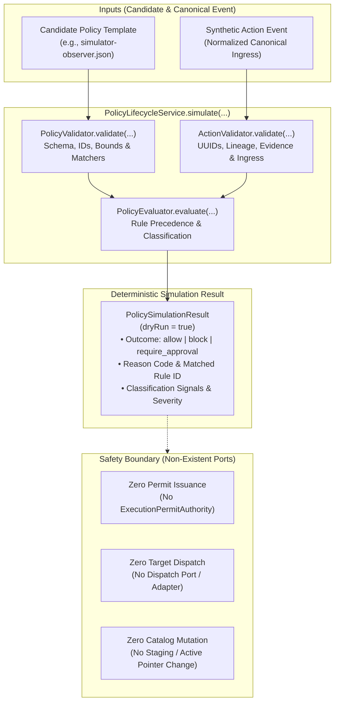

# Simulator Policy Template Pack and Dry-Run Qualification

Requirements: FR-005, FR-006, FR-013; SEC-001, SEC-002, SEC-003; OPS-002.
Architecture Decision: [ADR 0039](../architecture/0039-policy-lifecycle-staging-rollback-and-simulation.md).

This runbook documents the simulator-only policy template pack and its deterministic
dry-run qualification test harness. The templates provide opt-in, default-block policy
definitions for simulator observation and reviewed change workflows. They reuse the
existing Java policy lifecycle and evaluation engines without expanding the policy
language, adding administrative endpoints, or modifying production enforcement state.

---

## Architecture and Evaluation Flow

The qualification harness evaluates candidate policy templates against synthetic canonical
action events using `PolicyLifecycleService.simulate(...)`. This simulation path operates
entirely in memory: it validates candidate policy schemas and canonical actions, executes
deterministic rule evaluation, and returns a structured `PolicySimulationResult` with zero
database mutations, zero permit minting, and zero target dispatch.



---

## Template Definitions

Two opt-in candidate templates are provided under `policies/templates/`. Both templates
fail closed by declaring an explicit default decision of `block`:

### 1. Simulator Observer (`policies/templates/simulator-observer.json`)

- **ID:** `tpl-simulator-observer-001` (version 1)
- **Default Decision:** `block` (`SIMULATOR_OBSERVER_DEFAULT_BLOCK`)
- **Rules (ordered by priority descending):**
  1. `block-destructive-operations` (Priority 300): Explicitly blocks all destructive
     operations (`actionClasses: ["destructive"]`) before any read rule.
  2. `block-oversized-log-window` (Priority 200): Explicitly blocks CloudWatch log reads
     requesting result windows exceeding the 100-event threshold
     (`requiredSignals: ["OVERSIZED_RESULT_WINDOW"]`).
  3. `allow-cli-staging-cloudwatch-read` (Priority 100): Allows an authenticated CLI human
     user (`origins: ["cli"]`, `subjectTypes: ["human"]`) to read bounded CloudWatch logs
     (`toolNames: ["aws.logs.filter_log_events"]`, `actionClasses: ["read"]`) strictly
     within the simulator staging environment (`environments: ["staging"]`,
     `targetSystems: ["aws"]`).
- **Safety Property:** No generic "read verb" allow rule exists. Every unrecognized tool,
  non-CLI origin, non-human subject, and production environment is blocked.

### 2. Simulator Reviewed Change (`policies/templates/simulator-reviewed-change.json`)

- **ID:** `tpl-simulator-reviewed-change-001` (version 1)
- **Default Decision:** `block` (`SIMULATOR_REVIEWED_CHANGE_DEFAULT_BLOCK`)
- **Rules (ordered by priority descending):**
  1. `block-destructive-operations` (Priority 300): Explicitly blocks destructive operations
     before modification or read rules.
  2. `require-approval-cli-staging-security-group-update` (Priority 250): Requires human
     approval (`outcome: "require_approval"`, `reasonCode: "SIMULATOR_SECURITY_GROUP_UPDATE_REQUIRES_APPROVAL"`,
     `approvalGroup: "simulator-security-reviewers"`) for CLI human EC2 security group
     updates (`toolNames: ["aws.ec2.update_security_group"]`, `actionClasses: ["modify"]`)
     in staging. **Never allows writes unconditionally.**
  3. `block-oversized-log-window` (Priority 200): Blocks oversized log window queries.
  4. `allow-cli-staging-cloudwatch-read` (Priority 100): Allows bounded CLI human CloudWatch
     reads in staging.
- **Safety Property:** Destructive actions and oversized queries are blocked before read
  or approval rules. Unlisted mutations fall through to the default block.

---

## How to Run the Qualification Corpus

### Prerequisites

- Java 21 JDK
- Node >= 22 and pnpm 11.25.0

### Run Focused Qualification Test

```bash
source scripts/configure-java-environment.sh
java/gradlew -p java :policy:test --tests io.tracepermit.policy.PolicyTemplateQualificationTest
```

### Run Full Repository Quality Gates

```bash
pnpm check
pnpm format:check
pnpm docs:links
pnpm docs:flows:check
```

---

## Deterministic Qualification Matrix

The qualification matrix (`fixtures/policy-templates/matrix.json`) defines 12 synthetic
scenarios run through the actual Java simulation API:

| #   | Scenario Description                                       | Action Fixture                                     | Observer Outcome | Reviewed Change Outcome | Matched Rule ID / Reason Code                                                                                |
| --- | ---------------------------------------------------------- | -------------------------------------------------- | ---------------- | ----------------------- | ------------------------------------------------------------------------------------------------------------ |
| 1   | Positive read (bounded staging log read)                   | `cli-human-staging-log-read.json`                  | `allow`          | `allow`                 | `allow-cli-staging-cloudwatch-read`<br/>`CLI_STAGING_LOG_READ_ALLOWED`                                       |
| 2   | Approval write (staging security group update)             | `cli-human-staging-security-group-update.json`     | `block`          | `require_approval`      | `require-approval-cli-staging-security-group-update`<br/>`SIMULATOR_SECURITY_GROUP_UPDATE_REQUIRES_APPROVAL` |
| 3   | Termination denial (staging EC2 instance terminate)        | `cli-human-staging-ec2-terminate.json`             | `block`          | `block`                 | `block-destructive-operations`<br/>`DESTRUCTIVE_OPERATIONS_BLOCKED`                                          |
| 4   | Destructive deletion denial (security group delete)        | `cli-human-staging-ec2-delete-security-group.json` | `block`          | `block`                 | `block-destructive-operations`<br/>`DESTRUCTIVE_OPERATIONS_BLOCKED`                                          |
| 5   | Plausible read-like tool (`describe_log_groups`)           | `cli-human-staging-plausible-read.json`            | `block`          | `block`                 | Default deny (no generic read allow)<br/>`DEFAULT_BLOCK`                                                     |
| 6   | Unrecognized tool (`custom.unrecognized_operation`)        | `cli-human-staging-unknown-tool.json`              | `block`          | `block`                 | Default deny (unknown tool fail-closed)<br/>`DEFAULT_BLOCK`                                                  |
| 7   | Wrong origin (ChatGPT web instead of CLI)                  | `chatgpt-web-staging-log-read.json`                | `block`          | `block`                 | Default deny (origin mismatch)<br/>`DEFAULT_BLOCK`                                                           |
| 8   | Wrong subject & origin (API workload instead of CLI human) | `api-workload-staging-log-read.json`               | `block`          | `block`                 | Default deny (subject/origin mismatch)<br/>`DEFAULT_BLOCK`                                                   |
| 9   | Wrong environment for read (`prod` instead of `staging`)   | `cli-human-prod-log-read.json`                     | `block`          | `block`                 | Default deny (environment mismatch)<br/>`DEFAULT_BLOCK`                                                      |
| 10  | Wrong environment for write (`prod` instead of `staging`)  | `cli-human-prod-security-group-update.json`        | `block`          | `block`                 | Default deny (environment mismatch)<br/>`DEFAULT_BLOCK`                                                      |
| 11  | Oversized log window (`limit = 500` > 100)                 | `cli-human-staging-oversized-log-read.json`        | `block`          | `block`                 | `block-oversized-log-window`<br/>`OVERSIZED_LOG_WINDOW_BLOCKED`                                              |
| 12  | Unmatched modification (`aws.ec2.start_instances`)         | `cli-human-staging-unmatched-modify.json`          | `block`          | `block`                 | Default deny (unlisted mutation)<br/>`DEFAULT_BLOCK`                                                         |

---

## Mutation Testing: Detecting Broadened Allows

The qualification suite includes 5 programmatic policy mutation tests in
`PolicyTemplateQualificationTest.java` that prove the harness detects broadened allow vectors:

1. **Oversized Log Rule Removal:** Removing `block-oversized-log-window` causes the oversized
   query (`limit = 500`) to match `allow-cli-staging-cloudwatch-read`, producing an unauthorized
   `allow` instead of `block`. The test asserts this regression is detected.
2. **Tool Scope Broadening:** Removing `toolNames` from `allow-cli-staging-cloudwatch-read`
   broadens the rule to allow unreviewed read tools like `aws.logs.describe_log_groups`.
3. **Environment Scope Broadening:** Removing `environments` from `allow-cli-staging-cloudwatch-read`
   broadens the rule to allow reading from production (`prod`).
4. **Origin Scope Broadening:** Removing `origins` from `allow-cli-staging-cloudwatch-read`
   broadens the rule to allow unreviewed web agent triggers (`chatgpt-web`).
5. **Write Allow Mutation:** Mutating `require-approval-cli-staging-security-group-update`
   decision outcome from `require_approval` to `allow` produces an unauthorized unconditional
   write allow, violating the non-negotiable write-approval invariant.

---

## Capability Limits and Boundary Guarantees

> [!WARNING]
> These policy templates are candidate definitions for local simulator qualification.
> Do NOT describe these templates as production-ready, resource-scoped, or safe for arbitrary
> AWS accounts.

1. **No Arbitrary Resource/Argument Predicates:** The TracePermit policy schema matchers
   support only discrete enums and identifiers: `origins`, `subjectTypes`, `targetSystems`,
   `environments`, `actionClasses`, `toolNames`, `requiredSignals`, and `minimumSeverity`.
   They do NOT support arbitrary JSONPath, CIDR range, port number, or resource ARN matching.
2. **Classifier Signal Threshold vs Argument Validation:** The `OVERSIZED_RESULT_WINDOW`
   signal is generated by a hardcoded threshold (`limit > 100` on `aws.logs.filter_log_events`)
   inside `PolicyEvaluator.classify`. It is a coarse risk signal, not arbitrary argument
   schema validation. Detailed argument constraints remain the responsibility of trusted adapters.
3. **Synthetic Fixtures are Not Authentication:** The canonical action events in
   `fixtures/policy-templates/` contain synthetic tokens, fingerprints, and lineage structures.
   They satisfy contract structure for simulation testing but do not represent live cryptographic
   authentication.
4. **Pending Approval Does Not Execute:** A simulation result of `require_approval` indicates
   that the action cannot proceed without out-of-band human review. It mints zero permits
   and triggers zero downstream execution.

---

## Candidate Simulation vs Installed Runtime Enforcement

| Dimension               | Candidate Dry-Run Simulation (`PolicyLifecycleService.simulate`) | Installed Runtime Enforcement (`SecureExecutionService` / `DurableExecutionService`) |
| ----------------------- | ---------------------------------------------------------------- | ------------------------------------------------------------------------------------ |
| **State Storage**       | None; pure function over memory arguments                        | Staged and activated in `PolicyLifecycleStore` (PostgreSQL / in-memory)              |
| **Catalog Pointer**     | No pointer change; catalog is untouched                          | Monotonic `activation_sequence` and active pointer in `tp_active_policies`           |
| **Execution Authority** | None; simulation path has no permit issuer port                  | Mints cryptographic, single-use `ExecutionPermit`                                    |
| **Target Dispatch**     | None; simulation path has no dispatch port                       | Verifies permit claim atomically before invoking simulator target adapter            |
| **Evidence Ledger**     | None; returns ephemeral `PolicySimulationResult`                 | Appends immutable records to `ExecutionLedger` / PostgreSQL audit sink               |

---

## Proposed Requirement and Traceability Updates

The following rows are proposed for `docs/specs/12-traceability-matrix.md` to be applied by
the repository integrator before branch merge:

| Requirement ID | Requirement Description                                                                                                                   | Implementation Artifacts                                                                 | Verification Test                                                                                     | Status                 |
| -------------- | ----------------------------------------------------------------------------------------------------------------------------------------- | ---------------------------------------------------------------------------------------- | ----------------------------------------------------------------------------------------------------- | ---------------------- |
| **FR-005**     | TracePermit SHALL classify action class, severity, and risk signals from normalized action data.                                          | `java/policy/.../PolicyEvaluator.java`<br/>`policies/templates/*.json`                   | `PolicyTemplateQualificationTest`<br/>(oversized log window signal & severity checks)                 | Qualified (simulation) |
| **FR-006**     | Policy SHALL return exactly one of allow, block, sanitize, or require approval, with policy version and reason evidence.                  | `java/policy/.../PolicyEvaluator.java`<br/>`policies/templates/*.json`                   | `PolicyTemplateQualificationTest`<br/>(exact outcome, reasonCode, matchedRuleId & version assertions) | Qualified (simulation) |
| **FR-013**     | The control plane SHALL support policy versioning, validation, simulation, staged activation, and rollback.                               | `java/policy/.../PolicyLifecycleService.java`<br/>`policies/templates/*.json`            | `PolicyTemplateQualificationTest`<br/>(dry-run simulation without catalog mutations)                  | Qualified (simulation) |
| **SEC-001**    | Request bodies and tool arguments MUST NOT self-assert authenticated, verified, delegated, approved, or sanitized state.                  | `java/contracts/.../ActionValidator.java`<br/>`java/contracts/.../ActionNormalizer.java` | `PolicyTemplateQualificationTest`<br/>(strict validation rejects forged / unverified claims)          | Qualified (simulation) |
| **SEC-002**    | Unknown tools, schemas, algorithms, issuers, audiences, decision values, and permit states MUST fail closed.                              | `java/policy/.../PolicyValidator.java`<br/>`policies/templates/*.json`                   | `PolicyTemplateQualificationTest`<br/>(default-block, unknown tools & malformed schemas fail closed)  | Qualified (simulation) |
| **SEC-003**    | Bearer tokens, private keys, client secrets, API keys, and reusable target credentials MUST NOT enter source control or evidence records. | `fixtures/policy-templates/*.json`                                                       | `PolicyTemplateQualificationTest`<br/>(only synthetic identifiers and hashes in fixtures)             | Qualified (simulation) |
| **OPS-002**    | Operators SHALL be able to identify active policy, key, schema, and adapter versions for an evaluation.                                   | `java/policy/.../PolicySimulationResult.java`                                            | `PolicyTemplateQualificationTest`<br/>(asserts exact policyId, version, and schemaVersion)            | Qualified (simulation) |

---

## What Remains Unimplemented

1. **Authenticated Policy Administration:** No HTTP or MCP mutation tools exist for uploading,
   editing, or deleting policy templates.
2. **Runtime Activation Wiring:** These candidate templates are not automatically staged or
   activated upon server startup; default launchers retain their existing static policy profiles.
3. **Exact Resource Predicates:** Policy matchers do not support arbitrary CIDR, port, or
   resource-level pattern matching; adapters must perform resource filtering.
4. **Customer Qualification:** These templates have not been qualified against production
   AWS infrastructure or real identity providers.
5. **Production Target Enablement:** Real AWS credentials and destructive live targets remain
   strictly prohibited under repository safety invariants.
