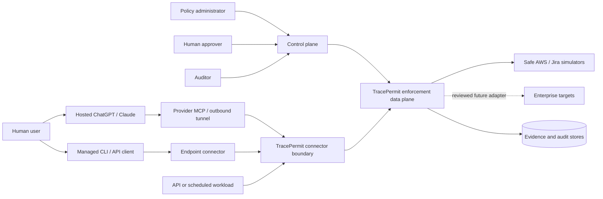
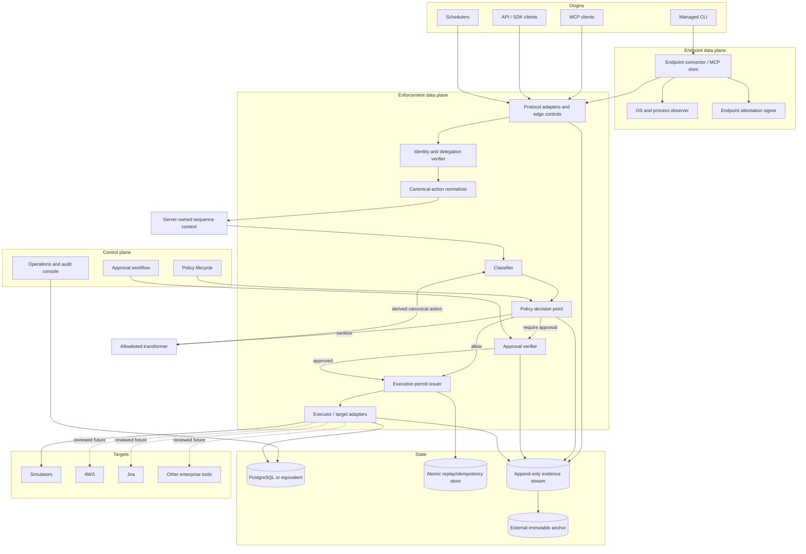

# High-level design

**Status:** Current foundation plus target architecture  
**Applies to:** Enterprise product design

## 1. Architecture goals

TracePermit must provide an enforceable, explainable path from authenticated
intent to constrained target execution while preserving evidence and keeping
control-plane compromise from automatically granting broad target authority.

## 2. System context

Real targets remain outside the current POC. The dashed path requires a
separate security review and all release gates in this specification.
Provider transport supplies reachability, not TracePermit user identity or
authority. A hosted-client path needs independently verified application
OAuth/OIDC evidence before it may claim the signed-in human as the subject.

The separate local durable-approval composition now accepts a bounded MCP
request/status/resume workflow. It converges with bearer/browser approval APIs
on the existing application service and PostgreSQL exact snapshot/claim, not a
parallel approval engine. A distinct browser reviewer decides, and the original
MCP principal/client explicitly resumes. See
[ADR 0037](../architecture/0037-mcp-durable-simulator-approval-composition.md).
This does not compose the hosted OAuth runtime or establish device assurance.

## 3. Target logical architecture

## 4. Component responsibilities

| Component                    | Responsibility                                                                    | Must not do                                                        |
| ---------------------------- | --------------------------------------------------------------------------------- | ------------------------------------------------------------------ |
| Endpoint connector           | Observe managed source context and bind it to the exact outbound request          | Treat local username or terminal presence as enterprise authority  |
| Protocol adapter             | Authenticate transport, validate narrow input, add observed context               | Accept verified identity from an untrusted body                    |
| Identity/delegation verifier | Validate subject, client, workload, delegation, revocation                        | Infer delegation from causal order                                 |
| Normalizer                   | Produce versioned canonical action from trusted configuration and validated input | Preserve attacker-controlled trusted fields                        |
| Classifier                   | Derive action class, severity, and signals                                        | Make target calls                                                  |
| Sequence context             | Derive bounded cross-action signals by tenant, subject, and target                | Trust request-supplied history or fail open                        |
| Policy decision point        | Evaluate versioned policy and produce reasoned decision                           | Convert unknown/error to allow                                     |
| Sanitizer                    | Create one reviewed narrower canonical action for full re-evaluation              | Mutate the original, widen authority, or issue execution authority |
| Approval service             | Bind reviewer decision to exact request and consume approval                      | Issue broad reusable approval                                      |
| Permit issuer                | Turn allow/approval into short-lived executor capability                          | Issue on block, pending, or unresolved sanitize                    |
| Executor                     | Verify permit, apply adapter allowlist, invoke target with constrained credential | Trust gateway control flow without verification                    |
| Evidence service             | Append correlated facts and lifecycle events                                      | Store reusable secrets or rewrite history                          |
| Control plane                | Manage policy, approval, keys, tenants, and visibility                            | Sit in the synchronous target path unnecessarily                   |

## 5. Control plane and data plane

The data plane makes synchronous decisions and executes target calls. It must
remain narrow, deterministic on the fast path, horizontally scalable, and able
to fail closed using validated cached configuration.

The control plane manages slower workflows: policy authoring, simulation,
approval, investigation, tenant configuration, and key lifecycle. A control-
plane outage must not silently create new authority.

## 6. Trust boundaries

| Boundary             | Untrusted side                                    | Trusted responsibility                                                     |
| -------------------- | ------------------------------------------------- | -------------------------------------------------------------------------- |
| Endpoint source      | Agent process, environment, local claims          | Observe OS/process context, protect device key, bind exact request         |
| Hosted MCP transport | Provider queue, tunnel identity, headers, `_meta` | Treat transport as reachability; independently authenticate the MCP caller |
| Connector edge       | Agent/client, headers, arguments                  | Authenticate, rate limit, validate transport                               |
| Scheduler edge       | Schedule body, workload/grant claims              | Verify registry-bound signatures, exact run/action, chain, replay          |
| Normalization        | Client-provided action fields                     | Construct canonical identity/target/action                                 |
| Policy               | Declared intent, arguments, unknown tools/history | Derive classification and sequence context; fail closed on required state  |
| Sanitization         | Proposed transformer identity/output              | Recompute reviewed transform; bind new event/hash; re-evaluate             |
| Approval             | Approval ID, UI state, reviewer claims            | Authenticate/authorize reviewer and bind exact request                     |
| Permit               | Mutable in-process request                        | Bind exact allowed request under signature                                 |
| Executor             | Gateway message and permit                        | Re-verify authority and target allowlist                                   |
| Target               | External system response                          | Record only observed outcome; use idempotency                              |
| Evidence             | Application-produced events                       | Append, redact, anchor, and reconcile                                      |

## 7. Deployment model

The recommended starting point is a modular Java service with clearly separated
ports and schemas, backed by PostgreSQL. It can later split into control-plane
and data-plane services when scaling or isolation requires it.

Enterprise deployment should support one or more of:

- vendor-hosted control and data plane;
- vendor control plane with customer-managed data plane; or
- fully customer-managed deployment.

The final product model, cloud targets, tenancy, and data-residency requirements
remain open decisions. Component interfaces must not assume that all services
share one network or trust domain.

Managed CLI deployments may add an endpoint connector as an MCP stdio shim,
local proxy, managed launcher, or privileged daemon. The initial proposed POC
uses the stdio shim because it observes a real parent agent and a structured
tool request without modifying the agent binary. Strong production process and
egress enforcement requires platform controls beyond an ordinary user process.

[ADR 0056](../architecture/0056-enterprise-credentials-and-egress-boundary.md)
proposes the future split between request-bound execution authority, provider
credential custody and operator-enforced egress. It does not add a real-target
adapter or production deployment, and does not qualify SEC-007/008 or OPS-005.
Its [delivery gates](../architecture/0056-enterprise-credentials-and-egress-boundary.md#delivery-sequence-and-decision-gates)
separate same-laptop evaluation from a future remote simulator pilot and a
separately reviewed non-production real-target pilot.

### 7.1 POC-qualified ingress stories

The guided demonstration moves from strongest observable
endpoint provenance to a hosted-client reachability path:

| Scenario | Ingress path                                                                           | Security claim                                                                                                                    | Explicit non-claim                                                                                    |
| -------- | -------------------------------------------------------------------------------------- | --------------------------------------------------------------------------------------------------------------------------------- | ----------------------------------------------------------------------------------------------------- |
| 0        | MCP client → Java endpoint connector → loopback Java `/mcp`                            | The connector measures endpoint context and binds it to the exact request and credential                                          | Source proof does not authorize the action                                                            |
| 1        | Same attested CLI path → policy → permit/simulator                                     | Semantic policy can allow a bounded read and block destruction for the same authenticated identity                                | The terminal pause is not human approval                                                              |
| 2        | Unmodified ChatGPT → OpenAI Secure MCP Tunnel → `tunnel-client` → loopback Java `/mcp` | A live hosted model can select a tool and traverse the complete Java enforcement path                                             | Tunnel access and the fixed demo bearer do not prove ChatGPT-login identity                           |
| 3        | Agent action → policy → Java approval service → PostgreSQL → permit/simulator          | An independent reviewer can authorize one exact request for one atomic, replay-safe simulated use                                 | The presenter keypress and development reviewer do not prove production OIDC                          |
| 4        | Signed scheduler workload → narrowed delegation → semantic policy → simulator          | Non-human identity and delegated authority are verified separately; sanitization and toxic-sequence controls run before execution | Development keys and process-local sequence state are not production custody or shared state          |
| 5        | Local deterministic qualification harness → policy/permit/simulator and outage probes  | The synchronous path meets bounded local latency objectives and required dependency failures dispatch zero calls                  | The measurements are not regional capacity, availability, or production SLO evidence                  |
| 6        | Unmodified ChatGPT → application OAuth → outbound tunnel → loopback Java OAuth MCP     | One Auth0/ChatGPT composition attributes the verified human separately from the hosted orchestrator and enforces allow/block      | Qualification is simulator-only; the tunnel hop does not provide direct client mTLS sender constraint |
| 7        | Signed scheduler → verified narrow delegation → Java policy denial                     | A valid automated origin can still be blocked for a production-labelled simulated EC2 stop before permit or dispatch              | The target is a risk-labelled simulator; there is no executable EC2 stop adapter or real AWS account  |
| 8        | Signed scheduler → exact human approval → durable one-use claim → simulator            | A critical production-labelled deletion stays pending until an independent reviewer approves the exact request; replay fails      | Reviewer identity is a development adapter, and the only deletion is in-memory simulated state        |
| 9        | Signed scheduler → synthetic CRM read → gateway history → egress policy block          | The same verified tenant/subject is correlated across two target systems; no external send permit or outbox dispatch occurs       | History is process-local, data is invented, and the outbox has no network transport                   |
| 10       | Signed scheduler → lower-trust runbook result → scripted agent proposal → IAM block    | Tool-result text can influence a proposal but cannot authorize a critical access-control effect before policy                     | The agent is deterministic, not a real model; the IAM target is only an in-memory flag                |
| 11       | Signed scheduler → workload grant → sub-agent grant → trusted adapter                  | A narrow child proceeds to one simulated read; scope/resource/audience/lifetime amplification is rejected before policy           | Runtime test keys and in-process replay/revocation are not production scheduler or key custody        |

The ingress paths converge on canonical action normalization and pre-execution
policy enforcement. Scenario 3 continues through the durable application
boundary without exposing a remote approval endpoint. Scenarios 4 and 5 are
standalone application-boundary qualifications. Scenario 6 uses a separate
OAuth runtime profile rather than co-hosting it with the development profile.
Scenario 7 is another standalone signed-workload qualification using a
scenario-specific fail-secure policy, leaving the earlier policy version
unchanged. Scenario 8 composes the same signed-origin boundary with the
durable approval service and a narrowly fixed deletion simulator; it does not
expose a hosted-client deletion tool.
Scenario 9 reuses the signed-origin boundary and a separate default-block
policy. It correlates only exact registered synthetic tools by verified
tenant/subject across target systems. The fixed customer dataset and outbox
are in-memory; no real PII or external network sender is introduced.
Scenario 10 uses the same signed-origin adapter to read a fixed local
runbook. A deterministic emulator follows attacker-style text in that result
and proposes an IAM attachment, which the separate Java policy blocks before
the in-memory role state changes. The tool result does not cross into the
identity, delegation, policy, or permit trust boundary.
Scenario 11 probes the earlier identity/delegation boundary itself. The
adapter validates a complete signed chain and refuses four independently
signed child escalations before policy, permit, or evidence; only the valid
control chain executes a local simulated read. The audience mismatch fails
credential binding before the chain-narrowing stage.
Every downstream effect remains a local simulator.

## 8. Availability principles

- Authentication, revocation, policy, approval, replay, and executor checks
  fail closed for sensitive writes.
- Read-only operations may use explicitly bounded stale configuration only
  under documented policy.
- Target timeouts produce failed or unknown outcomes based on evidence.
- Audit/evidence failure behavior is risk-tiered and must never be implicit.
- Cached policies and keys carry version, expiry, and tenant binding.
- Liveness remains available for diagnosis while readiness removes an unsafe
  instance from traffic; readiness never replaces component-level fail-closed
  behavior.

## 9. Current implementation boundary

The separate local approval runtime optionally serves built React at `/approvals`
and owns same-origin OIDC code/PKCE login and cookie/CSRF-protected browser APIs.
Server-held sessions converge with bearer API requests before the same current
role/scope/tenant/owner and exact approval checks. This browser profile is numeric
loopback HTTP only, separate from the default read console and hosted MCP tunnel.
Its synthetic IdP qualifier is test-classpath-only; an external browser provider
and a public TLS deployment are not qualified. See
[ADR 0036](../architecture/0036-local-browser-approval-boundary.md).

The supported POC backend is Java. The default runtime binds to loopback and
uses development credentials, process-local state, a deterministic simulator,
and a read-only React console. Its CLI connector verifies exact request and
credential-bound source proof; scheduled-workload tests verify signed,
monotonically narrowed delegation. A separate hosted-client profile verifies
OAuth tokens from a configured IdP behind an outbound private tunnel. One
Auth0/ChatGPT composition has been exercised end to end; that result does not
qualify other clients or a public production edge.

The PostgreSQL approval, durable claim, evidence outbox, signed external
receipt, lookup-only reconciliation, and hardened direct-TLS/mTLS components
are tested compositions. They are not all assembled into a deployable
production service. A production deployment still needs managed endpoint
keys, independent reviewer authentication, shared edge state, target credential
custody and egress enforcement, an external evidence sink, operations, and
client qualification. See the [current-state baseline](03-current-state-baseline.md)
and [threat model](10-security-threat-model.md).
