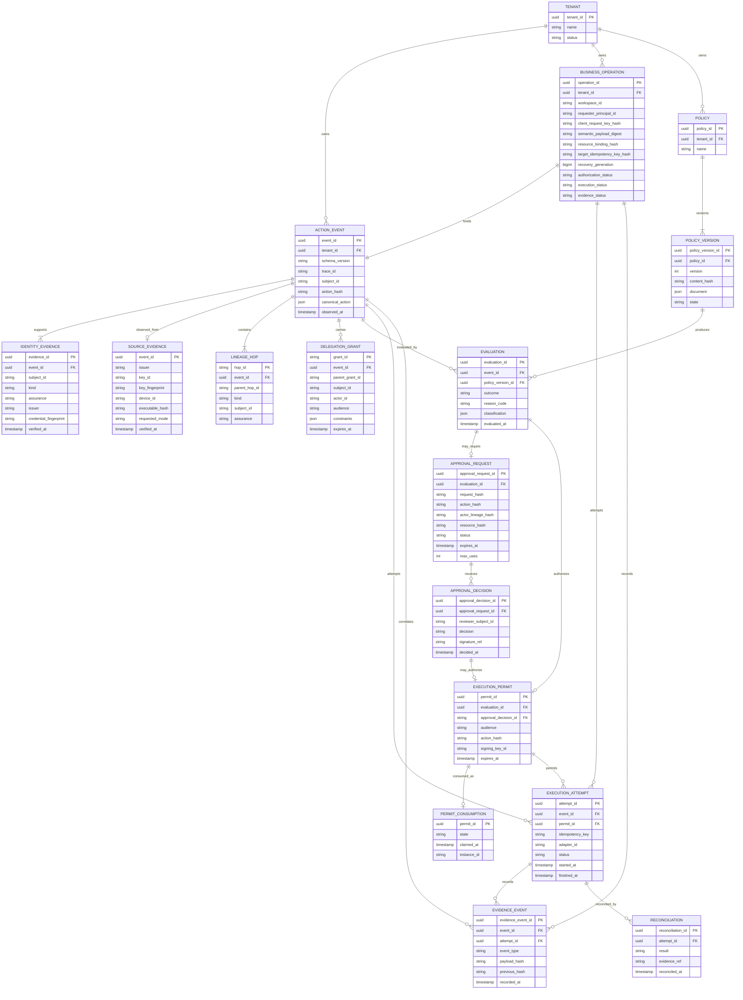
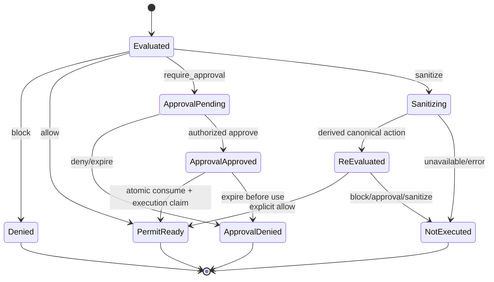
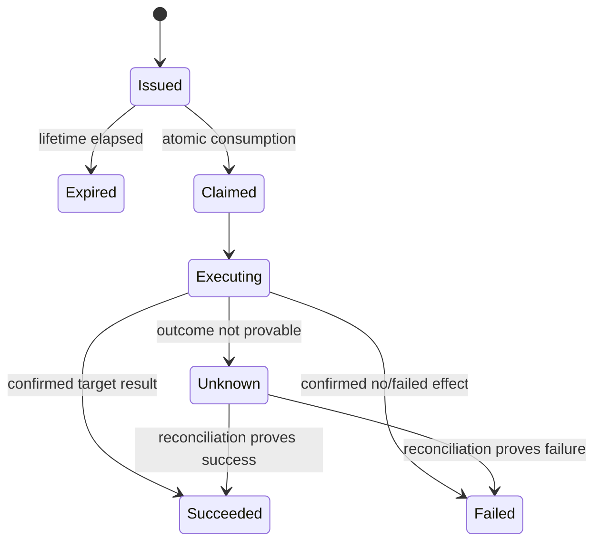

# Domain and data model

**Status:** Target model; current contracts implement a subset  
**Applies to:** Java backend and versioned language-neutral contracts

## 1. Domain language

| Term               | Meaning                                                            |
| ------------------ | ------------------------------------------------------------------ |
| Principal          | Human or workload identity                                         |
| Subject            | Principal whose authority is evaluated                             |
| Actor              | Immediate agent, service, orchestrator, or tool acting             |
| Trigger            | Human, service, or scheduled cause                                 |
| Action event       | Canonical observed request before classification and decision      |
| Business operation | Durable business intent spanning requests and lifecycle dimensions |
| Identity evidence  | Verification metadata and non-secret credential fingerprint        |
| Source attestation | Short-lived signed endpoint observations bound to one request      |
| Source evidence    | Safe verified device/process/trigger projection on an action       |
| Workload identity  | Scheduler-signed principal/run/action binding                      |
| Lineage hop        | Causal observation linking components in a request path            |
| Delegation grant   | Signed, verifiable, parent-linked authority transfer               |
| Classification     | Derived action class, severity, operation, and risk signals        |
| Evaluation         | Policy decision for one action event and policy version            |
| Approval request   | Pending request for a human decision on an exact action hash       |
| Approval decision  | Approver's allow or deny attestation                               |
| Execution permit   | Short-lived capability for one subject, action, and executor       |
| Execution attempt  | One claimed attempt to invoke a target                             |
| Evidence event     | Append-only lifecycle fact                                         |
| Reconciliation     | Later determination of an initially uncertain outcome              |

V10 storage additionally recognizes terminal `cancelled` and separate requester
cancellation provenance on pending→cancelled transitions, never reviewer fields.
The storage prerequisite is
[ADR 0059](../architecture/0059-explicit-v9-v10-simulator-upgrade.md).
[ADR 0060](../architecture/0060-authenticated-pending-request-withdrawal.md)
adds authenticated pending-only withdrawal with version3 bounded requester
lifecycle evidence and atomic outbox. It is not reviewer denial, approved-authority
revocation or interruption of a target operation. The React mutation is separate.

## 2. Aggregate boundaries

### Action aggregate

Owns the immutable canonical action, identity evidence references, lineage,
classification, and evaluations. The original normalized event is never edited
to reflect later decisions.

### Business-operation aggregate

Owns a server operation ID, trusted tenant/workspace/requester context, client
request-key fingerprint, immutable normalized action and hash, semantic payload
digest, resource/precondition binding, policy/artifact releases, recovery
generation, retention policy and independent authorization/execution/evidence
projections. Its append-only transitions are globally ordered and versioned per
dimension. Transport request, event, operation, semantic, resource and target
idempotency identities are deliberately distinct.

The implemented v1 contract and Java validator are a persistence-neutral
foundation only. They do not provide repository uniqueness, access control,
encryption, retention deletion, resume/cancel APIs, target dispatch or
reconciliation. See [ADR 0068](../architecture/0068-versioned-business-operation-contract.md).

### Approval aggregate

Owns approval request state, reviewer identity, decision, expiry, request hash,
and consumption. Approval cannot mutate the action it references.

### Execution aggregate

Owns permit metadata, atomic consumption, attempts, idempotency reference,
observed target outcome, and reconciliation.

### Policy aggregate

Owns immutable policy versions and activation state. Evaluations always record
the exact version used.

## 3. Target entity relationship model

## 4. Lifecycle state machines

### Evaluation and approval

The original event remains immutable. A sanitizer produces a second event with
a distinct event ID and canonical hash. Policy evaluation, permit binding, and
idempotency use that effective event; bounded evidence links the two hashes and
records the allowlisted transformer without persisting raw arguments.

### Execution

State transitions append evidence. Reconciliation does not rewrite the earlier
unknown event.

## 5. Data handling rules

- Canonical actions are immutable after acceptance.
- Large or sensitive arguments may be stored as redacted data plus a content
  hash and protected external reference.
- Tokens and reusable secrets are never stored.
- Permit and approval records retain IDs, hashes, key IDs, claims required for
  audit, and signatures only when safe and required.
- Tenant ID participates in every storage key and authorization decision.
- Retention and deletion must preserve legally required audit integrity while
  honoring tenant and privacy policy.

## 6. Java mapping guidance

Use immutable records/value objects for canonical events and signed claims.
Keep domain state transitions behind aggregate methods and repositories. JSON
transport objects must not double as trusted domain objects; adapters validate
and map them explicitly.

## 7. Implemented durable Java subset

The durable execution implementation Java simulator profile now persists tenant-scoped permit
consumption, execution attempts, monotonic transition history, ordered evidence
events, stream heads, and evidence outbox identities. The trusted tenant is an
application context value, not a field accepted from an arbitrary action body.

The persistence projection deliberately does not store canonical action JSON or
target results. It retains the action/idempotency hashes and bounded correlation,
policy, status, reason, timestamp, and credential-fingerprint fields required
for enforcement and evidence.

The request-bound approval implementation implements the approval subset in PostgreSQL V2: an immutable
`ApprovalBinding`, current aggregate state, and append-only transitions for
`pending`, `approved`, `denied`, `expired`, and `consumed`. The consumed
transition links to the permit and attempt under the same tenant. Reviewer
provenance stores bounded identity/authentication fields and a credential
fingerprint, never a reviewer token. Approval consumption and the durable execution implementation
claim rows commit together; the original request and transition history are
not overwritten. Policy-version documents, retention, outbox publication, and
external checkpoints remain target entities.

The hardened remote-edge implementation adds Flyway V3 only to align durable subject identifiers with the
existing issuer-qualified OAuth form (`issuer#subject`). The `#` delimiter is
accepted for subject and reviewer-subject domain values and the two persisted
subject columns; permit, attempt, event, policy, and other identifier grammars
remain unchanged. The remote adapter supplies the tenant as separate trusted
application context before this persistence boundary.

The evidence-publication implementation adds Flyway V4 publication state to `tp_evidence_outbox` and the
append-only `tp_evidence_anchors` relation. An outbox row may be unclaimed,
leased, delayed for retry, or published. Publication attempts increment without
changing the evidence event. A receipt binds one tenant/outbox/event/stream
position and payload hash and can never be updated or deleted. The stable
outbox ID is the external idempotency identity; the database does not claim
that an arbitrary sink provides exactly-once delivery.

The safe-reconciliation implementation adds `tp_reconciliation_queue`, created in the same transaction as an
`unknown` transition. The queue stores the original tenant/attempt/adapter/
idempotency binding, retry time, lookup count, and lease. It is deleted only in
the transaction that appends `unknown -> succeeded|failed`; an unconfirmed
lookup changes queue scheduling but not execution history.
