# Key sequence flows

**Status:** Current and target flows  
**Applies to:** Design, implementation, review, and testing

For a code/test map and synchronized public diagrams, see the
[nine-flow guide](../flows-guide.md). Separate deployment profiles and their
qualification limits are explicit there; the diagrams below do not imply every
foundation is composed into one running service.

## 1. Authenticated MCP allow and execution

The separate [loopback approval API foundation](../runbooks/authenticated-approval-api-foundation.md)
has an additional authenticated HTTP flow: verify JWT and operator membership
→ normalize one simulator action → atomically store pending approval, exact
action snapshot and evidence → distinct authorized reviewer decides against
the request hash → original requester executes the stored action once. It
rechecks active reviewer enrollment and policy binding before the durable
claim. The optional browser inbox signs in through the Java adapter, keeps
tokens in server memory, and reaches these same checks through cookie/CSRF
protected `/browser/api/v1/approvals` routes. Its separate authenticated local
MCP request/status/resume tools now share these durable checks; no MCP approval
tool exists and resume loads the original immutable action. This is not wired
into the hosted OAuth or default read-only React flows below. See
[ADR 0037](../architecture/0037-mcp-durable-simulator-approval-composition.md) and
[ADR 0036](../architecture/0036-local-browser-approval-boundary.md).

This flow is implemented by the Java loopback development backend and the Java
authenticated remote OAuth-to-simulator composition.

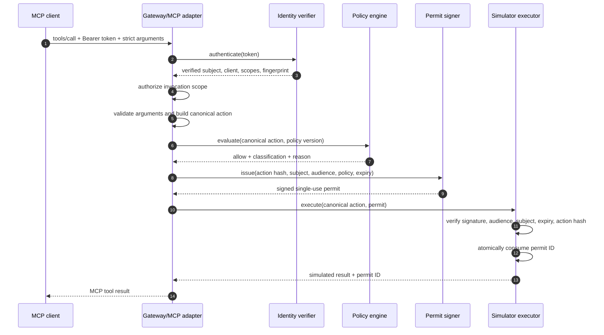

### Public-client browser login (synthetic qualification)

```mermaid
sequenceDiagram
  participant B as Same-Mac browser
  participant J as Loopback Java adapter
  participant I as Configured test IdP
  B->>J: GET /auth/login
  J-->>B: Binder cookie and code/S256 authorization redirect
  B->>I: client_id, exact redirect, configured organization, state, nonce, challenge
  I-->>B: code, state, exact iss
  B->>J: Callback plus binder cookie
  J->>J: Atomically consume state, verify binder/state/issuer
  J->>I: code + verifier + exact redirect + client_id; no secret/header
  I-->>J: Signed API and ID tokens
  J->>J: Independently verify keys, claims, organization and nonce
  J->>J: Require API approvals.read and current human enrollment
  J-->>B: Opaque expiring local session; tokens stay in Java
```

Callback replay or concurrent loss stops before another exchange. ID-token
nonce substitution prevents replay into a new flow. `openid` requests OIDC,
not API authority. Schema1.0 uses confidential Basic on the same PKCE path.
The synthetic fixture does not prove Auth0 emits `iss` or compatible tokens;
see [ADR0063](../architecture/0063-explicit-public-browser-code-pkce.md).

## 1A. Production OAuth/JWKS verification foundation

The Java verification flow is implemented through the verified-identity
projection. The remote OAuth transport supplies the HTTPS/JWKS edges and the
remote MCP adapter supplies the
simulator-only invocation path; deployable production composition remains
target work.

```mermaid
sequenceDiagram
  participant C as Remote MCP client
  participant G as Future HTTPS adapter
  participant V as Java OIDC verifier
  participant R as Operator provider registry
  participant K as Bounded JWKS cache/source
  participant M as MCP dispatch

  C->>G: Authorization: Bearer at+jwt
  G->>V: authenticate bounded credential
  V->>R: exact issuer lookup
  R-->>V: audience, JWKS URI, clients, tenants, scopes
  V->>K: resolve configured issuer/kid/RS256
  K-->>V: fresh trusted RSA public key
  V->>V: verify signature; re-sample trusted time; validate claims
  V-->>G: issuer-qualified subject + fingerprint-only evidence
  G->>M: dispatch with trusted identity
  Note over C,K: Token cannot supply its trust key or JWKS URL
```

### Bounded refresh within key resolution

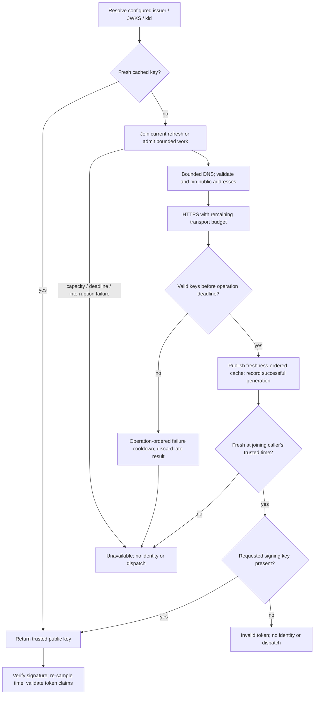

Warm reads bypass refresh work. Different providers do not hold one global
network lock, but share finite configured worker capacity. Waiters do not
force-stop uninterruptible OS DNS. Late older failures cannot replace newer
success with stale cooldown. Tests qualify these local boundaries, not a hard
end-to-end deadline, distributed fairness or a production readiness claim.
See [ADR 0049](../architecture/0049-bounded-jwks-refresh-isolation.md).

## 1B. SSRF-safe JWKS and authenticated remote MCP handshake

This handshake-only composition uses runtime-generated TLS/RSA test keys and
intentionally has no `tools/call` handler. The separate enforcing dispatcher is
described in 1C; a deployable production main remains absent.

```mermaid
sequenceDiagram
  participant C as Remote connector
  participant H as TLS OAuth edge
  participant V as OIDC verifier
  participant J as SSRF-safe JWKS source
  participant I as Configured issuer JWKS
  participant M as Handshake dispatcher

  C->>H: POST /mcp + Bearer + bounded body
  H->>H: validate exact Host/Origin and declared size
  H->>V: authenticate before reading JSON
  V->>J: fetch exact configured JWKS URI when cache needs it
  J->>J: resolve; reject private/mixed DNS; pin approved addresses
  J->>I: direct HTTPS GET; no redirect/proxy/retry
  I-->>J: bounded JSON/JWK-set response
  J-->>V: strict UTF-8 public JWKS
  V-->>H: verified connector projection
  H->>H: read bounded strict JSON
  H->>M: initialize / ping / tools-list + verified connector
  M-->>H: handshake/discovery response
  H-->>C: bounded JSON response
  Note over H,M: tools/call is explicitly not configured
```

An unauthenticated malformed body stops at the authentication step. A JWKS
outage returns unavailable and does not use an expired key or development
issuer.

## 1C. Authenticated remote MCP simulator enforcement

This Java flow is implemented by the explicit enforcing dispatcher.
The remote OAuth transport implementation handshake-only dispatcher remains a no-invocation composition.

```mermaid
sequenceDiagram
  autonumber
  participant C as Remote MCP connector
  participant H as TLS OAuth edge
  participant M as Enforcing MCP dispatcher
  participant A as Java application
  participant P as Policy and permit authority
  participant S as Safe target simulator
  participant E as Evidence ledger

  C->>H: tools/call + Bearer + strict arguments
  H->>H: Host/Origin and OAuth verification before parsing
  H->>M: parsed call + verified connector projection
  M->>M: registered tool + exact invocation scope + argument schema
  M->>M: construct canonical subject/actor/target/lineage
  M->>A: enforce(canonical action)
  A->>E: observation and evaluation evidence
  A->>P: classify and evaluate exact action
  alt block / approval / sanitize
    P-->>A: non-allow decision
    A->>E: denied or not-executed evidence
    A-->>M: no permit; no dispatch
  else allow
    P-->>A: allow + policy version
    A->>P: issue then verify/consume request-bound permit
    A->>E: authority and dispatch evidence
    A->>S: canonical action after permit verification
    S-->>A: bounded simulated result
    A->>E: succeeded/failed/unknown evidence
    A-->>M: bounded result
  end
  M-->>C: MCP tool result
```

No tool argument supplies identity, target, tenant, approval, policy, permit,
or credential state. Unknown tools stop before policy; the known destructive
simulation reaches policy and is explicitly blocked before a permit exists.

## 1D. Hardened sender-bound and durable remote invocation

This hardened remote-edge implementation flow is implemented as an injected Java/test composition. There
is no production bootstrap or real target.

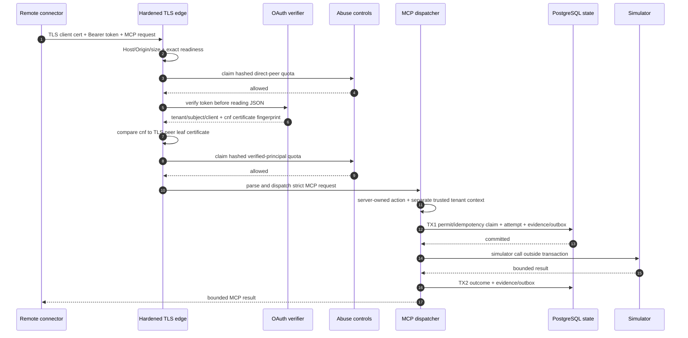

Wrong or missing certificate binding stops before body parsing. A rate/readiness
dependency failure stops before policy and simulator. Durable execution state
does not yet imply durable storage for every edge denial.

## 2. Discovery allowed but invocation denied

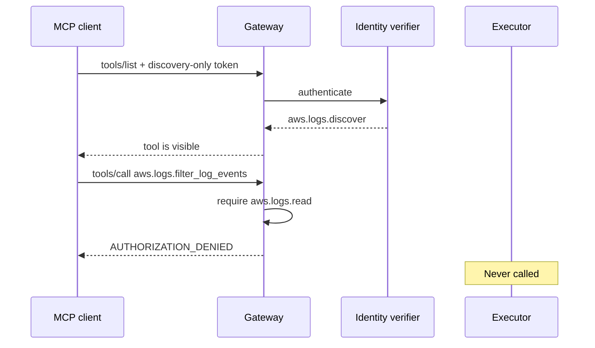

## 3. Policy block or unresolved sanitize

```mermaid
sequenceDiagram
  participant A as Adapter
  participant G as Gateway
  participant P as Policy engine
  participant S as Permit signer
  participant E as Executor

  A->>G: canonical action
  G->>P: evaluate
  alt block
    P-->>G: block
    G-->>A: denied
  else sanitize without configured sanitizer
    P-->>G: sanitize
    G-->>A: SANITIZER_NOT_CONFIGURED
  end
  Note over S,E: No permit; no execution
```

### 3.1 Resolved sanitize and sequence-aware denial

```mermaid
sequenceDiagram
  autonumber
  participant A as Trusted adapter
  participant Q as Server-owned sequence store
  participant P as Classifier + policy
  participant Z as Allowlisted sanitizer
  participant S as Permit authority
  participant E as Simulator executor

  A->>Q: validated original canonical event
  Q-->>P: bounded prior-action context
  P-->>A: sanitize + OVERSIZED_RESULT_WINDOW
  A->>Q: record original observation
  A->>Z: immutable original + evaluation
  Z-->>A: derived event, new ID/hash, bounded change summary
  A->>P: classify and evaluate derived event with same context
  alt derived action is explicitly allowed
    P-->>A: allow
    A->>S: issue permit for derived event/hash
    S-->>E: single-use verified authority
    E-->>A: simulated result
  else transform missing/fails or final outcome is not allow
    A-->>A: record not-executed evidence
    Note over S,E: No permit; no target call
  end
```

For later requests, the adapter queries history by tenant, authenticated
subject, and target system. The third read inside the POC window receives
`RAPID_REPEATED_READ_SEQUENCE`; the higher-priority rule blocks it before
permit issue. Requests cannot submit, reset, or override this history. A state
lookup or record failure produces `SEQUENCE_STATE_UNAVAILABLE` with no target
call.

## 4. Human approval flow

This flow is implemented through the Java application and PostgreSQL simulator
profile. The composing adapter supplies trusted reviewer context; the optional
loopback bearer/browser approval API authenticates reviewers for this same
workflow. There is no public approval administration endpoint.

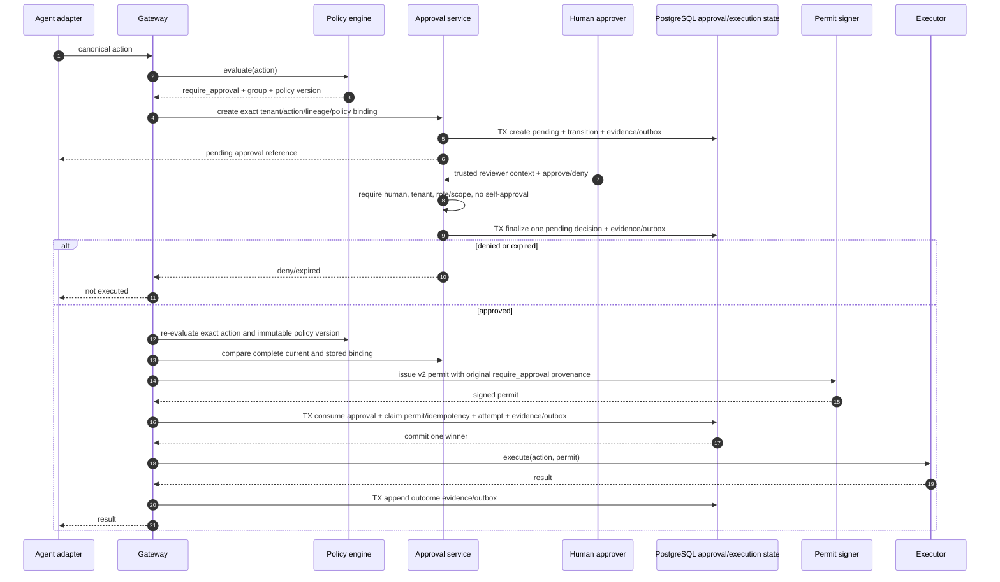

### Separate approval listener: bounded admission before handler work

This applies to the loopback approval API/browser/MCP composition, not the
default or hosted MCP listeners. The executor allows eight active plus sixteen
pending tasks by default. Host/URI/closed checks themselves consume an admitted
lane; malformed input is not capacity-free.

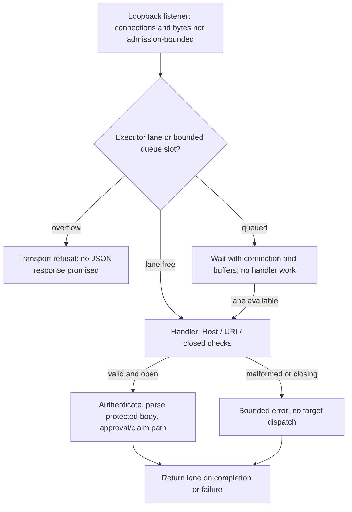

Close stops the listener, shuts down workers, waits up to two seconds, then
interrupts remaining lanes. A handler that ignores interruption can remain as
a daemon worker. Queued work need not run and admitted target outcomes can
remain uncertain; close is not a drain or forced dependency cancellation.
See [ADR 0050](../architecture/0050-bounded-simulator-approval-admission.md).

## 5. Scheduled workload with delegation

The verification boundary is implemented as a Java in-process foundation. A
real scheduler transport and production trust services remain target work.

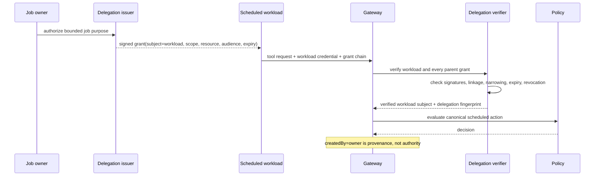

## 6. Concurrent replay attempt

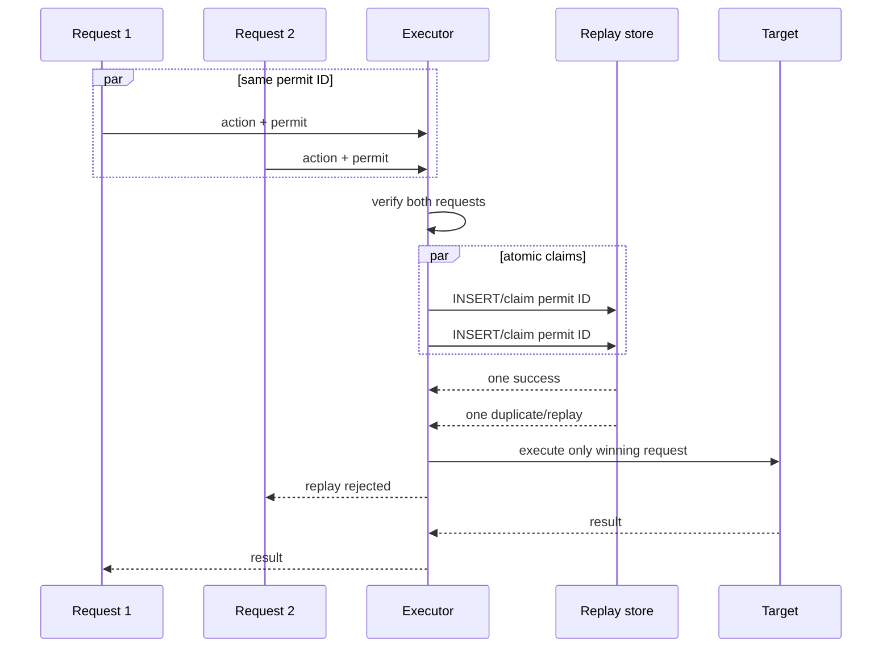

### Process-local capacity refusal

The in-memory source/workload replay and permit-consumption stores serialize
bounded expiry reclamation, duplicate/capacity checks and insertion. At full
retained capacity without reclaimable space, a fresh claim is refused via the
existing replay code, before returning verified identity or a consumed permit.
No live record is replaced. A duplicate whose expired record remains behind
the per-call budget is also refused until its own record is reclaimed; fresh
keys can use reclaimed slots earlier. Defaults are 65,536 retained entries and
64 removals. This is process-local state, not the PostgreSQL transaction shown
above or a distributed/restart guarantee. The focused integration tests use a
verification/consumption-then-test-callback harness, not an actual application
dispatch route. See [ADR 0054](../architecture/0054-bounded-local-replay-stores.md).

## 7. Crash and reconciliation

The durable Java simulator services implement claims, attempts, transitions,
evidence and lookup-only reconciliation ports in PostgreSQL. A completion
exception triggers one additional same-attempt unknown recording, not another
target call. The original response stays uncertain; a committed non-executing
state cannot be overwritten. Persistent outage or crash can still leave executing
state without a queued unknown. See [ADR 0048](../architecture/0048-bounded-durable-completion-uncertainty.md).

The separately configured leased worker queries only already queued unknowns;
it is not automatically scheduled by the approval launcher. Production target
lookup, abandoned-execution recovery and restore fencing remain future work.

Explicit [operator quarantine](../architecture/0051-operator-declared-recovery-quarantine.md)
adds a separate one-way containment flow: authority transactions first share-lock
the recovery row and commit their claim; declaration update-locks the same row
and commits quarantined state. Later claims/reviews fail closed across replicas.
Prior admitted claims may still dispatch/complete after declaration, and existing
completion/evidence/lookup transactions are not gated. This does not detect a
restored old ready row or define safe effectful resume.

Owner-only [recovery inspection](../architecture/0052-owner-only-recovery-inspection.md)
follows a separate read-only path: strict existing-schema validation, then a
public-schema repeatable-read transaction checks ownership/RLS and reads the
quarantine row plus aggregate stored statuses/queue count. The transaction ends
before any report is emitted. It takes no authority row lock and does not mutate,
refresh expiry, look up a target, release authority or declare safe resume.

```mermaid
sequenceDiagram
  autonumber
  participant G as Gateway
  participant D as Execution store
  participant T as Target
  participant R as Reconciler

  G->>D: TX1 claim permit + attempt + evidence/outbox
  D-->>G: commit; state=executing
  G->>T: request + stable idempotency key
  T-->>G: target may complete
  G->>D: TX2 append confirmed/unknown outcome + evidence/outbox
  opt completion throws (commit not assumed)
    G->>D: One same-attempt executing-to-unknown completion
    Note over G,D: Preserve any committed non-executing state; original response stays uncertain
  end
  Note over G,D: Crash/outage may leave executing; no automatic queue insertion is promised
  opt unknown committed and lookup worker separately configured
    R->>D: lease unknown queue row; commit
    R->>T: read-only lookup by tenant, adapter and idempotency key
    T-->>R: confirmed result
    R->>D: TX append confirmed state + evidence; delete queue row
  end
```

## 8. Current process-local evidence flow

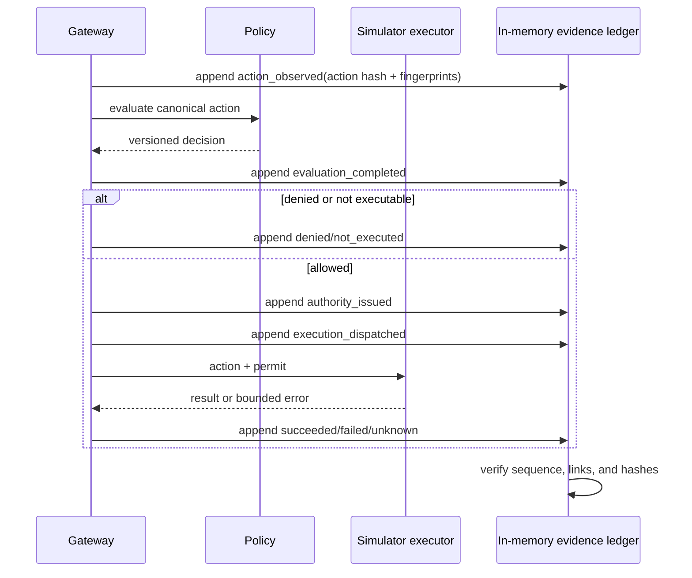

This flow is implemented but process-local. It minimizes evidence content and
detects local mutation; it does not provide an independent integrity anchor.

## 9. Target audit checkpointing

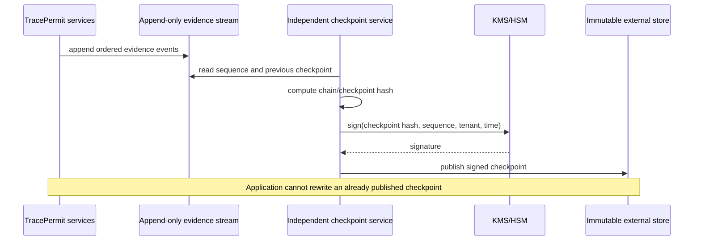

## 9A. Evidence publication and external anchoring

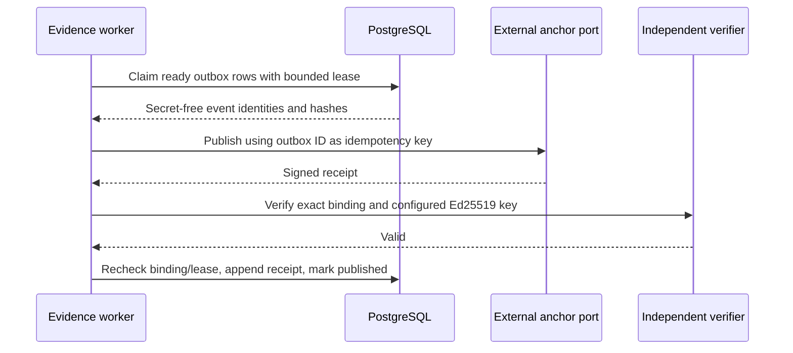

No database transaction spans the anchor call. A timeout releases or expires
the lease for retry and never marks delivery complete without a valid receipt.

## 10. Security dependency outage

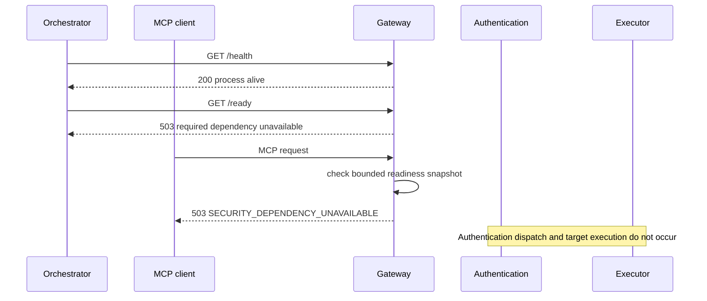

The readiness signal removes unsafe instances from traffic, while each
component must still fail closed if its dependency becomes unavailable after
the snapshot was read.

## 10A. Hardened-edge telemetry gate

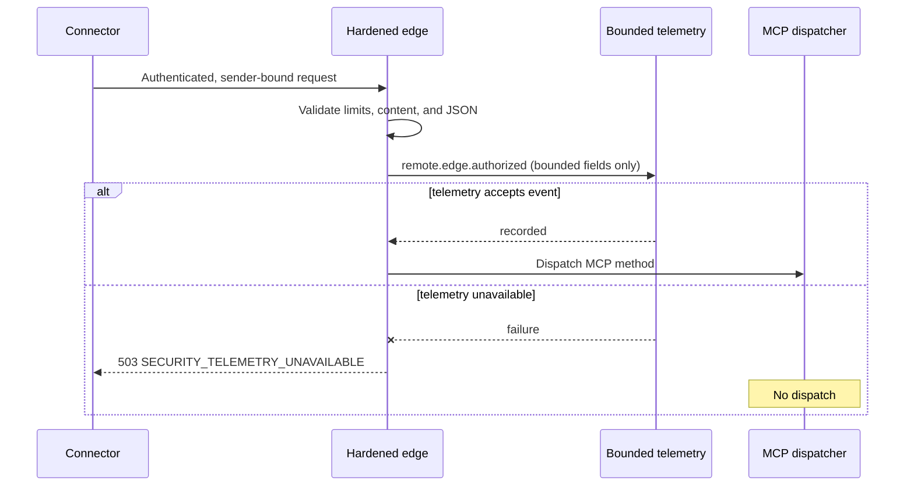

## 11. Managed CLI source attestation

This flow is implemented for the loopback development connector. Enrollment,
durable replay/revocation, protected platform key custody, and anti-bypass
controls remain target work.

```mermaid
sequenceDiagram
  autonumber
  participant C as Real MCP CLI client
  participant E as Endpoint stdio shim
  participant O as OS/process observer
  participant K as Endpoint key provider
  participant G as Gateway
  participant R as Source replay store
  participant P as Policy/executor

  C->>E: tools/call over stdio
  E->>O: observe parent process and session
  O-->>E: bounded source facts
  E->>E: hash canonical request and connector credential
  E->>K: sign short-lived source attestation
  K-->>E: signed attestation
  E->>G: MCP request + Bearer + source attestation
  G->>G: authenticate connector and verify enrolled endpoint key
  G->>G: verify request/credential binding, audience, and time
  G->>R: atomically consume source token ID
  R-->>G: first use accepted
  G->>G: construct trusted identity, trigger, and lineage evidence
  G->>P: evaluate and enforce
  P-->>G: result or denial
  G-->>E: MCP response
  E-->>C: MCP response
```

The endpoint contributes provenance but does not make the final authorization
decision. An endpoint signature also does not prove the provider account used
inside an encrypted browser session.

The implemented demo has three terminal branches after verification:

```mermaid
flowchart TD
  V[Verified source-bound MCP request] --> T{Registered bounded tool?}
  T -->|No| R[Reject at MCP boundary]
  T -->|Yes| P[Normalize, classify, evaluate policy]
  P -->|Block destructive simulation| D[Deny; executor not called]
  P -->|Allow bounded log read| E[Issue permit and call safe simulator]
```

## 12. Unmodified hosted client through an outbound tunnel

This Scenario 2 flow is qualified for the live simulator-only demonstration.
It validates compatibility and enforcement, not provider-account attribution.

```mermaid
sequenceDiagram
  autonumber
  participant H as Human in ChatGPT
  participant M as Hosted model/orchestrator
  participant O as OpenAI tunnel control plane
  participant T as Local tunnel-client
  participant G as Java MCP gateway
  participant P as Policy + permit
  participant S as Safe simulator

  H->>M: Request bounded read or simulated destructive action
  M->>O: Proposed MCP tools/call
  T->>O: Outbound long poll
  O-->>T: MCP JSON-RPC request
  T->>G: Loopback /mcp + short-lived development bearer
  G->>G: Authenticate before parsing
  G->>G: Ignore untrusted transport _meta; normalize server-owned action
  G->>P: Classify and evaluate policy
  alt allowed bounded read
    P->>P: Issue request-bound single-use permit
    P->>S: Verify permit and execute simulated read
    S-->>G: Bounded simulated result
  else blocked destructive action
    P-->>G: Block; no permit or target dispatch
  end
  G-->>T: Bounded MCP result
  T-->>O: Tunnel response
  O-->>M: Tool result
```

The tunnel runtime key authenticates `tunnel-client` to the provider transport.
The local development bearer authenticates a fixed simulated web profile to
Java. Neither establishes who is signed into ChatGPT; production attribution
requires application OAuth/OIDC claims independently verified by TracePermit.
