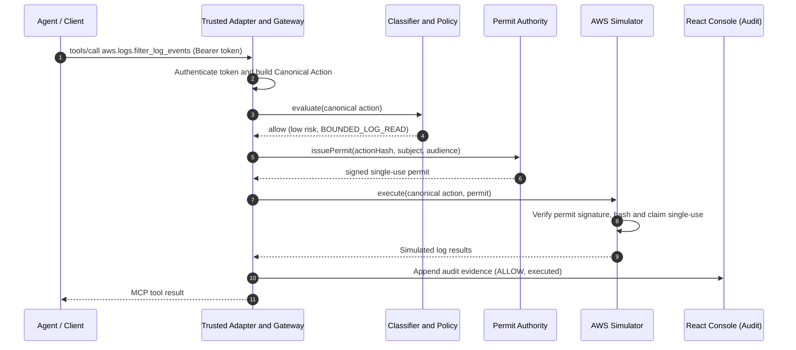
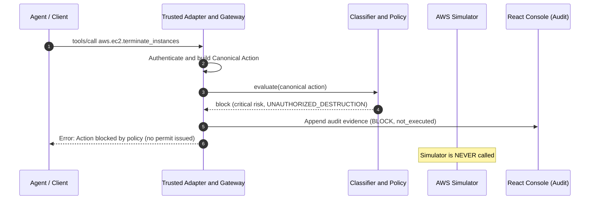
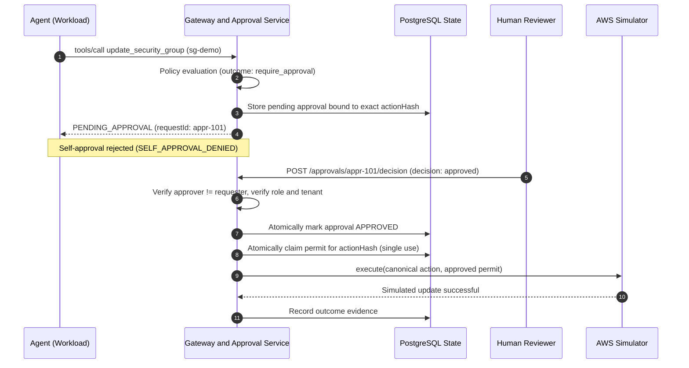
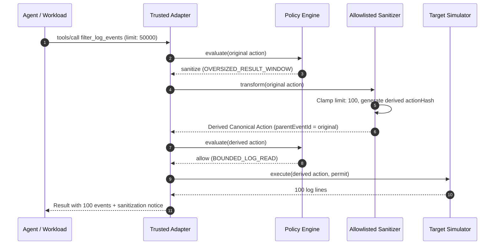
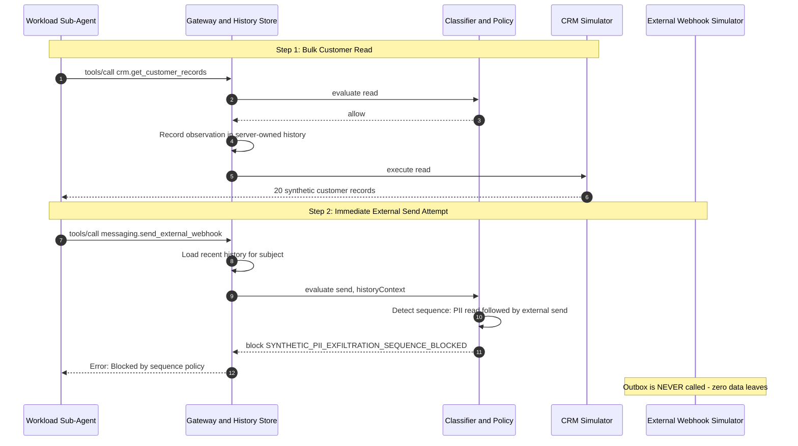

# Core Action Flows & Use Cases

TracePermit sits between AI agents (ChatGPT, Claude, autonomous CLI agents, scheduled jobs) and enterprise tools as an inline enforcement control plane.

::: info Drift Prevention & Developer Guide
This document represents the public, architectural reference for TracePermit's core use cases. For developer runbooks, local `pnpm demo:scenario:...` commands, and internal monorepo navigation, see the [Developer Flows Guide](https://github.com/hemantkgupta/tracepermit/blob/main/docs/flows-guide.md).
:::

---

## The Central Invariant

> **No agent ever touches an enterprise target directly.** Every tool call is intercepted, authenticated, normalized into a canonical action, evaluated by policy, and requires an exact, single-use, cryptographically verified **Execution Permit** before a safe simulator can execute.

```text
AI Agent / CLI / Workload
           | 1. Structured Tool Proposal
           v
   Trusted Gateway Adapter
   (authenticates caller, derives identity facts)
           | 2. Canonical Action (SHA-256 hash)
           v
     Policy Engine
     (evaluates risk, classification, server-owned history)
           |
     +-----+--------------------+--------------------+
     |                          |                    |
   allow                      block           require_approval
     |                          |                    |
     v                          v                    v
Issue Request-Bound       Deny & Record       Human Reviewer
Execution Permit          Audit Evidence      Independent Signoff
     |                          |                    | (approved)
     v                          |                    +----> Issue Permit
Atomic Claim (1x)               |
     |                          |
     v                          v
Deterministic Simulator   Evidence Ledger & Read-Only Console
```

---

## The 3 Fundamental Data Contracts

The enforcement lifecycle is governed by three canonical JSON contracts:

### 1. Canonical Action (`CanonicalAction`)

The normalized representation of what the agent wants to do. It strips client quirks, sorts keys canonically, and calculates a deterministic SHA-256 hash.

```json
{
  "eventId": "018f47a2-f5ce-7a4b-8f54-80e5d3eaf091",
  "traceId": "8f3a2c1e4b5d67890123456789abcdef",
  "identity": {
    "subject": {
      "id": "user:alice@example.com",
      "type": "human",
      "assurance": "authenticated"
    },
    "actor": {
      "id": "client:chatgpt-web",
      "type": "orchestrator",
      "assurance": "asserted"
    }
  },
  "trigger": { "kind": "human", "origin": "chatgpt-web" },
  "action": {
    "protocol": "mcp",
    "toolName": "aws.logs.filter_log_events",
    "arguments": {
      "logGroupName": "/app/prod",
      "filterPattern": "ERROR",
      "limit": 50
    },
    "target": {
      "system": "aws",
      "environment": "prod",
      "resourceType": "cloudwatch-log-group"
    }
  }
}
```

### 2. Policy Evaluation (`PolicyEvaluation`)

The decision produced by the policy engine after classifying the action's risk and checking server-owned sequence history.

```json
{
  "evaluationId": "018f47a2-f5ce-7a4b-8f54-80e5d3eaf099",
  "classification": {
    "actionClass": "read",
    "severity": "low",
    "operation": "aws.logs.filter_log_events"
  },
  "decision": {
    "outcome": "allow",
    "policyId": "pol-aws-web-001",
    "policyVersion": 2,
    "matchedRuleId": "allow-cloudwatch-read",
    "reasonCode": "BOUNDED_LOG_READ"
  }
}
```

### 3. Execution Permit (`ExecutionPermit`)

A tamper-proof, short-lived JWS minted only when an action is allowed or approved. The executor verifies the cryptographic signature, checks that the `actionHash` matches the request, and atomically claims it so it can never be reused.

```json
{
  "permitId": "018f47a2-f5ce-7a4b-8f54-80e5d3eaf080",
  "issuer": "https://execution-permits.tracepermit.invalid",
  "audience": "urn:tracepermit:executor:aws",
  "subjectId": "user:alice@example.com",
  "actionHash": "sha256:97efc87ece3fb5188e998b012a0c19eeadbadf5228bc89d07591cfaca0ec4476",
  "decision": { "outcome": "allow", "policyId": "pol-aws-web-001" },
  "maxUses": 1,
  "expiresAt": "2026-10-08T10:16:01.000Z"
}
```

---

## 5 Core Flows in Action

---

### Flow 1: Safe Read (Autonomous Allow)

#### The Scenario

An engineer asks ChatGPT or a local CLI assistant: _"Check the last 50 error logs for the production app."_ The agent invokes `aws.logs.filter_log_events`. TracePermit verifies the caller's identity, evaluates that bounded reads on log groups are permitted by organizational policy, issues a request-bound permit, and executes against the safe simulator.

#### Sequence Diagram

```text
Agent / Client               Trusted Gateway                Policy Engine               Simulator
      │                             │                             │                         │
      │── 1. tools/call (Token) ───>│                             │                         │
      │                             │── 2. Canonical Action ─────>│                         │
      │                             │      (actionHash: sha256)   │                         │
      │                             │                             │── 3. Decision: "allow" ─│
      │                             │<─ 4. Issue Single-Use Permit│                         │
      │                             │                             │                         │
      │                             │── 5. execute(action, permit) ────────────────────────>│
      │                             │                                                       │ Claim single-use
      │                             │<── 6. Simulated Log Results ──────────────────────────│
      │<─ 7. MCP Tool Result ───────│                                                       │
```

<details>
<summary>View Mermaid Syntax (for Notion / GitHub)</summary>



</details>

#### Security Takeaways

- **No Blanket Access**: The agent is never handed an AWS IAM credential.
- **Single-Use Binding**: The permit is bound to the exact parameters (`logGroupName: "/app/prod"`, `limit: 50`) and cannot be used for any other request.
- **Reference Code**: Handled by [`OidcAccessTokenVerifier.java`](https://github.com/hemantkgupta/tracepermit/blob/main/java/identity/src/main/java/io/tracepermit/identity/OidcAccessTokenVerifier.java) and [`ActionNormalizer.java`](https://github.com/hemantkgupta/tracepermit/blob/main/java/contracts/src/main/java/io/tracepermit/contracts/ActionNormalizer.java).
- **Demo Scenario**: [Scenario 1: Attested CLI Allow then Block](https://github.com/hemantkgupta/tracepermit/blob/main/docs/demo-scenarios/01-attested-cli-allow-block.md).

---

### Flow 2: Destructive Side Effect (Policy Block)

#### The Scenario

An agent is misled by an adversarial prompt injection or a hallucinated instruction and proposes terminating an EC2 instance: `aws.ec2.terminate_instances`. TracePermit verifies the caller's identity, but **authentication is not blanket authorization**. The classifier flags the operation as `critical` severity. Policy returns `block`. TracePermit records `not_executed` evidence and halts. **Zero permits are minted and no target API is called.**

#### Sequence Diagram

```text
Agent / Client               Trusted Gateway                Policy Engine               Simulator
      │                             │                             │                         │
      │── 1. terminate_instances ──>│                             │                         │
      │                             │── 2. Canonical Action ─────>│                         │
      │                             │                             │── 3. Decision: "block" ─│
      │                             │                             │      (critical risk)    │
      │                             │   4. Append audit evidence  │                         │
      │                             │      (not_executed)         │                         │
      │<─ 5. Error: Action Blocked ─│                             │     [Zero Dispatches]   │
      │      (no permit issued)     │                             │     (Never Called) ─────┼── X
```

<details>
<summary>View Mermaid Syntax (for Notion / GitHub)</summary>



</details>

#### Decision Payload

```json
{
  "evaluationId": "018f47a2-f5ce-7a4b-8f54-80e5d3eaf102",
  "classification": {
    "actionClass": "delete",
    "severity": "critical",
    "operation": "aws.ec2.terminate_instances"
  },
  "decision": {
    "outcome": "block",
    "policyId": "pol-aws-web-001",
    "matchedRuleId": "deny-destructive-ops",
    "reasonCode": "UNAUTHORIZED_INFRASTRUCTURE_DELETION"
  }
}
```

#### Security Takeaways

- **Fail-Closed Guardrails**: Unknown tools and high-risk unapproved mutations fail closed.
- **Immutable Evidence**: Even though no side effect occurred, the attempt and its exact provenance are recorded in the audit trail.
- **Reference Code**: Evaluated by [`PolicyEvaluator.java`](https://github.com/hemantkgupta/tracepermit/blob/main/java/policy/src/main/java/io/tracepermit/policy/PolicyEvaluator.java) and [`Classification.java`](https://github.com/hemantkgupta/tracepermit/blob/main/java/policy/src/main/java/io/tracepermit/policy/Classification.java).
- **Demo Scenario**: [Scenario 7: Signed Scheduled EC2 Stop Block](https://github.com/hemantkgupta/tracepermit/blob/main/docs/demo-scenarios/07-signed-scheduled-ec2-stop-block.md).

---

### Flow 3: Dual-Control Human Approval (Two-Man Rule)

#### The Scenario

An autonomous agent attempts a high-impact mutation, such as modifying a Security Group rule or deleting a database. The policy dictates `require_approval`.

TracePermit freezes the exact canonical action hash and registers a pending approval.

- **No Self-Approval**: The requesting principal or agent cannot approve its own proposal.
- **Exact-Request Binding**: An independent human approver with the requisite security role reviews the frozen SHA-256 hash.
- **Atomic One-Time Claim**: Upon approval, PostgreSQL atomically claims the permit for that exact hash. The simulator runs once. Replays or modified parameters are rejected.

#### Sequence Diagram

```text
Agent (Workload)             Gateway / Approvals            PostgreSQL DB        Human Reviewer      Simulator
      │                             │                             │                    │                 │
      │── 1. update_sec_group ─────>│                             │                    │                 │
      │                             │── Decision: require_approval│                    │                 │
      │                             │── 2. Store Pending Hash ───>│                    │                 │
      │<─ 3. PENDING (appr-101) ────│                             │                    │                 │
      │                             │                             │                    │                 │
      │── 4. Self-approval ────────>│ (REJECTED: No self-review)  │                    │                 │
      │                             │                             │                    │                 │
      │                             │<── 5. Review & Approve ──────────────────────────│ (Independent)   │
      │                             │── 6. Mark Approved ────────>│                    │                 │
      │                             │── 7. Claim Permit (1x) ────>│                    │                 │
      │                             │                             │                    │                 │
      │                             │── 8. execute(approved permit) ────────────────────────────────────>│
      │                             │<── 9. Simulated Update OK ────────────────────────────────────────│
```

<details>
<summary>View Mermaid Syntax (for Notion / GitHub)</summary>



</details>

#### Approval Binding Payload

```json
{
  "approvalRequestId": "appr-018f47a2-f5ce-7a4b-8f54-80e5d3eaf301",
  "actionHash": "sha256:4b22f01234567890abcdef1234567890abcdef1234567890abcdef1234567890",
  "subjectId": "user:alice@example.com",
  "requiredRole": "security-admin",
  "status": "approved",
  "reviewer": {
    "reviewerId": "user:bob-reviewer@example.com",
    "decision": "approved",
    "decidedAt": "2026-10-08T10:20:00.000Z"
  }
}
```

#### Security Takeaways

- **No Agent Broadening**: Human approval never grants general authority to an agent; it authorizes **one single execution** of one exact request hash.
- **Reference Code**: Defined in [`ApprovalBinding.java`](https://github.com/hemantkgupta/tracepermit/blob/main/java/execution/src/main/java/io/tracepermit/execution/ApprovalBinding.java) and [`ApprovalExecutionClaim.java`](https://github.com/hemantkgupta/tracepermit/blob/main/java/execution/src/main/java/io/tracepermit/execution/ApprovalExecutionClaim.java).
- **Demo Scenario**: [Scenario 3: Request-Bound Human Approval](https://github.com/hemantkgupta/tracepermit/blob/main/docs/demo-scenarios/03-request-bound-human-approval.md).

---

### Flow 4: Action Sanitization (Self-Healing Guardrails)

#### The Scenario

An agent requests log records with `limit: 50000`. If passed through directly, this would trigger downstream rate-limits and cause high latency. Instead of an uninformative hard deny, TracePermit's policy specifies `sanitize`.

An allowlisted transformer clamps `limit` down to `100`, creates a **derived canonical action** referencing the original event in its lineage, and re-submits it to policy. The derived action passes, a permit is minted for the modified hash, and the agent receives the bounded result without error.

#### Sequence Diagram

```text
Agent / Workload             Trusted Gateway                Policy Engine        Allowlisted Sanitizer   Simulator
      │                             │                             │                    │                     │
      │── 1. read(limit: 50000) ───>│                             │                    │                     │
      │                             │── 2. evaluate(original) ───>│                    │                     │
      │                             │<─ 3. outcome: "sanitize" ───│                    │                     │
      │                             │                             │                    │                     │
      │                             │── 4. transform(original) ───────────────────────>│                     │
      │                             │<── 5. Derived Action (limit: 100, new hash) ─────│                     │
      │                             │                             │                    │                     │
      │                             │── 6. evaluate(derived) ────>│                    │                     │
      │                             │<─ 7. outcome: "allow" ──────│                    │                     │
      │                             │                             │                    │                     │
      │                             │── 8. execute(derived action, permit) ─────────────────────────────────>│
      │<─ 9. Result (100 logs) ─────│                                                                        │
```

<details>
<summary>View Mermaid Syntax (for Notion / GitHub)</summary>



</details>

#### Derived Action Payload

```json
{
  "eventId": "018f47a2-f5ce-derived-0002",
  "parentEventId": "018f47a2-f5ce-original-0001",
  "arguments": {
    "logGroupName": "/app/prod",
    "filterPattern": "ERROR",
    "limit": 100
  },
  "sanitization": {
    "transformerId": "clamp-query-limit",
    "changes": ["limit clamped from 50000 to 100"],
    "finalOutcome": "allow"
  }
}
```

#### Security Takeaways

- **Explicit Provenance**: Sanitization never silently edits an existing event. It mints a fresh event ID and action hash while recording the parent link in causal lineage.
- **Reference Code**: Handled by [`PolicyEvaluator.java`](https://github.com/hemantkgupta/tracepermit/blob/main/java/policy/src/main/java/io/tracepermit/policy/PolicyEvaluator.java).
- **Demo Scenario**: [Scenario 4: Signed Workload and Semantic Sequence](https://github.com/hemantkgupta/tracepermit/blob/main/docs/demo-scenarios/04-signed-workload-semantic-sequence.md).

---

### Flow 5: Semantic Sequence & Multi-Step Defense (Anti-Exfiltration)

#### The Scenario

Traditional tool firewalls evaluate each tool call in isolation. Consider an agent that executes two steps:

1. Calls `crm.get_customer_records` to read 20 customer contact details (Allowed: benign internal read).
2. Proposes calling `messaging.send_external_webhook` with the retrieved records (Data exfiltration attempt).

Neither tool call is inherently forbidden on its own. TracePermit maintains **server-owned sliding-window history** per subject. When the external send arrives, the classifier detects the toxic sequence: `SYNTHETIC_PII_READ_THEN_EXTERNAL_SEND`. Policy immediately blocks the transmission.

#### Sequence Diagram

```text
Workload (Sub-Agent)         Gateway & History Store        Policy Engine        CRM Simulator       Egress Outbox
      │                             │                             │                    │                   │
      │ [STEP 1: Bulk Customer Read]│                             │                    │                   │
      │── 1. crm.get_records ──────>│                             │                    │                   │
      │                             │── 2. evaluate(read) ───────>│                    │                   │
      │                             │<─ 3. outcome: "allow" ──────│                    │                   │
      │                             │   (Record in history)       │                    │                   │
      │                             │── 4. execute read ──────────────────────────────>│                   │
      │<─ 5. 20 Customer Records ───│                                                  │                   │
      │                             │                             │                    │                   │
      │ [STEP 2: External Send Attempt]                           │                    │                   │
      │── 6. send_external_webhook ─>│                            │                    │                   │
      │                             │── 7. evaluate(send, history)│                    │                   │
      │                             │   (Detects: PII -> Send)    │                    │                   │
      │                             │<─ 8. outcome: "block" ──────│                    │                   │
      │                             │      (SYNTHETIC_PII_EXFIL)  │                    │                   │
      │                             │                             │                    │                   │
      │<─ 9. Error: Action Blocked ─│                             │                    │ [Zero Dispatches] │
      │      (no permit issued)     │                             │                    │ (Never Called) ───┼── X
```

<details>
<summary>View Mermaid Syntax (for Notion / GitHub)</summary>



</details>

#### Sequence Block Payload

```json
{
  "classification": {
    "actionClass": "send",
    "severity": "high",
    "signals": ["EXTERNAL_EGRESS", "SYNTHETIC_PII_READ_THEN_EXTERNAL_SEND"]
  },
  "decision": {
    "outcome": "block",
    "policyId": "pol-sequence-rules",
    "matchedRuleId": "block-pii-exfiltration-chain",
    "reasonCode": "SYNTHETIC_PII_EXFILTRATION_SEQUENCE_BLOCKED"
  }
}
```

#### Security Takeaways

- **Stateful Protection**: The gateway owns the sequence history; the client or agent cannot manipulate, reset, or forge recent action state.
- **Reference Code**: Defined in [`ClassificationContext.java`](https://github.com/hemantkgupta/tracepermit/blob/main/java/policy/src/main/java/io/tracepermit/policy/ClassificationContext.java) and [`Classification.java`](https://github.com/hemantkgupta/tracepermit/blob/main/java/policy/src/main/java/io/tracepermit/policy/Classification.java).
- **Demo Scenario**: [Scenario 9: Synthetic Customer Read Followed by External-Send Denial](https://github.com/hemantkgupta/tracepermit/blob/main/docs/demo-scenarios/09-synthetic-pii-read-external-send-block.md).

---

## Architectural Mapping

| Control Point           | Responsibility                                                                      | Code Reference                                                                                     |
| :---------------------- | :---------------------------------------------------------------------------------- | :------------------------------------------------------------------------------------------------- |
| **Ingress & Identity**  | Validates OAuth/OIDC JWTs, Ed25519 source attestations, and delegation chains.      | [`io.tracepermit.identity`](https://github.com/hemantkgupta/tracepermit/tree/main/java/identity)   |
| **Canonical Contracts** | Validates schemas and produces deterministic RFC 8785 canonical hashes.             | [`io.tracepermit.contracts`](https://github.com/hemantkgupta/tracepermit/tree/main/java/contracts) |
| **Policy Engine**       | Classifies action risk and evaluates ordered rules against server sequence context. | [`io.tracepermit.policy`](https://github.com/hemantkgupta/tracepermit/tree/main/java/policy)       |
| **Execution & Permits** | Issues single-use permits and verifies atomic consumption before simulation.        | [`io.tracepermit.execution`](https://github.com/hemantkgupta/tracepermit/tree/main/java/execution) |
| **Safe Simulators**     | Deterministic AWS and Jira mocks with zero real cloud credentials.                  | [`io.tracepermit.simulator`](https://github.com/hemantkgupta/tracepermit/tree/main/java/simulator) |
| **Console & Audit**     | Read-only visibility console for action feeds, lineage trees, and evidence graphs.  | [`apps/console`](https://github.com/hemantkgupta/tracepermit/tree/main/apps/console)               |
