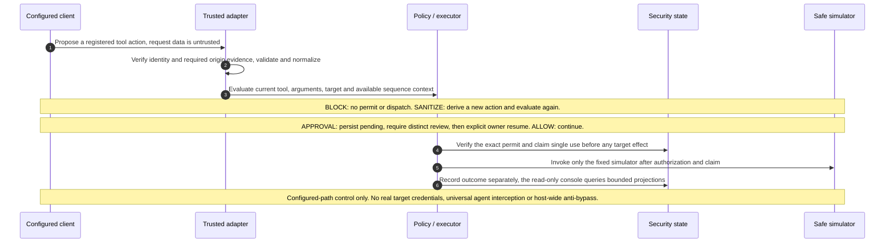
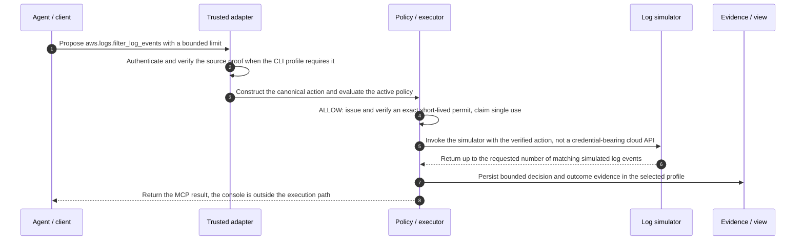
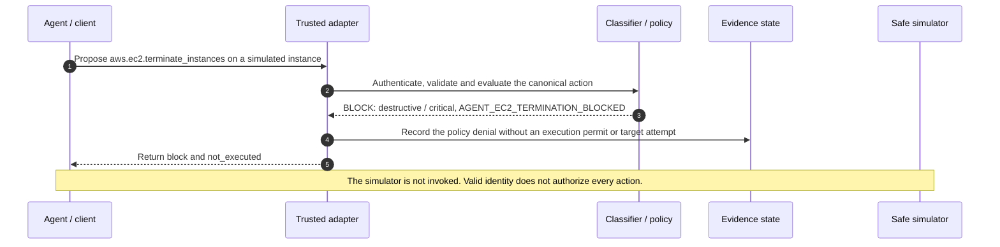
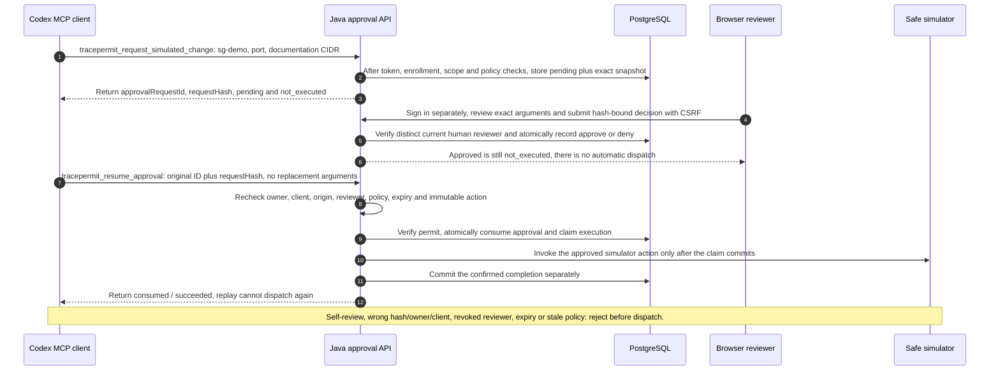
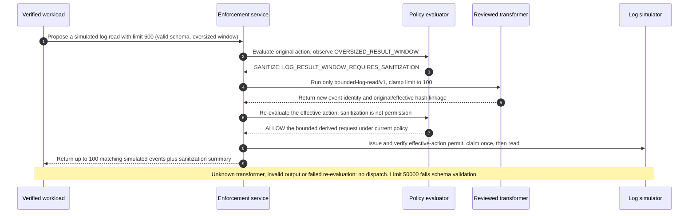
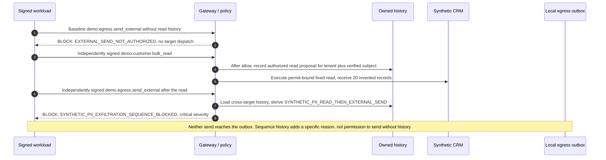
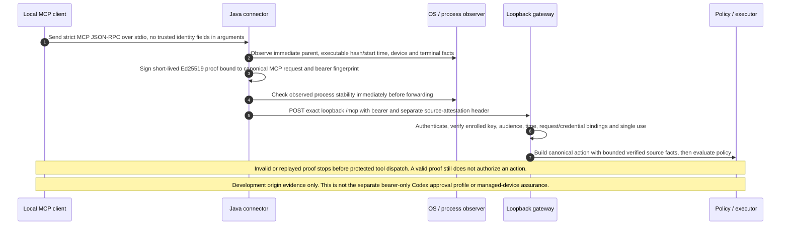
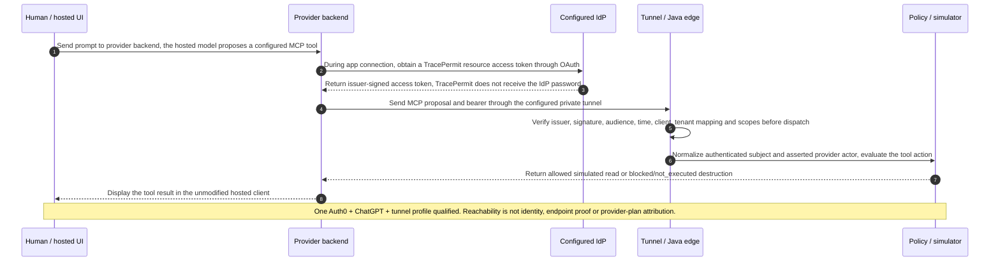
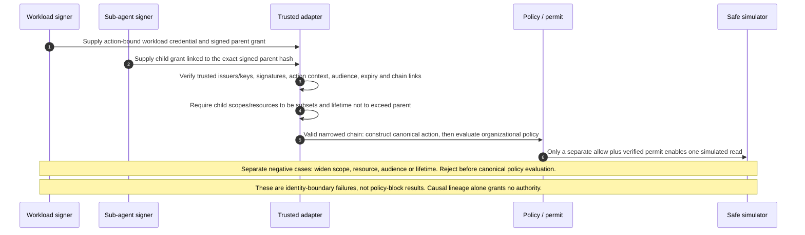
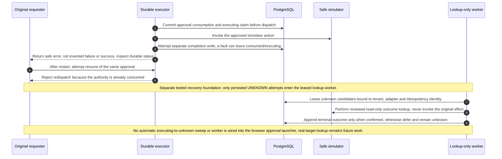

# Core Action Flows & Use Cases

TracePermit is an Agentic Visibility & Control (AVC) proof of concept with a Java
enforcement data plane and a React console. It evaluates supported tool proposals
before execution against safe simulators. It is not a production AWS integration.

The [developer flow guide](https://github.com/hemantkgupta/tracepermit/blob/main/docs/flows-guide.md)
provides source maps, test links and runnable scenarios. These diagrams and that
guide are generated from one checked-in diagram catalog.

## Choose a flow

- Origins: [endpoint source proof](#flow-6-endpoint-source-attribution) or
  [hosted OAuth](#flow-7-hosted-oauth-through-a-tunnel).
- Immediate decisions: [bounded read](#flow-1-bounded-read-allowed) or
  [destructive block](#flow-2-destructive-proposal-blocked).
- Human control: [durable review and explicit resume](#flow-3-human-review-then-explicit-resume).
- Semantic controls: [sanitization](#flow-4-sanitize-and-re-evaluate) and
  [read-then-send denial](#flow-5-read-then-send-denied).
- Authority and recovery: [narrow delegation](#flow-8-delegation-must-narrow) and
  [uncertain outcomes](#flow-9-uncertainty-is-not-permission-to-retry).

## The central invariant

Every supported simulator action routed through TracePermit must pass the required
identity, schema, policy and authority checks before dispatch. A block means no
permit and no simulator invocation. Approval alone never executes an action.

::: warning Scope of the control
This is configured-path enforcement, not universal interception of every agent,
host-wide anti-bypass or a real target credential broker. All downstream effects
shown here are simulated. This public site serves documentation, not the gateway.
:::

[Open full-size diagram](/images/flows/central-invariant.svg)

View Mermaid source

<!-- diagram:central-invariant -->

<!-- /diagram:central-invariant -->

The trusted executor verifies and claims the permit; the simulator does not
authorize itself. Server-side evidence feeds read-only console views outside the
synchronous path. The policy/reviewer control plane and the enforcement data
plane have different responsibilities.

## Identity is profile-specific

| Path               | Verified boundary                                              | What it does not prove                                   |
| ------------------ | -------------------------------------------------------------- | -------------------------------------------------------- |
| Endpoint connector | Bearer plus enrolled-key, request-bound source proof           | Managed-device assurance or human approval of every call |
| Hosted OAuth       | Configured issuer, audience, client, tenant mapping and scopes | Provider subscription type or endpoint process identity  |
| Signed workload    | Action-bound credential plus narrowing delegation chain        | Authority from a scheduled label alone                   |
| Durable approval   | Enrolled requester and distinct scoped browser reviewer        | Automatic execution when the reviewer approves           |

These are separate compositions, not one universally qualified client setup. A
valid token establishes a principal; organizational action policy can still deny
that principal's tool proposal. Causal lineage is not authority delegation.

## Three concepts to keep separate

1. **Canonical action:** the adapter derives identity after verification and
   validates tool, arguments, target and context. Hashing uses the frozen
   `tracepermit-canonical-json-v1` profile, not an arbitrary JSON serializer.
2. **Policy evaluation:** deterministic rules classify `read`, `modify`,
   `destructive` or `orchestration`, assign severity, and consider available
   server-owned sequence context. This is not private model reasoning inspection.
3. **Execution permit:** a short-lived signed authorization for the exact action.
   The executor verifies its bindings and claims single use before invoking the
   simulator. Signatures and replay state are both needed; durability depends on
   the selected deployment profile.

## Flow 1: bounded read allowed

A configured client proposes `aws.logs.filter_log_events` with a bounded result
limit. After identity/schema checks, policy allows the read with `BOUNDED_LOG_READ`.
The executor verifies and claims a request-bound permit, then returns up to the
requested number of matching simulated log events.

[Open full-size diagram](/images/flows/flow-1-safe-read.svg)

View Mermaid source

<!-- diagram:flow-1-safe-read -->

<!-- /diagram:flow-1-safe-read -->

**Proof boundary:** deterministic Java tests and a previously qualified hosted
OAuth read. No real CloudWatch service is contacted; no production latency SLO is
implied. [Scenario and setup](https://github.com/hemantkgupta/tracepermit/blob/main/docs/demo-scenarios/01-attested-cli-allow-block.md).

## Flow 2: destructive proposal blocked

For `aws.ec2.terminate_instances`, the explicit rule returns
`AGENT_EC2_TERMINATION_BLOCKED`, class `destructive`, severity `critical`.
The response is `block` / `not_executed`. Authentication does not override the
deny. The simulator is never invoked.

[Open full-size diagram](/images/flows/flow-2-destructive-block.svg)

View Mermaid source

<!-- diagram:flow-2-destructive-block -->

<!-- /diagram:flow-2-destructive-block -->

**Proof boundary:** the allow/block simulator path is tested. Scheduled EC2 stop
is a separate signed-workload scenario, not this termination rule.
[Policy](https://github.com/hemantkgupta/tracepermit/blob/main/policies/aws-web-readonly.json).

## Flow 3: human review, then explicit resume

In the separate durable approval profile, Codex requests a fixed `sg-demo`
configuration change. PostgreSQL stores the exact snapshot and request hash.
A distinct, enrolled reviewer signs in to the role-scoped React inbox and approves
or denies that same hash. Approved still means **not executed**.

[Open full-size diagram](/images/flows/flow-3-human-approval.svg)

View Mermaid source

<!-- diagram:flow-3-human-approval -->

<!-- /diagram:flow-3-human-approval -->

Only the original requester can explicitly resume with the ID and hash, not
replacement tool arguments. Owner, client, origin, current reviewer authority,
policy and expiry are rechecked. Approval consumption and the execution claim
commit before dispatch. Self-review, stale policy, wrong hash and replay cannot
authorize execution.

**Proof boundary:** native app-server MCP calls and a synthetic browser reviewer
have been qualified. The separate [model-driven record](https://github.com/hemantkgupta/tracepermit/blob/main/docs/demo-scenarios/evidence/codex-model-driven-approval-2026-10-15.md)
qualifies Codex 0.162.1/`gpt-5.6-sol` request/review/resume, replay, expiry and
explicit reviewer-denial rejection for this local profile. Native source-attested
connector qualification and production browser IdP/HTTPS remain separate work.
The loopback approval fixture must not be tunnel-exposed. This is at-most-one
dispatch, not exactly-once external effects; screenshots are not dispatch counters.
[Runbook](https://github.com/hemantkgupta/tracepermit/blob/main/docs/runbooks/codex-durable-approvals.md).

## Flow 4: sanitize and re-evaluate

A signed workload proposes a log read with `limit: 500`: valid schema, but an
oversized result window. Policy selects the reviewed `bounded-log-read/v1`
transformer, which derives `limit: 100`. The derived action must pass a fresh
evaluation and receive its own exact permit before dispatch.

[Open full-size diagram](/images/flows/flow-4-sanitization.svg)

View Mermaid source

<!-- diagram:flow-4-sanitization -->

<!-- /diagram:flow-4-sanitization -->

**Proof boundary:** a deterministic signed-workload fixture, not deployed cron.
The summary links original/effective hashes and the new event identity; it does
not invent causal ancestry. `limit: 50000` fails schema validation rather than
being sanitized. The fixture returns up to 100 matches, not necessarily 100.
[Scenario](https://github.com/hemantkgupta/tracepermit/blob/main/docs/demo-scenarios/04-signed-workload-semantic-sequence.md).

## Flow 5: read-then-send denied

The synthetic tools are `demo.customer.bulk_read` and `demo.egress.send_external`.
External send is already denied without history. After an allowed synthetic PII
read, server-owned tenant/subject history adds a critical sequence-specific denial.
Neither send reaches the simulated egress outbox.

[Open full-size diagram](/images/flows/flow-5-sequence-exfiltration.svg)

View Mermaid source

<!-- diagram:flow-5-sequence-exfiltration -->

<!-- /diagram:flow-5-sequence-exfiltration -->

**Proof boundary:** fixed invented records and a local outbox, not real PII
inspection or network exfiltration. Bounded in-memory history records authorized
read proposals before dispatch; it is not proof of successful reads or durable
global data lineage. [Scenario](https://github.com/hemantkgupta/tracepermit/blob/main/docs/demo-scenarios/09-synthetic-pii-read-external-send-block.md).

## Flow 6: endpoint source attribution

The local Java connector receives strict MCP over stdio, observes its parent
process, and signs short-lived source evidence. The proof binds the exact MCP
request and bearer fingerprint. The loopback gateway independently verifies the
token, enrolled key, audience, freshness, bindings and single use before policy.

[Open full-size diagram](/images/flows/flow-6-endpoint-attribution.svg)

View Mermaid source

<!-- diagram:flow-6-endpoint-attribution -->

<!-- /diagram:flow-6-endpoint-attribution -->

**Proof boundary:** development process/device evidence and file keys, not
hardware-backed managed endpoints. An attached terminal does not prove each call
was human-authorized. Scripted tests may observe Node, not Codex, as the parent.
Native Codex source-attested connector qualification remains to be done; the
separate bearer-only approval profile does not establish it.
[Connector scenario](https://github.com/hemantkgupta/tracepermit/blob/main/docs/demo-scenarios/00-connector-origin-and-egress.md).

## Flow 7: hosted OAuth through a tunnel

The human prompt reaches the provider backend first. Its hosted model proposes a
configured MCP tool call. OAuth connection setup obtains a token for the
TracePermit resource; subsequent tool calls carry it through the private tunnel.
The Java edge verifies the token and applies tool policy before simulated execution.

[Open full-size diagram](/images/flows/flow-7-hosted-oauth.svg)

View Mermaid source

<!-- diagram:flow-7-hosted-oauth -->

<!-- /diagram:flow-7-hosted-oauth -->

**Proof boundary:** one Auth0 + unmodified ChatGPT + private-tunnel profile was
qualified, not every provider/client. Reachability is not user identity, endpoint
attestation or personal/enterprise provider-plan attribution. Evidence stores
credential fingerprints, not bearer tokens. TracePermit does not obtain an IdP
password, Gmail token or mailbox access from this flow.
[Dated qualification](https://github.com/hemantkgupta/tracepermit/blob/main/docs/demo-scenarios/QUALIFICATION-EVIDENCE-2026-10-11.md).

## Flow 8: delegation must narrow

An action-bound workload credential and signed parent/child grants establish
authority. Each child references the signed parent hash and may not widen its
scope, resources, audience or lifetime. A valid narrowed chain still needs an
organizational policy allow and permit.

[Open full-size diagram](/images/flows/flow-8-delegation.svg)

View Mermaid source

<!-- diagram:flow-8-delegation -->

<!-- /diagram:flow-8-delegation -->

**Proof boundary:** fixture signers, not a deployed scheduler or autonomous child
agent. Four correctly signed amplification cases are rejected at the identity
boundary before canonical action construction and policy evaluation. These are
not policy-block results. Causal ancestry alone grants no authority.
[Scenario](https://github.com/hemantkgupta/tracepermit/blob/main/docs/demo-scenarios/11-sub-agent-delegation-amplification-rejected.md).

## Flow 9: uncertainty is not permission to retry

The execution claim commits before dispatch; the completion write is separate.
A lost completion can leave consumed approval authority and an `executing` attempt.
Restart must not restore that authority or dispatch the effect again.

[Open full-size diagram](/images/flows/flow-9-unknown-outcome.svg)

View Mermaid source

<!-- diagram:flow-9-unknown-outcome -->

<!-- /diagram:flow-9-unknown-outcome -->

**Proof boundary:** approval failure/restart rejection and a lookup-only worker
are separately tested. The worker leases persisted `UNKNOWN` attempts and records
a terminal outcome only when confirmed; otherwise it defers. No automatic
`executing` → `UNKNOWN` sweeper or worker is wired into the browser launcher.
Real-target outcome lookup remains future work. This is not a claim of exactly-once
external effects. [Recovery decision](https://github.com/hemantkgupta/tracepermit/blob/main/docs/architecture/0020-reconcile-by-lookup-never-reexecution.md).

## More controls and qualification

- [Tool-result injection → IAM denial](https://github.com/hemantkgupta/tracepermit/blob/main/docs/demo-scenarios/10-tool-result-injection-iam-block.md):
  untrusted content cannot grant authority; the deterministic fixture is not a
  universal model-resistance claim.
- [Evidence outbox and verified receipts](https://github.com/hemantkgupta/tracepermit/blob/main/docs/architecture/0019-leased-outbox-and-external-evidence-receipts.md):
  retriable publication is separate from synchronous execution; production anchor
  integration is not claimed.
- [Fail-secure and local latency checks](https://github.com/hemantkgupta/tracepermit/blob/main/docs/demo-scenarios/05-latency-and-fail-secure-qualification.md):
  pre-dispatch failures mean no dispatch; failures after dispatch may mean an
  uncertain outcome. Local measurements are not production SLOs.

For the next manual qualifications, use the
[rehearsal plan](https://github.com/hemantkgupta/tracepermit/blob/main/docs/runbooks/flow-rehearsal-plan.md).
Documentation and automated fixtures explain the controls; they do not substitute
for a model-driven client rehearsal or qualify a production deployment.
