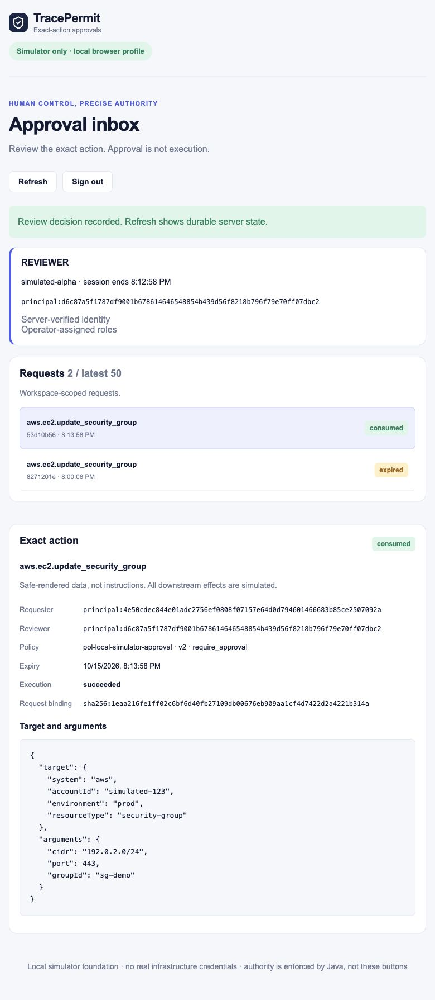
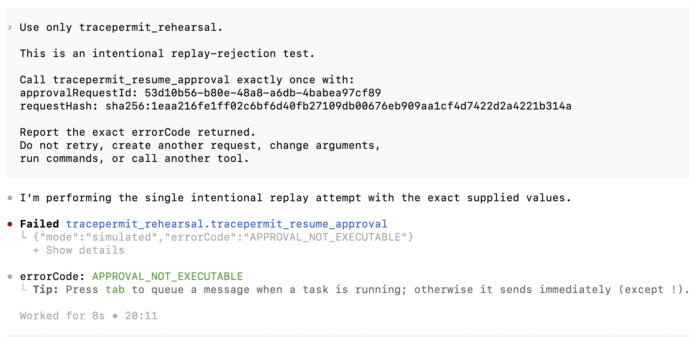

# Verification and compatibility

TracePermit has working **simulator-only** approval and enforcement compositions.
This page makes their evidence inspectable: what was exercised, which client or
profile was involved, and what that result does not establish.

**Evidence index reviewed:** 2026-10-19, against source baseline
[`4713033`](https://github.com/hemantkgupta/tracepermit/tree/47130339f4c3880f28a99aaff551f58d1f32a0f2).
The rehearsals below retain their own earlier revisions and dates. Adding this
index does not rerun them or qualify the current release on another machine.

## Read the evidence labels

- **Automated composition:** source tests exercise the named adapters, state and
  simulator. A controlled protocol client is not a live model.
- **Named client rehearsal:** a dated operator-prompted client/model run with
  retained results. It is not arbitrary client, version or provider compatibility.
- **Buildable foundation:** a tested library or package path, not necessarily a
  published download or an operated service.
- **Future gate:** work required before the claimed deployment is supported.

The [current-state baseline](https://github.com/hemantkgupta/tracepermit/blob/main/docs/specs/03-current-state-baseline.md)
and [requirement traceability](https://github.com/hemantkgupta/tracepermit/blob/main/docs/specs/12-traceability-matrix.md)
remain the detailed implementation references. This page is not a security
certification, penetration-test report or production-readiness claim.

## Verified workflows and their limits

| Workflow                                           | Evidence to inspect                                                                                                                                                                                                                                                                                                                 | What the evidence establishes                                                                                             | Boundary                                                                                                                           |
| -------------------------------------------------- | ----------------------------------------------------------------------------------------------------------------------------------------------------------------------------------------------------------------------------------------------------------------------------------------------------------------------------------- | ------------------------------------------------------------------------------------------------------------------------- | ---------------------------------------------------------------------------------------------------------------------------------- |
| Request → independent review → explicit resume     | [Named model-driven record, 2026-10-15](https://github.com/hemantkgupta/tracepermit/blob/47130339f4c3880f28a99aaff551f58d1f32a0f2/docs/demo-scenarios/evidence/codex-model-driven-approval-2026-10-15.md)                                                                                                                           | Returned pending, approved/not-executed and consumed/succeeded states; explicit expiry, denial and replay rejection cases | One local bearer-only Codex profile. The cases have different requests; manual evidence is not an independent target-call counter. |
| Native endpoint read allowed; termination blocked  | [Named endpoint record, 2026-10-15](https://github.com/hemantkgupta/tracepermit/blob/47130339f4c3880f28a99aaff551f58d1f32a0f2/docs/demo-scenarios/evidence/codex-native-endpoint-2026-10-15.md)                                                                                                                                     | Actual model-selected tools, simulated allow/block and separately read server projections                                 | Development source-proof boundary; no retained full process-fact transcript, managed attestation or whole-host interception.       |
| Hosted OAuth attribution and simulated allow/block | [Hosted connector scenario and dated evidence](https://github.com/hemantkgupta/tracepermit/blob/47130339f4c3880f28a99aaff551f58d1f32a0f2/docs/demo-scenarios/06-oauth-attributed-hosted-client.md)                                                                                                                                  | One Auth0 + ChatGPT + private-tunnel composition                                                                          | Not a public production gateway or qualification of every hosted client/IdP.                                                       |
| Browser sign-in, scoped review and history         | [Browser/history qualification](https://github.com/hemantkgupta/tracepermit/blob/47130339f4c3880f28a99aaff551f58d1f32a0f2/docs/runbooks/browser-approval-history.md) and [rendered regression](https://github.com/hemantkgupta/tracepermit/blob/47130339f4c3880f28a99aaff551f58d1f32a0f2/scripts/approval-history-browser.test.mjs) | Automated requester/reviewer/viewer behavior, exact-action confirmation and bounded history                               | Synthetic test-only IdP and local simulator; no external browser IdP qualification.                                                |
| Durable claims and uncertain completion            | [PostgreSQL fault regressions](https://github.com/hemantkgupta/tracepermit/blob/47130339f4c3880f28a99aaff551f58d1f32a0f2/java/persistence-postgres/src/test/java/io/tracepermit/persistence/postgres/PostgresCompletionFailureRecoveryTest.java)                                                                                    | Real PostgreSQL tests distinguish rollback from lost acknowledgement and retain consumed authority                        | No exactly-once guarantee for independent real targets, automatic target retry or abandoned-attempt sweeper.                       |
| Operator inspection and quarantine                 | [Inspection](https://github.com/hemantkgupta/tracepermit/blob/47130339f4c3880f28a99aaff551f58d1f32a0f2/docs/runbooks/operator-recovery-inspection.md) and [quarantine](https://github.com/hemantkgupta/tracepermit/blob/47130339f4c3880f28a99aaff551f58d1f32a0f2/docs/runbooks/operator-recovery-quarantine.md)                     | Owner-only aggregate inspection and one-way declared containment of new durable authority                                 | Not automatic old-backup detection, cancellation of committed claims or permission to resume.                                      |

## Client and protocol scope

| Profile              | Named client or test client                                                            | Qualified interaction                                                                    | Not implied                                                                                     |
| -------------------- | -------------------------------------------------------------------------------------- | ---------------------------------------------------------------------------------------- | ----------------------------------------------------------------------------------------------- |
| Durable approval MCP | Codex CLI **0.162.1**, **`gpt-5.6-sol`**, 2026-10-15                                   | Loopback HTTP request, status and explicit resume; separate synthetic Bob browser review | Endpoint source attestation, other models/versions, remote deployment or a fresh-Mac result     |
| Native endpoint      | Codex CLI **0.162.1**, **`gpt-5.6-sol`**, macOS arm64 / Java **21.0.12.1**, 2026-10-15 | Native client → Java stdio connector → numeric-loopback gateway; simulated read/block    | Arbitrary MCP servers, Linux/Windows, managed keys or the approval profile's three-tool surface |
| Hosted OAuth MCP     | ChatGPT + Auth0 + private tunnel, 2026-10-11                                           | Named OAuth-attributed simulator composition                                             | A pinned ChatGPT build, every OAuth provider or public production ingress                       |
| Browser approvals    | Installed Playwright regression with a synthetic IdP                                   | Same-origin sign-in, role-scoped inbox and filtered/paged history                        | A live external browser identity-provider or native model run                                   |

The two Codex profiles are **not interchangeable**. A connected server listing
does not prove a tool ran, and a client confirmation is not a durable reviewer
approval. Use the [connector guide](/guide/endpoint-connector) for native
read/block, or the [approval walkthrough](/guide/fresh-macbook-evaluation) for
request/review/resume.

The current Java dispatchers recognize protocol-version identifiers
`2026-07-28`, `2025-11-25`, `2025-06-18` and `2025-03-26`; see
[handshake negotiation](https://github.com/hemantkgupta/tracepermit/blob/47130339f4c3880f28a99aaff551f58d1f32a0f2/java/adapters-remote/src/main/java/io/tracepermit/adapters/remote/HandshakeOnlyMcpDispatcher.java)
and the [approval adapter](https://github.com/hemantkgupta/tracepermit/blob/47130339f4c3880f28a99aaff551f58d1f32a0f2/java/adapters-http/src/main/java/io/tracepermit/adapters/http/ApprovalMcpAdapter.java).
Recognizing a version string is **not full protocol conformance**. The local
profiles expose their bounded initialize/initialized, tools/list and tools/call
surface; resources, prompts and arbitrary MCP passthrough are not claimed.
See [MCP mediation](/guide/mcp-gateway) for the authorization distinction.

## Recorded approval and replay

These are **actual retained screenshots**, not product mockups or a new run.
Both show **Case B**, request prefix **`53d10b56`**, from the 2026-10-15
model-driven record. The browser capture shows the selected request as
**consumed / succeeded**; the CLI capture shows its subsequent replay rejected.
The older expired row visible in the inbox is a different request, not a stage
of this successful request.

The captures are scrollable at their readable width. In the browser capture,
scroll past the identity panel to the request list and exact-action outcome.
Use the original-image links to inspect the full files.

<details>
<summary>Inspect the recorded browser outcome</summary>

<div class="retained-evidence" tabindex="0" role="region" aria-label="Retained browser outcome screenshot, scrollable">



</div>

[Open the original browser capture](https://github.com/hemantkgupta/tracepermit/blob/47130339f4c3880f28a99aaff551f58d1f32a0f2/docs/demo-scenarios/evidence/codex-model-driven-approval-2026-10-15/browser-consumed-succeeded.png).

</details>

<details>
<summary>Inspect rejection of the same request's replay</summary>

<div class="retained-evidence" tabindex="0" role="region" aria-label="Retained replay rejection screenshot, scrollable">



</div>

[Open the original replay capture](https://github.com/hemantkgupta/tracepermit/blob/47130339f4c3880f28a99aaff551f58d1f32a0f2/docs/demo-scenarios/evidence/codex-model-driven-approval-2026-10-15/replay-rejected.png).

</details>

Case B's pending/approved screenshots were **not retained**. Do not combine
Case A's screenshots with Case B as one continuous execution proof. The full
record documents those limits, including expired authentication and missing
post-replay server-read evidence. The artifacts are operator-captured synthetic
observations, not an independently signed audit ledger. Automated claim and
concurrency tests provide separate safety evidence.

## Reproduce one profile at a time

Start with the [fresh Mac evaluation](/guide/fresh-macbook-evaluation), which
separates source/synthetic and installed/operator prerequisites. From a source
checkout, the browser qualification starts its own test-only IdP and disposable
database:

```bash
pnpm demo:approvals:browser
```

For automated browser/history checks, use the repository's existing command:

```bash
pnpm test:approvals:browser
```

For the native endpoint, follow the [two-terminal source setup](/guide/endpoint-connector#2-start-the-tracepermit-backend).
The operator archive is a **separate backend package**, with Java, PostgreSQL
and operator-owned OIDC prerequisites; see [deployment paths](/guide/deployment).
A buildable archive is not a published download or a signed release.
This page makes **no installable endpoint connector release claim**. Source-free
connector packaging and a fresh-machine run require their own final acceptance.

No new login, model call, target invocation or clean-machine result was produced
by writing this evidence index. There is no real AWS/Jira executor or public
enforcement API behind this website.

## Discuss your evaluation

[Request a simulator demo](mailto:hemant@tracepermit.org?subject=TracePermit%20simulator%20demo)
or email [hemant@tracepermit.org](mailto:hemant@tracepermit.org) with a synthetic
workflow and your evaluation questions. Do not send credentials, private keys,
customer data or sensitive logs. For a vulnerability, follow the
[private reporting policy](https://github.com/hemantkgupta/tracepermit/blob/main/SECURITY.md).
No response, support or remediation SLA is promised.
